# Lecture 21: The Order Book

*Systematic Trading: Lecture Notes (MSc) · draft, Nov 16, 2026 · Max Gnesi*

*Pipeline stage (Lecture 1 §2.1): data and execution (the resting orders behind the trades, read as a state and as a flow).*

Lectures 18 to 20 worked with the tape: every trade, the moment two orders met. The tape cannot show the orders that wait to be met, and both strategies of Lecture 20 stopped at that wall (Lecture 20, §15.4). This lecture turns to the order book: what it is, how much of it public data show, how to rebuild it and check it, and what it reveals about a market's liquidity. It then reads the book in two ways, as a **state**, what rests where at one moment, and as a **flow**, what was added, cancelled and filled between moments, and asks of each statistic what it says about what comes next. The data are Bybit's BTCUSDT perpetual from 20 September to 3 November 2025, around the liquidation cascade of 10 October, with the trades of Binance beside them; one day of 2024 illustrates the book.

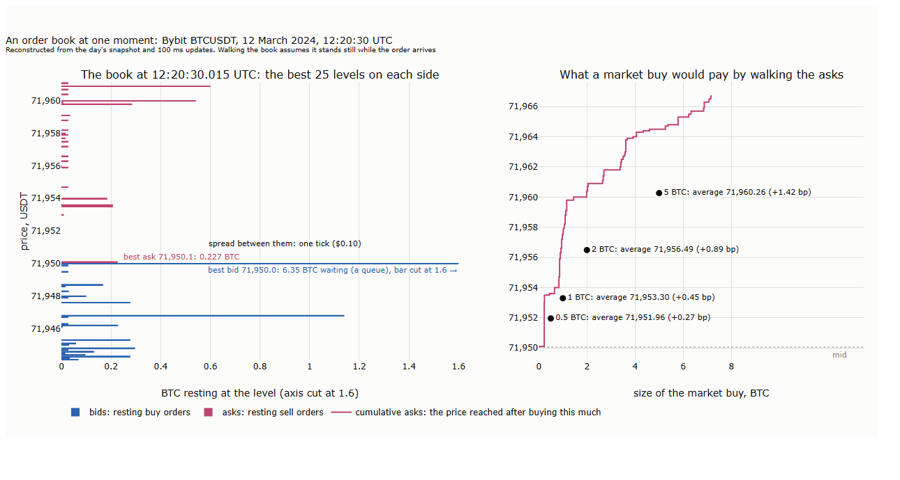
<b>How to read the figure.</b> <b>Axes.</b> Left: size (x) at each price (y). Right: price reached (y) by a market buy of size x. <b>Left:</b> the best 25 levels on each side, bids (resting buy orders) in blue below the price, asks (resting sell orders) in pink above it; each bar is the size waiting at that price. The horizontal axis is cut at 1.6 BTC so that the small levels show; the best bid's bar runs on to 6.35 BTC. <b>Right:</b> the asks added up from the best ask outwards (pink): the price a market buy reaches after buying a given amount. Black dots: the average price of market buys of 0.5, 1, 2 and 5 BTC, and how far it lies above the mid.

At that moment the best bid was $71,950.0, with 6.35 BTC queued, and the best ask one tick higher, $71,950.1, with 0.23 BTC: a spread of one tick. The book was lopsided. Within $10 of the mid, 14.7 BTC waited to buy against 2.0 BTC to sell. About three seconds later, buyers took the thin asks and the price rose $35. Whether such an imbalance predicts the next move is the question of §5.1.

| § | Topic | Question |
|---|---|---|
| 1 | The order book | What is in it, what does a market order do to it, and how does an exchange handle an order? |
| 2 | Three levels of detail | What do L1, L2 and L3 data show, and what does L2, the level we have, leave out? |
| 3 | The data and the rebuilt book | Which files are needed, and how do we know the rebuilt book is right? |
| 4 | What the book shows | How deep and tight is the book, and does the depth hold when it is reached? |
| 5 | The book as a state | What do imbalance, the microprice, queues, markouts and the book's clock say about what comes next? |
| 6 | The book as a flow | What do order-flow imbalance, impact over time, VPIN, Hawkes processes and lead-lag add? |
| 7 | Verdicts | Which statistics answer their question on our sample? |
| 8 | 10 October | Did anything in the book or the flow warn of the cascade, and what changed afterwards? |
| 9 | Summary, exercises and reading | |

Sections 1 to 4 describe the book, 5 to 7 measure it, and 8 tests it on the day of the cascade. Everything left out is in [E24](../extended/24-the-order-book/lecture.md), [E25](../extended/25-statistics-of-the-book/lecture.md) and [E26](../extended/26-statistics-of-the-flow/lecture.md).

> **What to take away**
>
> 1. **The book is the queue of orders waiting to be met.** A market order walks it, so its cost grows faster than its size; public data show the size at each price (L2), and a book rebuilt from them is checked, not trusted.
> 2. **On a calm day the BTCUSDT book on Bybit is deep and tight, and least reliable when it is needed most:** large market orders paid, on average, nearly twice what the last recorded book promised.
> 3. **As a state, the book ranks the next move of the mid nine times in ten,** mostly through the mechanics of a tiny queue about to empty; filled resting orders lose, 59 ticks per BTC one second after the fill.
> 4. **As a flow, the pressure on the book explains 39% of the mid's moves over ten seconds, the trades alone 17%,** but it forecasts the next ten seconds by 0.1%; most trading reacts to trading, and Binance moves about 40 to 50 milliseconds before Bybit.
> 5. **Nothing in the book or the flow anticipated the news of 10 October;** several measures reacted within five minutes, and the book stayed thinner for the rest of our sample.

## 1. The order book

### 1.1 What is in it

An order book is the list of orders waiting to trade at each price. Every term the rest of Part V uses is defined here once:

| Term | Meaning | Financial interpretation |
|---|---|---|
| **Limit order** | An order to buy or sell up to a given size at a given price or better | A trader willing to wait for a better price, at the risk of not trading |
| **Resting order** | A limit order that could not trade at once and waits in the book | Liquidity offered to others: the maker's side of a trade (Lecture 18, §3.1) |
| **Market order** | An order to trade a given size at once, at whatever prices are available | A trader in a hurry: the taker's side, who pays the spread and more |
| **Bid, ask** | A resting order to buy (bid) or to sell (ask) | The two sides of the book |
| **Level** | One price with resting orders | On BTCUSDT, prices come in ticks of $0.10, so levels are at least a tick apart |
| **Best bid, best ask** | The highest bid and the lowest ask | The prices at which a small market order sells or buys |
| **Spread** | Best ask minus best bid | The cost of buying and selling at once; on BTCUSDT usually one tick |
| **Mid** | The average of the best bid and the best ask | The usual reference price between trades |
| **Depth** | The size resting within a distance of the mid, on one side | How much can be traded before the price moves that far |
| **Queue** | The orders resting at one level, in the order they arrived | Who trades first when a market order comes: first come, first served (price-time priority) |

### 1.2 What a market order does to it

A market order takes the best price first and then the next, level by level, until it is filled: it **walks the book**. Its average price is the cost of its hurry:

| Market buy at 12:20:30 | Levels taken | Average price | Above the mid | Last price paid |
|---|---|---|---|---|
| 0.5 BTC | 4 | 71,951.96 | 0.27 bp | 71,953.6 |
| 1 BTC | 12 | 71,953.30 | 0.45 bp | 71,957.5 |
| 2 BTC | 22 | 71,956.49 | 0.89 bp | 71,960.4 |
| 5 BTC | 40 | 71,960.26 | 1.42 bp | 71,964.5 |

<b>How to read the table.</b> Our calculation from the rebuilt book: the asks taken in order from the best, until the size is filled. bp: basis points of the mid, $71,950.05.

The cost grows faster than the size, because each additional bitcoin is bought further from the mid. Walking the book this way assumes the book stands still while the order travels to the exchange, and it does not: during the order's **latency**, market makers can revise or cancel their quotes, above all when the price starts to move. This is **quote fading**. Part of the displayed depth was never meant to trade at all: over a third of limit orders on Nasdaq's book are cancelled within two seconds, **fleeting orders** in the term of Hasbrouck and Saar (2009), and a trade on one venue is followed within 100 milliseconds by cancellations on others (van Kervel, 2015). Practitioners call the result the **liquidity mirage**: depth that is displayed but gone when it is reached. The costs above are therefore a lower bound; §4.2 measures by how much real market orders did worse, and Lecture 22 makes latency a setting of every replay.

### 1.3 How an exchange handles an order

Between a trader's decision and a trade lies a chain of steps, each with its own rules. Together they are the venue's **market model**, and every later question of Part V, from manipulation (§5.2) to replaying the exchange (Lecture 22) and quoting on two venues (Lecture 23), is a question about one of these steps:

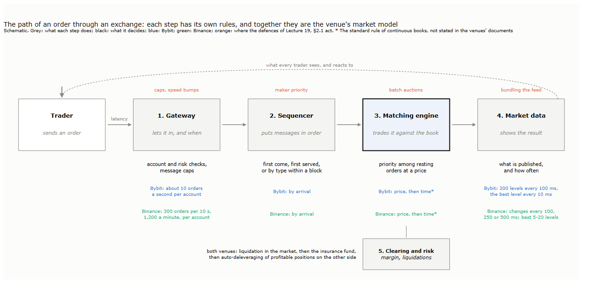
<b>How to read the figure.</b> An order travels from left to right; what the market data step publishes goes back to every trader (dotted). Under each step, what it decides (black), and what Bybit (blue) and Binance (green) do there. Orange: where the defences against manipulation of §5.2 act. * The standard rule of continuous books; neither venue states it in the documents we checked.

| Step | What it decides | Bybit | Binance |
|---|---|---|---|
| **Latency** | How long the order takes to reach the exchange | Set by the trader's distance and connection; servers in the same cloud region (AWS Singapore) are fastest | The same, from the trader's side |
| **1. Gateway** (order entry) | Whether and when an order is let in: checks on the account and its margin, caps on messages, any deliberate delay | About 10 new orders a second per account and request type; higher limits for institutions | By default 300 orders per 10 seconds and 1,200 a minute, per account |
| **2. Sequencer** | The order in which messages reach the matching engine | By arrival | By arrival |
| **3. Matching engine** | Which resting orders a new order trades against: the **priority rule** | Best price first, then the oldest order at that price (price-time priority)* | The same* |
| **4. Market data** | What the world sees, and how often | 200 levels every 100 ms, 50 every 20 ms, the best level every 10 ms | Changes to the book every 100, 250 or 500 ms; partial books of the best 5, 10 or 20 levels |
| **5. Clearing and risk** | Margin, liquidations, and who bears a loss the margin does not cover | A liquidated position is closed in the market; a shortfall falls on the insurance fund, and beyond it on **auto-deleveraging**: profitable positions on the other side are closed at the bankruptcy price | The same chain |

<b>How to read the table.</b> From the venues' own documentation, late 2025 (sources in [E24 §1.3](../extended/24-the-order-book/lecture.md)); caps can change by account tier. * Price-time priority is the standard of continuous order books; neither venue states it explicitly in the documents we checked, and L2 data cannot show the order inside a queue.

The two venues are built the same way, and differ mainly in their caps and in what they publish. Other designs change the steps themselves: some exchanges delay aggressive orders at the gateway by a few milliseconds while letting cancellations through (TSX Alpha, Eurex), some match by size rather than time (pro-rata, in some interest-rate futures at CME), and Hyperliquid sorts each block of orders by type, cancellations before orders that take liquidity. Section 5.2 explains why such rules matter.

**Why it matters before any backtest.** A backtest that uses only the book silently assumes the most favourable value at every step: no latency, no gateway delay, a place at the front of every queue, a perfect view of the book, and no liquidation chain that could close the position at a bad price. Each assumption flatters the result, and Lecture 22 replaces each of them with a setting that can be varied; the rules attached to each order, listed in Lecture 18, §3.2, are applied at the gateway and the matching engine.

## 2. Three levels of detail

Public order-book data come at three levels of detail, and the level decides which questions can be answered:

| Level | What it shows | Example |
|---|---|---|
| **L1** | The best bid and the best ask, with their sizes | Binance's best bid and ask, used in Lecture 19, §10 |
| **L2** | Every level, with the total size resting there | **Bybit's book, used in this lecture and in Lectures 22 and 23**: 500 levels a side until mid-2025, 200 since, updated every 100 milliseconds |
| **L3** | Every single order: when it arrived, at which price and size, and when it was filled or cancelled | Some venues publish it live; historical L3 data are rare and usually paid for |

L2 answers most questions about liquidity: where the depth is, how wide the spread, what a market order costs. What it cannot show is the queue inside a level, and that matters to anyone whose order waits in it.

**What L2 cannot tell: one real window of 100 milliseconds.** On 12 March 2024, between 12:00:27.215 and 12:00:27.314 UTC, the size at the best bid of $72,117.20 changed as follows:

| What the data show | BTC | From |
|---|---|---|
| Resting at the best bid, before | 3.883 | The book (L2) |
| Sold into it by market orders, three trades | 0.132 | The trades |
| Resting at the best bid, after | 0.747 | The book (L2) |
| **Removed otherwise:** cancellations minus new orders that joined | **3.004** | The difference |

<b>How to read the table.</b> One level of the rebuilt book over one update, with the trades at its price in between; the last row is what the first three leave unexplained.

The book alone shows that the size fell by 3.136 BTC. Only the trades say that 0.132 BTC of that was filled; without them, a fall of the queue through trading could not be told from orders being withdrawn. Even with both, the last row is a net figure: L2 cannot say whether 3.004 BTC were cancelled, or 4 BTC were cancelled while 1 BTC of new orders joined. Had our own order been waiting at the back of that queue, it would now stand somewhere between the front of the queue and 0.747 BTC behind it. With L3, the exact position would be known; with L2, it must be estimated by a model of where in the queue cancellations happen, and the estimate becomes a range. Lecture 22 builds such models (§5.4 introduces them); the fills it simulates come as ranges for this reason.

## 3. The data and the rebuilt book

The book of every moment can be rebuilt from Bybit's files, and on our 45 days the rebuilt book matches Bybit's own snapshots exactly, apart from three gaps of about ten seconds in which the feed stopped.

### 3.1 Two files a day

Bybit publishes the history of its book and its trades as daily files, free and without an account. **The book** comes as one message every 100 milliseconds: a full snapshot of the 200 levels a side at the start, then only the levels that changed, each with its new size (70–300 MB zipped a day). **The trades** come as every trade, with its time, its aggressor side, its size and its price (10–120 MB zipped). Each book message carries two times, `ts` (when Bybit sent it) and `cts` (when the matching engine produced the state), and an update number that rises by exactly 1 per message, so that a gap shows a lost message. A change gives only the new size at a price, not what happened there: whether a level was filled or cancelled, the message cannot tell, which is the L2 limit of §2. The addresses, the raw lines and the scripts to download and convert the data yourself are in [E24 §3](../extended/24-the-order-book/lecture.md).

**Why both files.** The window of §2 showed it: the book says how much rests at each price, the trades say how much of a change was trading. A study of liquidity needs the book; anything about fills, queues or cancellations needs both, aligned in time.

### 3.2 Rebuilding the book: checked, not trusted

| Step | What is done | Why |
|---|---|---|
| 1. Start | Read the day's first message, a snapshot: 200 levels a side, each with its size | The book at midnight |
| 2. Apply each change | For every later message, set each listed price to its new size; remove the price if the size is 0 | A delta lists only the levels that changed, and the size it gives is the new total, not a change |
| 3. Restart at a snapshot | When another snapshot arrives, replace the book with it | Bybit sends one at midnight and after an interruption (§3.3) |
| 4. Time it | Stamp each state with the matching engine's time, `cts` | The clock that lines the book up with the trades (§3.4) |

Each day file ends with the next midnight's snapshot. That gives a strict test: rebuild the whole day from its first snapshot, about 860,000 messages and 40 to 80 million changes, and compare the result with that final snapshot, level by level:

| Test | Result on 45 days |
|---|---|
| Update numbers rise by 1 from message to message, apart from the restarts of §3.3 | Every day |
| The book rebuilt over the whole day equals Bybit's end-of-day snapshot at every one of its 400 levels, sizes to the last digit | **Every day**, and on the three days of §3.3 for the part after the restart |
| No trade lost in the conversion: rows and total size equal those of the raw file | Every day |

<b>How to read the table.</b> Our checks for these notes, run by the conversion script on every day.

A single error in reading the files, or in the rules of the method, would carry forward and show at the end of the day. None does. The course's book viewer (`tools/orderbook_viewer`) rebuilds the book the same way.

### 3.3 Three gaps in the feed

On three days the book's messages stop for about ten seconds, and the next message is a fresh snapshot:

| Day | Gap, UTC | Length | What follows | Trades during the gap |
|---|---|---|---|---|
| 25 September | 06:20:10.9 – 06:20:22.0 | 11.1 s | Snapshot; update numbers jump by 110 | 132 |
| 14 October | 06:14:22.6 – 06:14:32.9 | 10.3 s | Snapshot; update numbers restart at 1 | 247 |
| 23 October | 02:52:44.8 – 02:52:54.6 | 9.8 s | Snapshot; update numbers restart at 1 | 41 |

<b>How to read the table.</b> Our checks for these notes; trades during the gap are those recorded while no book message arrived.

Trading went on during every gap: Bybit's matching engine kept working, and only the book's data feed stopped. The book is therefore unknown for 31 seconds of the 45 days, and those seconds are recorded in a register ([`BTCUSDT_book_gaps.csv`](../extended/24-the-order-book/results/BTCUSDT_book_gaps.csv)), which every later measurement leaves out. The check itself needed checking: its first version compared the book with the day's second snapshot wherever it came, and on the gap days reported hundreds of differing levels, a failure of the check, not of the data ([E24 §4.3](../extended/24-the-order-book/lecture.md)).

### 3.4 Lining up the book with the trades

The book and the trades come from different files with different clocks. The right clock is the one under which the trades fit the book. On 1 October, for every trade, we took the book as of its last message before the trade and asked whether the trade's price was a level resting on the side it traded against:

| Clock for the book | Trades at a price resting just before |
|---|---|
| `ts`, the time sent | 90.4% |
| **`cts`, the matching engine's time** | **90.6%** |
| `cts` shifted 100 ms earlier | 30.4% |
| `cts` shifted 100 ms later | 86.4% |

<b>How to read the table.</b> Our calculation for 1 October 2025, 1.73 million trades. A shift of one update interval in either direction makes the fit clearly worse.

`cts` fits best, and is used throughout. The remaining tenth of trades happen at prices that the book of up to 100 milliseconds earlier did not show: orders that arrived and were filled between two messages. Counted fill by fill, only 34% of trades happen at the best price; counted by the first trade of each millisecond, close to one market order, 72% do, because one market order often fills against several levels in the same millisecond. Throughout this lecture a **taker order** is therefore all trades with the same millisecond and side, sizes summed.

## 4. What the book shows

On an ordinary day the BTCUSDT book on Bybit is deep and tight: one tick of spread, about 48 BTC within 5 bp of the mid on each side, and a quarter of a basis point for a 5 BTC market order. After the cascade of 10 October it stayed about half as deep for the rest of our sample. And it is least reliable in the seconds in which a trader most wants it.

### 4.1 A calm day, and the days after the cascade

| Measure | How it is computed, every second | Calm days, 20 September – 3 November without 10 October |
|---|---|---|
| **Spread** | Best ask minus best bid | One tick ($0.10) in 99.8% of seconds |
| **Depth** | BTC resting within 5 bp of the mid, on each side; at a price of $110,000, 5 bp is $55 | Median 48 BTC of bids and 49 BTC of asks, about $5 million each |
| **Book imbalance** | Bids minus asks among the best 5 levels, divided by their sum: from −1 (only asks) to +1 (only bids) | Swings widely: a standard deviation of 0.63 |
| **Cost of a market buy** | Walking the book (§1.2): how far above the mid the average price lies | 1 BTC: 0.005 bp, half a tick, the best ask; 5 BTC: 0.23 bp in the median second, 1.5 bp in the worst 1% of seconds |

<b>How to read the table.</b> Our measurement for these notes, over 3,801,555 seconds of the reconstructed book; the three feed gaps of §3.3 are left out. bp beyond the mid; sells cost about the same.

The spread hardly ever opens beyond its minimum of one tick: so many orders compete at the best prices that a level emptied by a trade is refilled at once. A market order of 1 BTC almost always fills at the best ask alone; one of 5 BTC walks a few levels.

**The days after the cascade.** The cascade divided the sample in two. In the three weeks before it, depth within 5 bp was 41 to 82 BTC a side (the range of the daily medians) and a 5 BTC market order cost 0.004 to 0.18 bp. On every day after it, depth was lower, 31 to 52 BTC, and the same order cost 0.22 to 0.60 bp, two to four times as much, without a sign of returning to the earlier level by 3 November. Why the market makers quoted less after the cascade the book cannot tell; losses on the day, and the higher volatility that followed it, would both be reasons to ([E24 §5.3](../extended/24-the-order-book/lecture.md) draws the 45 days).

### 4.2 The liquidity mirage

**Key message.** Large market orders paid, on average, nearly twice what the last recorded book promised; the gap sits in a minority of orders and grows when the price is moving. In the same moments the quotes near the price are withdrawn most.

**Quote fading, measured.** Section 1.2 walked the book as if it stood still while the order travelled. Here that assumption is tested on every market order of 1 BTC or more: 609,011 orders on the 44 days without 10 October. For each, the book as of its last message before the order gives the price that walking it predicted; the trades give the average price actually paid.

| A market order of 1 BTC or more | What walking the last recorded book promised | What the order paid |
|---|---|---|
| The median order | 0.005 bp: half a tick, the best price | 0.006 bp |
| The average order | 0.21 bp | 0.38 bp |

<b>How to read the table.</b> bp beyond the mid; our measurement. 22% of the orders did worse than promised, by more than 0.05 bp; 11% did better; the rest paid what the book promised.

The median order got what it saw. The average order paid nearly twice as much, because about one order in five paid more, some of them much more. Which orders those were, the figure shows:

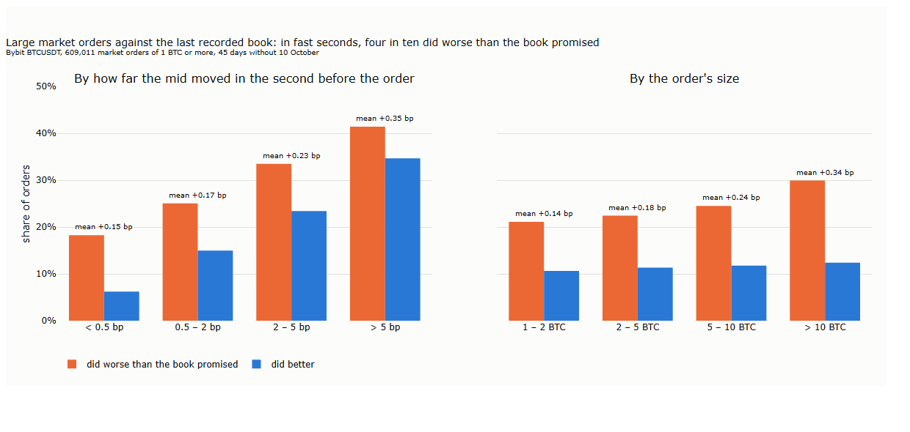
<b>How to read the figure.</b> <b>Axes.</b> Groups of orders (x), share of orders (y); orange = worse, blue = better than the book promised. Market orders of 1 BTC or more, on the 44 days without 10 October. <b>Orange:</b> the share of orders that paid more than walking the last recorded book promised, by more than 0.05 bp; <b>blue:</b> the share that paid less. Above each pair, the mean fade: what the orders paid beyond the promise, in bp of the mid, on average. <b>Left:</b> by how far the mid moved in the second before the order; <b>right:</b> by the order's size.

Two results stand out. First, the book is a poor guide when the price is moving: after a second in which the mid moved more than 5 bp, 41% of the orders did worse and 35% did better than promised, against 18% and 6% after a quiet second. Second, larger orders, which reach more levels, each of which may have changed, did worse more often: 30% of the orders above 10 BTC, against 21% of those of 1 to 2 BTC. In the direction, the result held on every one of the 45 days. L2 data recorded every 100 milliseconds cannot tell whether quotes were cancelled while an order travelled or taken first by other orders: the numbers are what a trader working from this feed would have faced.

**Pulls.** L2 data do not show cancellations, but a burst of them leaves a trace. We call an update a **pull** when five or more of the best 20 levels of one side shrink in it by more than the trades at those prices explain. On the median day, 13.7% of all updates were pulls.

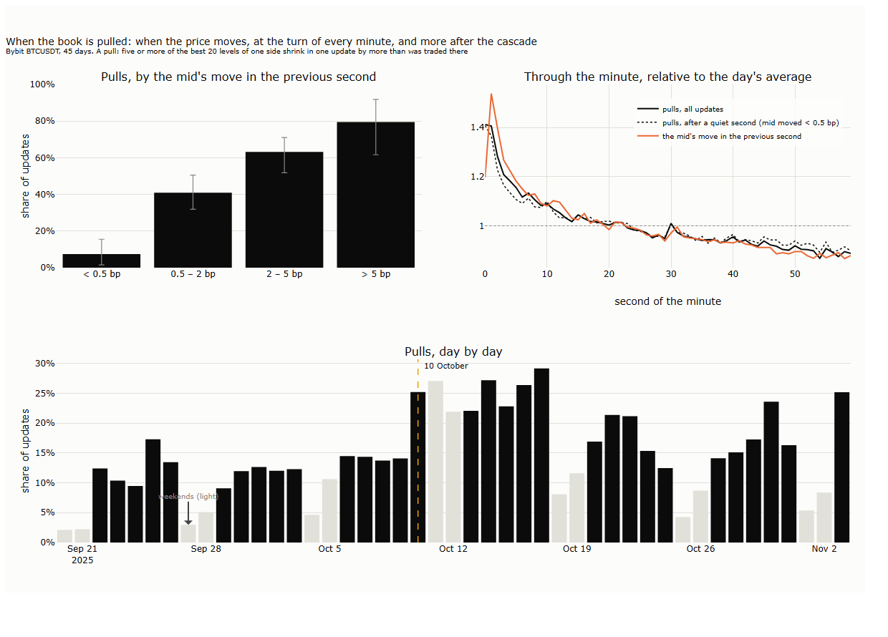
<b>How to read the figure.</b> <b>Axes.</b> Share of updates that are pulls (y): by the prior move, by second of the minute, by day (x). A pull: an update in which five or more of the best 20 levels of one side shrink by more than was traded at them. <b>Top left:</b> the share of updates that are pulls, by how far the mid moved in the second before: the median day (bar) and the range over the 45 days (whisker). <b>Top right:</b> through the minute, by its second, relative to the day's average (1 = average); solid, all updates; dotted, only updates after a second in which the mid moved less than 0.5 bp; orange, the mid's move in the second before; the median over the 45 days. <b>Bottom:</b> the share of updates that are pulls, day by day; weekends light.

| What drives the pulls | Our result | Reading |
|---|---|---|
| **The price moving** | 7% of updates after a quiet second, 41% after a move of 0.5 – 2 bp, 79% after a move of more than 5 bp; on every one of the 45 days | Market makers cancel and repost at the new prices: the book is pulled when it is needed most |
| **The clock** | 1.4 times the day's average in the first seconds of every minute, decaying to 0.9 times by its end; on every day, and as strong after a quiet second | Pulls that answer to the clock, not to the price (§5.6) |
| **The day** | Weekdays: 12.5% before 10 October, 21% after; weekends: 4% and 8.5% | After the cascade the book was pulled more often while it held half the depth |

<b>How to read the table.</b> Our measurement over the 45 days; daily medians.

The book of §4.1 is therefore deep in a calm second and least reliable in the seconds in which a trader most wants it: when the price moves and, less obviously, at the turn of each minute. This is the liquidity mirage, measured.

## 5. The book as a state

The rest of the lecture measures two kinds of quantity. A **level** is the state of the book at one moment, how much rests where, like a balance sheet; a **delta** is what changed over an interval, orders added, cancelled and filled, like a cash-flow statement. This section reads levels, §6 deltas.

**How the tests are set up.** The days are split in three. The 20 calm days before the cascade, 20 September to 9 October, are **in sample**: every quantity that has to be estimated, such as the slope of a fit or the microprice's table, is estimated on them only. The 24 days after the cascade, 11 October to 3 November, are **out of sample**: the tests are run on them. 10 October stands alone (§8). A forecast of the direction of the next move is scored by its **AUC**: the probability that a randomly chosen moment before an up move gets a higher score than a randomly chosen moment before a down move; 0.5 is a coin flip and 1 a perfect ranking. Uncertainty comes from resampling whole days (2,000 times), so that days, not millions of correlated updates, count as the observations. With many hypotheses, some would pass by luck alone; the Benjamini-Hochberg procedure controls the share of false discoveries among those that pass at 5% (§7). The hypotheses were fixed before any result was computed ([register of the book](../extended/25-statistics-of-the-book/results/hypotheses.md)):

| Statistic | The hypotheses, fixed in advance |
|---|---|
| Book imbalance (§5.1) | H1: it ranks the next move of the mid better than a coin flip; H2: on every day; H3: after the cascade and on 10 October; H4: the best five levels add to the best; H5: it is strongest when the smaller best queue is small |
| Imbalance that resists gaming (§5.2) | H6: weighted, age-filtered or smoothed versions forecast as well, at every setting; H7: a spoof candidate moves the weighted version less |
| Microprice (§5.3) | H8: it forecasts the mid better than the mid and the weighted mid |
| Queues and shape (§5.4) | H9: a thin book comes before larger moves; H10: cancellations dominate the decreases of the best queues; H11: the queues' times to empty add to imbalance |
| Markouts (§5.5) | H12: after a fill the price moves against the resting side; H13: more so after larger taker orders |
| The book's clock (§5.6) | H19 to H23, added later and fixed before their results: spread, depth and pulls at round times, and who refreshes the book then |

<b>How to read the table.</b> Numbered as in the register; H14 to H18 concern 10 October (§8). The flow's hypotheses (§6) have their own register and are written "H1 (flow)" and so on.

### 5.1 Book imbalance

**Key message.** Book imbalance says which side of the book outweighs the other. When one side's best queue is much smaller, a few trades can empty it, and the mid moves towards that side. On our data it ranks the next move of the mid correctly about nine times in ten, and most of that accuracy is the mechanics of small queues.

**Mechanism.**

| Step | Calculation | Financial meaning |
|---|---|---|
| 1 | Take the size at the best bid, $`q^b`$, and at the best ask, $`q^a`$ | What a seller and a buyer can trade at the best price right now |
| 2 | Imbalance at the best: $`I = \frac{q^b - q^a}{q^b + q^a}`$ | −1: only asks; 0: balanced; +1: only bids |
| 3 | The same with the total size of the best 5 levels | How lopsided the book is a little deeper |

<b>How to read the table.</b> Sizes in BTC; the formula is the queue imbalance of Gould and Bonart (2015).

In the model of Cont and de Larrard (2013), in which orders arrive and leave at random, the price moves when one of the two best queues empties: the next move is a race between two lines, and its odds depend on their lengths. This is the mechanics behind book imbalance, which hypothesis H5 separates from information.

**On our 45 days.**

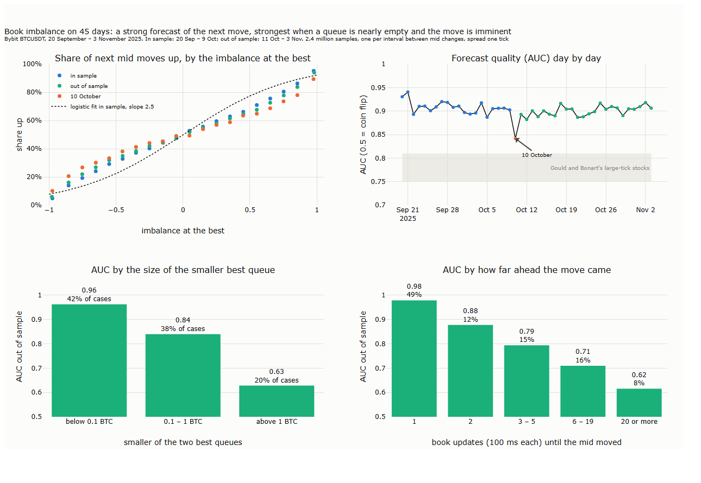
<b>How to read the figure.</b> <b>Axes.</b> Top left: imbalance (x), share of up moves (y). Top right: day (x), AUC (y). Bottom: groups (x), AUC (y). One sample per interval between two changes of the mid, the book at a random update inside it, kept when the spread is one tick: 2.4 million samples (Gould and Bonart, 2015). <b>Top left:</b> the share of samples whose next mid move was up, in 20 bands of the imbalance at the best; the dotted curve is the logistic fit on the in-sample days. <b>Top right:</b> the AUC of each day (blue in sample, green out of sample, orange 10 October); the grey band is the range Gould and Bonart report for large-tick Nasdaq stocks. <b>Bottom left:</b> the AUC out of sample, by the size of the smaller of the two best queues, with the share of samples in each group. <b>Bottom right:</b> the same, by the number of book updates (100 ms each) until the mid moved.

- **H1 (direction) holds.** The slope of the in-sample fit is $`x_1 = 2.47`$, at the top of the range of 2 to 2.7 that Gould and Bonart report for large-tick stocks. The AUC is 0.904 in sample and 0.897 out of sample (95% interval 0.894–0.901), above their 0.75 to 0.81.
- **H2 (stability) holds.** The AUC is above 0.5 on all 45 days; the daily AUC lies between 0.84 and 0.94.
- **H3 (regime) holds.** The AUC is 0.897 out of sample and 0.842 on 10 October, the lowest day of the 45 but far above a coin flip.
- **H4 (depth) fails.** Adding the imbalance over the best five levels leaves the AUC where it was, 0.8970 against 0.8972: what stands behind the best adds nothing that the best does not already say.
- **H5 (mechanics) holds.** When the smaller of the two best queues holds less than 0.1 BTC, which is 42% of the samples, the AUC is 0.96; between 0.1 and 1 BTC it is 0.84; above 1 BTC, 0.63.

A queue of less than 0.1 BTC, about $11,000, is emptied by one ordinary market order. On the bottom right, half the moves came at the very next update of the book, and there the AUC is 0.98; when the move came 2 seconds or more later, it was 0.62. Imbalance forecasts the next move best when that move is about to happen anyway; how much is information and how much the arithmetic of a queue about to run out, our data cannot separate further. The move is large when it comes: a median of 44 ticks, about $4.40 or 0.4 bp. A market order sent to profit from it pays Bybit's base taker fee of 0.055%, 5.5 bp, more than ten times the move (Bybit, n.d.-b). Its value, if it has one, lies with orders that already rest in the book: whether to stay in the queue or step out of it.

**Blind spot.** The imbalance counts size, not intentions: an order can be cancelled the moment it is approached (§4.2), and part of the lean may vanish before a trade reaches it. And part of what it predicts is the arithmetic of queue sizes rather than information about the price.

### 5.2 Can imbalance be made hard to game?

**Key message.** A statistic that traders act on invites traders who want them to act. We found no way to make imbalance hard to game without losing its forecast, and none has been shown on real data in the literature either.

**Mechanism.** The simplest way to move book imbalance is a large order not meant to trade: a wall a few levels behind the best price, cancelled before the price reaches it. Other traders read a heavy book and lean the wrong way; the one who placed the wall trades against them. This is **spoofing**; the offence turns on intent, which market data cannot show. On the Korea Exchange, where accounts could be identified, about 0.8% of all orders were spoofs, and they paid (Lee, Eom and Park, 2013); on crypto exchanges, by one estimate 31% of large orders could have been used to spoof (Fabre and Challet, 2025). Three defences should make the imbalance harder to move: weighting depth by distance, each level counting $`e^{-k/\lambda}`$ at $`k`$ ticks behind the best, since a wall must stand back to stay unfilled; counting only depth that has rested at least $`\tau`$ seconds, since a spoof is short-lived; and smoothing over time, so that a lean must last. Each was tested at five settings fixed beforehand. Related practices, such as flooding the matching engine so that **stale quotes** can be taken before their cancellations arrive, and the venues' defences against them, are set out in [E25 §2.1](../extended/25-statistics-of-the-book/lecture.md); the race for stale quotes is the central risk of quoting on one venue against another (Lecture 23).

**On our 45 days.** None of the three defences works as hoped:

- **H6 (no loss of power) holds for distance weighting only.** Across all five settings of $`\lambda`$, the distance-weighted imbalance scores 0.897, slightly above the plain five-level version, 0.894: a plateau, not a lucky setting. Smoothing fails at every setting: a half-life of 0.2 s already costs 0.05 of AUC, one of 5 s costs 0.26. The age filter fails worst, with an AUC between 0.28 and 0.33, below a coin flip.
- **H7 (resistance) holds as fixed, but only by construction.** A depth that has rested less than a second does not count in the age-weighted version, so a new order cannot move it at all. The informative half of the test is distance alone, and there the plain imbalance moved less than the weighted one on every day and in every combination.

Each failure has a mechanism, and each comes back to the thin best queues of H5. **Distance weighting** makes walls louder because the weighted measure is dominated by the best queue, and that queue is often tiny: a wall of 5 BTC nine ticks back gets a weight of $`e^{-9/1.5} \approx 0.0025`$, about 0.012 BTC, yet when the best queue holds 0.01 BTC that is enough to swing the measure. **The age filter** inverts because successive changes of the mid run in the same direction about three times in four; after a move, the side that moved has a new best level, all of it young, and the filter leaves it out. A spoof is young, but so is every honest level that has just formed. **Smoothing** costs power because half the moves come within 200 ms, and an average over the last second still remembers a book that is gone.

**Blind spot.** Spoof candidates are common: of 979,000 additions of at least 2 BTC 1 to 9 ticks behind the best, 78% were removed within 5 seconds without a trade at their price. Most are probably market makers moving their quotes, and L2 data cannot tell the two apart.

### 5.3 The microprice

**Key message.** The mid is halfway between the best bid and ask whatever the queues look like. The microprice is the mid to expect once the price has moved: it leans towards the side that is likely to give way. On BTCUSDT it must be estimated, not computed, and it cuts the error of the next mid by 19%.

**Mechanism.**

| Estimate | Calculation | Financial meaning |
|---|---|---|
| **Mid** | $`m = \frac{1}{2}(b + a)`$, with $`b`$ the best bid and $`a`$ the best ask | The price halfway between buying and selling, blind to the queues |
| **Weighted mid** | $`\frac{q^a\, b + q^b\, a}{q^b + q^a}`$ | Each price weighted by the size on the other side: it moves towards the thin side, as if that side were sure to be taken |
| **Microprice** | The expected mid after the price has moved, given the imbalance and the spread, estimated from data (Stoikov, 2018) | Where the price is likely to be, on average, once the next moves have happened |

<b>How to read the table.</b> $`b`$, $`a`$: best bid and ask prices; $`q^b`$, $`q^a`$: the sizes there. Ours is a first, empirical step of Stoikov's estimator: the mid plus the average change of the mid that followed each band of the imbalance on the in-sample days.

The weighted mid never moves more than half a tick from the mid: it assumes that the price moves by one tick. How far the price really tends to move from a lopsided book is a matter of data.

**On our 45 days.**

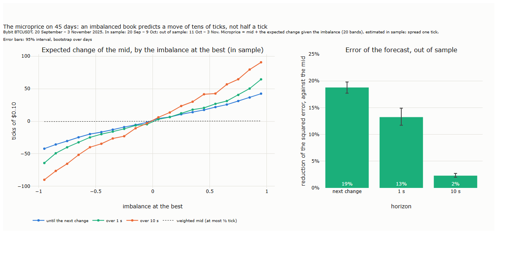
<b>How to read the figure.</b> <b>Axes.</b> Left: imbalance (x), expected change of the mid in ticks (y). Right: horizon (x), error reduction (y). <b>Left:</b> on the in-sample days, the average change of the mid in ticks of $0.10 until its next change (blue), over 1 s (green) and over 10 s (orange), in 20 bands of the imbalance at the best, spread one tick. The microprice is the mid plus this curve. The dotted line is the weighted mid's correction, which is never more than half a tick. <b>Right:</b> out of sample, the reduction of the mean squared error of the microprice against the mid, at three horizons; error bars are 95% intervals from resampling days.

- **H8 holds.** At the next change, the microprice's error is 19% below the mid's (17.7–19.8%). Over 1 s the reduction is 13% (11.7–14.9%), over 10 s 2.3% (2.0–2.7%). The weighted mid barely improves on the mid, by less than 0.5% at every horizon: its correction stays within half a tick, while the move it should anticipate is tens of ticks.

**Blind spot.** The microprice is only as good as the data it is estimated from: in a regime unlike its sample its probabilities may no longer hold. On 10 October the same table, estimated on calm days, cut the error by 6% at the next change and 1% over 1 s, since the moves of that day were far larger than any in sample. It also inherits the blind spots of the imbalance it is built on.

### 5.4 Queues and the shape of the book

**Key message.** The size at a price is not one order but a line of orders, served first come, first served. How long the line at the best price lasts says how long the price holds; where an order stands in it says when that order will be filled. L2 shows only the length of the line, so both have to be inferred from how the length changes. On our data the best queues shrink mostly by cancellation: of each 100 BTC that left a best queue, about 92 were cancelled and 8 traded.

**Mechanism.**

| Step | Calculation | Financial meaning |
|---|---|---|
| 1 | Queue size at the best: $`q^b`$, $`q^a`$, read from L2 | What must trade or be withdrawn before the price moves |
| 2 | Split each change of a queue: $`\Delta q = \text{added} - \text{traded} - \text{cancelled}`$, with the traded part taken from the trades at that price and the rest of a decrease counted as cancelled | Whether the line shortens because others trade against it or because its own members leave |
| 3 | Time to empty: $`q`$ divided by the rate at which the line shortens, traded plus cancelled minus added, per second | How long the price is likely to hold |
| 4 | Replay the changes through a first-in, first-out line: additions join the back, trades take from the front, cancellations by assumption | How much stands in front of an order of ours, and how long the depth has rested |

<b>How to read the table.</b> Steps 2 to 4 combine the book with the trade feed, matched by time. Within one 100-millisecond update only the net change is seen: an order that arrives and is cancelled inside it leaves no trace.

Where a cancellation comes from is the choice every backtest of resting orders has to make (Lecture 22), and open-source backtesters offer two models (hftbacktest documentation): cancellations from the back of the line, the cautious choice for fills, since what stands in front of us then shrinks only through trades, or spread over the line in proportion to the size in front of and behind our order (Rigtorp, 2013). A place near the front is worth money in itself: in large-tick stocks, whose spread is nearly always one tick as that of BTCUSDT on Bybit is, it can be worth of the order of the spread (Moallemi and Yuan, 2016). Two further traces are measured here: the **shape** of the book, how depth builds up level by level, since flatter books go with more trading and higher volatility (Næs and Skjeltorp, 2006); and **icebergs**, which on Bybit place the next slice of a large order once the previous one has traded (Bybit, n.d.-a), so that a level is taken and refilled at the same price by a similar size, again and again.

**On our 45 days.**

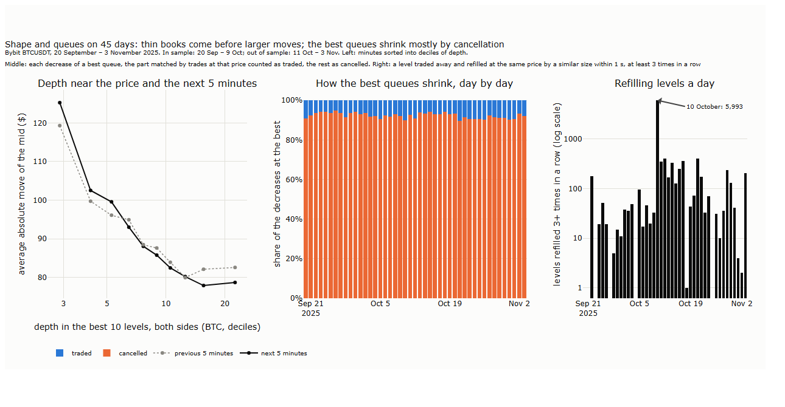
<b>How to read the figure.</b> <b>Axes.</b> Left: depth (x, log), move of the mid (y). Middle: day (x), traded vs cancelled (y). Right: day (x), refilled levels (y, log). <b>Left:</b> every minute of the 45 days, sorted into ten groups by the depth in the best 10 levels of both sides at its start (log scale); each point is a group's average absolute move of the mid over the next 5 minutes (black) and the previous 5 minutes (grey dotted), in dollars. <b>Middle:</b> each day's decreases of the best bid and ask queues, split into traded (the part matched by trades at that price in the interval) and cancelled (the rest). <b>Right:</b> levels traded away and refilled at the same price by a similar size within 1 s, at least 3 times in a row, per day (log scale; days with none are empty).

- **H9 (depth and moves) holds, weakly.** Controlling for the previous 5 minutes, the rank correlation between depth and the size of the next 5-minute move is −0.10 (−0.14 to −0.05), negative on 29 of the 45 days. But the previous 5 minutes show almost the same pattern, so depth mostly reflects how active the market already is.
- **H10 (cancellations dominate) holds.** On every day, 90% to 95% of the decreases of the best queues were cancellations, and for every BTC traded at the best about five BTC were added: a best queue is mostly orders that come and go, which is what makes the plain imbalance easy to move.
- **H11 (queue race) fails.** Adding the race between the two queues' times to empty does not raise the AUC: 0.896 against 0.897. The time to empty is infinite on both sides in 59% of the samples, which left the registered ratio undefined; we used the bid's share of the two times instead, a change to the fixed test that we state.

The iceberg count is descriptive: 10,092 levels were refilled at least three times in a row over the 45 days, a median of 38 a day, and 5,993 on 10 October alone. Such chains are what an iceberg or any repeated quoting at one price leaves behind; our data cannot tell which.

**Blind spot.** Where a cancellation comes from is an assumption, not an observation, and the estimated position and age are only as good as that assumption. Rates of arrival and departure are not constant: Huang, Lehalle and Rosenbaum (2015) find that they depend on the size of the queue itself, so a time to empty computed from average rates is a first approximation.

### 5.5 Markouts

**Key message.** The statistics so far describe the book before a trade; a markout looks after it. It measures how the mid moved after a fill, from the side of whoever was filled. For a resting order, it shows whether the spread it earned was kept or lost to a price that moved against it: the cost of trading with someone who knew more, **adverse selection**. On our data the average resting order was 59 ticks per BTC under water one second after its fill.

**Mechanism.**

| Step | Calculation | Financial meaning |
|---|---|---|
| 1 | Markout of a fill at price $`p`$, on side $`s`$ ($`+1`$ bought, $`-1`$ sold), at horizon $`h`$: $`M(h) = s\,(m_{t+h} - p)`$ | What the fill was worth $`h`$ seconds later, valuing the position at the mid |
| 2 | At the fill: $`M(0) = s\,(m_t - p)`$ | The half spread: earned by the resting order, paid by the market order |
| 3 | Split: $`M(h) = s\,(m_t - p) + s\,(m_{t+h} - m_t)`$ | The spread earned, plus the move of the price after the fill; for a resting order the move is usually against it, the **price impact** of the trade |
| 4 | Average over many fills, horizon by horizon: the markout curve | Whether fills are good on average, and at what horizon the damage is done |

<b>How to read the table.</b> $`m_t`$: the mid at the fill; $`m_{t+h}`$: the mid $`h`$ seconds later. Signs are such that positive means earned by whoever was filled; the taker's markout is minus the maker's. The split is the classic decomposition of the effective spread into a realized spread and a price impact (Huang and Stoll, 1996).

The scale matters. One tick of BTCUSDT is about 0.01 bp, while the base maker fee on Bybit is 0.02% of the value traded, 2 bp, about 200 ticks (Bybit, n.d.-b). Lecture 19 (§10) measured the same split on Binance's best bid and ask; we have no fills of our own, so the markouts below are those of the trades in the feed, one fill per taker order, from the side of the resting order each one hit.

**On our 45 days.**

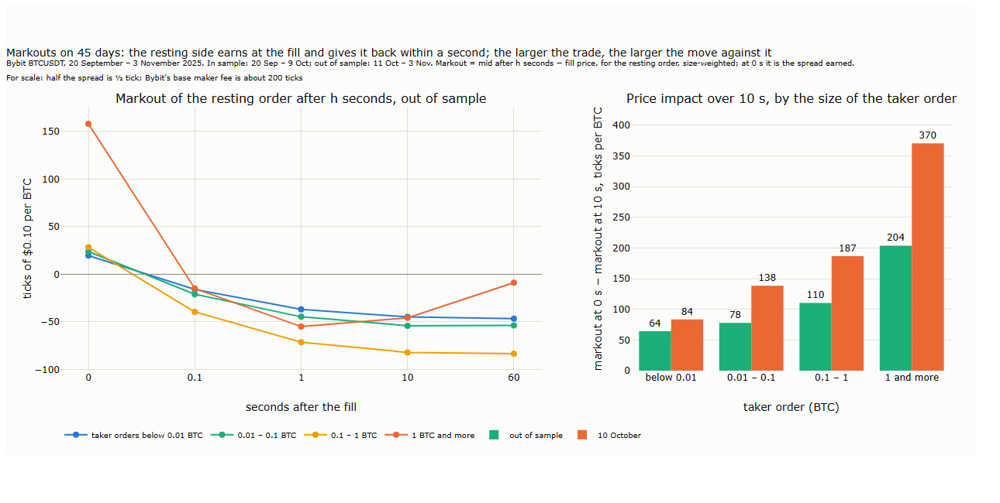
<b>How to read the figure.</b> <b>Axes.</b> Left: seconds after the fill (x), markout in ticks per BTC (y), one line per order size. Right: order size (x), impact (y). One fill per taker order: the trades with the same millisecond and side, sizes summed, the price weighted by size. <b>Left:</b> out of sample, the markout of the resting side, the mid after $`h`$ seconds minus the fill price, signed for the resting side, size-weighted, in ticks of $0.10 per BTC, by size of the taker order. At 0 s it is the spread the resting order earned against the mid. <b>Right:</b> the price impact over 10 s, the markout at 0 s minus that at 10 s, by size, out of sample (green) and on 10 October (orange).

- **H12 (adverse selection) holds.** Over all sizes, the price impact out of sample is 171 ticks per BTC at 1 s (161–182) and 169 at 10 s (154–185). The markout itself turns negative within 100 ms and stays negative: −59 ticks, about −$5.90 per BTC, at 1 s.
- **H13 (size) holds.** The impact over 10 s grows with the size of the taker order: 64 ticks for orders below 0.01 BTC, 78, 110, and 204 for orders of 1 BTC and more. The difference between the largest and the smallest is 140 ticks (118–163). On 10 October each size moved the price further, 370 ticks for the largest.

Bybit's base maker fee, about 200 ticks per BTC at these prices, is larger than the spread at the fill for every size. A resting order at the base fee tier that is filled by the average taker loses on two counts, the move and the fee. Who can rest profitably, at which fee and with which choice of fills, is the subject of Lectures 22 and 23.

**Blind spot.** A markout values the position at the mid, not at what it would cost to close, and its verdict depends on the horizon. Horizons shorter than one update of the book cannot be measured on our data. And the curve is the average fill of a resting order at the time, not that of a particular strategy; those fills come with the replay of Lecture 22.

### 5.6 The book's clock

**Key message.** The book has a clock, and it is not the one we expected. Quotes are withdrawn and replaced at the start of every minute, and much more so at the start of minutes :00 and :30; at those moments depth near the price does not thin, it jumps. In the first seconds of :00 and :30, taker orders follow the direction of the last half hour, while the new depth goes to both sides.

**Mechanism.** Lecture 18 (§12) found that trading bunches at round times, above all at the full hour when funding is paid (00:00, 08:00 and 16:00 UTC). Section 4.2 found a clock in the book's pulls, as frequent after a quiet second as after any other; at 100 milliseconds, the finest the record allows, the pulls and the price's own moves jump in the same interval after the full minute, and neither comes first. Activity that starts at the same instant, on every day, points to a common trigger, the clock: strategies on one-minute bars, execution algorithms that slice every minute, and market makers who refresh on a schedule would all produce it. This is identification by timing: withdrawals one after another point to traders reacting to each other (§6.4); withdrawals at the same instant point to a shared trigger.

**How the test is set up.** The slots of Lecture 18, one minute each, fixed by the schedule: minute :00 with funding, minute :00 without, minute :30, minutes :15 and :45, minute :59. The control: minutes :07, :17, :37 and :47, which nobody schedules. Each measure in a slot is divided by its own average over the hour that ends 5 minutes before the slot, the same for the control, and the test is whether the slot's ratio exceeds the control's, with a bootstrap over the 44 days without 10 October.

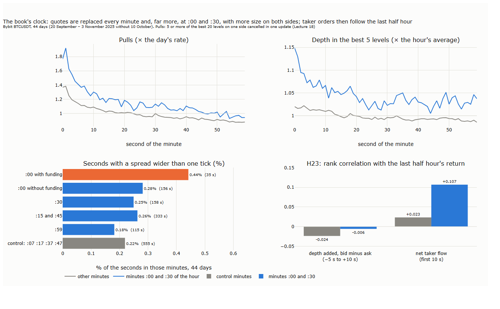
<b>How to read the figure.</b> <b>Axes.</b> Top: second of the minute (x), pulls and depth relative to normal (y). Bottom: share of wide-spread seconds by slot; correlations (y). Bybit BTCUSDT, 44 days without 10 October. <b>Top:</b> by second of the minute, in minutes :00 and :30 of the hour (blue) and in all other minutes (grey). Left, the share of book updates with a pull (5 or more of the best 20 levels on one side losing size beyond trades, §4.2), relative to the day's share; right, the depth in the best 5 levels of both sides, relative to its average in the same clock hour; 1 is ordinary. <b>Bottom left:</b> the share of seconds whose spread was wider than one tick, by slot, with the number of such seconds. <b>Bottom right:</b> H23, the rank correlation, averaged over days, between the mid's return over the 30 minutes before the start of the minute and, left, the change in depth on the bid minus the ask from 5 s before to 10 s after; right, the net taker flow over the first 10 s; in minutes :00 and :30 (blue) and in the control minutes (grey).

- **H21 (pulls) holds at :00 and :30.** Over the slot minute, pulls ran at 1.45 times their rate in the hour before at :00 with funding, 1.18 at other minutes :00 and 1.11 at :30, against 1.05 in the control minutes (p ≤ 0.001 for all three); the quarter hours did not differ. Second by second, the clock has two layers: at second 0 of an ordinary minute pulls run at 1.37 times the day's rate; at second 0 of minutes :00 and :30 at 1.77, and 1.92 a second later.
- **H20 (depth thins) fails, and the data point the other way.** Over the slot minute, depth relative to the hour before was 1.02 to 1.05 against 0.99 in the control. Second by second, depth jumps at the very start of minutes :00 and :30, to 1.15 times the hour's average, at the moment of the burst of pulls, and stays raised for 20 to 30 seconds; there was no thinning before the slot either. Pulls and more depth together mean quotes cancelled and replaced with more size: a result on our sample with a mechanism to test, not a tested claim.
- **H19 (spread) holds, but small; H22 (the funding minute is special) fails.** The spread was wider than one tick in 0.44% of the seconds of the funding minutes, 0.28% of the other minutes :00 and 0.26% of the quarter hours, against 0.22% in the control minutes.
- **H23 (who refreshes at :00 and :30?) holds for the taker orders, not for the depth.** The net taker flow over the first 10 seconds followed the return of the last 30 minutes with a rank correlation of +0.107, against +0.023 in the control minutes (difference +0.084, 95% interval +0.040 to +0.129, positive on 36 of 44 days). The change in depth, bid minus ask, did not follow it: −0.006 against −0.024 (p = 0.25). The rule fixed in advance for a mixed outcome was to report it as mixed.

Directional orders act when bars close, though a correlation of 0.1 leaves most of that flow unexplained; the depth added at the same moment goes to both sides, so it is not the same traders. One reading, not tested: liquidity providers know that flow arrives at :00 and :30 and put out more size to meet it. For a resting order this means more competition in the queue, and fills against the trend of the last bar.

**Blind spot.** Public data show when the book changes, not who changes it. The clock is measured on one symbol and one venue over 44 days; whether it holds on other books is open.

## 6. The book as a flow

Section 5 read the book at one moment; this section measures what changes between moments. The same word, imbalance, names one of each. **Book imbalance** compares the sizes resting at the best bid and the best ask at one moment (§5.1). **Order-flow imbalance** adds up, over an interval, everything that pushed on the best prices, whether by a trade or by a cancellation (Cont, Kukanov and Stoikov, 2014). **Trade imbalance** counts only the trades: size bought by takers minus size sold, the net aggressive flow of Lecture 19 (§1).

The tests are set up as in §5. The share of a price move that a statistic explains is measured by the out-of-sample $`R^2`$: one minus the squared errors of the in-sample fit, divided by the squared deviations of the moves from their in-sample mean. Checks not fixed in advance are labelled **follow-up**: they suggest explanations, they do not test them. The hypotheses ([register of the flow](../extended/26-statistics-of-the-flow/results/hypotheses.md)):

| Statistic | The hypotheses, fixed in advance |
|---|---|
| Order-flow imbalance (§6.1) | H1 (flow): it explains more of the mid's move over 10 seconds than the trade imbalance; H2 (flow): the last 10 seconds' pressure forecasts the next 10 |
| Impact over time (§6.2) | H3 (flow): a taker order's own impact has faded, 500 orders later, below where it started |
| VPIN (§6.3) | H4 (flow): it forecasts the next hour's volatility beyond the last hour's volatility and volume |
| Hawkes processes (§6.4) | H5 (flow): the share of trading triggered by trading stays below 0.9 in most hours |
| Lead and lag (§6.5) | H6 (flow): Binance moves before Bybit; H7 (flow): the bounce of Binance's last trade explains why Bybit's book seemed to lean against Binance's price |

<b>How to read the table.</b> One row per statistic; H8 and H9 (flow) concern 10 October (§8).

### 6.1 Order-flow imbalance: a level against a delta

**Key message.** Order-flow imbalance adds up everything that pushed on the best prices over an interval: trades, new orders and cancellations. It measures the pressure that moves the price, of which the trades are only one part. On our sample it explains about twice as much of the price's move over ten seconds as the trades alone, but forecasts the next ten seconds by a margin far too small to trade.

**Mechanism.**

| Step | Calculation | Financial meaning |
|---|---|---|
| 1 | Bid side of update $`n`$: if the best bid rose, $`+q^b_n`$, the size at the new best bid; if it stayed, $`+(q^b_n - q^b_{n-1})`$, the change of its size; if it fell, $`-q^b_{n-1}`$, the size that was there | Buying interest arriving at the top of the book, or leaving it: filled, cancelled or outbid |
| 2 | Ask side, with the opposite sign: if the best ask fell, $`-q^a_n`$; if it stayed, $`-(q^a_n - q^a_{n-1})`$; if it rose, $`+q^a_{n-1}`$ | Selling interest arriving at the top, or leaving it |
| 3 | Contribution of the update: $`e_n`$ = bid side + ask side; over an interval, $`\text{OFI} = \sum_n e_n`$ | The net pressure on the price over the interval, in BTC: positive pushes it up |
| 4 | Fit the change of the mid over the interval, $`\Delta m = \beta \cdot \text{OFI}`$ | How far one BTC of pressure moves the price; $`\beta`$ is roughly inversely proportional to the depth at the best (Cont, Kukanov and Stoikov, 2014) |

<b>How to read the table.</b> $`q^b_n, q^a_n`$: size at the best bid and ask after update $`n`$, in BTC. Steps 1 and 2 are the formula of Cont, Kukanov and Stoikov (2014). The trade imbalance is the part of the same pressure that came from trades: taker buys minus taker sells.

A level forgets, a delta adds up. In one minute of 1 October 2025 the book imbalance changed sign 69 times, while the added-up order-flow imbalance followed the mid almost step for step. In a fall of $68 within that minute, takers sold a net 57 BTC, but the order-flow imbalance lost 261 BTC, 211 of them at the ask, where sellers placed new resting orders at lower and lower prices that never traded and that the trade imbalance cannot see ([E26 §1](../extended/26-statistics-of-the-flow/lecture.md) draws the minute). A wall placed at the best and cancelled within the same interval adds its size and takes it away again, so the order-flow imbalance is immune to walls at the best price, which book imbalance is not. The literature disagrees on how much the book adds: on 50 US stocks, Cont, Kukanov and Stoikov (2014) found 65% against 32%, while on the BitMEX bitcoin perpetual the trades explained more (Silantyev, 2019).

**On our 45 days.**

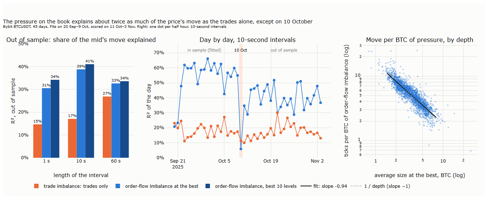
<b>How to read the figure.</b> <b>Axes.</b> Left: interval (x), share of the move explained (y). Middle: day (x), the same (y). Right: depth (x, log), move per BTC (y, log). <b>Left:</b> the out-of-sample R² for intervals of 1, 10 and 60 seconds: the share of the variance of the mid's change over the interval explained by a straight line fitted on the in-sample days, for the trade imbalance (orange), the order-flow imbalance at the best (blue) and the order-flow imbalance over the best 10 levels (dark blue). <b>Middle:</b> the same R² day by day, 10-second intervals, with the in-sample slope; 10 October is shaded. <b>Right:</b> one dot per half hour: the slope of the mid's change on the order-flow imbalance, in ticks per BTC, against the average size at the best bid and ask; black: fitted line; dotted: a slope of exactly −1, the move per BTC inversely proportional to depth.

- **H1 (flow), does the pressure on the book explain more than the trades? Holds.** Over 10 seconds, the order-flow imbalance explains 39% of the variance of the mid's change out of sample and the trade imbalance 17%; the difference, 22 percentage points, has a 95% interval of 17 to 26 points. The order is the same over 1 second (31% against 15%) and over 60 seconds (33% against 27%), where the trades catch up with the orders placed and pulled in the minute. The book's pressure explains more on 43 of the 45 days; the exceptions are 20 September, the quietest day, and 10 October.
- **H2 (flow), does the pressure of the last ten seconds forecast the next ten? Holds, but the forecast is tiny.** The out-of-sample R² is 0.10% (0.04% to 0.17%): one BTC of net pressure in the last ten seconds is followed by about 0.4 ticks in the same direction over the next ten, against about 3.8 ticks during the ten seconds in which it happened. The flow describes how the price moved far better than it tells where it will move.

Reported, not tested: **the best 10 levels** add little, 41% against 39% over 10 seconds (Xu, Gould and Howison, 2019, found more on US stocks). Per half hour, the price move per BTC of pressure falls with the **depth** at the best, with a slope of −0.94 on the log scale, close to the −1 that Cont, Kukanov and Stoikov (2014) derived: a book twice as deep moves about half as far per BTC. That explains part of the drop from in sample to out of sample, 56% to 39%: after 10 October the size at the best halved. **Kyle's lambda**, the move per BTC of net taker flow (Kyle, 1985), had a median of 10 ticks ($1) per BTC per half hour.

**Blind spot.** A trade followed by a refill of the same size within one 100 ms update shows as no change at all. And in the cascade it lost its grip: on 10 October it explained 6% of the day's moves and the trades 11%, and refitting on the day did not change the order (7% against 19%); one candidate, not established, is the 100 ms book, when takers sweep several levels and market makers requote within one update.

### 6.2 Impact over time

**Key message.** After a fill the price kept moving against the resting order (§5.5). Either each trade's own impact keeps growing, or each trade's impact fades and more trades on the same side follow. The propagator model separates the two. On our sample, a taker order's own impact builds for about a dozen orders and then fades; the price keeps moving because buys follow buys, and the move a maker sees is about nine times the order's own impact at its peak.

**Mechanism.**

| Step | Calculation | Financial meaning |
|---|---|---|
| 1 | Sign of each taker order, $`\varepsilon_i = +1`$ (buy) or $`-1`$ (sell); its autocorrelation $`C(\ell)`$, the average of $`\varepsilon_i \varepsilon_{i+\ell}`$ | Do buys follow buys? A large order split into many small ones makes them |
| 2 | Response: $`R(\ell)`$, the average of $`\varepsilon_i\,(m_{i+\ell} - m_i)`$ | How far the mid moved in the direction of an order, $`\ell`$ orders later: what a maker filled by it sees, as in a markout (§5.5) |
| 3 | Propagator model: $`m_t = \sum_{i<t} G(t-i)\,\varepsilon_i`$ + noise | Each order leaves a bare impact $`G`$ that may fade with the number of orders since |
| 4 | Then $`R(\ell) = \sum_{n>0} G(n)\,C(\lvert n-\ell \rvert) - \sum_{n>0} G(n)\,C(n)`$; given $`R`$ and $`C`$, solve for $`G`$ by least squares | The response mixes an order's own impact with that of the orders that follow it; the solution separates them |

<b>How to read the table.</b> $`i`$ counts taker orders (§3.4); $`m_i`$: the mid just before order $`i`$, in ticks; $`C(0) = 1`$. Steps 3 and 4 follow Bouchaud, Gefen, Potters and Wyart (2004).

Bouchaud et al. (2004) found the bare impact on the Paris Bourse fading from the first order, slowly enough to offset the slowly fading correlation of signs: it is how a market whose order flow is predictable, since buys follow buys, can still have prices that are not. Lecture 18 (§7.1) found the same slow decay of order signs on Binance's tape.

**On our 45 days.**

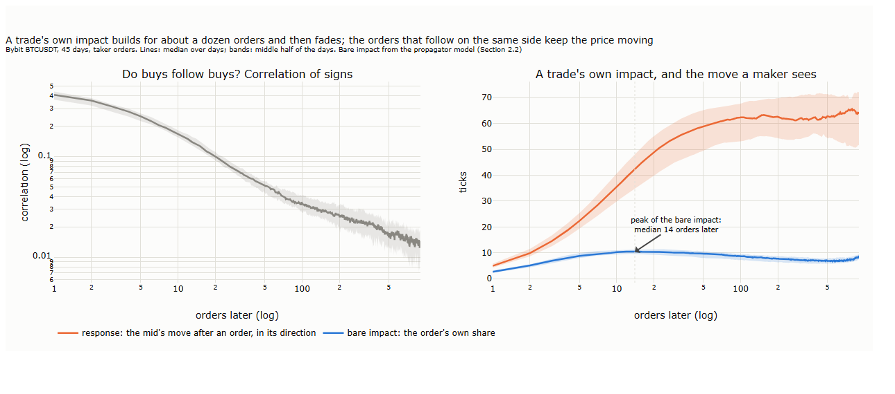
<b>How to read the figure.</b> <b>Axes.</b> Lag in orders (x, log). Left: sign correlation (y, log). Right: response and bare impact (y). Taker orders (trades with the same millisecond and side) of each day; lines are the median over the 45 days, bands the middle half of the days; log scale on the horizontal axes. <b>Left:</b> the correlation between the sign of an order (+1 buy, −1 sell) and the sign of the order $`\ell`$ orders later, log scale. <b>Right:</b> the response, how far the mid moved in the direction of an order $`\ell`$ orders later (orange), and the bare impact of the propagator model, the order's own share of that move (blue), both in ticks of $0.10. The dotted line marks where the bare impact peaks. Lags beyond 900 are left out: near the end of the window the least-squares solution is unstable.

- **H3 (flow), has a trade's own impact faded 500 orders later, below where it started? Fails.** The bare impact 500 orders later is above its value at the first order on all 45 days: 6.9 ticks against 2.7 (medians). On our data impact is not largest at once.

**Follow-up.** The bare impact rises from 2.7 ticks at the first order to a peak of 10.5 ticks, at a median of 14 orders later, and then fades: by 500 orders it is about two thirds of the peak. Because the rise is the opposite of what the literature leads one to expect, we checked for a mistake: the solver recovers a known impact to two decimals at every lag, and the book does not show trades late (the mid jumps at the very next update). But the same simulated mid, seen only at book updates as in our data, produces a rise up to 4 orders later, not 14: part of the rise is our measurement. What remains is real movement of the price after a trade, which the model attributes to the order because Bybit's own orders are all it sees; one candidate, not tested, is that Bybit's takers follow moves that have started, plausibly on Binance (§6.5).

The signs explain the rest. An order's sign correlates 0.41 with the next order's, 0.17 ten orders later, 0.03 a hundred later and still 0.01 a thousand later, fading roughly as a power of the lag with exponent 0.47, close to the 0.6 that Lillo and Farmer (2004) found on the London Stock Exchange. So the response, what a maker sees, keeps climbing long after the bare impact has peaked: 5 ticks one order later, 35 ten orders later, about 62 from a hundred on. On our sample, a maker filled by a buy is likely to face more buys.

**Blind spot.** The model is linear and an average: one large order and one small one count the same, and so do calm hours and a cascade. Time runs in orders, not seconds: on 1 October, 300 taker orders took 20 seconds in the busiest hour and about 3 minutes in the quietest. And it has no cancellations, while §6.1 showed that much of the pressure comes from orders that never trade.

### 6.3 VPIN

**Key message.** VPIN measures how one-sided trading has been, counted in volume rather than in time. Its authors built it as a warning of **toxic flow**, flow that is informed and that market makers lose to (Easley, López de Prado and O'Hara, 2012); a later study found that it mostly tracks how much is being traded (Andersen and Bondarenko, 2014). On our sample, with the sides that Bybit records, it warned of nothing that volume and the last hour did not already show.

**Mechanism.** Cut the trades into buckets of equal volume $`V`$, one fiftieth of an average day's volume; in each, take the volume bought by takers, $`V^B`$, and sold, $`V^S`$; VPIN is the average of $`\lvert V^B - V^S \rvert / V`$ over the last 50 buckets, from 0 (as much bought as sold) to 1 (all on one side). The original estimates the sides from one-minute bars, counting the share $`\Phi(\Delta p / \sigma)`$ of a bar's volume as bought, with $`\Delta p`$ the bar's price change, $`\sigma`$ its standard deviation and $`\Phi`$ the normal distribution function: a bar whose price moved by two standard deviations is counted as 98% bought, whoever traded. Bybit records the taker side of every trade, so we use the true sides and report the estimated version beside them.

**On our 24 out-of-sample days.**

- **H4 (flow), does VPIN warn of volatility beyond what volume and the last hour already show? Fails.** The partial rank correlation with the next hour's realised volatility is −0.004, with a 95% interval of −0.09 to +0.08, over 576 hours. Without the controls it is +0.12, and VPIN itself rises with the last hour's volume (rank correlation 0.24): what little VPIN appears to say is the activity that everyone can already see.

With the original's estimated sides, VPIN correlates +0.39 with the next hour's volatility and +0.46 with the last hour's; after the controls, +0.08 remains: the warning comes largely from the past moves it is built from, in line with the critique of Andersen and Bondarenko (2014).

**Blind spot.** It has settings that matter, and a one-sided bucket does not show who was informed: a large trader working an order looks the same as one who knows something. Our sample cannot refute VPIN as its authors used it, for futures without trade sides and as a warning of rare events, of which our 24 out-of-sample days contain none.

### 6.4 Hawkes processes

**Key message.** Trades and cancellations come in clusters: one event raises the chance of more. A Hawkes process splits activity into events that come from outside, such as news or a trader's own decision, and events triggered by earlier events (Hawkes, 1971). The **branching ratio** is the share that is triggered: how far the market feeds on itself. On our sample, in the median hour 84% of taker orders were attributed to earlier orders, yet the market stayed below the critical point of 1 in all but 2 of 1,080 hours.

**Mechanism.**

| Step | Calculation | Financial meaning |
|---|---|---|
| 1 | Outside rate $`\mu`$, events per second | Activity that does not depend on the market's own recent past |
| 2 | Intensity $`\lambda(t) = \mu + \sum_{t_j < t} \phi(t - t_j)`$ | The expected rate of events now: each past event adds a bump $`\phi`$ that fades with time |
| 3 | Branching ratio $`n = \int_0^\infty \phi(s)\,ds`$ | The number of events one event triggers directly, on average; also the share of all events that are triggered |
| 4 | Average rate $`\mu / (1 - n)`$ | With $`n`$ = 0.5 activity is twice the outside rate; with $`n`$ = 0.9 ten times; at $`n`$ = 1 it would never settle |
| 5 | Fit $`\mu`$ and $`\phi`$ by maximum likelihood, hour by hour | So that the daily rise and fall of activity is not read as one event triggering another |

<b>How to read the table.</b> $`t_j`$: times of past events. We use for $`\phi`$ a sum of exponentials with decay times from 1 ms to 100 s, each with its own weight (Bacry, Mastromatteo and Muzy, 2015); the branching ratio is the sum of the weights. Step 5 follows Filimonov and Sornette (2015), who showed that ignoring the daily pattern, outliers or changes of regime makes $`n`$ look larger than it is.

A market close to $`n`$ = 1 would be one where small shocks can set off very large bursts (an analogy: a chain reaction near its critical point). Filimonov and Sornette (2012) estimated that the share rose from about 0.3 in 1998 to above 0.7 from 2007 on S&P 500 futures, and Hardiman, Bercot and Bouchaud (2013), with a kernel that fades more slowly, found it close to 1. A whole chain of cancellations can fit within one 100 ms update of our book; trades carry millisecond times, which is why the model is fitted to taker orders.

**On our 45 days.**

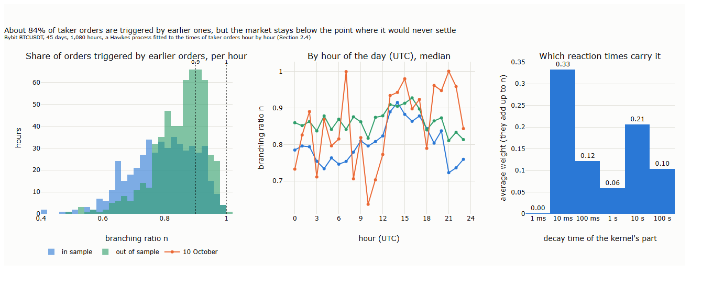
<b>How to read the figure.</b> <b>Axes.</b> Left: branching ratio (x), number of hours (y). Middle: hour of the day (x), branching ratio (y). Right: reaction time (x), weight (y). A Hawkes process fitted to the times of Bybit's taker orders, one hour at a time, with an outside rate that is constant within the hour and a kernel made of six exponentials with decay times from 1 ms to 100 s; a median hour had 12,500 orders. <b>Left:</b> the branching ratio of each hour, in sample (blue) and out of sample (green); dotted lines at 0.9 and 1. <b>Middle:</b> the median by hour of the day, UTC, and 10 October hour by hour (orange). <b>Right:</b> the average weight of each part of the kernel; the weights add up to the branching ratio.

- **H5 (flow), does the market stay clearly below the point where trading would never settle? Holds.** The branching ratio was below 0.9 in 74% of hours (95% interval 70% to 78%), with a median of 0.84; 5% of hours were below 0.64 and 5% above 0.96. Our estimator, checked on simulated data, is close to unbiased at these values (0.83 for a true 0.8) but finds 0.07 where there is no excitation at all.

The ratio was higher after the cascade than before it, a median of 0.87 against 0.80, and highest from 13:00 to 17:00 UTC, the hours when US markets are open, at about 0.9. Most of the weight sits at two reaction times: 10 ms (0.33) and 10 s (0.21). The first is the speed of machines reacting to machines; what the second is, our data cannot say, only that it is slower than any algorithm needs to be.

**Blind spot.** The branching ratio depends on the kernel: ours stops at 100 s, and a kernel with a longer tail would attribute more of the slow clustering to excitation and raise the ratio, which is part of why the literature disagrees. Excitation in the model is always positive. And a triggered event is a statistical attribution, not an observed cause.

### 6.5 Lead and lag between venues

**Key message.** When bitcoin moves, one venue usually moves first; a market maker on the other venue who watches it sees the move coming, and one who does not gets picked off. On our sample Binance moves first: its price changes correlate most with Bybit's about 40 to 50 milliseconds later, on almost every day.

**Mechanism.**

| Step | Calculation | Financial meaning |
|---|---|---|
| 1 | The two price series, each at its own trade times | Prices as they were actually traded, without filling gaps |
| 2 | Shift the times of one venue by a lag $`\tau`$ | Ask: does B, read $`\tau`$ later, move with A? |
| 3 | Correlation of the price changes, from all pairs of changes whose time intervals overlap | The Hayashi-Yoshida estimator, built for prices that change at different times (Hayashi and Yoshida, 2005; Hoffmann, Rosenbaum and Yoshida, 2013) |
| 4 | Repeat for $`\tau`$ from −1 s to +1 s; the lead is the lag with the highest correlation | How long the follower takes |
| 5 | Lead-lag ratio: the sum of squared correlations at positive lags divided by that at negative lags | Above 1: A leads on balance (Huth and Abergel, 2014) |

<b>How to read the table.</b> Resampling both series on a common clock and taking the last price in each interval biases correlations towards zero at short intervals; the Hayashi-Yoshida estimator avoids this by never resampling.

Bybit and Binance stamp their trades with their own clocks, and an offset of a few milliseconds between them is plausible; nothing in the prices tells an offset from a lead. A lead much larger than any plausible offset is real, and a lead that changes with market conditions cannot be an offset alone.

**On our 45 days.**

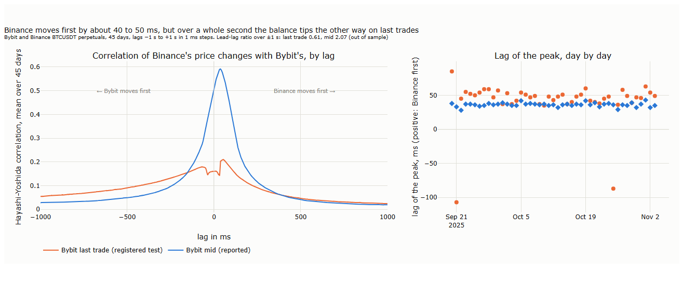
<b>How to read the figure.</b> <b>Axes.</b> Left: lag in ms (x), correlation (y). Right: day (x), lag of the peak (y). <b>Left:</b> the Hayashi-Yoshida correlation of Binance's price changes with Bybit's, Bybit read τ milliseconds later, averaged over the 45 days; positive lags mean Binance moves first. Orange: Bybit's last trade, the registered test; blue: Bybit's mid. <b>Right:</b> the lag of the peak on each day, for the last trade (dots) and the mid (diamonds).

- **H6 (flow), does Binance lead? Fails.** The hypothesis had two parts, and both had to hold. The first holds: the correlation peaks at a positive lag on 43 of 45 days, at a median of 48 ms (one-sided sign test, p < 0.001). The second fails: the lead-lag ratio is 0.61 out of sample (0.57 to 0.66). Near the peak, Binance-first lags dominate; beyond about 300 ms, the correlation on the Bybit-first side is larger, it fades more slowly, and over 1,000 lags on each side the tail outweighs the peak.

With Bybit's mid instead of its last trade, reported and not tested, the picture is clean: a peak of 0.59 at a median of 36 ms, positive on all 45 days, within 28 to 43 ms, and a lead-lag ratio of 2.07. On 10 October the peak was at 35 ms on last trades and 37 on the mid, as on calm days; a lead that does not change with conditions cannot be told apart from a constant offset between clocks. Alexander and Heck (2020) found that perpetuals on large unregulated venues led bitcoin price discovery; our result is in the same spirit, for one pair of venues.

Because the two parts of H6 disagree, we checked the estimator on a case with a known answer: on the real trade times of both venues, 12:00 to 14:00 on 1 October, one simulated price that Binance's trades show at once and Bybit's 40 ms later. The peak lands exactly at 40 ms, but the lead-lag ratio over ±1 s is only 1.31: with prices that change only when a trade happens, every long gap between Bybit's changes overlaps many of Binance's, so the correlation stays raised far from the true lead, on both sides. On this data the registered ratio would barely exceed 1 even under a perfect lead; it had little power. Within ±100 ms the real last trades behave as the simulated 40 ms lead does (a ratio of 1.16 against 1.18); beyond about 200 ms they do not, and the Bybit-first side carries more; why, we have not established ([E26 §3.5](../extended/26-statistics-of-the-flow/lecture.md) gives the ratio by window).

**The puzzle of Bybit's book.** On the 20 calm days Bybit's imbalance at the best correlated negatively with the gap between Binance's last trade and Bybit's mid (a median rank correlation of −0.09). That is puzzling if Binance leads: when Binance trades above Bybit, Bybit's book should lean up, not down.

- **H7 (flow), does the bounce of Binance's last trade between its bid and ask explain the puzzle? Fails.** With the bounce removed, the correlation is more negative, not less, on all 20 days: a median of −0.18 against −0.09.

**Follow-up: a Simpson's paradox.** Splitting the samples by the direction of Bybit's last move dissolves the puzzle. After an up move, the correlation is positive on all 20 days (median +0.07); after a down move, on 19 of 20 (+0.08). Pooled, it is negative, because the last move pushes the two quantities in opposite directions. After Bybit's mid moves up, Bybit's imbalance leans up (rank correlation +0.69 with the sign of the move: successive moves of the mid tend to continue, §5.2), while the gap to Binance falls (−0.18), because Bybit's mid has just jumped and Binance's last trade has not caught up. Mixing the two groups gives a negative correlation that neither group has, the pattern that Simpson (1951) described; it is strongest right after the move and gone after a second ([E26 §3.5](../extended/26-statistics-of-the-flow/lecture.md) draws it). Within each direction, Bybit's book leans towards Binance's price, as a Binance lead would suggest, though weakly.

**Blind spot.** It measures who moves first on average, not why, and a lead of a few milliseconds is visible but not usable by a trader whose orders take longer to arrive.

## 7. Verdicts

Each statistic of §5 and §6 was asked one question. The table collects the answers. **The question it answers** is the plain question behind the statistic; **on our sample** gives its main numbers; **verdict** names the hypotheses fixed in advance and whether each held after the correction for testing many of them.

| Statistic | The question it answers | On our sample | Verdict after correction |
|---|---|---|---|
| **The book as a state (§5)** | | | |
| Book imbalance | Which way will the mid move next? | AUC 0.90 out of sample, on all 45 days; 0.96 when the smaller best queue holds under 0.1 BTC | H1–H3, H5 hold; H4 (deeper levels add) fails |
| Imbalance that resists gaming | Can the forecast be kept while walls are ignored? | Distance weight: same AUC, walls louder; smoothing 0.84 to 0.64; age filter 0.28–0.33 | H6 holds for distance only; H7 holds by construction, distance alone fails |
| Microprice | Where will the mid be once it has moved? | Error 19% below the mid's at the next change | H8 holds |
| Shape of the book | Does a thin book come before larger moves? | Rank correlation −0.10, mostly the activity already under way | H9 holds, weak |
| Queues | Why do the best queues shrink, and does their race add to imbalance? | 92% cancelled; the race adds nothing | H10 holds; H11 fails |
| Markouts | What is a resting order's fill worth a second later? | −59 ticks per BTC at 1 s; impact from 64 to 204 ticks by size | H12, H13 hold |
| The book's clock | Does the book change at round times? | More pulls at :00 and :30; depth rises, not falls; takers follow the last half hour | H21 holds at :00 and :30; H19 holds at three slots, small; H23b holds; H20, H22, H23a fail |
| **The book as a flow (§6)** | | | |
| Order-flow imbalance | Does the pressure on the book explain moves better than the trades, and forecast them? | R² 39% against 17% over 10 s; forecast 0.10% | H1 holds; H2 holds, too small to trade |
| Impact over time | When a trade pushes the price, does the push last or fade? | Builds for about 14 orders, then fades; signs correlated for a thousand orders | H3 fails: impact builds, partly our 100 ms book |
| VPIN | When trading turns one-sided, is a storm coming? | Partial correlation −0.004 | H4 fails |
| Hawkes branching ratio | How much of the trading is a reaction to trading? | Median 0.84; below 0.9 in 74% of hours | H5 holds |
| Lead and lag | Which exchange moves first? | Peak at +48 ms on 43 of 45 days; ratio 0.61 on last trades | H6 fails: the peak leads, the ratio had little power; H7 fails: a Simpson's paradox instead |

<b>How to read the table.</b> One row per statistic, in the order of §5 and §6; hypotheses are numbered as in each register, the flow's in the lower half. The Benjamini-Hochberg procedure at 5% is applied within each family: the 15 tests of the book's H1 to H13 (H6 split into its three families), of which eleven hold; the 22 tests of the clock's H19 to H22, of which six hold, with H23's two parts corrected on their own; and the 12 tests of the flow's H1 to H9, of which three hold (H8 and H9 in §8). p-values: [E25 §3.6–§3.7](../extended/25-statistics-of-the-book/lecture.md) and [E26 §3.6](../extended/26-statistics-of-the-flow/lecture.md).

Three caveats apply to all of it. The book is published every 100 ms, so moves within an update cannot be seen. Every quantity is measured on one symbol and two venues over 45 days; a hypothesis that holds here may fail elsewhere, and one that fails here does not refute the study that proposed it. And none of the results is a trading result: a forecast is worth something only to those who can act on it in time and at a cost below the move. The open questions, how much of imbalance's forecast is mechanics, what trades on a 10-second reaction time, whether Binance's lead is partly an offset between clocks, invite independent tests.

## 8. 10 October

On the evening of 10 October 2025, after a post announcing 100% US tariffs on China at 20:50:01.7 UTC, Bybit's BTCUSDT fell from about $117,000 to about $103,100 within 35 minutes, and more than $19 billion of leveraged positions were liquidated across crypto venues (Lecture 5, §3.3). This section asks of the book and the flow whether either changed before the fall. One event cannot separate informed trading from chance, and it is not evidence of what anyone knew; no trader is named or identifiable in our data. The question is narrower: did the book and the flow, on this day, look different from the same hours of the other 44 days?

### 8.1 Timing the news, and the tests

There were two posts that day. At 14:57:52 UTC a first post on Truth Social criticised China's export controls; at 20:50:01.702 UTC a second announced an additional tariff of 100% on Chinese goods. The exact time matters: a flow that moved at 20:48 moved before the news, one that moved at 20:51 after it. The time comes from the post's ID, which the platform builds from the milliseconds since 1970 at which the post was created, and it falls in the minute that the American Presidency Project's log gives (American Presidency Project, 2025). Timing the news from the price would be circular, since it assumes the price did not move before the news, which is the question ([E26 §4.1](../extended/26-statistics-of-the-flow/lecture.md) shows how to decode such an ID).

**How the tests are set up.** The start of the cascade, **T0**, is fixed by a rule: the first minute of 10 October whose move of the mid was larger than any one-minute move on the 20 calm days. The rule gives 21:14 UTC, a minute in which the mid fell by $977. The fall began with the post, 24 minutes earlier: between 20:49 and 20:54 the mid dropped by about $1,700. For the book, the **pre-window** is the two hours before T0, compared with every two-hour window of the other 44 days that starts at the same time of day, 526 windows in all; for the flow, the windows end at the post. The p-value is the share of reference windows at least as extreme. The hypotheses, fixed in advance, ask whether, before the fall, levels refilled again and again (H14), the book was thinner (H15), Bybit's feed slowed down (H16), and Bybit and Binance parted (H18a); whether imbalance kept forecasting through the cascade (H17) and leaned towards Binance (H18b); and whether, before the post, takers sold on net (H8a, H8b, flow) and trading turned one-sided, fed on itself or moved the price more per BTC (H9a to H9c, flow).

### 8.2 Before the news

**Result.** Nothing in the book or the flow anticipated the tariff post. The hour before it had net buying, much of it one burst; the price was flat once that burst unwound; the book was as deep and Bybit's feed as fast as on any day.

| The question in plain words | Hypothesis | 10 October | Reference (median) | p | Verdict after correction |
|---|---|---|---|---|---|
| Did levels refill again and again before the fall? | H14 | 530 chains (37 before the fall began) | 0 | 0.002 | Holds; rose with the fall, not before it |
| Was the book thinner? | H15 | 8.6 BTC | 9.3 BTC | 0.43 | Fails |
| Did Bybit's feed slow down? | H16 | 6 ms | 18 ms | 1.00 | Fails |
| Did Bybit and Binance part? | H18a | $12.7 | $8.5 | 0.25 | Fails |
| Was there net selling on Bybit in the hour before the post? | H8a (flow) | Net buying, +2,241 BTC | | 1.00 | Fails |
| Was there net selling on Binance in the hour before the post? | H8b (flow) | Net buying, +434 BTC | | 0.85 | Fails |
| Was trading unusually one-sided in the two hours before? | H9a (flow) | VPIN 0.255 | 0.191 | 0.018 | Fails, narrowly |
| Was the market feeding on itself more than usual? | H9b (flow) | Branching ratio 0.94 | 0.88 | 0.13 | Fails |
| Did each BTC traded move the price more than usual? | H9c (flow) | 2.2 ticks per BTC | 6.7 | 0.99 | Fails: lower, mostly an effect of measuring per BTC |

<b>How to read the table.</b> "10 October": the window before the fall (H14 to H18a) or before the post (H8, H9); reference: the median over the same windows of the other 44 days. "p" is one-sided, from the rank of 10 October among those windows; small means unusual in the direction of the hypothesis. Verdicts after the Benjamini-Hochberg correction within each register (§7); H17 and H18b are in §8.4.

Of the 530 refilling chains (§5.4) in the pre-window, 493 came in the last 30 minutes, once the fall had begun. On the flow side, most of Bybit's net buying in the hour before the post came in 46 seconds: between 20:43:52 and 20:44:38 UTC, 15 taker buy orders of 50 to 122 BTC each, mostly exactly 100, bought 1,495 BTC, several of them exactly 500 milliseconds apart, as from a program releasing slices on a timer; each time the book refilled within seconds. Reported and not tested; without it, the hour still had net buying of about 750 BTC. The heaviest selling of the afternoon came earlier, in the hour of the first post and between 18:50 and 19:50 UTC, when nothing we can time was published.

Low impact before the post does not show that no one knew: in an extension of Kyle's model, an informed trader trades more when noise trading is high, because the trades are then better hidden (Collin-Dufresne and Fos, 2016). But hidden trades still move the price, so the most direct check is the price itself. It did not fall before the post more than it falls in ordinary hours: of sixteen windows, from 1 to 120 minutes on both venues, the only low values, over 2 and 5 minutes, undo the 20:44 burst, and the largest fall before the post, 17 bp, is about 4% of the 426 bp that followed it to T0 ([E26 §4.2](../extended/26-statistics-of-the-flow/lecture.md)).

### 8.3 Did any statistic warn?

A market maker who widens or pulls quotes when a measure turns extreme would like it to turn before the news, not after. The early-warning test asks this of every measure of the book and the flow with one rule, fixed in advance: a measure **flags** when it stays beyond the 99th percentile of the calm days' minutes (below the 1st for depth) for five minutes in a row. The price of a warning is its false alarms, counted on the other 44 days.

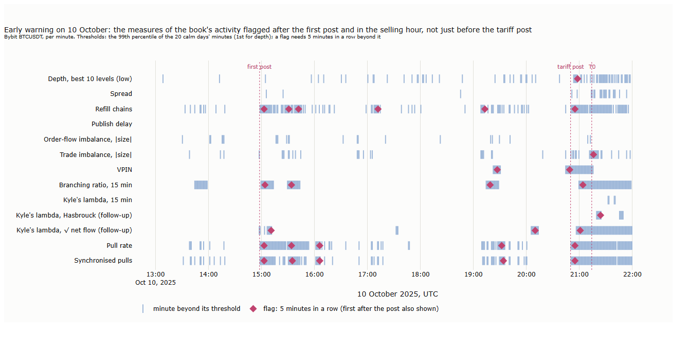
<b>How to read the figure.</b> <b>Axes.</b> Time of day (x), one row per measure (y); marks = minutes beyond the threshold. One row per measure, per minute, Bybit BTCUSDT. Light marks: minutes beyond the measure's threshold; red diamonds: flags, raised at the end of the fifth minute in a row; for each measure the first flag after the post is shown too. Dotted lines: the first post, the tariff post and T0. Every measure uses only data up to the end of its minute.

**Result.** By the rule fixed in advance, four measures flagged almost six hours before the post: refill chains, the pull rate, synchronised pulls and the branching ratio, first at 15:03 and 15:04. But that is five and six minutes after the first post, the earliest a five-minute rule can respond. They reacted to news; they did not anticipate it. The same four, joined by VPIN, flagged again between 19:13 and 19:34, during the selling hour. In the last hour before the post, only VPIN flagged, at 20:49, after the burst of buying at 20:44 had made the volume one-sided. Order-flow imbalance, trade imbalance, depth, spread and the exchange's delay did not flag before the post. After it, refill chains and both pull measures flagged at the earliest possible moment, 20:55, nineteen minutes before T0; depth followed at 20:58 and the branching ratio at 21:04. A market maker using them would have stepped back before the worst of the fall, but after the news, not before it. The price of the warnings is their false alarms: on calm days the activity measures raise up to one a day; after the cascade, when the market stayed busier and the book thinner, two to seven ([E26 §4.3](../extended/26-statistics-of-the-flow/lecture.md) tabulates every measure).

Kyle's lambda never flagged, even in the cascade: its highest values come in quiet minutes (rank correlation −0.60 with the last 15 minutes' volume on the calm days). Price impact grows more slowly than the size traded, close to the square-root law (Tóth et al., 2011), so a price per BTC falls whenever trading is heavy, and a cascade is when trading is heaviest. Follow-ups, added after the results: two square-root versions, Hasbrouck's (2009) and our own on the net flow, put the cascade at or near the top of the calm days' range but raise about ten false alarms a day after it; and separate slopes for buys and sells (Brennan, Chordia, Subrahmanyam and Tong, 2010) moved alike, with no sign of the bid side thinning before the news.

### 8.4 What changed afterwards

What the book and the flow did show is how the market behaved once the news was out.

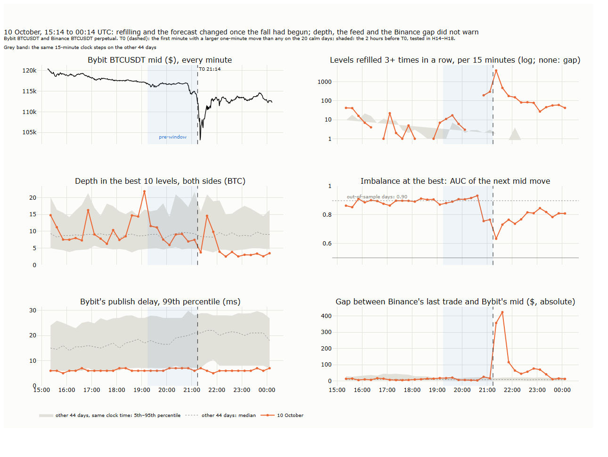
<b>How to read the figure.</b> <b>Axes.</b> Every panel: time of the evening (x); orange = 10 October, grey band = the other days. 10 October 15:14 to 11 October 00:14 UTC, in 15-minute steps; the dashed line is T0, 21:14, and the shaded area the two-hour pre-window. In every panel but the top left, the orange line is 10 October and the grey band the 5th to 95th percentile of the same 15-minute steps on the other 44 days, with their median dotted. <b>Top left:</b> Bybit's mid every minute. <b>Top right:</b> levels refilled at least three times in a row (§5.4), log scale; steps with none are left empty. <b>Middle left:</b> depth in the best 10 levels of both sides. <b>Middle right:</b> the AUC of the imbalance at the best for the next mid move (§5.1); the dotted line is the out-of-sample value. <b>Bottom left:</b> the 99th percentile of Bybit's publish delay, the time between the matching engine's stamp and the publication of each update. <b>Bottom right:</b> the average absolute gap between the last trade on Binance and Bybit's mid.

- **The book emptied over minutes, not in one order.** The spread opened to 15 ticks within three minutes of the post and averaged 60 to 128 ticks, $6 to $13, from 21:16 to 21:22; depth within 5 bp was, at its lowest, 2 to 4 BTC. Trading went on throughout, as the resting orders that normally refill the best levels stopped coming ([E24 §5.4](../extended/24-the-order-book/lecture.md)). After T0, depth in the best 10 levels fell to about 3 BTC and stayed there for the rest of the evening.
- **Imbalance kept working, less well (H17 holds).** The AUC stayed above 0.5 in every 15-minute step from T0 − 2 h to T0 + 2 h (p < 0.001): 0.88 to 0.93 before the fall, 0.76 in the step in which it began, 0.63 at T0, and 0.73 to 0.85 over the next two hours. As the moves grew, the book a few hundred milliseconds old said less about the next one; the order-flow imbalance lost more of its grip than the trades (§6.1).
- **The venues parted.** The average absolute gap between Binance's last trade and Bybit's mid widened to $420 over the 15 minutes from 21:29: for half an hour two of the largest venues disagreed on the price of bitcoin by hundreds of dollars. Bybit's imbalance leaned slightly towards the gap (+0.02, p = 0.011; H18b holds, tiny), against about −0.09 on the calm days (§6.5).
- **Trading fed on itself, and the feed stayed fast.** The branching ratio was 1.00 in the hour of the cascade (§6.4), each size of taker order moved the price further (§5.5), and the longest single publish delay during the fall was 38 ms.
- **The book stayed thinner.** For the rest of our sample, depth within 5 bp was lower on every day, and the book was pulled about 1.7 times as often on weekdays (§4).

The cascade was set off by news, and a book does not anticipate news; that none of the statistics of the book or the flow moved before the price did is the result one would expect, and it is now measured rather than assumed. One day, one venue and one event cannot show that warnings are impossible; they show that on this day, none of these measures gave one that the news itself did not. As Lecture 19 (§9) found on five years of the tape, the best early warning of a cascade is the turbulence already under way; on this day too, the measures that flagged did so once it had begun. These are the conditions that the replay of Lecture 22 has to reproduce, and in which the market maker of Lecture 23 would have had to decide whether to keep quoting.

## Back to the base layer

*Food for thought.*

| | |
|---|---|
| **The idea** | Read the book to time the daily portfolio's executions, and to pause a strategy when liquidity thins: a kill switch |
| **What our results already say** | Imbalance at the best ranks the next move of the mid nine times in ten (§5.1); after the cascade the book held about half the depth and charged two to four times as much (§4.1); large market orders paid about twice what the last recorded book promised (§4.2); nothing in the book or the flow warned before the news of 10 October, and the activity measures reacted within five minutes (§8) |
| **What a test would need** | The cost of the portfolio's own orders by state of the book, on its own markets; the first thing that could kill it: the forecasts work over seconds, so the gain may be below the cost |
| **Status** | Not tested in this course; a research direction |

<b>How to read the card.</b> Food for thought, not a result: the idea, only numbers this lecture has shown, what a test would need, and its status.

## 9. Summary, exercises and reading

### 9.1 Eight takeaways

1. **The book is the queue of orders waiting to be met.** A market order walks it from the best price outwards, so its cost grows faster than its size, and the book does not stand still while the order travels.
2. **Public data are L2, and a rebuilt book is checked, not trusted.** The size at each price, not the orders behind it; with the trades alongside, a level's change splits into filled and withdrawn only as a net figure. Bybit's rebuilt book matched every end-of-day snapshot, apart from three feed gaps of about ten seconds.
3. **The book is least reliable when it is needed most.** On a calm day: one tick of spread, about 48 BTC within 5 bp of the mid on each side, a quarter of a basis point for 5 BTC. Yet large market orders paid, on average, nearly twice what the last recorded book promised, most of it when the price was moving and quotes were withdrawn: the liquidity mirage, measured.
4. **Imbalance at the best ranks the next move nine times in ten, mostly through mechanics:** 0.96 when the smaller best queue holds less than 0.1 BTC. We found no way to make it hard to game without losing its forecast. The estimated microprice cut the error of the next mid by 19%, because the mid jumps a median of 44 ticks, not one.
5. **Resting orders are mostly cancelled, filled ones lose, and the book has a clock.** 92% of the size that left the best was withdrawn; one second after a fill the average resting order was 59 ticks per BTC under water, before a base maker fee of about 200 ticks. Quotes are withdrawn and replaced at the start of every minute, much more so at :00 and :30, when depth rises and taker orders follow the last half hour.
6. **A delta adds up what a level forgets.** The pressure on the book explained 39% of the mid's moves over 10 seconds, the trades alone 17%, but forecast the next 10 seconds by 0.1%. A trade's own push builds briefly and fades, while order signs stay correlated for a thousand orders; VPIN with the true sides warned of nothing that volume did not already show.
7. **Most trading is a reaction to trading, and Binance moves first:** about 84% of taker orders were attributed to earlier ones, below the critical point; Binance led Bybit by about 40 to 50 milliseconds, and Bybit's book seemed to lean away from Binance's price only through a Simpson's paradox.
8. **Nothing in the book or the flow anticipated the news of 10 October.** The measures of activity reacted within five minutes of each post; afterwards depth fell to a third, the venues parted by hundreds of dollars, and the book stayed thinner. Every result here is on one symbol, two venues and 45 days.

### 9.2 Exercises

- [ ] Download one day of the book and the trades for ETHUSDT ([E24 §3.4](../extended/24-the-order-book/lecture.md)), rebuild the book and check it against the day's last snapshot (§3.2). Does it match, and are there feed gaps?
- [ ] Repeat the measurement of quote fading of §4.2 with a deliberately older book: the book of 200, 500 and 1,000 milliseconds before each order. How fast does the share of orders that did worse grow with the age of the book? This is the latency setting of Lecture 22.
- [ ] Simulate the race of two queues in the style of Cont and de Larrard (2013), with arrival, cancellation and market-order rates measured on one of our days. What AUC does mechanics alone give, against the 0.90 we measured (§5.1)?
- [ ] Repeat the lead-lag test of §6.5 with a third venue. Does Binance lead both, and does the lead change with the hour of the day, which a constant offset between clocks could not do?
- [ ] Take another timed announcement, a scheduled US data release or another post, and repeat §8: the flow, the price and the early-warning table in the hours before it.

### 9.3 Reading

For the book together with the trades that move it, Bouchaud et al. (2018), the reference for this lecture. For the imbalance at the best as a forecast, Gould and Bonart (2015); for the microprice, Stoikov (2018); for the price as a race between queues, Cont and de Larrard (2013); for spoofing, Lee, Eom and Park (2013); for markouts, Huang and Stoll (1996). For order-flow imbalance, Cont, Kukanov and Stoikov (2014); for impact over time, Bouchaud, Gefen, Potters and Wyart (2004); for VPIN and its critique, Easley, López de Prado and O'Hara (2012) and Andersen and Bondarenko (2014); for Hawkes processes, Bacry, Mastromatteo and Muzy (2015); for lead and lag, Hoffmann, Rosenbaum and Yoshida (2013).

Full versions: [E24](../extended/24-the-order-book/lecture.md), [E25](../extended/25-statistics-of-the-book/lecture.md) and [E26](../extended/26-statistics-of-the-flow/lecture.md).

### 9.4 Next: replay and a market that reacts

This lecture read the book from outside: every fill, markout and cancellation belonged to other traders. Lecture 22 puts our own orders into the recorded market: when a resting order is filled, at what price a market order is executed, and what the price does afterwards, with latency as a setting and the queue models of §5.4 turning fills into ranges. A replay that treats our orders as invisible is still too kind, since quotes fade when the price moves (§4.2) and most trading reacts to trading (§6.4); the second half of Lecture 22 lets the market react to our order, and asks when it absorbs the order calmly and when it tips into a move that feeds on itself.

## References

- Alexander, C. and Heck, D. F. (2020). Price discovery in Bitcoin: the impact of unregulated markets. *Journal of Financial Stability* 50, 100776. — perpetuals on unregulated venues led bitcoin price discovery (§6.5).
- American Presidency Project (2025). Truth Social posts, October 10, 2025. University of California, Santa Barbara. presidency.ucsb.edu/documents/truth-social-posts-october-10-2025. — the logged times of both posts (§8.1).
- Andersen, T. G. and Bondarenko, O. (2014). VPIN and the flash crash. *Journal of Financial Markets* 17, 1–46. — the critique of VPIN (§6.3).
- Bacry, E., Mastromatteo, I. and Muzy, J.-F. (2015). Hawkes processes in finance. *Market Microstructure and Liquidity* 1(1), 1550005. — survey; kernels and estimation (§6.4).
- Bouchaud, J.-P., Bonart, J., Donier, J. and Gould, M. (2018). *Trades, Quotes and Prices: Financial Markets Under the Microscope*. Cambridge University Press. — the book and the trades that move it (§9.3).
- Bouchaud, J.-P., Gefen, Y., Potters, M. and Wyart, M. (2004). Fluctuations and response in financial markets: the subtle nature of 'random' price changes. *Quantitative Finance* 4(2), 176–190. — the propagator model (§6.2).
- Brennan, M. J., Chordia, T., Subrahmanyam, A. and Tong, Q. (2010). Sell-side illiquidity and the cross-section of expected stock returns. *Global Management Conference*, Bali, April–May 2010, 75–88; published as Sell-order liquidity and the cross-section of expected stock returns, *Journal of Financial Economics* 105(3), 523–541 (2012). — separate lambdas for buy and sell orders, equation (4) (§8.3).
- Budish, E., Cramton, P. and Shim, J. (2015). The high-frequency trading arms race: frequent batch auctions as a market design response. *Quarterly Journal of Economics* 130(4), 1547–1621. — frequent batch auctions (§5.2).
- Bybit (n.d.-a). How to use iceberg orders. *Bybit Learn*, bybit.com/en/learn/bybit-guide/how-to-use-iceberg-orders. — icebergs on Bybit as slices placed one after another (§5.4).
- Bybit (n.d.-b). Perpetual futures contract fees explained. *Bybit Help Center*. — maker 0.02%, taker 0.055% at the base tier, VIP 0 (§5.1, §5.5).
- Cartea, Á., Jaimungal, S. and Wang, Y. (2020). Spoofing and price manipulation in order-driven markets. *Applied Mathematical Finance* 27(1–2), 67–98. — a model of a spoofing seller (§5.2).
- Collin-Dufresne, P. and Fos, V. (2016). Insider trading, stochastic liquidity, and equilibrium prices. *Econometrica* 84(4), 1441–1475. — informed trading hides in noise trading that varies over time (§8.2).
- Cont, R. and de Larrard, A. (2013). Price dynamics in a Markovian limit order market. *SIAM Journal on Financial Mathematics* 4(1), 1–25. — the next price move as a race between the two best queues (§5.1).
- Cont, R., Kukanov, A. and Stoikov, S. (2014). The price impact of order book events. *Journal of Financial Econometrics* 12(1), 47–88. — order-flow imbalance (§6).
- Easley, D., López de Prado, M. and O'Hara, M. (2012). Flow toxicity and liquidity in a high-frequency world. *Review of Financial Studies* 25(5), 1457–1493. — VPIN (§6.3).
- Fabre, T. and Challet, D. (2025). Learning the spoofability of limit order books with interpretable probabilistic neural networks. arXiv 2504.15908. — distance and spoofing on crypto exchanges (§5.2).
- Filimonov, V. and Sornette, D. (2012). Quantifying reflexivity in financial markets: towards a prediction of flash crashes. *Physical Review E* 85(5), 056108. — the branching ratio of S&P 500 futures, 1998–2010 (§6.4).
- Filimonov, V. and Sornette, D. (2015). Apparent criticality and calibration issues in the Hawkes self-excited point process model: application to high-frequency financial data. *Quantitative Finance* 15(8), 1293–1314. — what biases the branching ratio upwards (§6.4).
- Gould, M. D. and Bonart, J. (2015). Queue imbalance as a one-tick-ahead price predictor in a limit order book. arXiv 1512.03492. — the imbalance at the best and the next mid move (§5.1).
- Hardiman, S. J., Bercot, N. and Bouchaud, J.-P. (2013). Critical reflexivity in financial markets: a Hawkes process analysis. *European Physical Journal B* 86(10), 442. — a branching ratio close to 1 (§6.4).
- Hasbrouck, J. (2009). Trading costs and returns for U.S. equities: estimating effective costs from daily data. *Journal of Finance* 64(3), 1445–1477. — lambda on the signed square root of dollar volume (§8.3).
- Hasbrouck, J. and Saar, G. (2009). Technology and liquidity provision: the blurring of traditional definitions. *Journal of Financial Markets* 12(2), 143–172. — fleeting orders (§1.2).
- Hawkes, A. G. (1971). Spectra of some self-exciting and mutually exciting point processes. *Biometrika* 58(1), 83–90. — the Hawkes process (§6.4).
- Hayashi, T. and Yoshida, N. (2005). On covariance estimation of non-synchronously observed diffusion processes. *Bernoulli* 11(2), 359–379. — correlation without resampling (§6.5).
- hftbacktest documentation (n.d.). Queue models. hftbacktest.readthedocs.io. — cautious and probabilistic models of queue position in an open-source backtester (§5.4).
- Hoffmann, M., Rosenbaum, M. and Yoshida, N. (2013). Estimation of the lead-lag parameter from non-synchronous data. *Bernoulli* 19(2), 426–461. — lead and lag (§6.5).
- Huang, R. D. and Stoll, H. R. (1996). Dealer versus auction markets: a paired comparison of execution costs on NASDAQ and the NYSE. *Journal of Financial Economics* 41(3), 313–357. — effective spread, realized spread and price impact (§5.5).
- Huang, W., Lehalle, C.-A. and Rosenbaum, M. (2015). Simulating and analyzing order book data: the queue-reactive model. *Journal of the American Statistical Association* 110(509), 107–122. — arrival and cancellation rates that depend on the queue size (§5.4).
- Huth, N. and Abergel, F. (2014). High frequency lead/lag relationships — empirical facts. *Journal of Empirical Finance* 26, 41–58. — the lead-lag ratio (§6.5).
- Kyle, A. S. (1985). Continuous auctions and insider trading. *Econometrica* 53(6), 1315–1335. — Kyle's lambda (§6.1).
- Lee, E. J., Eom, K. S. and Park, K. S. (2013). Microstructure-based manipulation: strategic behavior and performance of spoofing traders. *Journal of Financial Markets* 16(2), 227–252. — spoofing on the Korea Exchange (§5.2).
- Lillo, F. and Farmer, J. D. (2004). The long memory of the efficient market. *Studies in Nonlinear Dynamics & Econometrics* 8(3), 1–35. — slowly fading correlation of order signs (§6.2).
- Moallemi, C. C. and Yuan, K. (2016). A model for queue position valuation in a limit order book. Working paper, Columbia Business School. — the value of a place in the queue (§5.4).
- Næs, R. and Skjeltorp, J. A. (2006). Order book characteristics and the volume–volatility relation: empirical evidence from a limit order market. *Journal of Financial Markets* 9(4), 408–432. — the slope of the book (§5.4).
- Rigtorp, E. (2013). Estimating order queue position. Blog post, rigtorp.se, 8 June 2013. — estimating queue position from market-by-level data (§5.4).
- Silantyev, E. (2019). Order flow analysis of cryptocurrency markets. *Digital Finance* 1, 191–218. — trade and order-flow imbalance on the BitMEX bitcoin perpetual (§6.1).
- Simpson, E. H. (1951). The interpretation of interaction in contingency tables. *Journal of the Royal Statistical Society, Series B* 13(2), 238–241. — Simpson's paradox (§6.5).
- Stoikov, S. (2018). The micro-price: a high-frequency estimator of future prices. *Quantitative Finance* 18(12), 1959–1966. — the microprice (§5.3).
- Tóth, B., Lempérière, Y., Deremble, C., de Lataillade, J., Kockelkoren, J. and Bouchaud, J.-P. (2011). Anomalous price impact and the critical nature of liquidity in financial markets. *Physical Review X* 1(2), 021006. — the square-root law of impact (§8.3).
- van Kervel, V. (2015). Competition for order flow with fast and slow traders. *Review of Financial Studies* 28(7), 2094–2127. — cancellations across venues (§1.2).
- Xu, K., Gould, M. D. and Howison, S. D. (2019). Multi-level order-flow imbalance in a limit order book. *Market Microstructure and Liquidity* 4(3–4), 1950011. — order-flow imbalance over several levels (§6.1).
