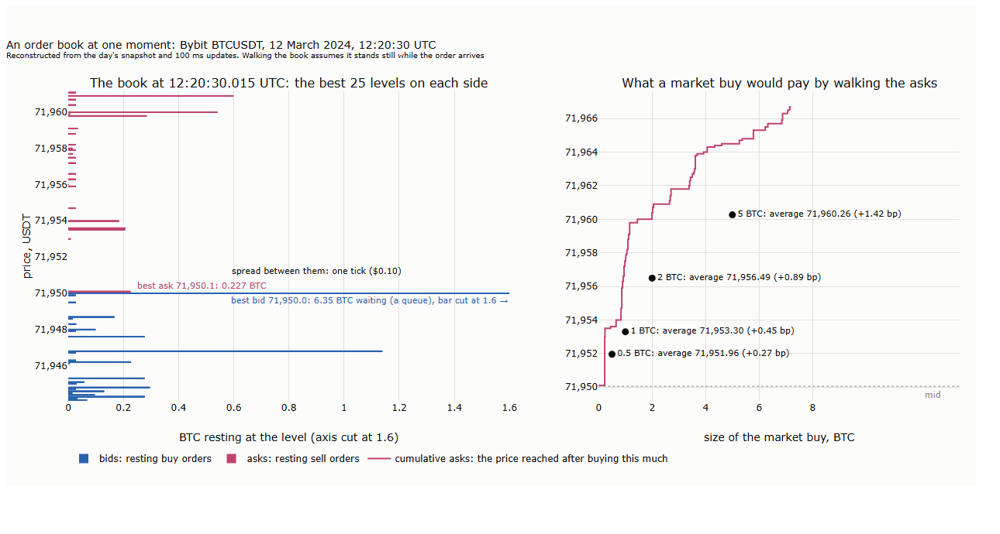
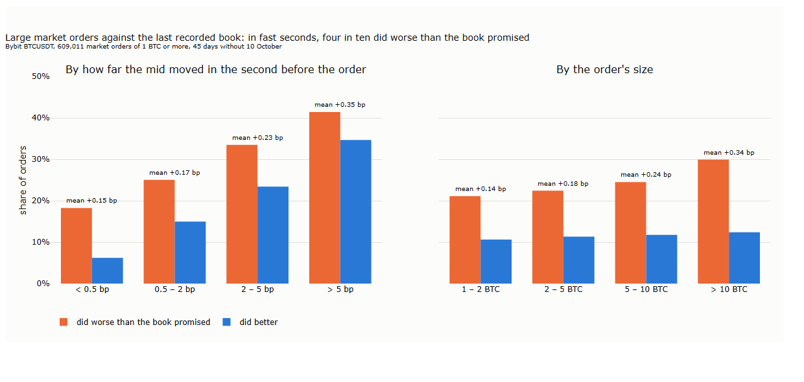
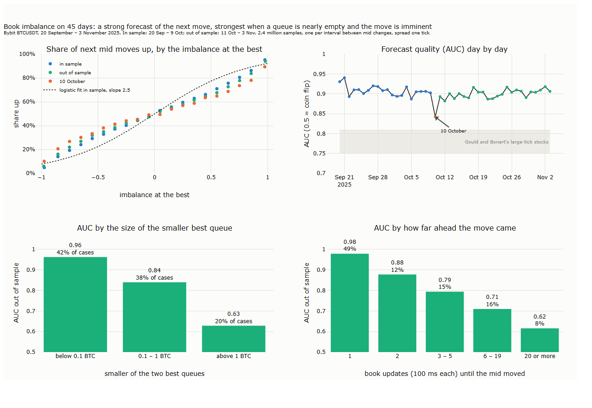
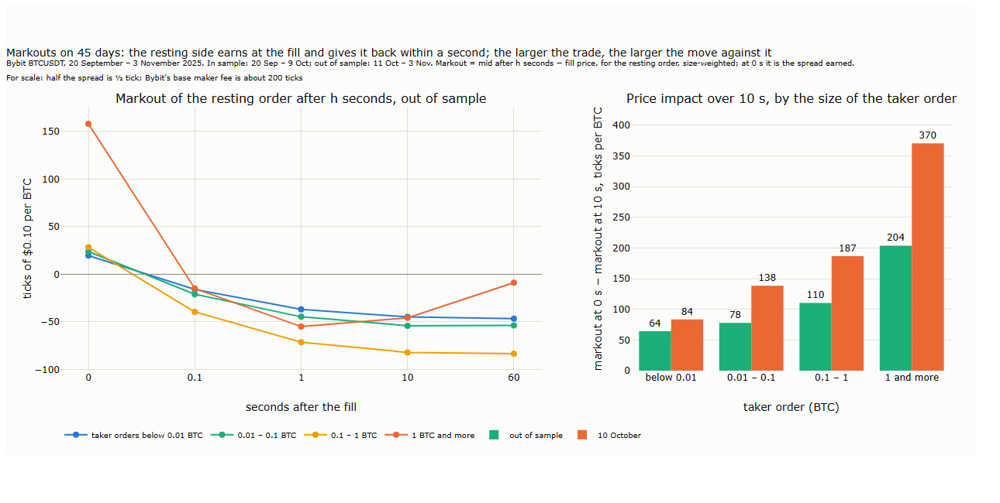
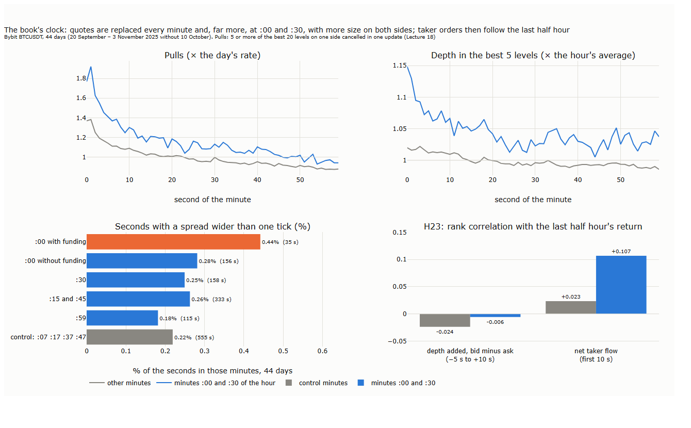
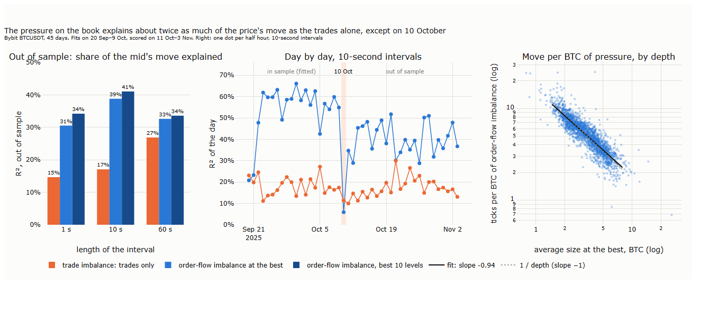
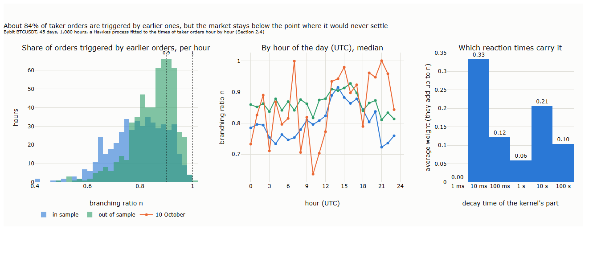
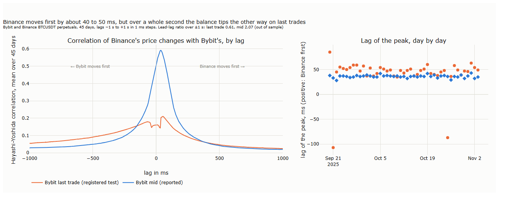
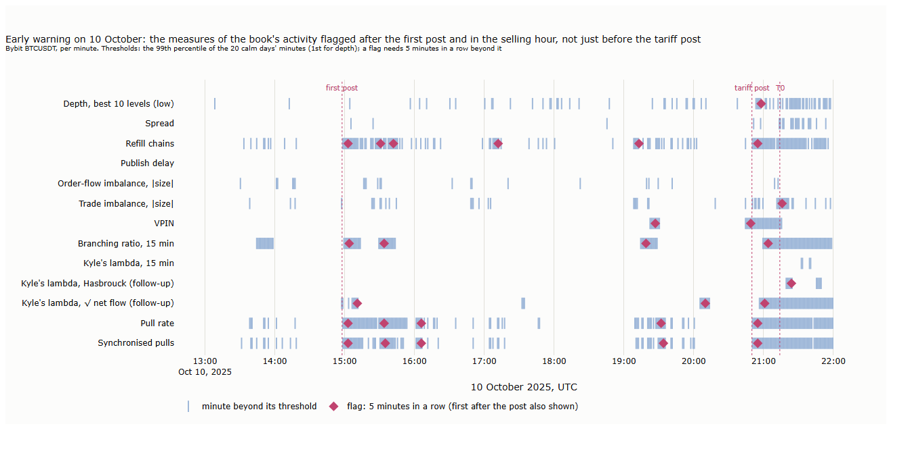

# Lecture 21: The Order Book

> The tape shows the trades; the book shows the orders waiting to be met, read at one moment as a state and between moments as a flow.

Part V · Pipeline stage: data and execution (the resting orders behind the trades, read as a state and as a flow)

---

# The book is a queue of waiting orders

> A market order walks the book level by level, so its cost grows faster than its size.

- A buy of 0.5 BTC pays 0.27 bp above the mid; 5 BTC, 1.42 bp
- Within USD 10 of the mid: 14.7 BTC to buy, 2.0 to sell
- The walk assumes the book stands still while the order travels

---

# The liquidity mirage

> Large market orders paid, on average, nearly twice what the last recorded book promised; quotes are pulled when the price moves.

- Average order of 1 BTC or more: promised 0.21 bp, paid 0.38 bp
- After a move of more than 5 bp, 41% did worse; after a quiet second, 18%
- Pulls: 7% of updates after a quiet second, 79% after a move of more than 5 bp

---

# Public data are L2; a rebuilt book is checked

> Public data show the size at each price, not the orders behind it; a book rebuilt from them is checked against the exchange's own snapshots, not trusted.

| Level | What it shows |
|---|---|
| **L1** | The best bid and the best ask, with their sizes |
| **L2** | Every level with its total size: Bybit, 200 levels a side every 100 ms |
| **L3** | Every single order, filled or cancelled; rare, usually paid for |

- **L2 cannot see inside a queue:** a level fell by 3.136 BTC, of which 0.132 BTC traded
- **Checked:** on every day the rebuilt book equals Bybit's end-of-day snapshot at all 400 levels
- **Three feed gaps** of about ten seconds, left out of every measurement

---

# Imbalance ranks the next move nine times in ten

> As a state, the book ranks the next move of the mid correctly about nine times in ten, mostly through the mechanics of a tiny queue about to empty.

$$I = \frac{q^b - q^a}{q^b + q^a}$$

- AUC 0.897 out of sample, above 0.5 on all 45 days
- 0.96 when the smaller best queue holds less than 0.1 BTC
- The microprice cuts the next mid's error by 19%

---

# Resting orders: mostly cancelled, filled ones lose

> Of each 100 BTC that left a best queue, about 92 were cancelled; one second after its fill the average resting order was 59 ticks per BTC under water.

$$M(h) = s\,(m_{t+h} - p)$$

- Impact over 10 s grows with size: 64 to 204 ticks per BTC
- The base maker fee, about 200 ticks per BTC, comes on top
- L2 shows a queue's length; a place in it must be modelled

---

# The book's clock

> Quotes are withdrawn and replaced at the start of every minute, much more so at :00 and :30, when depth rises rather than thins.

- Second 0 of minutes :00 and :30: pulls at 1.77 times the day's rate
- Depth jumps to 1.15 times the hour's average, for 20 to 30 seconds
- Takers follow the last 30 minutes: +0.107 against +0.023

---

# The book as a flow: order-flow imbalance

> A level forgets, a delta adds up: the pressure on the best prices explains 39% of the mid's moves over ten seconds, the trades alone 17%, but forecasts the next ten by 0.1%.

$$\Delta m = \beta \cdot \text{OFI}$$

- OFI: buying interest arriving at the best bid minus selling at the best ask, summed
- The pressure explains more than the trades on 43 of the 45 days
- A book twice as deep moves about half as far per BTC

---

# Most trading is a reaction to trading

> In the median hour 84% of taker orders were attributed to earlier orders, yet the market stayed below the critical point in all but 2 of 1,080 hours.

$$\lambda(t) = \mu + \sum_{t_j < t} \phi(t - t_j)$$

- A trade's own push peaks 14 orders later, then fades; buys follow buys
- Most weight at two reaction times: 10 ms and 10 s
- VPIN with the true sides: partial correlation −0.004, no warning

---

# Binance moves first

> Binance's price changes correlate most with Bybit's about 40 to 50 milliseconds later, on almost every day.

- Peak at a positive lag on 43 of 45 days, at a median of 48 ms
- The registered lead-lag ratio, 0.61, fails; it had little power here
- Bybit's book seemed to lean away from Binance: a Simpson's paradox

---

# Verdicts

> Most of the book's hypotheses held, few of the flow's; none of the results is a trading result.

| Statistic | The question it answers | On our sample | Verdict |
|---|---|---|---|
| Book imbalance | Which way will the mid move next? | AUC 0.90 on all 45 days | Holds |
| Markouts | What is a fill worth a second later? | −59 ticks per BTC | Holds |
| Order-flow imbalance | Does it explain moves? | 39% against 17% | Holds; too small to trade |
| VPIN | When trading turns one-sided, is a storm coming? | Partial correlation −0.004 | Fails |

- After the Benjamini-Hochberg correction: eleven of the 15 tests of the book hold, three of the 12 of the flow

---

# 10 October: nothing warned before the news

> Nothing in the book or the flow anticipated the tariff post; the measures of activity reacted within five minutes, after the news.

- Before the post: the book as deep, Bybit's takers net buyers
- Refill chains and pulls flagged at 20:55, nineteen minutes before T0
- Afterwards the book stayed thinner for the rest of our sample

---

# Back to the base layer

> Food for thought: read the book to time the daily portfolio's executions, and pause a strategy when liquidity thins.

| | |
|---|---|
| **The idea** | Time executions by the state of the book, and a kill switch when liquidity thins |
| **What our results say** | Imbalance ranks the next move nine times in ten; after the cascade the book held about half the depth and charged two to four times as much; nothing warned before the news |
| **What a test would need** | The cost of the portfolio's own orders by state of the book, on its own markets; the first threat: the forecasts work over seconds, so the gain may be below the cost |
| **Status** | Not tested in this course; a research direction |

---

# Takeaways

1. **The book is a queue of waiting orders:** a market order walks it, so its cost grows faster than its size
2. **Public data are L2,** and a rebuilt book is checked, not trusted
3. **The book is least reliable when it is needed most:** large orders paid nearly twice what it promised
4. **As a state, imbalance ranks the next move nine times in ten,** mostly through mechanics; filled resting orders lose
5. **As a flow, the pressure describes moves, not the future:** 39% against 17%, a forecast of 0.1%; Binance moves first
6. **Nothing anticipated the news of 10 October;** the measures of activity reacted after it
