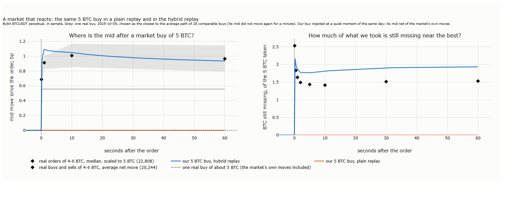
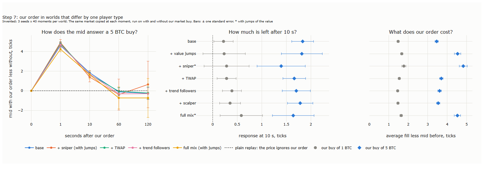
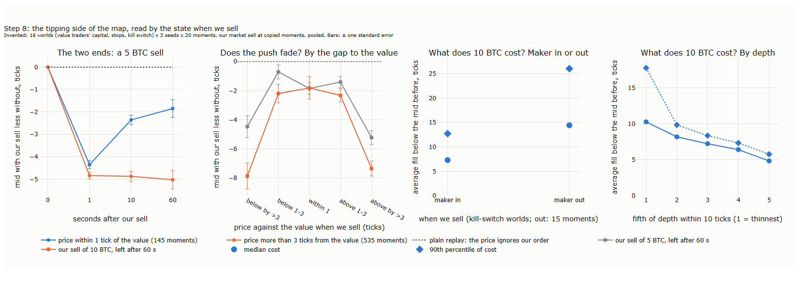
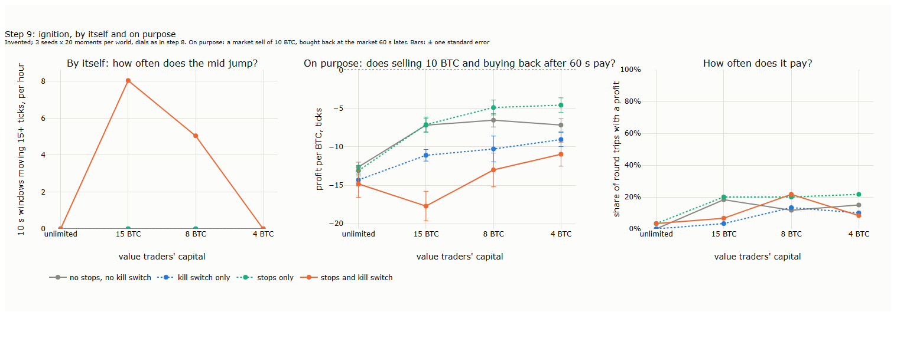
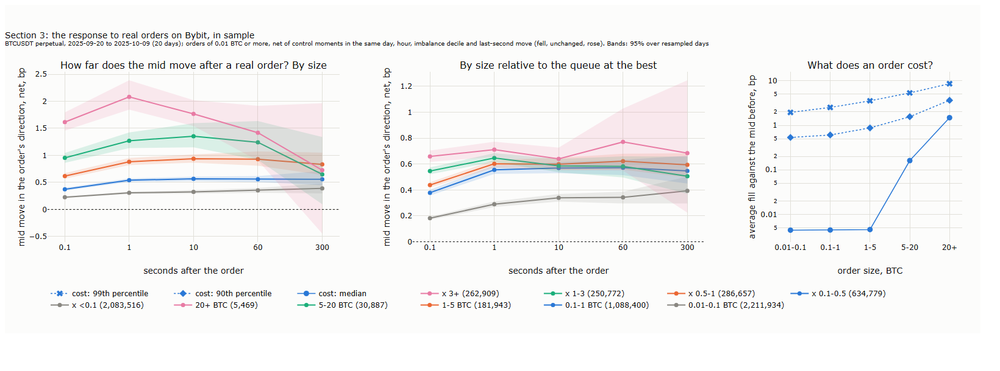
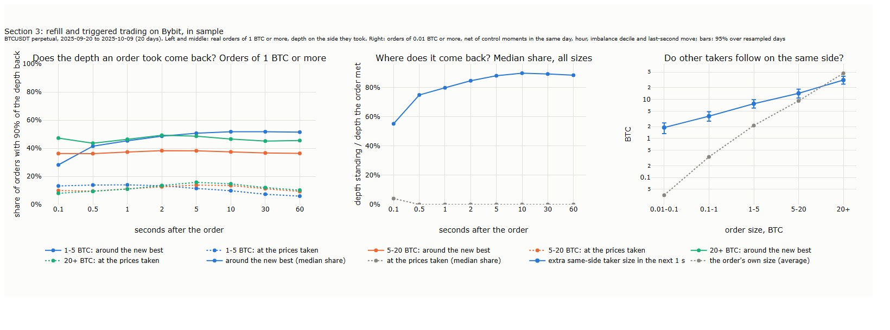

# Lecture 22: A Market That Reacts: Our Order's Footprint, Normal Slippage and the Tipping Point

*Systematic Trading: Lecture Notes (MSc) · draft, Nov 8, 2026 · Max Gnesi*

> **Draft.** Sections 1 to 3 are written on results already computed in sample (20 September to 9 October 2025). Sections 4 to 6 wait for the out-of-sample tests, which have not been run. The hypotheses were fixed before any of their results were computed ([results/hypotheses.md](results/hypotheses.md)); every change to them is dated there.

Lecture 21 replayed the recorded Bybit book as if our orders were invisible: nobody answered them, and what they took came straight back. This lecture lets the market react. It asks two things of a market order: what it costs in normal conditions, and when the market is close to a point where the same order sets off far more than its own size. The first is answered by a **hybrid replay** on Bybit's BTCUSDT perpetual, 20 September to 3 November 2025; the second by a laboratory market, a small simulated exchange in which every trader's rule is known. Companion notebook: to follow.

## 1. One order, two replays

A plain replay forgets our order at once. The hybrid replay keeps the recorded book as its background and adds what real orders of the same size were measured to do: the price moves and only slowly comes back, and what we took returns only in part. The difference fits in one chart:


<sub><b>How to read the figure.</b> <b>Axes.</b> Both panels: seconds after the order (x). Left: the mid's move since the order, in basis points (bp; 1 bp was about USD 12 on that day). Right: how much of the 5 BTC our buy took is still missing from the levels near the best ask, in BTC. Bybit BTCUSDT, in sample. <b>Left:</b> our market buy of 5 BTC injected at a quiet moment of 5 October 2025 (no order of 1 BTC or more within 60 s), its mid net of the market's own moves: plain replay (orange) and hybrid replay (blue). Diamonds and grey band: the average net move after real buys and sells of 4 to 6 BTC, 20,244 orders, with a 95% band over resampled days. Grey line: one real buy of 5.8 BTC on the same day, the closest of 28 comparable buys to their average path; its mid then did not move for a minute. <b>Right:</b> plain replay (orange, nothing missing) and hybrid replay (blue); diamonds: the median for real orders of 4 to 6 BTC, scaled to 5 BTC, 22,808 orders.</sub>

| Seconds after the buy | Plain replay: mid | Hybrid replay: mid | Real orders of 4-6 BTC: mid | Hybrid: BTC still missing | Real orders: BTC still missing |
|---|---|---|---|---|---|
| 1 | 0 | 1.09 bp | 0.91 bp | 1.9 | 1.6 |
| 10 | 0 | 1.05 bp | 1.01 bp | 1.8 | 1.4 |
| 60 | 0 | 0.93 bp | 0.97 bp | 1.9 | 1.5 |

<sub><b>How to read the table.</b> The numbers behind the figure. Mid: the move in the direction of the order, net of the market's own moves (injected order) or of matched control moments (real orders, §3.1). Missing: of the 5 BTC taken, the size not yet standing again within the same number of levels of the new best. Our measurement for these notes, in sample.</sub>

The plain replay is wrong in both panels. The price does not forget a 5 BTC buy: a minute later real orders of that size still leave the mid about 1 bp higher, and the hybrid replay, built from them, does the same. Nor does the book give back what was taken: a minute later about 1.5 BTC of the 5 is still missing near the best. A second order sent soon after meets a dearer book. In a test run on 1 October at 14:30 UTC, a second 5 BTC buy 2 s after the first cost 0.004 bp in the plain replay and 1.08 bp in the hybrid one.

The chart shows the calm end of a wider picture. The cost of a market order depends on two things: its size, and the state of the market when it arrives. Think of it as **one map**, cost against size and state. Where the book is deep and the traders who supply liquidity stay, the map is smooth and a push fades, as in the chart. Where they withdraw, the same order can tip the market into a move that feeds on itself, and the map turns steep. The lecture has two aims, one for each end:

| Aim | The question | Where |
|---|---|---|
| Normal slippage | What does an order cost, and how does the price answer, when the market absorbs it? | The hybrid replay, §3 and §4 (H1 to H8) |
| The tipping point | In which states does the same order set off far more than itself, and can we read them before trading? | The laboratory market, §2, then 10 October and H9, H20 (§5) |

<sub><b>How to read the table.</b> One row per aim. The hypotheses are numbered as in [results/hypotheses.md](results/hypotheses.md).</sub>

The lecture runs as follows:

| § | Step | Question |
|---|---|---|
| 1 | One order, two replays | Does the market's reaction change what a replay reports? |
| 2 | A laboratory market | How does a push fade, and how does a market tip? |
| 3 | The reaction on our data | How far does the price move after real orders, does the book refill, and do others follow? |
| 4 | Does the hybrid replay tell the truth? | H1 to H8, out of sample (to follow) |
| 5 | Close to the tipping point | 10 October, H9 and H20 (to follow) |
| 6 | Summary, exercises and reading | (to follow) |

## 2. A laboratory market

The mechanisms behind the map cannot be seen in Bybit's data, because the data never say who traded, who withdrew or whose capital ran out. This section builds them where they can be seen: a **laboratory market**, a small exchange in which a handful of traders follow written rules. It is a caricature on purpose. Physicists study magnets with a grid of arrows that no magnet resembles (the Ising model), because the grid shows how a sudden change arises from simple rules; Schelling (1978) showed with a board and two kinds of counters how mild individual preferences tip a whole neighbourhood. Our market is used in the same spirit.

**Why it is worth studying.** It gives four things real data cannot. The **counterfactual**: we copy the market at a moment and run it on with and without our order, which on real data is never possible. **Rare events on demand**: our 45 days hold one cascade, the laboratory thousands of near-tips. **Instruments checked before use**: a measure is first tried where the answer is known, as physicists inject fake signals into their own detectors. **Questions that transfer**: who supplies liquidity, how much capital is left to correct the price, where stops lie. What it does not give is numbers about Bybit. Every size, rate and threshold in it is invented, prices are in ticks of an invented market, and the size of any effect on Bybit is left to Sections 3 to 5. Every figure from it is marked *Invented*.

| Trader | Rule | Stands for |
|---|---|---|
| Noise traders | Limit orders, market orders and cancellations at random | Everyone whose reasons we cannot model |
| Value traders | Buy below a hidden value, sell above it, when the gap exceeds a threshold; capital limited or not | Arbitrageurs who tie the price to its value |
| Market maker | Quotes a ladder around its estimate of the value, leaning against its position; may pull all quotes after a fast move (kill switch) | Liquidity providers |
| Stops and liquidations | Rest at a density around the price; a move through them becomes a market order in the same direction | Stop-losses and forced closes of leveraged positions |

<sub><b>How to read the table.</b> The traders of the laboratory market used in this lecture. The hidden value moves as a random walk. The code and checks are in `scripts/l22_sim.py` and `scripts/checks/test_sim.py`.</sub>

### 2.1 The calm side: why a push fades

**Key message.** A push fades when someone takes the other side of it at a profit: first the market maker, then the arbitrageurs.

The mechanism, traced in the laboratory: our buy of 5 BTC is filled partly by the market maker, which is left short. It moves its quotes up to shed that position, and the mid rises further for about a second. Then the value traders sell into the higher price and take the position over, and the price returns towards the value.

| Seconds after our buy | Mid, with our buy less without | Market maker's position | Value traders' position |
|---|---|---|---|
| 0 | +2.7 ticks | filled 1.9 of our 5 BTC | |
| 1 | +4.6 | −1.8 BTC, quotes leaned up about 7 ticks | −0.2 BTC |
| 10 | +1.8 | −0.5 | −1.7 |
| 60 | +0.4 | −0.1 | −4.1 |

<sub><b>How to read the table.</b> <i>Invented.</i> The same market copied at 30 moments and run on with and without our buy; averages. Positions are the change caused by our buy.</sub>

This is the inventory story of market-making theory, and it is plausible. Two features of it are built in rather than found. The fade is assumed, because the value moves on its own and the value traders always pull the price back to it. And impact is linear in size, because the maker leans by a fixed number of ticks per BTC; on real data impact grows much more slowly than size (§3.1).


<sub><b>How to read the figure.</b> <b>Axes.</b> Left: seconds after our buy (x), mid with our buy less without, ticks (y). Middle and right: one row per world (y); response at 10 s and cost, ticks (x). <i>Invented</i>; 3 seeds × 40 moments per world. Bars: ± one standard error.</sub>

Adding a sniper, a slicing trader, trend followers or a scalper one at a time, each at a small share, leaves the response within one standard error of the base world. What changes is the cost: with jumps in the value, a 5 BTC buy costs 4.5 to 4.8 ticks against 3.5 in calm worlds, because the book is thinner and more often stale.

### 2.2 The tipping side: three dials

**Key message.** A market tips when the traders who absorb a push are out of capital, out of the book, or outnumbered by those who add to it.

Three dials turn the laboratory towards the tipping side. The value traders' **capital**: a position beyond which they stop correcting the price, the limits of arbitrage of Shleifer and Vishny (1997). The market maker's **kill switch**: it pulls all its quotes for 5 s after a move of 5 ticks within a second, and with a position beyond its limit quotes only the side that reduces it. **Stops**: a density of stop orders around the price, which a move turns into market orders in the same direction.


<sub><b>How to read the figure.</b> <b>Axes.</b> First panel: seconds after our sell (x), mid with our sell less without, ticks (y). Second: the price against the value when we sell (x), the move left after 60 s (y). Third and fourth: the maker in or out, and fifths of depth within 10 ticks (x), cost of a 10 BTC sell, ticks (y). <i>Invented</i>; 16 worlds × 3 seeds × 20 moments, our market sell at copied moments, pooled. Bars: ± one standard error.</sub>

Read by the state at the moment of the order, two results stand out.

| State when our 10 BTC sell arrives | Moments | Move left after 60 s | Median cost | 90th percentile of cost |
|---|---|---|---|---|
| Price within 3 ticks of the value | 425 | −1.8 to −2.3 ticks | | |
| Price more than 3 ticks from the value, either side | 535 | −7.3 to −7.9 ticks | | |
| Market maker in the book | 465 | | 7.3 ticks | 12.7 ticks |
| Market maker out (kill switch) | 15 | | 14.4 ticks | 29.0 ticks |

<sub><b>How to read the table.</b> <i>Invented.</i> The 960 moments of the figure. The upper rows split by the gap between price and value; the lower rows use the worlds with a kill switch.</sub>

**A loose anchor.** When the price is already far from the value, in either direction, the arbitrageurs have stopped correcting it, and any push stays. Moved towards the value, it stays because we did their work; moved further away, because nobody is left to push back. A first draft of hypothesis H20 expected the direction to matter; the laboratory showed it is the size of the gap.

**A fat tail.** With the maker out of the book, the median cost of a 10 BTC sell doubles and its 90th percentile more than doubles. The tail, not the average, carries the risk, so this lecture reports costs as percentiles.

**Physics: a chain reaction.** If each trade or quote withdrawal sets off on average n others, a push of size 1 has a total effect of about 1/(1 − n): it dies out while n stays below 1 and runs away as n reaches 1, as in a reactor going critical. The quantity is the branching ratio of a Hawkes process, which Lecture 20 measured on Bybit. Whether markets sit near n = 1 is disputed: Filimonov and Sornette (2012) found reflexivity rising towards it, Hardiman, Bercot and Bouchaud (2013) found it close to 1 throughout. Fosset, Bouchaud and Benzaquen (2020) built an order-book model in which liquidity that falls after volatility, and volatility that rises when liquidity falls, produce exactly such a threshold: stable for weak feedback, crises with certainty above it.

**Physics: slowing down before the edge.** Near a tipping point a system recovers ever more slowly from small shocks (Scheffer et al., 2009). In a book, recovery is the refill of what an order took (§3.2); a refill that slows is the textbook early warning. The warning is not guaranteed: later work found cases where it does not appear or comes too late.

**Game theory: a run on liquidity.** A kill switch is rational for each maker: when others pull, the one who stays is left alone against the flow. Each maker's best move depends on what the others do, so the market has two stable outcomes, all stay or all pull, as in a bank run (Diamond and Dybvig, 1983); which one occurs is the question of global games (Morris and Shin, 1998). The rule that protects each maker makes the market fragile for all.

### 2.3 Ignition, by itself and on purpose

**Key message.** A large enough push into a fragile book sets off stops and withdrawals; nobody needs to intend it, and intending it does not pay in our laboratory.

**Momentum ignition** is the name for trading aggressively to set off others' rules and then trading against the move. Regulators have described it as a concern of fast markets, and in many jurisdictions it is treated as manipulation; it is shown here as a risk to recognise, not a strategy. Brunnermeier and Pedersen (2005) give the game-theoretic version: traders who sell ahead of a distressed seller and buy back after.


<sub><b>How to read the figure.</b> <b>Axes.</b> All panels: the value traders' capital (x). Left: 10 s windows with a move of 15 ticks or more, per hour (y). Middle: profit per BTC of selling 10 BTC and buying back at the market 60 s later, ticks (y). Right: share of such round trips with a profit (y). <i>Invented</i>; 3 seeds × 20 moments per world. Bars: ± one standard error.</sub>

**By itself.** Jumps of 15 ticks within 10 s appear only where stops, a kill switch and limited capital come together, 5 to 8 an hour, and not in every such world; no single ingredient produces them. The counts are small, one simulated hour per world, so the pattern across capital settings is not read further.

**On purpose.** Selling and buying back at the market loses on average in every world, by 1.4 to 20 ticks per BTC: paying the spread and the impact twice outweighs the overshoot. In fragile worlds 20 to 40% of round trips profit, a lottery with a negative mean. The kill switch hurts the pusher too: with makers out, up to 30% of a 10 BTC buy-back cannot be filled at once. Our pusher is naive; one that placed resting orders below the price before pushing, and collected the cascade as a maker, was not tested. Whether that version pays is an open question, so these results show only that the naive round trip does not.

## 3. The reaction on our data

Section 2 showed how a push fades or tips where every rule is known. This section measures, on Bybit, what the hybrid replay needs: how far the price moves after real orders, whether what they took comes back, and whether other traders follow. Everything here is estimated in sample, 20 September to 9 October 2025 (20 days); Section 4 tests it on the 24 days after 10 October.

**Real orders and their controls.** A real order is the trades with the same millisecond and side (Lecture 19). Its move is compared with that of control moments: one random moment in every 10 s, matched on the same day and hour, the decile of the imbalance at the best, whether the mid fell, held or rose over the last second, the third of the market's activity in the last 10 s, and the quarter of the last 10 s of taker size that was on the order's side. The last two were added after an in-sample look, before any out-of-sample use, for a reason given in §3.3.

### 3.1 How far does the price move?

**Key message.** The price moves in the direction of an order, far less than in proportion to its size, and the move of large orders fades within minutes.

```math
R(\tau) = c(\tau)\, S^{\delta(\tau)}
```

| Symbol | Meaning |
|---|---|
| $`R(\tau)`$ | the move of the mid in the order's direction, $`\tau`$ seconds after it, net of its controls, in bp |
| $`S`$ | the order's size in BTC |
| $`\delta(\tau)`$ | how fast the move grows with size: 1 is in proportion, 0.5 a square root, 0 no growth |
| $`c(\tau)`$ | the move of an order of 1 BTC |


<sub><b>How to read the figure.</b> <b>Axes.</b> Left and middle: seconds after the order (x), the mid's move in the order's direction, net of controls, bp (y). Right: order size (x), cost, bp, log scale (y). BTCUSDT, 20 September to 9 October 2025; orders of 0.01 BTC or more. Left: by size class; middle: by size relative to the size at the best on the side taken; right: median, 90th and 99th percentile of cost (average fill against the mid before). Bands: 95% over resampled days.</sub>

| Order size | Orders | 1 s | 10 s | 300 s |
|---|---|---|---|---|
| 0.01-0.1 BTC | 1,891,435 | 0.30 bp | 0.31 | 0.40 |
| 1-5 BTC | 154,489 | 0.87 | 0.90 | 0.80 |
| 5-20 BTC | 26,147 | 1.24 | 1.30 | 0.67 |
| 20 BTC or more | 4,613 | 2.03 | 1.66 | 0.48 |

<sub><b>How to read the table.</b> Net move in the order's direction, in sample. Our measurement for these notes.</sub>

Fitted on the classes, $`\delta`$ is 0.27 at 1 s and 0.24 at 10 s: an order 10 times larger moves the price less than twice as far, flatter than the square root (δ about 0.5) that Donier and Bonart (2015) report for bitcoin, a comparison our out-of-sample test H2 takes up. Orders of 20 BTC or more move the price most after a second and keep about a quarter of it after five minutes; small orders' moves do not fade at all, because small orders come in streams on the same side (Lecture 20), and the stream carries the price on. Size relative to the queue at the best separates the curves less than size in BTC; which of the two predicts better out of sample is H5.

**Cost is a distribution.** Below 5 BTC the median order pays nothing measurable: it fills at the best, and half a spread is 0.004 bp at this price. Yet the 99th percentile is 3.5 bp for orders of 1 to 5 BTC and 8.0 bp for 20 BTC or more. An average would hide that most orders pay nothing and a few pay a lot, the pattern the laboratory linked to makers out of the book (§2.2) and H20 tests on Bybit.

### 3.2 Does what an order took come back?

**Key message.** The depth an order took does not return at the prices it took; it re-forms around the new best, and more slowly after larger orders.


<sub><b>How to read the figure.</b> <b>Axes.</b> Left and middle: seconds after the order (x). Left: share of orders with 90% of the depth back (y); middle: depth standing over depth the order met, median (y). Right: order size (x), BTC, log scale (y). Real orders of 1 BTC or more, depth on the side they took: at the prices the order took (dotted) and over as many levels from the new best (solid). Right: extra taker size on the order's side in the next second, net of controls, and the order's own size.</sub>

At the prices an order took, the median share standing again is 0% from half a second on: the price has moved away from them. Over as many levels from the new best, 75% stands again within half a second and about 90% from five seconds on, after orders of 1 to 5 BTC. After orders of 5 to 20 BTC the refill stops at about 60 to 65%, which is why the key chart's 5 BTC order still misses about 1.5 BTC a minute later. The hybrid replay therefore refills around the new best, by size class.

### 3.3 Do others follow?

**Key message.** Much more trading follows an order on its side than at control moments, but most of it is a stream already under way, not a reaction to the order.

At first look, an order of 0.01 to 0.1 BTC was followed within a second by 1.9 BTC more than its controls on the same side, 50 times its size. Matching on the market's activity changed this little. What explained it was a stream already running. On 1 October, orders of 20 BTC or more were followed by 49 BTC on their side when more than three quarters of the last 10 s of taker size had been on that side, and by 6 BTC when less than a quarter had. This is the long memory of order signs: large orders are split into many pieces, and the pieces follow each other (Lillo and Farmer, 2004).

An order of ours has no stream behind it, so the controls now also match the share of the last 10 s on the order's side. The follow-on falls only modestly, to 28 BTC after orders of 20 BTC or more, because an order of a given size also tells that a large trader is active now. Without trader identities, public data cannot separate a reaction from the same trader's next slices. The hybrid replay therefore takes its triggered trading (layer D) from orders that came against the recent flow, the closest real cousins of an order with no stream, and reports the full-sample curve as an upper bound.

### 3.4 The hybrid replay

The pieces add up to a replay that keeps the recorded book as its background:

| Layer | What it does | Estimated in |
|---|---|---|
| A. Depletion | What our order took is removed from the levels near the best, at the same distance from the best | Bookkeeping |
| B. Refill | It comes back along the measured curve, by size class | §3.2 |
| C. Impact | The mid, and the book with it, moves by $`R(\tau)`$ for our size, held at its 300 s value afterwards | §3.1 |
| D. Triggered trading | Extra taker size on our side, which can fill our resting orders; it does not move the price again | §3.3 |
| E. Reaction to resting size | Lecture 21's curve, if it passes H8 | §4 |

<sub><b>How to read the table.</b> Each layer is switched on one at a time, and an order's cost is reported layer by layer. Code: `scripts/l22_hybrid.py`; hand cases in `scripts/checks/test_sim.py`.</sub>

**No double counting.** The measured move $`R(\tau)`$ already contains everything the market did after real orders, the refill and the trading that followed included. So the mid comes from layer C alone; the levels that layers A and B leave empty only make our next order's walk dearer. Holding $`R`$ at its 300 s value, rather than letting the book return to the record, keeps a lasting part of the impact from being erased; the test of whether that is right is H3.

## 4. Does the hybrid replay tell the truth?

To follow: H1 to H8, out of sample, 11 October to 3 November 2025.

## 5. Close to the tipping point

To follow: 10 October 2025, H9 and H20.

## 6. Summary, exercises and reading

To follow.

### Reading list (draft)

- Brunnermeier, M. K. and Pedersen, L. H. (2005). Predatory trading. *Journal of Finance*. — selling ahead of a distressed seller (§2.3).
- Diamond, D. W. and Dybvig, P. H. (1983). Bank runs, deposit insurance, and liquidity. *Journal of Political Economy*. — two stable outcomes, all stay or all run (§2.2).
- Donier, J. and Bonart, J. (2015). A million metaorder analysis of market impact on the Bitcoin. — square-root impact on bitcoin (§3.1).
- Filimonov, V. and Sornette, D. (2012). Quantifying reflexivity in financial markets: towards a prediction of flash crashes. arXiv 1201.3572. — branching ratio as reflexivity (§2.2).
- Fosset, A., Bouchaud, J.-P. and Benzaquen, M. (2020). Endogenous liquidity crises. *Journal of Statistical Mechanics*, arXiv 1912.00359. — a threshold between stable and crisis-prone books (§2.2).
- Hardiman, S. J., Bercot, N. and Bouchaud, J.-P. (2013). Critical reflexivity in financial markets: a Hawkes process analysis. arXiv 1302.1405. — markets close to n = 1 (§2.2).
- Lillo, F. and Farmer, J. D. (2004). The long memory of the efficient market. — order signs follow each other because orders are split (§3.3).
- Morris, S. and Shin, H. S. (1998). Unique equilibrium in a model of self-fulfilling currency attacks. *American Economic Review*. — global games (§2.2).
- Scheffer, M. et al. (2009). Early-warning signals for critical transitions. *Nature* 461, 53-59. — slowing recovery before a tipping point (§2.2).
- Schelling, T. C. (1978). *Micromotives and Macrobehavior*. — simple rules, sudden collective change (§2).
- Shleifer, A. and Vishny, R. W. (1997). The limits of arbitrage. *Journal of Finance*. — arbitrage capital runs out (§2.2).

*References are given from memory and should be checked against the originals before circulation.*
