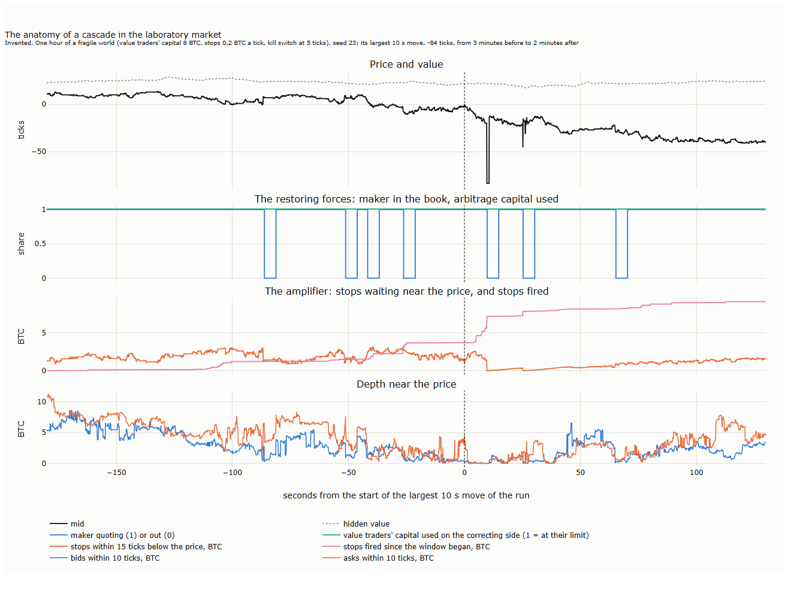
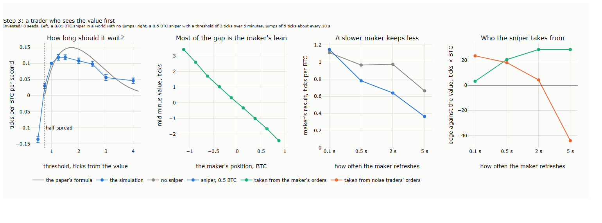
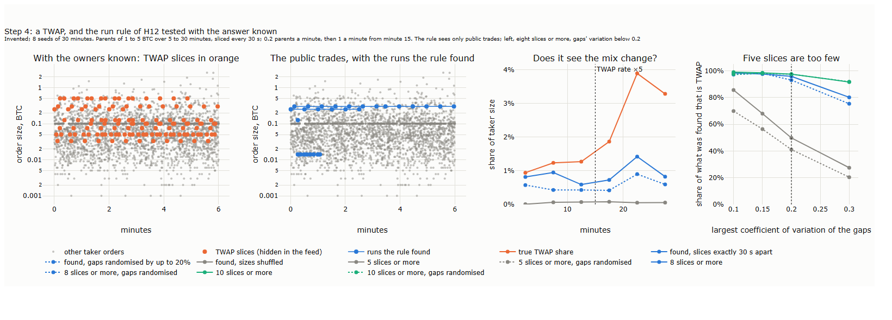
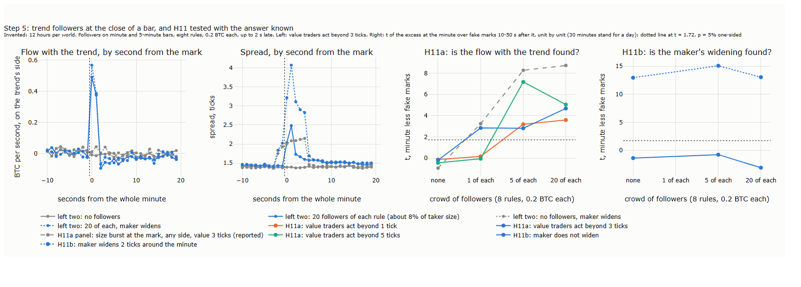
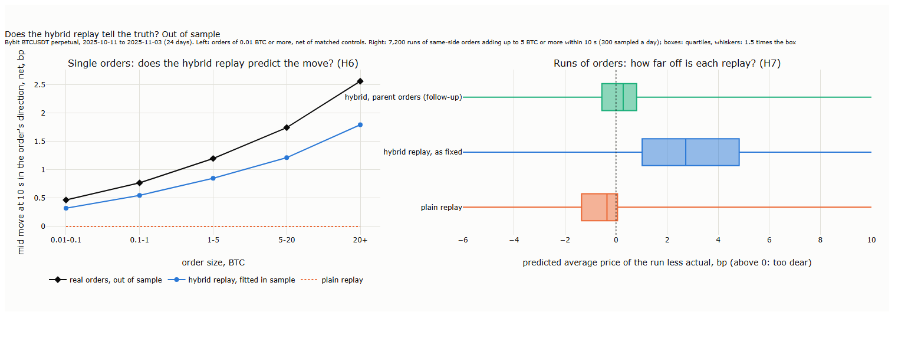
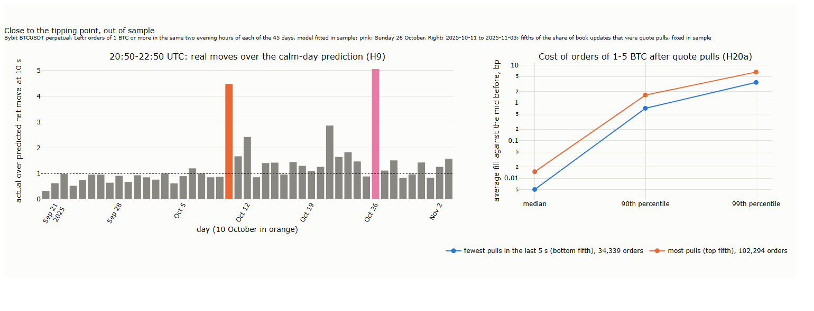

# Lecture 22: A Market That Reacts: Our Order's Footprint, Normal Slippage and the Tipping Point

*Systematic Trading: Lecture Notes (MSc) · Nov 9, 2026 · Max Gnesi*

The hypotheses were fixed before any of their results were computed ([results/hypotheses.md](results/hypotheses.md)); every change to them is dated there.

Lecture 21 replayed the recorded Bybit book as if our orders were invisible: nobody answered them, and what they took came straight back. This lecture lets the market react, and its central idea is that the reaction is made by people with rules: market makers, arbitrageurs, snipers, slicers, trend followers, stops. How each of them behaves, and what their behaviour adds up to together, decides whether a market absorbs our order calmly or tips into a move that feeds on itself, and the lecture asks why. A laboratory market, a small simulated exchange in which every trader's rule is known, shows the mechanisms; a **hybrid replay** on Bybit's BTCUSDT perpetual, 20 September to 3 November 2025, measures what our order costs in normal conditions and which states of the book come close to the tipping point. Companion notebook: [22_a_market_that_reacts.ipynb](22_a_market_that_reacts.ipynb).

## 1. One order, two replays

A plain replay forgets our order at once. The hybrid replay keeps the recorded book as its background and adds what real orders of the same size were measured to do: the price moves and only slowly comes back, and what we took returns only in part. The difference fits in one chart:


<sub><b>How to read the figure.</b> <b>Axes.</b> Both panels: seconds after the order (x). Left: the mid's move since the order, in basis points (bp; 1 bp was about USD 12 on that day). Right: how much of the 5 BTC our buy took is still missing from the levels near the best ask, in BTC. Bybit BTCUSDT, in sample. <b>Left:</b> our market buy of 5 BTC injected at a quiet moment of 5 October 2025 (no order of 1 BTC or more within 60 s), its mid net of the market's own moves: plain replay (orange) and hybrid replay (blue). Diamonds and grey band: the average net move after real buys and sells of 4 to 6 BTC, 20,244 orders, with a 95% band over resampled days. Grey line: one real buy of 5.8 BTC on the same day, the closest of 28 comparable buys to their average path; its mid then did not move for a minute. <b>Right:</b> plain replay (orange, nothing missing) and hybrid replay (blue); diamonds: the median for real orders of 4 to 6 BTC, scaled to 5 BTC, 22,808 orders.</sub>

| Seconds after the buy | Plain replay: mid | Hybrid replay: mid | Real orders of 4-6 BTC: mid | Hybrid: BTC still missing | Real orders: BTC still missing |
|---|---|---|---|---|---|
| 1 | 0 | 1.09 bp | 0.91 bp | 1.9 | 1.6 |
| 10 | 0 | 1.05 bp | 1.01 bp | 1.8 | 1.4 |
| 60 | 0 | 0.93 bp | 0.97 bp | 1.9 | 1.5 |

<sub><b>How to read the table.</b> The numbers behind the figure. Mid: the move in the direction of the order, net of the market's own moves (injected order) or of matched control moments (real orders, §3.1). Missing: of the 5 BTC taken, the size not yet standing again within the same number of levels of the new best. Our measurement for these notes, in sample.</sub>

The plain replay is wrong in both panels. The price does not forget a 5 BTC buy: a minute later real orders of that size still leave the mid about 1 bp higher, and the hybrid replay, built from them, does the same. Nor does the book give back what was taken: a minute later about 1.5 BTC of the 5 is still missing near the best. A second order sent soon after meets a dearer book. In a test run on 1 October at 14:30 UTC, a second 5 BTC buy 2 s after the first cost 0.004 bp in the plain replay and 1.08 bp in the hybrid one.

The chart shows the calm end of a wider picture, and the players are what move us along it. The cost of a market order depends on two things: its size, and the state of the market when it arrives. Think of it as **one map**, cost against size and state. Where the book is deep and the traders who supply liquidity stay, the map is smooth and a push fades, as in the chart: others take the other side of it at a profit. Where they withdraw, or run out of capital, and others add to the move instead, the same order can tip the market into a move that feeds on itself, and the map turns steep. Which end we are at is decided by how the players behave, one by one and together. The lecture has two aims, one for each end:

| Aim | The question | Where |
|---|---|---|
| Normal slippage | What does an order cost, and how does the price answer, when the market absorbs it? | The hybrid replay, §3 and §4 (H1 to H8) |
| The tipping point | In which states does the same order set off far more than itself, and can we read them before trading? | The laboratory market, §2, then 10 October and H9, H20 (§5) |

<sub><b>How to read the table.</b> One row per aim. The hypotheses are numbered as in [results/hypotheses.md](results/hypotheses.md).</sub>

The lecture runs as follows:

| § | Step | Question |
|---|---|---|
| 1 | One order, two replays | Does the market's reaction change what a replay reports? |
| 2 | A laboratory market | How does a push fade, and how does a market tip? |
| 3 | The reaction on our data | How far does the price move after real orders, does the book refill, and do others follow? |
| 4 | Does the hybrid replay tell the truth? | H1 to H8, out of sample (to follow) |
| 5 | Close to the tipping point | 10 October, H9 and H20 (to follow) |
| 6 | What it means for an algorithm | Which signals to read at each stage, what to do, and how to test in calm and fast markets |
| 7 | Summary, exercises and reading | |

## 2. A laboratory market

The mechanisms behind the map cannot be seen in Bybit's data, because the data never say who traded, who withdrew or whose capital ran out. This section builds them where they can be seen: a **laboratory market**, a small exchange in which a handful of traders follow written rules. It is a caricature on purpose. Physicists study magnets with a grid of arrows that no magnet resembles (the Ising model), because the grid shows how a sudden change arises from simple rules; Schelling (1971; 1978, ch. 4) showed with a board and two kinds of counters how mild individual preferences tip a whole neighbourhood. Our market is used in the same spirit.

**From players to the collective.** The point of the laboratory is to see how individual rules add up. The same traders produce three regimes:

| Regime | What the players do | What it adds up to | Why |
|---|---|---|---|
| Calm | Makers fill our order and lean their quotes; arbitrageurs trade the price back to its value | A push that fades within a minute: negative feedback | Each earns by taking the other side of our push, and has the capital and the quotes to do it |
| Near the tipping point | Makers pull their quotes after fast moves; arbitrageurs near their capital limits stop correcting; stops sit close to the price | A push that stays, and a cost with a fat tail: the restoring forces weaken while the amplifying ones wait | Pulling is rational for each maker when others pull (a run on liquidity); capital is finite (limits of arbitrage) |
| Cascade | Stops and forced closes fire into a thin book; trend followers and others join the move | A move that feeds on itself until the fuel near the price is used up: positive feedback | Each trade sets off more than one other, a chain reaction above its threshold; after it the book stays thin for a while (hysteresis) |

<sub><b>How to read the table.</b> One row per regime of the laboratory market (§2.1 to §2.4); the same traders appear in every row, only their state and their incentives change. On Bybit, the calm row is what the hybrid replay measures (§3, §4); the second is tested by H20 and the third by 10 October (§5).</sub>

**Why it is worth studying.** It gives four things real data cannot. The **counterfactual**: we copy the market at a moment and run it on with and without our order, which on real data is never possible. **Rare events on demand**: our 45 days hold one cascade, the laboratory thousands of near-tips. **Instruments checked before use**: a measure is first tried where the answer is known, as physicists inject fake signals into their own detectors. **Questions that transfer**: who supplies liquidity, how much capital is left to correct the price, where stops lie. What it does not give is numbers about Bybit. Every size, rate and threshold in it is invented, prices are in ticks of an invented market, and the size of any effect on Bybit is left to Sections 3 to 5. Every figure from it is marked *Invented*.

**How the traders are built.** Each trader is a small object with a written rule, a wake-up time and a record of its orders; the exchange runs whichever wakes first, matches orders by price and then time, and publishes only what Bybit publishes: the book every 100 ms without owners, and the trades without names. Traders are added one at a time, and each is checked on cases computed by hand before it joins.

| Trader | Rule | Stands for | Anchored in |
|---|---|---|---|
| Noise traders | Limit orders, market orders and cancellations at random rates | Everyone whose reasons we cannot model | Zero-intelligence traders of the simulation literature |
| Value traders | Trade towards a hidden value when the gap exceeds a threshold; capital limited or not | Arbitrageurs who tie the price to its value | Limits of arbitrage (Shleifer and Vishny, 1997) |
| Market maker | Quotes a ladder around its estimate of the value, leaning against its position; may pull all quotes after a fast move (kill switch) and quote one side beyond a position limit | Liquidity providers | Inventory models of market making |
| Sniper | Sees the value first and trades when the mid is a set distance from it, holding until the other edge | A fast trader who picks off stale quotes | Stale-quote sniping (Budish, Cramton and Shim, 2015, a model result); the band rule of Rabechini Amaral (2026) |
| Slicer (TWAP) | Splits a parent order into equal market orders every 30 s | A trader working a large order over time | Bybit's TWAP tool, default interval 30 s |
| Trend followers | At each bar close, compare a fast and a slow average of the mid and go long or short | Bar-based trend rules | Bursts of trading at clock marks (Kim and Hansen, 2026, preprint) |
| Scalper | Joins the best price, exits a few ticks better or at a stop | A one-level market maker, the floor scalper | Silber (1984) |
| Stops and liquidations | Rest at a density around the price; a move through them becomes a market order in the same direction | Stop-losses and forced closes of leveraged positions | |

<sub><b>How to read the table.</b> The traders of the laboratory market. The hidden value moves as a random walk, with occasional jumps where a sniper is present. The code and its hand-case checks are in `scripts/l22_sim.py` and `scripts/checks/test_sim.py`. How each style can be recognised from public data alone, and how far our measures succeed where the answer is known, is the subject of the lecture on trading styles that follows this one.</sub>

### 2.1 The calm side: why a push fades

**Key message.** A push fades when someone takes the other side of it at a profit: first the market maker, then the arbitrageurs.

The mechanism, traced in the laboratory: our buy of 5 BTC is filled partly by the market maker, which is left short. It moves its quotes up to shed that position, and the mid rises further for about a second. Then the value traders sell into the higher price and take the position over, and the price returns towards the value.

| Seconds after our buy | Mid, with our buy less without | Market maker's position | Value traders' position |
|---|---|---|---|
| 0 | +2.7 ticks | filled 1.9 of our 5 BTC | |
| 1 | +4.6 | −1.8 BTC, quotes leaned up about 7 ticks | −0.2 BTC |
| 10 | +1.8 | −0.5 | −1.7 |
| 60 | +0.4 | −0.1 | −4.1 |

<sub><b>How to read the table.</b> <i>Invented.</i> The same market copied at 30 moments and run on with and without our buy; averages. Positions are the change caused by our buy.</sub>

This is the inventory story of market-making theory, and it is plausible. Two features of it are built in rather than found. The fade is assumed, because the value moves on its own and the value traders always pull the price back to it. And impact is linear in size, because the maker leans by a fixed number of ticks per BTC; on real data impact grows much more slowly than size (§3.1).


<sub><b>How to read the figure.</b> <b>Axes.</b> Left: seconds after our buy (x), mid with our buy less without, ticks (y). Middle and right: one row per world (y); response at 10 s and cost, ticks (x). <i>Invented</i>; 3 seeds × 40 moments per world. Bars: ± one standard error.</sub>

Adding a sniper, a slicing trader, trend followers or a scalper one at a time, each at a small share, leaves the response within one standard error of the base world. What changes is the cost: with jumps in the value, a 5 BTC buy costs 4.5 to 4.8 ticks against 3.5 in calm worlds, because the book is thinner and more often stale.

### 2.2 The tipping side: three dials

**Key message.** A market tips when the traders who absorb a push are out of capital, out of the book, or outnumbered by those who add to it.

Three dials turn the laboratory towards the tipping side. The value traders' **capital**: a position beyond which they stop correcting the price, the limits of arbitrage of Shleifer and Vishny (1997). The market maker's **kill switch**: it pulls all its quotes for 5 s after a move of 5 ticks within a second, and with a position beyond its limit quotes only the side that reduces it. **Stops**: a density of stop orders around the price, which a move turns into market orders in the same direction.


<sub><b>How to read the figure.</b> <b>Axes.</b> First panel: seconds after our sell (x), mid with our sell less without, ticks (y). Second: the price against the value when we sell (x), the move left after 60 s (y). Third and fourth: the maker in or out, and fifths of depth within 10 ticks (x), cost of a 10 BTC sell, ticks (y). <i>Invented</i>; 16 worlds × 3 seeds × 20 moments, our market sell at copied moments, pooled. Bars: ± one standard error.</sub>

Read by the state at the moment of the order, two results stand out.

| State when our 10 BTC sell arrives | Moments | Move left after 60 s | Median cost | 90th percentile of cost |
|---|---|---|---|---|
| Price within 3 ticks of the value | 425 | −1.8 to −2.3 ticks | | |
| Price more than 3 ticks from the value, either side | 535 | −7.3 to −7.9 ticks | | |
| Market maker in the book | 465 | | 7.3 ticks | 12.7 ticks |
| Market maker out (kill switch) | 15 | | 14.4 ticks | 26.0 ticks |

<sub><b>How to read the table.</b> <i>Invented.</i> The 960 moments of the figure. The upper rows split by the gap between price and value; the lower rows use the worlds with a kill switch. The maker was out in only 15 of those moments, so its percentiles are rough.</sub>

**A loose anchor.** When the price is already far from the value, in either direction, the arbitrageurs have stopped correcting it, and any push stays. Moved towards the value, it stays because we did their work; moved further away, because nobody is left to push back. A first draft of hypothesis H20 expected the direction to matter; the laboratory showed it is the size of the gap.

**A fat tail.** With the maker out of the book, the median cost of a 10 BTC sell doubles and its 90th percentile more than doubles. The tail, not the average, carries the risk, so this lecture reports costs as percentiles.

**Physics: a chain reaction.** If each trade or quote withdrawal sets off on average n others, a push of size 1 has a total effect of about 1/(1 − n): it dies out while n stays below 1 and runs away as n reaches 1, as in a reactor going critical. The quantity is the branching ratio of a Hawkes process, which Lecture 20 measured on Bybit. Whether markets sit near n = 1 is disputed. On E-mini S&P 500 futures, Filimonov and Sornette (2012) found n rising from about 0.3 in 1998-2000 to 0.7-0.8 after 2007, and 0.95 in the flash crash of 6 May 2010; Hardiman, Bercot and Bouchaud (2013), fitting a kernel with a longer memory to the same market, found it close to 1 throughout. Fosset, Bouchaud and Benzaquen (2020) found that liquidity falls after volatility and price trends, and built an order-book model in which that feedback produces exactly such a threshold: stable for weak feedback, crises with certainty above it.

**Physics: slowing down before the edge.** Near a tipping point a system recovers ever more slowly from small shocks (Scheffer et al., 2009). In a book, recovery is the refill of what an order took (§3.2); a refill that slows is the textbook early warning. The warning is not guaranteed: later work found cases where it does not appear or comes too late.

**Game theory: a run on liquidity.** A kill switch is rational for each maker: when others pull, the one who stays is left alone against the flow. Each maker's best move depends on what the others do, so the market has two stable outcomes, all stay or all pull, as in a bank run (Diamond and Dybvig, 1983). Morris and Shin (1998) showed that when each player has only a noisy private view of the fundamentals, the outcome becomes unique and the fundamentals decide it. The rule that protects each maker makes the market fragile for all.

### 2.3 From calm to cascade, step by step

**Key message.** A cascade does not come from nowhere: the restoring forces wear away first, quietly, and only then does a small push set off a chain reaction that runs until its fuel is spent.

To see the passage slowly, one fragile world of §2.2 (value traders' capital 8 BTC, stops, a kill switch at 5 ticks) was run for an hour and recorded every 100 ms. Its largest move, 84 ticks within 10 seconds, is shown from three minutes before to two minutes after.


<sub><b>How to read the figure.</b> <b>Axes.</b> All panels: seconds from the start of the largest 10 s move of the run (x). Top: mid and hidden value, ticks from the mid at 0 s (y). Second: the market maker quoting (1) or out (0), and the share of their limit the value traders have used on the side that would correct the move (1 = no capital left) (y). Third: stops within 15 ticks below the price, and stops fired since the window began, BTC (y). Bottom: bids and asks within 10 ticks of the mid, BTC (y). <i>Invented</i>; one hour of one fragile world, seed 23.</sub>

| Stage | Seconds | What the players do | What it adds up to | What could be seen |
|---|---|---|---|---|
| 1. Loading | −180 to −90 | The price has drifted 17 ticks below the value; the value traders are at their limit and stop buying | The restoring force from capital is gone, invisibly: the price looks calm | Depth near the price falling (from 14 to about 12 BTC); a lasting gap to the value |
| 2. Flickering | −90 to 0 | The maker's kill switch fires four times: out 22% of the time; stops fire in small bursts (2.5 BTC) | The second restoring force flickers; each small move meets less depth | Quote pulls in bursts; depth near the price down to 5 BTC; the spread widening |
| 3. Trigger and chain reaction | 0 to 15 | A small push meets an empty bid side: 3.5 BTC of stops fire, the maker is out a third of the time | Each sale sets off more: the mid falls 14 ticks at the median and 84 at the worst moment, when the bid side is empty | Bids within 10 ticks at zero; trades at prices far through the book |
| 4. Exhaustion | 15 to 40 | The stops near the price are used up (from 1.6 to 0.2 BTC); the maker returns more often | The chain stops for lack of fuel, not because anyone corrects the price | Stops firing slows; depth starts to return (0.4 to 0.7 BTC) |
| 5. Aftermath | 40 to 130 | Depth rebuilds slowly; the value traders are still at their limit | The price stays 36 ticks lower and 59 below the value: nobody has the capital to pull it back | Depth at about 5 BTC against 14 before; a large lasting gap to the value |

<sub><b>How to read the table.</b> <i>Invented.</i> One row per stage of the recorded episode; numbers are medians over the stage unless stated. The stages are our reading of one episode; other episodes of the same world differ in timing, not in order.</sub>

Three features matter. First, the price is the last thing to show the danger: in stages 1 and 2 it barely moves while the forces that would hold it erode. Second, the withdrawal flickers before it breaks: the maker steps out and back in several times, the pattern that Scheffer et al. (2009) list among the signals of an approaching transition. Third, a cascade ends when its fuel is spent, not when someone corrects it; if the capital that would correct it is still exhausted, the price stays where the cascade left it, the hysteresis of §5.

### 2.4 Ignition, by itself and on purpose

**Key message.** A large enough push into a fragile book sets off stops and withdrawals; nobody needs to intend it, and intending it does not pay in our laboratory.

**Momentum ignition** is the name for trading aggressively to set off others' rules and then trading against the move. The US Securities and Exchange Commission described it in 2010 as initiating "a series of orders and trades ... in an attempt to ignite a rapid price move", for instance to "trigger standing stop loss orders", and its staff reviewed the evidence in 2014. Manipulation is illegal, and the practice raises that concern; it is shown here as a risk to recognise, not a strategy. Brunnermeier and Pedersen (2005) give the game-theoretic version: traders who sell ahead of a distressed seller and buy back after.


<sub><b>How to read the figure.</b> <b>Axes.</b> All panels: the value traders' capital (x). Left: 10 s windows with a move of 15 ticks or more, per hour (y). Middle: profit per BTC of selling 10 BTC and buying back at the market 60 s later, ticks (y). Right: share of such round trips with a profit (y). <i>Invented</i>; 3 seeds × 20 moments per world. Bars: ± one standard error.</sub>

**By itself.** Jumps of 15 ticks within 10 s appear only where stops, a kill switch and limited capital come together, 5 to 8 an hour, and not in every such world; no single ingredient produces them. The counts are small, one simulated hour per world, so the pattern across capital settings is not read further.

**On purpose.** Selling and buying back at the market loses on average in every world, by 1.4 to 20 ticks per BTC: paying the spread and the impact twice outweighs the overshoot. In fragile worlds 20 to 40% of round trips profit, a lottery with a negative mean. The kill switch hurts the pusher too: with makers out, up to 30% of a 10 BTC buy-back cannot be filled at once. Our pusher is naive; one that placed resting orders below the price before pushing, and collected the cascade as a maker, was not tested. Whether that version pays is an open question, so these results show only that the naive round trip does not.

### 2.5 Who reacts to our order, and how

**Key message.** An algorithm is engineered against other traders: each type changes the market on its own, and each meets our order differently depending on whether we take liquidity (a market order) or provide it (a resting order).

The laboratory lets each type be added alone, so its effect on the market and on our order can be traced, and it lets us test, with the answer known, whether that type leaves a footprint public data could reveal. The table reads across: what the trader does to the market, what it does to our market order, what it does to our resting order, and whether we can see it.

| Trader | Its effect on the market | Our market order meets it | Our resting order meets it | Can we see it? (laboratory, answer known) |
|---|---|---|---|---|
| Market maker | Supplies most of the depth near the best; leans its quotes against its position; may pull everything after a fast move | It fills us, then leans: the price moves further for about a second and our next slice pays more (§2.1). If it has pulled, we walk a thin book and land in the tail of the cost (§2.2) | It competes with us for the front of the queue. When it pulls in a fast move, our order is left at the front alone and filled just before the price runs through (adverse selection, Lecture 21) | Its pulls are visible in the book (Lecture 18); on Bybit they predict a fatter cost tail (H20a, §5) |
| Value traders (arbitrageurs) | Tie the price to its value; with limited capital they stop, and mispricings linger | They take the other side after us and pull the price back: our push fades, and a later slice is cheaper. Out of capital, our push stays (§2.2) | They fill our resting order when the price has moved away from the value, so its fills tend to come when the price is about to return | Not directly; the gap to another venue stands in for it, and did not predict persistence on Bybit (H20b, §5) |
| Sniper | Removes stale quotes the moment the value moves; makes slow quoting costly | Competes with us for the same price after news; if it is faster, we pay the moved price | Takes our quote the moment it is stale: our resting order is filled exactly when it is wrong (§2.5, step 3) | Not from the book: the losers of a race leave no trace (Aquilina, Budish and O'Neill, 2022) |
| Slicer (TWAP) | Steady one-sided flow at regular intervals; adds pressure in one direction without reacting | Trading with its side adds to its pressure; against it, it is a predictable counterparty | Fills our resting orders on the other side steadily, with little information in the fills | Yes: runs of eight or more equal orders at regular gaps; 93 to 96% of what the rule finds is a TWAP, but it finds only about 40% |
| Trend followers | Flow in the direction of recent moves, bunched just after each bar close | A push near a crossing can set them off and move the price further than our order alone; sending into the seconds after a minute meets their burst | In the seconds after a whole minute, their flow fills resting orders against the trend, at a moment when the price tends to continue | Yes, through the clock: flow with the trend just after whole minutes is found from about 1% of taker size; a crossing rule finds nothing, because others take the flow back |
| Scalper | A thin layer of quotes at the best that comes and goes | Provides a little depth at the best, gone after one fill | Stands ahead of us in the queue and leaves quickly, so our place in line is less certain | Only partly: an echo at its exit distance, but a market maker with a fixed order size leaves the same echo |
| Stops and liquidations | Turn a move through crowded levels into more selling or buying | A large order through their levels sets them off: we pay for our own move and for theirs | A resting order on the other side is filled by the cascade, at prices that keep running | Not in our data: Bybit publishes no history of liquidations; falling open interest stands in for them |

<sub><b>How to read the table.</b> One row per trader type of the laboratory market. "Market order": our order takes liquidity at once; "resting order": it waits in the book to be filled. In the middle columns, entries with a section or lecture reference were measured there; the others follow from the traders' rules and are open questions for our data, not results. The last column reports what our measures recovered where the truth was known (<i>Invented</i> data); whether the same footprints appear on Bybit is tested in the lecture on trading styles that follows. Our own measures and settings, not validated against identified traders.</sub>

Four lessons follow for anyone engineering an order. First, the side we choose decides whom we meet: a market order meets makers, snipers and stops; a resting order meets them too, but on their terms, filled when they want to trade, which is when it is worst for us. Second, the traders who answer within a second, the maker and the sniper, decide the cost of a single order; those who answer on a clock or at a price level, trend followers and stops, decide what a push does over minutes. Third, a footprint that others absorb is invisible: the trend followers' crossing flow vanished because value traders took it back. Fourth, the types that matter most for the tail of our cost, the maker who pulls and the stops that fire, are those whose withdrawal or arrival is quickest.


<sub><b>How to read the figure.</b> <i>Invented.</i> How a sniper that sees the value first feeds on stale quotes: its threshold against the band rule of Rabechini Amaral (2026), the gap it trades, and what it takes from the maker as the maker refreshes its quotes more slowly. With jumps in the value, the maker's margin per BTC falls from 1.15 to 0.36 ticks as its refresh slows from 0.1 s to 5 s with a sniper present, against 1.11 to 0.66 without.</sub>


<sub><b>How to read the figure.</b> <i>Invented.</i> A slicer's orders hidden in the public trades, the runs our rule finds, how the found share follows a change in the slicer's rate, and why five slices were too few: chance runs among other orders matched them. Eight slices or more, gaps varying by less than a fifth.</sub>


<sub><b>How to read the figure.</b> <i>Invented.</i> Flow with the trend and the spread, by second around each whole minute; how strongly each measure finds crowds of trend followers of growing size; and a maker that widens before the minute, found by the spread just before it.</sub>

## 3. The reaction on our data

Section 2 showed how a push fades or tips where every rule is known. This section measures, on Bybit, what the hybrid replay needs: how far the price moves after real orders, whether what they took comes back, and whether other traders follow. Everything here is estimated in sample, 20 September to 9 October 2025 (20 days); Section 4 tests it on the 24 days after 10 October.

**Real orders and their controls.** A real order is the trades with the same millisecond and side (Lecture 19). Its move is compared with that of control moments: one random moment in every 10 s, matched on the same day and hour, the decile of the imbalance at the best, whether the mid fell, held or rose over the last second, the third of the market's activity in the last 10 s, and the quarter of the last 10 s of taker size that was on the order's side. The last two were added after an in-sample look, before any out-of-sample use, for a reason given in §3.3.

### 3.1 How far does the price move?

**Key message.** The price moves in the direction of an order, far less than in proportion to its size, and the move of large orders fades within minutes.

```math
R(\tau) = c(\tau)\, S^{\delta(\tau)}
```

| Symbol | Meaning |
|---|---|
| $`R(\tau)`$ | the move of the mid in the order's direction, $`\tau`$ seconds after it, net of its controls, in bp |
| $`S`$ | the order's size in BTC |
| $`\delta(\tau)`$ | how fast the move grows with size: 1 is in proportion, 0.5 a square root, 0 no growth |
| $`c(\tau)`$ | the move of an order of 1 BTC |


<sub><b>How to read the figure.</b> <b>Axes.</b> Left and middle: seconds after the order (x), the mid's move in the order's direction, net of controls, bp (y). Right: order size (x), cost, bp, log scale (y). BTCUSDT, 20 September to 9 October 2025; orders of 0.01 BTC or more. Left: by size class; middle: by size relative to the size at the best on the side taken; right: median, 90th and 99th percentile of cost (average fill against the mid before). Bands: 95% over resampled days.</sub>

| Order size | Orders | 1 s | 10 s | 300 s |
|---|---|---|---|---|
| 0.01-0.1 BTC | 1,891,435 | 0.30 bp | 0.31 | 0.40 |
| 1-5 BTC | 154,489 | 0.87 | 0.90 | 0.80 |
| 5-20 BTC | 26,147 | 1.24 | 1.30 | 0.67 |
| 20 BTC or more | 4,613 | 2.03 | 1.66 | 0.48 |

<sub><b>How to read the table.</b> Net move in the order's direction, in sample. Our measurement for these notes.</sub>

Fitted on the classes, $`\delta`$ is 0.27 at 1 s and 0.24 at 10 s: an order 10 times larger moves the price less than twice as far, flatter than the square root (δ about 0.5) that Donier and Bonart (2015) report for bitcoin, a comparison our out-of-sample test H2 takes up. Orders of 20 BTC or more move the price most after a second and keep about a quarter of it after five minutes; small orders' moves do not fade at all, because small orders come in streams on the same side (Lecture 20), and the stream carries the price on. Size relative to the queue at the best separates the curves less than size in BTC; which of the two predicts better out of sample is H5.

**Cost is a distribution.** Below 5 BTC the median order pays nothing measurable: it fills at the best, and half a spread is 0.004 bp at this price. Yet the 99th percentile is 3.5 bp for orders of 1 to 5 BTC and 8.0 bp for 20 BTC or more. An average would hide that most orders pay nothing and a few pay a lot, the pattern the laboratory linked to makers out of the book (§2.2) and H20 tests on Bybit.

### 3.2 Does what an order took come back?

**Key message.** The depth an order took does not return at the prices it took; it re-forms around the new best, and more slowly after larger orders.


<sub><b>How to read the figure.</b> <b>Axes.</b> Left and middle: seconds after the order (x). Left: share of orders with 90% of the depth back (y); middle: depth standing over depth the order met, median (y). Right: order size (x), BTC, log scale (y). Real orders of 1 BTC or more, depth on the side they took: at the prices the order took (dotted) and over as many levels from the new best (solid). Right: extra taker size on the order's side in the next second, net of controls, and the order's own size.</sub>

At the prices an order took, the median share standing again is 0% from half a second on: the price has moved away from them. Over as many levels from the new best, 75% stands again within half a second and about 90% from five seconds on, after orders of 1 to 5 BTC. After orders of 5 to 20 BTC the refill stops at about 60 to 65%, which is why the key chart's 5 BTC order still misses about 1.5 BTC a minute later. The hybrid replay therefore refills around the new best, by size class.

### 3.3 Do others follow?

**Key message.** Much more trading follows an order on its side than at control moments, but most of it is a stream already under way, not a reaction to the order.

At first look, an order of 0.01 to 0.1 BTC was followed within a second by 1.9 BTC more than its controls on the same side, 50 times its size. Matching on the market's activity changed this little. What explained it was a stream already running. On 1 October, orders of 20 BTC or more were followed by 49 BTC on their side when more than three quarters of the last 10 s of taker size had been on that side, and by 6 BTC when less than a quarter had. Order signs have long memory: a buy is followed by buys far longer than chance allows (Lillo and Farmer, 2004). The splitting of large orders into many pieces was proposed as its cause and formalised by Lillo, Mike and Farmer (2005).

An order of ours has no stream behind it, so the controls now also match the share of the last 10 s on the order's side. The follow-on falls only modestly, to 28 BTC after orders of 20 BTC or more, because an order of a given size also tells that a large trader is active now. Without trader identities, public data cannot separate a reaction from the same trader's next slices. The hybrid replay therefore takes its triggered trading (layer D) from orders that came against the recent flow, the closest real cousins of an order with no stream, and reports the full-sample curve as an upper bound.

### 3.4 The hybrid replay

The pieces add up to a replay that keeps the recorded book as its background:

| Layer | What it does | Estimated in |
|---|---|---|
| A. Depletion | What our order took is removed from the levels near the best, at the same distance from the best | Bookkeeping |
| B. Refill | It comes back along the measured curve, by size class | §3.2 |
| C. Impact | The mid, and the book with it, moves by $`R(\tau)`$ for our size, held at its 300 s value afterwards | §3.1 |
| D. Triggered trading | Extra taker size on our side, which can fill our resting orders; it does not move the price again | §3.3 |
| E. Reaction to resting size | Lecture 21's curve, if it passes H8 | §4 |

<sub><b>How to read the table.</b> Each layer is switched on one at a time, and an order's cost is reported layer by layer. Code: `scripts/l22_hybrid.py`; hand cases in `scripts/checks/test_sim.py`.</sub>

**No double counting.** The measured move $`R(\tau)`$ already contains everything the market did after real orders, the refill and the trading that followed included. So the mid comes from layer C alone; the levels that layers A and B leave empty only make our next order's walk dearer. Holding $`R`$ at its 300 s value, rather than letting the book return to the record, keeps a lasting part of the impact from being erased; the test of whether that is right is H3.

## 4. Does the hybrid replay tell the truth?

The hybrid replay predicts single orders better than the plain one, but as fixed it overstates what a run of orders costs. Every curve, fit and boundary comes from the in-sample days; the tests use the 24 days from 11 October to 3 November 2025, with one-sided p-values from 2,000 resamples of days and Benjamini-Hochberg at 5% over the ten primary tests (H1 to H7, H9, H20a, H20b).

| Question | Hypothesis | Result | p | Corrected | Verdict |
|---|---|---|---|---|---|
| Does depth return faster around the new best than at the prices taken? | H1 | 28 percentage points more orders with 90% back within 1 s | < 0.001 | 0.001 | Holds |
| Does the move grow less than in proportion to size? | H2 | δ = 0.23 (95% 0.22 to 0.25) | < 0.001 | 0.001 | Holds |
| Does the move of orders of 5 BTC or more fade from 60 s to 300 s? | H3 | 0.38 bp (−0.03 to 0.84) | 0.038 | 0.063 | Fails after correction |
| Do large orders draw more trading on their side? | H4 | 10.0 BTC more after 5-20 BTC than after 0.1-1 BTC | < 0.001 | 0.001 | Holds |
| Is size relative to the queue the better scale? | H5 | No: the model in BTC has the lower error | 1.00 | 1.00 | Fails |
| Does the hybrid replay predict single orders better than the plain one? | H6 | Lower error at 10 s, by 1.37 bp² | < 0.001 | 0.001 | Holds |
| Does it predict runs of orders better? | H7 | No: average error 3.5 bp against 1.3 | 1.00 | 1.00 | Fails |
| Was 10 October's reaction the most out of line? | H9 | Second of 45 days | 0.044 | 0.064 | Fails after correction |
| Is the tail of the cost fatter after quote pulls? | H20a | 90th percentile 1.62 bp against 0.72 | < 0.001 | 0.001 | Holds |
| Does a push last longer when Bybit is far from Binance? | H20b | 0.93 of the 1 s move left at 60 s against 0.89 | 0.33 | 0.42 | Fails |

<sub><b>How to read the table.</b> One row per test, in the plain question it answers; the wording of each hypothesis is in [results/hypotheses.md](results/hypotheses.md). p: one-sided, from resampled days ("< 0.001": none of the 2,000 resamples on the wrong side). Corrected: Benjamini-Hochberg over the ten tests. Our measurement for these notes.</sub>


<sub><b>How to read the figure.</b> <b>Axes.</b> Left: order size (x), mid move at 10 s in the order's direction, net of controls, bp (y). Right: one row per replay (y), predicted average price of a run less its actual average price, bp (x); above 0 the replay makes the run too dear. BTCUSDT, 11 October to 3 November 2025. Left: real orders (black), the hybrid replay's prediction fitted in sample (blue) and the plain replay's (orange, zero). Right: 7,200 runs of same-side orders adding up to 5 BTC or more within 10 s, 300 sampled a day; boxes: quartiles; whiskers: 1.5 times the box.</sub>

**Single orders.** The plain replay predicts no move; real orders move the price, so the hybrid replay is closer at every size (H6). It is too low by about a quarter: out of sample, real moves were 1.33 times its prediction. The days after 10 October had a thinner book than the days it was fitted on (§5), and the same order moved the price further. Size in BTC predicted better than size relative to the queue (H5), against our expectation; the halving of the queue after 10 October did not make relative size the better scale. The move grows with an exponent of about 0.23, already between the two smallest classes (0.22), so we see no near-linear regime for small orders.

**Runs of orders.** As fixed, the hybrid replay charged each slice of a run its own impact and added them up. With an exponent of 0.23, a small order carries a large impact per BTC, so ten slices of 0.5 BTC add up to several times the impact of one order of 5 BTC: the replay made runs too dear by 3.0 bp on average, and was closer than the plain replay in only 15% of them (H7 fails). A follow-up, run after the result and not a test, charges a run the impact of its cumulative size, as impact laws for split orders are stated: the bias falls to 0.13 bp and the average error to 1.23 bp, slightly below the plain replay's 1.29 (difference 0.05 bp, 95% 0.03 to 0.07). Impact that grows more slowly than size cannot be added slice by slice.

**Refill and follow-on trading.** Out of sample, depth again re-formed around the new best rather than at the prices taken (H1), and larger orders were followed by more trading on their side (H4), with the caveat of §3.3 that much of it is a stream already under way. Whether the move of large orders fades from one to five minutes is not settled: the difference has the expected sign but does not survive the correction (H3).

**A condition on layer E (H8).** Lecture 21 measured that the price moves away from large size added at the best: 0.25 bp after a second for additions as large as the queue. Built into a replay, that reaction offers a seller a gift: post a bid as large as the queue, sell 0.001 BTC at the ask a second later, cancel the bid. At zero fee, in 89% of 7,200 such round trips the version with the bid ended ahead by exactly that 0.25 bp. On average it lost (−0.60 USDT per round trip, 95% −1.13 to −0.16), because in the other cases the large bid was hit and bought several BTC just before the price fell; with fills only when the price went through the bid, the loss was larger (−1.81 USDT). So the condition holds and layer E is kept, reported as a band, E on against E off. The caveat is plain: a trader who could cancel just before being filled would collect the reaction every time, which is why that behaviour is banned as spoofing.

## 5. Close to the tipping point

The calm-day replay holds near the calm end of the map. Near the other end, two results stand out: the tail of the cost fattens after quote pulls, as the laboratory predicted, and after the cascade of 10 October the market stayed more reactive for weeks.


<sub><b>How to read the figure.</b> <b>Axes.</b> Left: day (x), real net move at 10 s over the move predicted from the calm days (y), orders of 1 BTC or more between 20:50 and 22:50 UTC. Right: three points of the cost distribution (x), cost of orders of 1 to 5 BTC, bp, log scale (y). Left: 10 October in orange, Sunday 26 October in pink, the dotted line where real equals predicted. Right: orders in the fifth of moments with the most quote pulls in the last 5 s (orange) and the fewest (blue), fifths fixed in sample; 11 October to 3 November 2025.</sub>

**The cost tail after quote pulls (H20a).** In the fifth of moments with the most quote pulls in the 5 s before, orders of 1 to 5 BTC had a 90th percentile of cost of 1.62 bp, against 0.72 bp in the fifth with the fewest; the 99th percentile was 6.6 against 3.5 bp. The median barely moved, 0.015 against 0.005 bp. This is the laboratory's mechanism seen on real data: when makers withdraw, most orders still fill at the best, and a few walk a thin book. Pulls are measured before our order is sent, so they can be read in time.

**A loose anchor (H20b).** The laboratory found that a push stays when the price is already far from its value. With the gap between Bybit and Binance standing in for that distance, the difference is small and not significant (0.93 against 0.89 of the 1 s move left after a minute). Two venues of the same contract are rarely far apart for long, and the gap may measure their disagreement rather than a lost anchor; at this resolution the laboratory's result does not carry over.

**10 October (H9).** Between 20:50 and 22:50 UTC on 10 October, orders of 1 BTC or more moved the price 4.5 times as far as the calm-day replay predicted. Only one evening was further out of line: Sunday 26 October, with 1,807 orders against 20,756, where the same ratio reached 5.1. So 10 October ranks second of 45, and H9 does not survive the correction. The model relative to the queue was no closer to 1 on 10 October (5.3). The cascade evening was extreme in how far each order moved the price, but a thin Sunday evening can match that ratio on far fewer orders; what set 10 October apart was the size of the move and the number of orders, not the reaction per order.

**10 October, stage by stage.** Our data cannot see capital or stops, but the timing of the book and the flow fits the same stages, with one difference: the trigger was news.

| Stage | Laboratory (§2.3) | 10 October 2025, Bybit (UTC) |
|---|---|---|
| Loading | Capital at its limit, depth thinning, price calm | Not visible: no measure of Lectures 19 and 20 warned before the post (Lecture 20, §4.3) |
| Trigger | A small push into a loaded book | The tariff post at 20:50:01.7: news, not a push |
| Withdrawal | The maker flickers out | Quote pulls and refill chains flagged at 20:55; depth at 20:58 |
| Chain reaction | Stops fire into an empty book | The branching ratio flagged at 21:04; at 21:14 the first minute larger than any calm-day minute, the mid down USD 977; 426 bp from the post to then |
| Aftermath | The price stays down, depth rebuilds slowly | Orders moved the price 1.4 times as far as before for three weeks (below) |

<sub><b>How to read the table.</b> Left: the stages of the laboratory episode. Right: the times measured on Bybit in Lecture 20, §4, and in this section. On 10 October the stages are inferred from the book and the flow; who withdrew and whose stops fired cannot be seen.</sub>

**After the cascade.** The left panel shows something no test asked about. Before 10 October the evening ratio sat below 1 (median 0.86); after it, above 1 on three evenings in four (median 1.42). The market stayed more reactive for at least three weeks after the cascade, as the thinner book of Lecture 20 already suggested. In the language of §2, this is hysteresis: after tipping, the system does not return at once to where it was. It is also why a replay calibrated before an event understates what orders cost after it, by about a third here.

## 6. What it means for an algorithm

The players and their stages are not only a description of the market; they are what an algorithm meets. This section draws the consequences: what to watch, what to do, and how to test it, in calm markets and in fast ones.

### 6.1 Signals and actions by stage

| Stage | The signal an algorithm can read | What it should do |
|---|---|---|
| Calm | Depth at its usual level, few quote pulls, the gap to other venues small | Trade normally; size and expect cost from the hybrid replay, as a distribution (median and 90th percentile, §3.1) |
| Loading | Depth falling against its usual level; a lasting gap to other venues; extreme funding or open interest | Cut the size of each order relative to depth; keep resting orders small; raise the cost assumption |
| Flickering | Quote pulls in bursts (H20a: the tail of cost doubles in the top fifth); the spread widening | Stop sending large market orders; slice more slowly and wait for refills; pull resting orders from the side a fall would hit |
| Chain reaction | Depth near zero on one side; trades far through the book; the branching ratio high | Do not chase and do not be the trigger; quote only if the strategy is built and capitalised to absorb the flow; let the algorithm's own kill rules act |
| Exhaustion and aftermath | Depth returning; stops firing slowing; costs still above normal | Return gradually; recalibrate cost curves, which can stay higher for weeks (1.4 times after 10 October, §5) |

<sub><b>How to read the table.</b> The signals in the middle column are measured on our data where a section is given (H20a, §5); the actions are our design suggestions, not tested results. The thresholds that turn a signal into an action belong to the strategy and must be tested as below.</sub>

Two warnings go with the table. The signals arrive late: on 10 October they came five to eight minutes after the news, not before it, so they say "the book is fragile now", not "a crash is coming". And an algorithm can be the trigger: in a loaded book our own order is the small push of stage 3, so the size rules matter most when the market looks calm and is not.

### 6.2 Testing in both regimes

Fast markets are hard to backtest: they are rare, our data hold one, and in them our own orders matter most. No single test covers them, so the work is a set of tests, each answering a different question.

| Test | What it tests | What it cannot test |
|---|---|---|
| Hybrid replay on calm days | Normal slippage and cost distribution, with a replay validated out of sample (H6) | Anything the calm days did not contain |
| Hybrid replay through stressed windows | The algorithm on real fast paths: 10 October, the moments with the most quote pulls, the weeks after a cascade, with impact curves fitted there or scaled by the measured ratios (4.5 on the night, 1.4 after) | Its own effect when it becomes a large part of the market; the record does not react to it beyond the layers |
| The laboratory market with the algorithm as a player | Whether it triggers a cascade, is caught in one, or survives one, over the three dials and many seeds | Numbers: every setting is invented; it tests rules, not profits |
| Shocks of chosen size | A book thinned by a share, impact multiplied, a jump in value or a burst of liquidations injected into the replay, over a grid of severities, to find where the algorithm breaks | Which severity will come |
| Limits that need no model | A maximum position, a maximum order size relative to depth, the algorithm's own kill rules, the worst loss if every resting order is filled at the worst price | Nothing about likelihood: they bound the damage when the models are wrong |
| Live at small size | Its real cost and fills, logged with the state of the book, against the replay's prediction | Fast markets until one happens; never provoke one on purpose |

<sub><b>How to read the table.</b> One row per kind of test, from the cheapest to the slowest. The first two use real data, the third invented data, the last three need no model of the market at all, or only the real market.</sub>

**Things may happen differently.** Every test above assumes we know what can go wrong. A fast market can unfold in an order or a way no test contained: the trigger on 10 October was a post on social media, not a trade. The answer is not one more scenario but limits that hold whatever happens, and a **pre-mortem** before going live: imagine the algorithm has lost badly in a fast market, and write down how. Each answer becomes a limit, a test or a signal to watch.

## 7. Summary, exercises and reading

### 7.1 Takeaways

1. **A market's reaction is made by its players.** Makers, arbitrageurs, snipers, slicers, trend followers and stops each see a different part of our order and answer by their own rule; what our order costs is the sum of their answers (§2.5).
2. **In calm markets the answers cancel the push.** Makers lean and arbitrageurs trade the price back, so a push fades: on Bybit a 5 BTC order still leaves about 1 bp after a minute, and the depth it took re-forms around the new best rather than where it was (§1, §3).
3. **Near a tipping point the restoring forces weaken first.** Makers pull and arbitrage capital runs out before anything visible happens to the price; the first sign is in the tail of the cost, not its average (§2.2, H20a).
4. **A cascade is a chain reaction.** When stops and forced closes sit in a thin book, each trade sets off more than one other, and the move feeds on itself until the fuel near the price is used up; no single ingredient does it (§2.4).
5. **Rational for each, fragile for all.** A kill switch protects each maker and leaves the market without liquidity when everyone uses it, the structure of a run (§2.2).
6. **A replay must react, and react to the whole order.** A plain replay forgets our order at once; the hybrid replay is closer for single orders (H6), but adding up the impact of many small slices made runs too dear by 3 bp (H7); charged by their cumulative size, they come out close (§4).
7. **A cascade has stages, and the price is the last to show them.** The restoring forces wear away first, then flicker; a small push or a piece of news then sets off a chain reaction that ends when its fuel is spent (§2.3, §5).
8. **Test in both regimes, and bound what no test covers.** Calm days for normal slippage, stressed windows and the laboratory for fast markets, shocks of chosen size, and limits that need no model (§6).
9. **After tipping, a market does not snap back.** For three weeks after 10 October the same orders moved the price about 1.4 times as far as before; a replay calibrated on calm days understates the cost after an event (§5).

### 7.2 Exercises

- [ ] **Why runs cannot be added up.** With $`R = c\,S^{\delta}`$, show that $`n`$ equal slices of a parent order of size $`S`$, each charged its own impact, add up to $`n^{1-\delta}`$ times the impact of the whole order. Compute the factor for $`\delta = 0.23`$ and $`n = 10`$, and compare it with the bias of H7 (§4).
- [ ] **The key chart for a seller.** Reproduce the key chart (§1) for a market sell, and for orders of 1 and 20 BTC. Where does the hybrid replay leave the band of real orders?
- [ ] **Move the kill switch.** In the laboratory market, set the market maker's kill switch at 3 and at 8 ticks instead of 5 and rerun step 8. Does the tail of the cost move with it, or does it depend on something else?
- [ ] **Construct a free profit.** In the laboratory, give a trader who posts a large bid the power to cancel it a moment before it is hit. With layer E on, show that the round trip of H8 now earns the reaction every time. What does this say about using a measured reaction as a cause?
- [ ] **A smarter pusher.** Let the pusher of §2.4 place resting buys below the price before it sells, so that it collects the cascade as a maker. Does ignition now pay, and in which of the 16 worlds?
- [ ] **Depth instead of pulls.** Repeat H20a with fifths of the depth at the best five levels instead of quote pulls. Which of the two reads the tail of the cost better?
- [ ] **After the cascade, all day.** The post-cascade rise of §5 was measured between 20:50 and 22:50 UTC. Repeat it for every hour of the day. Does the market stay more reactive at every hour, or only in the evening?
- [ ] **A chain reaction on real data.** Using Lecture 20's Hawkes branching ratio, compare the weeks before and after 10 October. Does the ratio rise with the post-cascade reactivity of §5?

### 7.3 Reading list

The references of §2 to §5, each with what it is used for.

- Aquilina, M., Budish, E. and O'Neill, P. (2022). Quantifying the high-frequency trading "arms race". *Quarterly Journal of Economics* 137(1), 493-564. — in book data the losers of a race leave no trace (§2.5).
- Brunnermeier, M. K. and Pedersen, L. H. (2005). Predatory trading. *Journal of Finance* 60(4), 1825-1863. — when one trader must sell, others sell first and buy back (§2.4).
- Budish, E., Cramton, P. and Shim, J. (2015). The high-frequency trading arms race: frequent batch auctions as a market design response. *Quarterly Journal of Economics* 130(4), 1547-1621. — identical fast firms split into one liquidity provider and stale-quote snipers, indifferent between the roles (§2.1).
- Diamond, D. W. and Dybvig, P. H. (1983). Bank runs, deposit insurance, and liquidity. *Journal of Political Economy* 91(3), 401-419. — two equilibria, all stay or all run (§2.2).
- Donier, J. and Bonart, J. (2015). A million metaorder analysis of market impact on the Bitcoin. *Market Microstructure and Liquidity* 1(2), 1550008. — square-root impact of metaorders on bitcoin (§3.1).
- Filimonov, V. and Sornette, D. (2012). Quantifying reflexivity in financial markets: toward a prediction of flash crashes. *Physical Review E* 85(5), 056108. — the branching ratio as a measure of reflexivity (§2.2).
- Fosset, A., Bouchaud, J.-P. and Benzaquen, M. (2020). Endogenous liquidity crises. *Journal of Statistical Mechanics: Theory and Experiment*, 063401. — a threshold between a stable and a crisis-prone book (§2.2).
- Hardiman, S. J., Bercot, N. and Bouchaud, J.-P. (2013). Critical reflexivity in financial markets: a Hawkes process analysis. *European Physical Journal B* 86(10). — the branching ratio close to 1 throughout (§2.2).
- Kim, C. and Hansen, P. R. (2026). The quarter-hour effect: periodic algorithmic trading and return predictability in cryptocurrency futures. arXiv 2607.09426, preprint. — bursts in volatility and volume at minute, five-minute and quarter-hour marks (§2.1, §2.5).
- Lillo, F. and Farmer, J. D. (2004). The long memory of the efficient market. *Studies in Nonlinear Dynamics & Econometrics* 8(3). — long memory of order signs (§3.3).
- Lillo, F., Mike, S. and Farmer, J. D. (2005). Theory for long memory in supply and demand. *Physical Review E* 71, 066122. — order splitting as the cause of that memory (§3.3).
- Morris, S. and Shin, H. S. (1998). Unique equilibrium in a model of self-fulfilling currency attacks. *American Economic Review* 88(3), 587-597. — noisy private information makes the outcome unique (§2.2).
- Rabechini Amaral, L. (2026). Optimal trading of microstructure mean reversion. arXiv 2608.00885, preliminary. — the band rule of the sniper; proven optimal on a Gaussian surrogate (§2.1, §2.5).
- Scheffer, M., Bascompte, J., Brock, W. A., Brovkin, V., Carpenter, S. R., Dakos, V., Held, H., van Nes, E. H., Rietkerk, M. and Sugihara, G. (2009). Early-warning signals for critical transitions. *Nature* 461, 53-59. — slower recovery before a tipping point (§2.2).
- Schelling, T. C. (1971). Dynamic models of segregation. *Journal of Mathematical Sociology* 1(2), 143-186; and (1978). *Micromotives and Macrobehavior*, ch. 4. Norton. — simple rules, sudden collective change (§2).
- Securities and Exchange Commission (2010). Concept release on equity market structure. Release No. 34-61358. — momentum ignition described (§2.4).
- Securities and Exchange Commission, Division of Trading and Markets (2014). Equity market structure literature review, part II: high frequency trading. Staff paper, §III.B.3. — evidence on momentum ignition (§2.4).
- Shleifer, A. and Vishny, R. W. (1997). The limits of arbitrage. *Journal of Finance* 52(1), 35-55. — arbitrage fails when prices are far from value and capital is withdrawn after losses (§2.2).
- Silber, W. L. (1984). Marketmaker behavior in an auction market: an analysis of scalpers in futures markets. *Journal of Finance* 39(4), 937-953. — one floor scalper's records: scalpers as market makers holding for minutes (§2.1).

*References were checked against their sources or standard bibliographic records on 9 November 2026; quotations from the originals.*
