# Lecture 22: Replaying the Exchange: Fills, Latency and a Market That Reacts

*Systematic Trading: Lecture Notes (MSc) · draft, Nov 17, 2026 · Max Gnesi*

*Pipeline stage (Lecture 1 §2.1): execution (our own orders in the recorded market, and the market's answer to them).*

Lecture 21 read the order book from outside: every fill, markout and cancellation belonged to other traders. This lecture puts our own orders into the recorded market and asks what would have happened to them: when a resting order is filled, at what price a market order is executed, and what the price does afterwards. A backtest of execution is only as good as its **replay**, and four choices decide a replay: the rule that says when a resting order is filled, the queue in front of it, the delay before our order arrives, and the market's reaction to our order. Each choice, made more realistic, makes the replay less flattering. The first half of the lecture builds a replay in which the market ignores our orders and tests it; the second half lets the market react, and asks when it absorbs an order calmly and when it tips into a move that feeds on itself. The data are Bybit's BTCUSDT perpetual from 20 September to 3 November 2025, around the liquidation cascade of 10 October. Bitcoin is the worked example; the method, what to look at and how, applies to every instrument traded on an exchange (§10).

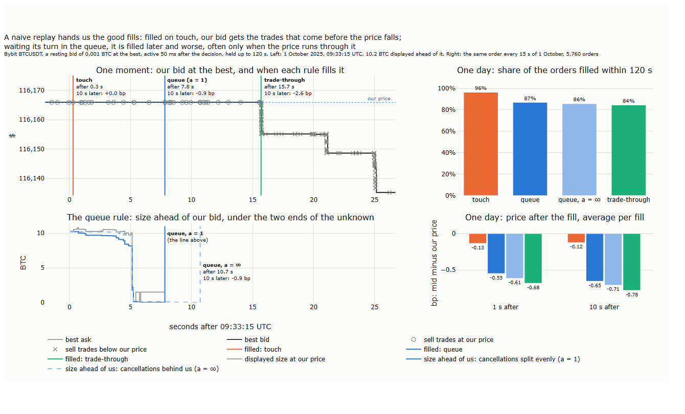
<sub><b>How to read the figure.</b> <b>Axes.</b> Left: time (x); price (top) and size ahead of our bid (bottom); vertical lines = fills. Right: share filled and price after the fill (y), by rule. Bybit BTCUSDT, a resting bid of 0.001 BTC (Bybit's minimum) placed at the best bid; it becomes active 50 ms after the decision and is held up to 120 s, not moved. <b>Left, top:</b> 1 October 2025 from 09:33:15 UTC: the best bid (black) and ask (grey, one tick above), our price (dotted), sell trades at our price (circles) and below it (crosses); a vertical line marks the fill under each rule, labelled with the wait and with the mid 10 s after the fill minus our price, in basis points (bp, hundredths of a per cent; 1 bp is about USD 11.6 here). <b>Left, bottom:</b> the size displayed at our price (grey) and the size ahead of us under the queue rule, with cancellations split evenly over the line (dark blue, a = 1) and with every cancellation put behind us where possible (light blue, dashed, a = ∞). <b>Right:</b> the same order placed every 15 s over all of 1 October, 5,760 orders: the share filled within 120 s, and the average over fills of the mid 1 s and 10 s after the fill minus our price. Below zero means the price fell after our bid was filled. One day of the in-sample period.</sub>

The same order, in the same recorded market, earned a 10-second markout of 0.0 bp, −0.9 bp or −2.6 bp, depending only on the rule the replay used to decide when it was filled. Section 1 explains why.

| § | Topic | Question |
|---|---|---|
| 1 | Three replays of one order | Does the fill rule change what a replay reports? |
| 2 | The life of an order in a replay | What is a replay made of: the recorded streams, the latency gap, the queue, adverse fills, our footprint? |
| 3 | The replay on our data | What do market and resting orders meet on Bybit, and which fills are the bad ones? |
| 4 | Does the replay tell the truth? | Does the naive rule flatter, does the unknown queue decide the answer, and up to what size does the replay hold? |
| 5 | A market that reacts | Who answers our order, how does a push fade, and how does a market tip? |
| 6 | The reaction on our data | How far does the price move after real orders, does the book refill, and is a replay that reacts closer to the truth? |
| 7 | Verdicts | Which hypotheses held on our sample? |
| 8 | 10 October | What would the cascade have done to our orders, and what did it leave behind? |
| 9 | What it means for an algorithm | What to read, what to do, and how to test, in calm and in fast markets |
| 10 | Before trading an instrument: the method | What to look at in any instrument's microstructure, and how |
| | Back to the base layer | Food for thought |
| 11 | Summary, exercises and reading | |

Sections 1 to 4 build a replay in which nobody answers our orders and test it; 5 and 6 let the market react; 7 collects the tests, 8 runs everything through the cascade, 9 turns it into rules for an algorithm, and 10 into a method for any instrument. Everything left out is in [E27](../extended/27-replaying-the-exchange/lecture.md) and [E28](../extended/28-a-market-that-reacts/lecture.md), with their hypotheses fixed before any result ([E27 register](../extended/27-replaying-the-exchange/results/hypotheses.md), [E28 register](../extended/28-a-market-that-reacts/results/hypotheses.md)).

> **What to take away**
>
> 1. **The fill rule decides the picture.** The same resting order loses −0.29 bp a second after its fills under the naive touch rule and −0.76 bp under the queue rule, out of sample: simple rules fill more, sooner, and keep the good fills.
> 2. **The fills a resting order gets are mostly the bad ones.** Four in five come as the price runs through it; they carry nearly all the loss. None of the replays comes near paying the maker fee of 2 bp at the smallest size.
> 3. **A market order meets a later book than the one it was decided on,** and the orders that miss are the ones that would have paid. Real taker orders paid 0.14 to 0.32 bp beyond the last recorded book.
> 4. **The market reacts to our order.** A 5 BTC buy still leaves the price about 1 bp higher a minute later, and the depth it took does not come back where it was. Impact grows far more slowly than size, so the cost of a sliced order must be charged on its cumulative size, not slice by slice.
> 5. **Near a tipping point the tail of the cost fattens first.** After bursts of quote withdrawals the 90th percentile of cost more than doubled while the median barely moved; after the cascade of 10 October the same orders moved the price 1.4 times as far for three weeks.
> 6. **Understand the microstructure of every instrument a portfolio trades,** its liquidity, impact and slippage, in calm markets and after events, before designing how to trade it.

## 1. Three replays of one order

A **replay** runs the recorded book and trades forward in time and inserts hypothetical orders of ours into them. A market order in a replay is simple to judge: it trades against the book that stands when it arrives. A resting order is not, because the data never say when it would have been filled. The replay has to supply a **fill rule**, and the three rules in common use give different answers:

| Rule | Our resting bid is filled when | What it assumes |
|---|---|---|
| Touch | the first sell trade occurs at our price | we are first in line at our price |
| Queue | the size that stood ahead of us when we joined has been traded or cancelled, and a sell trade then reaches us | we join at the back of the line; how the cancellations split between ahead of us and behind us is unknown |
| Trade-through | a sell trade occurs below our price | everyone at our price has been filled, us included; Lecture 20's rule |

<sub><b>How to read the table.</b> A sell trade is a trade started by a seller (a taker selling into the bids). The same rules apply to a resting ask with buy trades and prices above. Touch and trade-through need only the trades; the queue rule also needs the size displayed at our price, from the book.</sub>

In the key chart the bid joined at USD 116,165.90 behind 10.2 BTC already displayed there. Four moments decide the story:

| Seconds after 09:33:15 | What happened | Touch | Queue | Trade-through |
|---|---|---|---|---|
| 0.3 | A seller takes 0.003 BTC at our price | **filled** | 10.2 BTC ahead of us | waiting |
| 0.3 to 5.0 | Sellers take 0.26 BTC at our price; some size is cancelled | | ahead: 8.2 BTC (a = 1), 9.7 BTC (a = ∞) | waiting |
| 5.1 to 5.2 | 9.9 BTC is cancelled at our price within two book updates | | ahead: 0.13 BTC (a = 1), 0.16 BTC (a = ∞) | waiting |
| 7.8 and 10.7 | Sellers take 0.05 BTC, then 0.38 BTC at our price | | **filled** at 7.8 s (a = 1), at 10.7 s (a = ∞) | waiting |
| 15.7 | A seller trades below our price | | | **filled** |

<sub><b>How to read the table.</b> One row per event that moves our order; "ahead" is the size in front of our bid under the queue rule, for the two ends of the unknown split of cancellations (§2.3). Ten seconds after the trade-through, the best bid stood USD 30.7 below our price.</sub>

Under the touch rule the order was filled within a third of a second by the first small seller, at a moment when the price had not moved, although the 10.2 BTC ahead of us would in fact have been filled first. Under the queue rule it waited until the line in front of it had gone, and was filled 5 to 8 seconds before the price fell through its level. Under trade-through it was filled only as the fall began.

Over the whole day the picture is the same, and it explains why the naive rule flatters:

| Rule | Filled within 120 s | Median wait | Mid 10 s after, bp | Fills that came only when the price ran through |
|---|---|---|---|---|
| Touch | 96% | 0.6 s | −0.12 | |
| Queue, a = 1 | 87% | 5.5 s | −0.65 | 61% |
| Queue, a = ∞ | 86% | 6.1 s | −0.71 | 77% |
| Trade-through | 84% | 6.8 s | −0.78 | 100% |

<sub><b>How to read the table.</b> The order of the key chart, placed every 15 s on 1 October 2025, 5,760 orders. Median wait: over filled orders. "Mid 10 s after": the average over fills of the mid 10 s after the fill minus our price, in bp, before the fee. Last column: the share of the queue rule's fills that came at the trade-through itself, because the line had not been used up before. One in-sample day: it shows the mechanism, not a result; the test is H1 (§4).</sub>

The touch rule fills almost every order, quickly, and its fills see the price barely move. The rules that respect the line fill a few orders fewer, later and at worse prices, and most of their fills come only when the price runs through the level. The fills the touch rule adds are the good ones: a seller arrived while the line was long and the price stable. Lalor and Swishchuk (2024) make the same point for futures: simulations that assume every fill comes at the front of the queue and without loss are "over-inflated".

All three rules leave out two things that act on a real order: the time our order needs to reach the exchange, during which the book changes (§2.2), and the market's reaction to our order itself (§5).

## 2. The life of an order in a replay

A replay rests on several choices, one for each step in the life of an order. This section lays them out on an invented book before any of them is measured on Bybit (§3). Each piece gets the same card: the key message, how it works, an example, and what it misses.

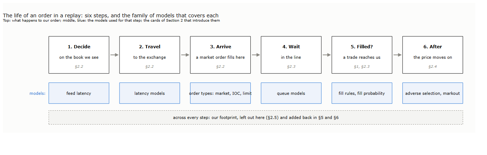
<sub><b>How to read the figure.</b> A diagram, not data. Top row: what happens to our order, from the decision to the price after the fill; a market order is filled at step 3, a resting order goes on to steps 4 and 5. Middle row: the family of models used for that step, with the card of this section that introduces it. Bottom: our footprint, which acts at every step, is left out of the replay of Sections 1 to 4 and added back in §5 and §6.</sub>

### 2.1 What a replay is

**Key message.** A replay merges two recorded streams, the book and the trades, into one time order and inserts our orders into them. Part of what it needs is recorded; the rest, such as how much was cancelled at our price, it must infer. And the recorded market never responds to our orders.

| Step | Calculation | Financial meaning |
|---|---|---|
| 1 | Merge the book updates (every 100 ms on Bybit's feed, Lecture 21 §3) and the trades (to the millisecond) in time order | One clock for everything that happened at our price |
| 2 | Between two book updates, every trade at our price lowers the size there by its own size | The part we know: it was filled |
| 3 | At the next update, the change beyond those trades: a decrease was cancelled, an increase was added | The part we infer: the book shows how much is there, not who came or left |
| 4 | Our order, decided at time $`t`$, becomes active at $`t + L`$ and meets what stands then | $`L`$ is the latency: the time our order needs to reach the matching engine (§2.2) |
| 5 | Our resting order is filled by the recorded trades, under a fill rule (§1); the recorded streams stay as they were | Non-reactive: nobody responds to our order, and our fills take nothing out of the recorded book (§2.5) |

<sub><b>How to read the table.</b> Steps 1 to 3 rebuild what happened at one price; steps 4 and 5 add our order. Trades between two updates are applied before the update.</sub>

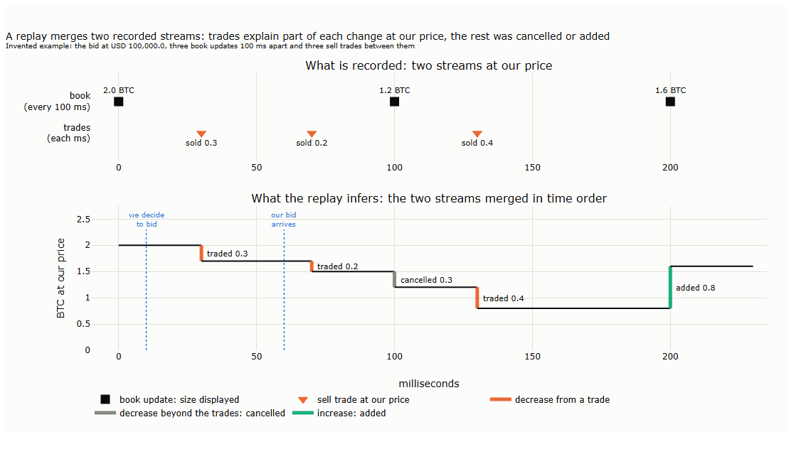
<sub><b>How to read the figure.</b> <b>Axes.</b> Time in ms (x). Top: what is recorded. Bottom: size at our price (y), coloured by cause. An invented bid at USD 100,000.0. <b>Top:</b> the book, every 100 ms, reports the size displayed at that price (squares); the trades, to the millisecond, report each sale at that price (triangles). <b>Bottom:</b> the size at that price as the replay infers it, each change coloured by its cause: a trade (orange), a decrease beyond the trades, counted as cancelled (grey), an increase, counted as added (green). Dotted: a bid of ours decided at 10 ms and arriving 50 ms later.</sub>

Between the first two updates the displayed size fell from 2.0 to 1.2 BTC. Trades account for 0.5 of it, so the replay counts the other 0.3 as cancelled. Between the next two, 0.4 BTC was sold and yet the size rose from 1.2 to 1.6: 0.8 was added. Our bid, decided at 10 ms, arrives at 60 ms; the last book still reports 2.0 BTC, but 0.3 has been sold since, so 1.7 BTC stands ahead of it when it joins.

**What it misses.** The book reports only the net change between two updates: the 0.8 BTC added could have been 1.0 added and 0.2 cancelled. It does not say who cancelled, ahead of our bid or behind it (§2.3). And in the replay our bid takes part in no recorded trade and changes nobody's behaviour (§2.5).

### 2.2 The latency gap

**Key message.** Our order meets a later book than the one we decided on. In that gap faster traders act, and they act most when the price is about to move: the trades we miss are disproportionately the ones that would have paid.

| Step | Calculation | Financial meaning |
|---|---|---|
| 1 | An order decided at $`t`$ on the book we see reaches the matching engine at $`t + L`$ | The gap between the book we saw and the book our order meets |
| 2 | A **market order** walks the book that stands at $`t + L`$; slippage = average price paid minus the average price the book seen at $`t`$ promised (for a buy) | The cost of the gap for an order that must be filled |
| 3 | An **immediate-or-cancel (IOC)** order at the best price seen takes only what stands at that price at $`t + L`$; the rest is dropped | The gap as missed trades, for an order that must not pay more |
| 4 | A plain **limit order** takes the same and rests with the remainder, joining the line at its price | The order meant as a trade becomes a quote (§2.3, §2.4) |
| 5 | A cancellation also takes $`L`$ to arrive: a resting order can be filled after we decided to withdraw it | A stale quote picked off |

<sub><b>How to read the table.</b> A replay evaluates every order of ours against the recorded book at $`t + L`$, never at $`t`$, and must know the order's type.</sub>

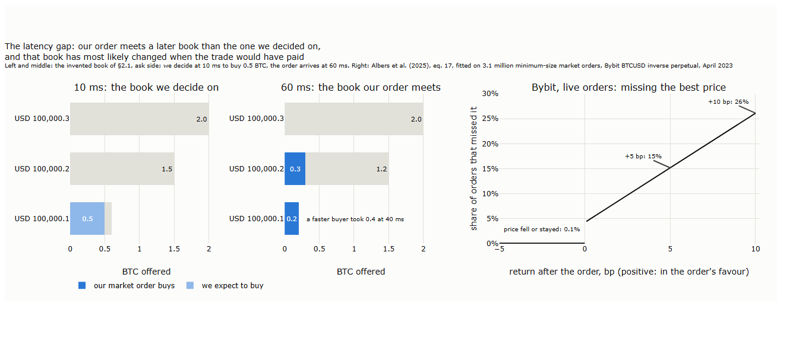
<sub><b>How to read the figure.</b> <b>Axes.</b> Left and middle: size (x) at each ask price (y). Right: share of orders that missed (y), by the later return (x). <b>Left and middle:</b> the ask side of the invented book, best three levels. At 10 ms we decide to buy 0.5 BTC on the book last seen (light blue: what we expect to buy); a faster buyer takes 0.4 BTC at the best ask at 40 ms; our order arrives at 60 ms and buys what stands then (dark blue). <b>Right:</b> from Albers, Cucuringu, Howison and Shestopaloff (2025), eq. 17 with their Table 6: the share of their own minimum-size market orders on Bybit that could not be filled at the best price they had seen, against the return over the next ten events of their experiment (a median of 1.14 s), positive when the price moved in the order's favour.</sub>

On the book we saw, 0.6 BTC was offered at USD 100,000.1, enough for our 0.5. By the time our order arrived, a faster buyer had taken 0.4 of it. A market order still gets its 0.5 BTC, 0.2 at USD 100,000.1 and 0.3 one tick higher. An IOC order at USD 100,000.1 pays no more, but buys only 0.2 BTC. If the faster buyer was right and the price rises, the 0.3 BTC the IOC order missed is exactly the part that would have earned most; a plain limit order would leave it resting as a bid, behind the move it was sent for.

**Good orders fail.** Albers et al. (2025) measured this live: 3.1 million market orders of the minimum size on Bybit's inverse BTCUSD perpetual in April 2023, each compared with the best price it had seen. Overall 1.35% could not be filled at that price. When the price then fell or stayed, almost none failed (0.09%); when it rose in the order's favour, 15% failed at +5 bp and 26% at +10 bp. A backtest that fills every order at the price seen at the decision is wrong in a biased way: it keeps the trades that paid and that, in reality, others took first.

**What it misses.** $`L`$ itself differs by trader, connection and moment, and rises in busy markets, exactly when it matters; the replay takes it as a setting and reports results at 10, 50 and 100 ms. The recorded trades show who won each race, not who else was racing. True failure rates come only from live orders.

### 2.3 The queue

**Key message.** A resting order is filled only when everything ahead of it at its price has traded or left. The book shows how long the line is, not who leaves it, so a replay must assume how cancellations split between ahead of us and behind us. One dial, $`a`$, spans the assumptions.

| Step | Calculation | Financial meaning |
|---|---|---|
| 1 | When our order arrives, the size ahead of it is the size displayed at our price (§2.1) | We join at the back: everyone already there was first |
| 2 | A sell trade of size $`s`$ at our price fills us if $`s`$ exceeds the size ahead; otherwise the size ahead falls by $`s`$ | Trades serve the line from the front |
| 3 | A cancellation of size $`c`$ at our price lowers the size ahead by $`p \cdot c`$, with $`p = x^a`$ and $`x`$ = ahead / (ahead + behind); never more is taken from behind us than stands there | Someone left the line; $`p`$ is the share assumed to have stood in front of us |
| 4 | An increase at our price joins behind us | Later arrivals queue after us |
| 5 | A sell trade below our price fills whatever is left of our order | The whole line at our price has been served |

<sub><b>How to read the table.</b> $`x`$ is our position in the line: 1 at the back, 0 at the front. $`a = 1`$ splits a cancellation in proportion to the size on each side, as if every unit of size were equally likely to leave; a larger $`a`$ puts more of it behind us; $`a = \infty`$ puts none ahead unless nobody stands behind us, the "risk-averse" model of the open-source backtester hftbacktest. Results use $`a`$ = 1, 2, 5, 20 and ∞.</sub>

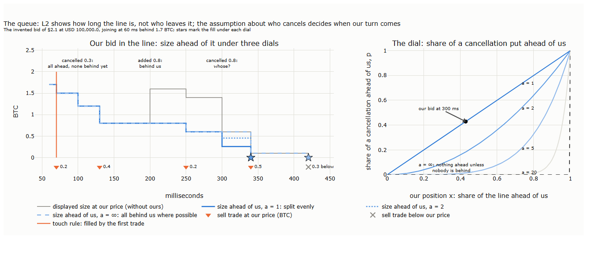
<sub><b>How to read the figure.</b> <b>Axes.</b> Left: time (x), size ahead of us (y), one line per dial. Right: share of a cancellation put ahead of us (y), by our place in the line (x). <b>Left:</b> the bid of §2.1 joins at 60 ms behind 1.7 BTC. Grey: the size displayed at our price; blue lines: the size ahead of our bid under $`a = 1`$ (solid), $`a = 2`$ (dotted) and $`a = \infty`$ (dashed); stars: our fill under each; orange line: the touch rule's fill. Triangles: sell trades at our price; cross: a sell below our price. <b>Right:</b> $`p = x^a`$ against $`x`$ for $`a`$ = 1, 2, 5 and 20, and $`a = \infty`$ (dashed); the dot marks our bid at 300 ms.</sub>

At 300 ms, 0.8 BTC is cancelled while 0.6 BTC stands ahead of our bid and 0.8 behind it ($`x = 0.43`$). With $`a = 1`$, 43% of the cancellation is put ahead of us and our bid is filled at 340 ms by a trade at our price; with $`a = 2`$, 18%, and the same fill; with $`a = \infty`$, none, and our turn never comes before the price runs through our level at 420 ms. The touch rule had filled it at 70 ms, while 1.7 BTC still stood in front. The dial moves the fill from a trade at a stable price to the moment the price falls through: the same order becomes a good fill or a bad one (§2.4).

**The models in the literature.** Every queue model for data that show the size at each price, but not the orders (L2 data, Lecture 21 §2), answers the same question as the dial: when the size at our price falls by more than was traded, how much stood ahead of us? Rigtorp (2013) writes the share ahead as $`f(\text{ahead}) / (f(\text{ahead}) + f(\text{behind}))`$ for any increasing $`f`$; hftbacktest implements power and log versions of it and the risk-averse model. On the cancellation at 300 ms the published models leave between 0.06 and 0.60 BTC ahead of our order, a factor of ten; the log models also depend on the unit in which size is counted, a hidden parameter. Our $`a = 1`$ reproduces Rigtorp's proportional rule and our $`a = \infty`$ hftbacktest's risk-averse model on 3,000 random test sequences; the formulas were taken from hftbacktest's source code, which in one place counts the other way round from its documentation (the probability it computes is the share *behind* our order). Reading the code rather than the description matters: a backtest's results come from the code.

**Which is right?** None of these formulas is derived from how traders behave. Evidence comes only from order-by-order (L3) data: Databento (2025), with such data for CME's E-mini S&P 500 future, concluded that "cancels are mostly pulled from the back of the queue". A reason, as an argument: an order that has just joined has least to lose by leaving, while one near the front is about to be filled. Bybit publishes no such data, so the lecture spans the leaning with $`a`$ from 1 to ∞ and asks whether the answer changes inside that range (H3); models that lean ahead of us, against that evidence, are left out.

**What it misses.** The truth, which only L3 data or live orders show; any dependence of the split on the length of the line, the speed of the market or the hour; and everything inside one 100 ms update.

### 2.4 Adverse fills

**Key message.** A resting order is not filled at random moments. When the price runs through it, it is filled for certain; when the price moves away, it is filled only if a counterparty reaches it first. So the fills an order gets lean towards those followed by a loss, even in a market with no trend.

| Step | Calculation | Financial meaning |
|---|---|---|
| 1 | A fill is **adverse** if, at the first book update after it, the best price on our side has moved through our level (for a bid: below it) | We bought just as the price fell through us |
| 2 | A move through our level fills us with certainty; a move away fills us only with a chance $`R`$ | A price cannot pass a resting order without filling it |
| 3 | Expected move after a fill, in ticks: $`E[d \mid \text{fill}] = \dfrac{R \cdot P(U) - P(D)}{P(D) + R \cdot P(U)}`$ | Negative whenever $`R < 1`$ and the market has no trend: the fill itself is bad news |
| 4 | Report the markout of adverse and non-adverse fills separately | Whether the replay's fills are the bad ones, and by how much |

<sub><b>How to read the table.</b> Step 3 is the model of DeLise (2024), eq. 3, for a bid at the best: the next move is one tick down with probability $`P(D)`$, which fills our bid, or one tick up with probability $`P(U)`$, in which case we are filled only with chance $`R`$; $`d`$ is the move after the fill. A **markout** is the mid a set time after the fill minus the fill price, signed for our side.</sub>

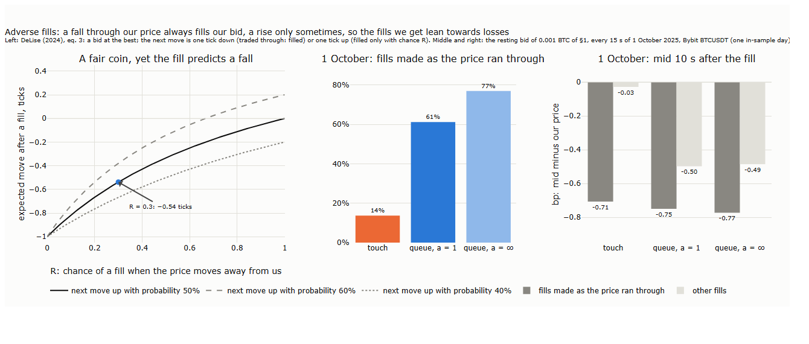
<sub><b>How to read the figure.</b> <b>Axes.</b> Left: move after a fill (y), by fill chance R (x). Middle: share of fills as the price ran through (y). Right: price 10 s after the fill (y), by rule. <b>Left:</b> DeLise's formula against $`R`$, for a next move up with probability 50% (black), 60% and 40% (grey); at $`R = 1`$ every touch is a fill and the bias vanishes. <b>Middle and right:</b> the resting bid of §1, every 15 s of 1 October 2025: the share of each rule's fills that came at the trade that took the price through our level, and the mid 10 s after those fills (dark) and after the others (light), minus our price, in bp. One in-sample day, before the maker fee.</sub>

Take a fair coin: the price is as likely to tick up as down. If our bid is filled on every down move and on only 30% of up moves, then of every 100 moves, 50 down moves and 15 up moves fill us, and the average move after a fill is (15 − 50) / 65 = −0.54 ticks, although the price itself has no trend. The fill is evidence about what happens next.

The effect is known from live and recorded orders. DeLise (2024) predicted −0.48 ticks after a fill on the US 10-year Treasury note future and measured −0.45. Lalor and Swishchuk (2024) found 66% to 89% of fills adverse on four CME futures (our computation from their Table 2). Albers et al. (arXiv 2502.18625), with live minimum-size orders on Binance, found 1-second markouts from −0.06 bp at the front of a short line to −1.16 bp at the back of long lines.

**What it misses.** The definition depends on the interval: a fill just before the price runs through counts as non-adverse, so the split understates how bad fills are. And scale: Bybit's base maker fee is 0.02%, 2 bp per fill, larger than every markout above, so the sign of a maker's result is decided by fees and these fractions of a basis point together.

### 2.5 Our footprint

**Key message.** A replay assumes that our orders take nothing from the recorded market and change nobody's behaviour. For the smallest orders this is close to true; as our size grows towards the size of the queues it fails, in a direction that flatters us.

| Step | What the replay leaves out | Financial meaning |
|---|---|---|
| 1 | What our market order took is still in the recorded book afterwards | Liquidity counted twice: a second order of ours finds it again |
| 2 | A recorded trade that fills our resting order also filled the orders it filled in reality | Our fill is added to the record, not taken from someone in it |
| 3 | Our trades do not move the recorded price | Impact (Lecture 21 §6.2): a large order pushes the price, and the push fades only slowly |
| 4 | Nobody reacts to our resting size | A large bid can draw sellers to it, or scare others into cancelling (H8) |
| 5 | Our trades trigger no further trading | Most trading reacts to trading (Lecture 21 §6.4), and ours would too |

<sub><b>How to read the table.</b> Steps 1 and 2 are mechanical and could be added by bookkeeping; steps 3 to 5 are behaviour and must be measured on other people's orders (§6).</sub>

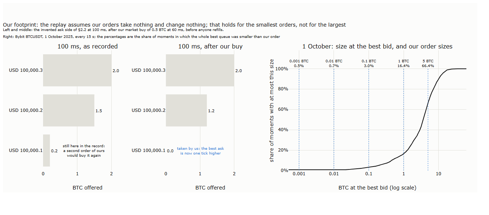
<sub><b>How to read the figure.</b> <b>Axes.</b> Left and middle: size (x) at each ask price (y). Right: share of moments (y) with at most a given best queue (x, log); dotted = our sizes. <b>Left and middle:</b> the ask side of the invented book at 100 ms, as recorded, and as it would stand after our market buy of 0.5 BTC at 60 ms if nobody refilled. <b>Right:</b> Bybit BTCUSDT, 1 October 2025: the size displayed at the best bid at each of 5,760 moments, as a cumulative share (log scale); dotted lines mark the lecture's order sizes, labelled with the share of moments in which the whole best queue was smaller than the order.</sub>

The scale decides how much this matters. On 1 October the median queue at the best bid was 3.7 BTC. An order of 0.001 BTC is 0.03% of it, and the whole best queue was smaller than the order in 0.5% of moments; an order of 1 BTC is 27% of it (16% of moments); an order of 5 BTC is 137% of it, larger than the whole queue two times in three. At 5 BTC our order would empty the level, move the price and be seen by everyone. Section 4 measures where the replay stops being trustworthy, and Sections 5 and 6 add the footprint back.

## 3. The replay on our data

Section 2 laid out the pieces on an invented book. This section builds each of them on Bybit's recorded book and trades, 20 September to 3 November 2025, in the order of an order's life. The measurements here are descriptive; the tests are Section 4.

**The clocks agree, and the book hides a fifth of the flow.** A replay merges two streams (§2.1), so their clocks must agree. Shifting the trades against the book by a few milliseconds either way makes the inferred bookkeeping worse on every day tested, so the trades' timestamps and the book's engine time are the same clock. But a book published every 100 ms hides flow: on the median day, 22% of the size traded at an unchanged best price was replaced within the same update, unseen. The blind spot has a direction: what the net book can hide from the queue rule is a cancellation ahead of our order offset by an addition behind it, so it keeps our order further back than it may be. By our reasoning, not a measurement, the net book never makes the queue rule too optimistic, only too cautious. Details in [E27 §3.1](../extended/27-replaying-the-exchange/lecture.md).

**What it costs to compute.** The cost of a replay is set by how many moments it asks about, not by the size of the data. A strategy that decides now and then, such as the daily systems of Parts I to IV, needs the book only at its decision moments, and a laptop gets through a year of data overnight. Resting orders and market making need every event in the life of every order, and the cost grows with the activity of the market: fix a sample of days and a small grid before the results, and time a busy window before launching. Searching many designs over months is work for compiled code on many cores ([E27 §3](../extended/27-replaying-the-exchange/lecture.md)).

### 3.1 The latency gap on data

**Key message.** Most of the time our order meets the book it saw. The gap grows with order size and delay, and the IOC orders it leaves short are, as Albers et al. found live, the ones that would have paid.

| Step | Calculation | Financial meaning |
|---|---|---|
| 1 | One decision moment at a random millisecond in every 10 s, 8,640 a day, 45 days; a buy and a sell at each | Moments that do not line up with the bots that act on round seconds |
| 2 | Expected price: the average price of size $`S`$ walking the book published at $`t`$ | What the order promises on the book we decide on |
| 3 | Paid price: the same walk on the book at $`t + L`$ | What a market order actually meets |
| 4 | An IOC order takes what stands at the best price seen, at $`t + L`$; a limit order takes the same and rests with the remainder | The gap for orders that must not pay more |
| 5 | The move of the mid over the next second, signed for the order | Whether the orders that miss are the ones that would have paid |

<sub><b>How to read the table.</b> $`S`$ in {0.001, 0.01, 0.1, 1, 5} BTC and $`L`$ in {10, 50, 100} ms; prices in bp of the mid at $`t`$. The book's depth at each moment is read from the day's book file in half-hour blocks, a method checked exactly against a full rebuild of the book ([E27 §3.2](../extended/27-replaying-the-exchange/lecture.md)).</sub>

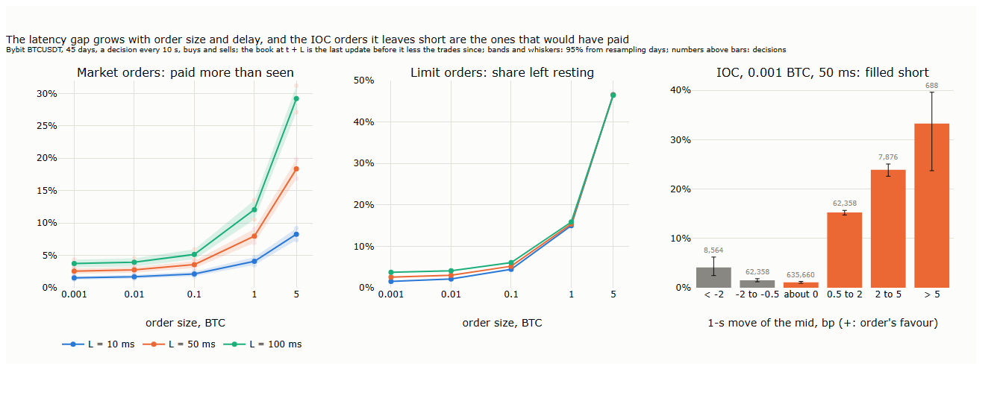
<sub><b>How to read the figure.</b> <b>Axes.</b> Left and middle: order size (x, log), share of orders (y), one line per latency. Right: 1-s move of the mid (x, bp), share of IOC orders filled short (y). <b>Left:</b> market orders whose average price at $`t + L`$ was worse than the walk on the book seen at $`t`$. <b>Middle:</b> the share of a limit order's size not filled at once and left resting at its price. <b>Right:</b> orders of 0.001 BTC at 50 ms; positive moves in the order's favour (orange), negative against it (grey). Bands and whiskers: 95% from 2,000 resamples of days.</sub>

- **Small orders mostly meet the book they saw.** A market order of 0.001 BTC paid more than expected in 1.5% of decisions at 10 ms, 2.6% at 50 ms and 3.7% at 100 ms; at 5 BTC, in 8%, 18% and 29%. The book moves both ways, so on average the gap costs about 0.003 bp, against 0.37 bp from the mid for walking the book with 5 BTC at all. Latency is a lottery with a mean near zero; what it changes is which orders win.
- **A limit order's remainder is mostly about size.** At 1 BTC 15%, and at 5 BTC 46%, of a limit order's size was left resting, almost the same at every latency: the best level often holds less than the order.
- **The orders that miss are the ones that would have paid.** When the mid hardly moved over the next second, 1.1% of the minimum-size IOC orders were filled short; when it moved 0.5 to 2 bp in the order's favour, 15%; more than 5 bp, 33%. By the volatility of the hour: 0.8% in the calmest third, 5.0% in the most volatile. Albers et al. (2025) found the same shape live.

In a replay the miss follows from the recorded book by construction, so the curve shows the mechanism, not a measured failure rate; the comparison with Albers et al. is of shape, not level.

### 3.2 The queue on data

**Key message.** Our order joins behind a few BTC, and the touch rule fills it far too fast. The unknown cancellation split barely changes whether it is filled: most queue fills come as the price runs through our level, not because we reached the front.

The test: on each of the 45 days, eight half-hours drawn at random, an order of 0.001 BTC sent every 15 s on each side, joining at the best price standing 50 ms later and held up to 120 s, 86,392 orders. Each is filled under touch, trade-through and the queue rule at five values of $`a`$.

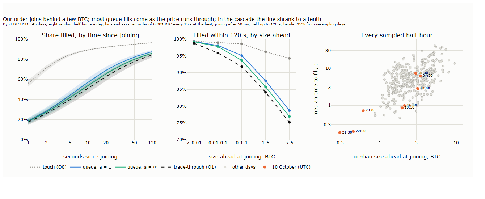
<sub><b>How to read the figure.</b> <b>Axes.</b> Left: seconds since joining (x, log), share filled (y). Middle: size ahead at joining (x), share filled within 120 s (y, from 70%). Right: median size ahead (x, log), median time to fill (y, log), one dot per half-hour. <b>Left and middle:</b> one line per fill rule; touch dotted, trade-through dashed; the queue rule at $`a`$ = 2, 5 and 20 lies between its two lines and is left out. Bands: 95% from 2,000 resamples of days. <b>Right:</b> the queue rule at $`a = 1`$; 360 half-hours, those of 10 October in orange with their start time in UTC.</sub>

- **The line is long.** The median order joins behind 2.5 BTC, 2,500 times its own size.
- **The touch rule fills far too fast.** Within one second it has filled 56% of the orders, the queue rule 18 to 19%; within ten seconds 89% against 54 to 57%. After 120 s the gap has closed to 96% against 86 to 88%: touch misstates when an order is filled, and which fills it gets, more than whether.
- **The dial hardly changes whether we are filled:** 87.5% at $`a = 1`$, 85.9% at $`a = \infty`$. When we join nobody stands behind us, so every cancellation must come from ahead whatever $`a`$ is; the dial only acts once new orders have joined behind us.
- **Most queue fills are not a turn reached.** 64% at $`a = 1`$ and 78% at $`a = \infty`$ came with the first trade through our price. The best price usually moves before a line of a few BTC has been worked off.

### 3.3 Adverse fills on data

**Key message.** Three queue fills in four are adverse, and they carry nearly all the loss. The touch rule makes the same orders look three times better than they are.

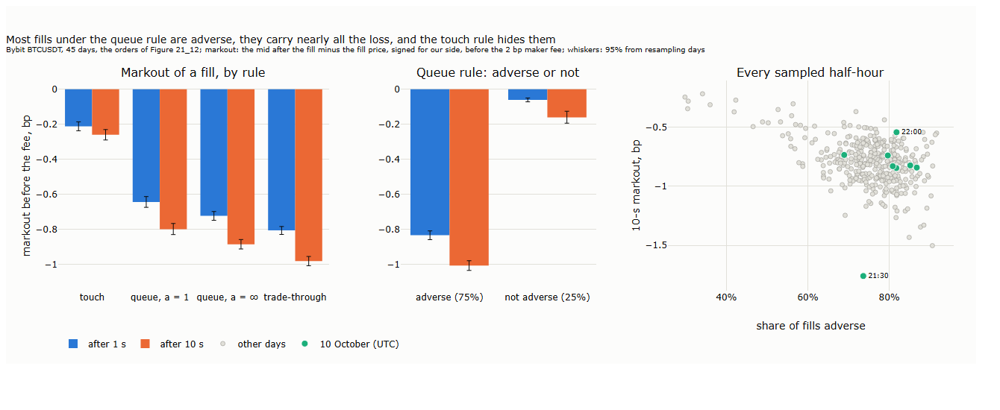
<sub><b>How to read the figure.</b> <b>Axes.</b> Left and middle: fill rule or kind of fill (x), markout in bp (y), one bar per horizon. Right: share of fills adverse (x), 10-s markout (y), one dot per half-hour. <b>Left:</b> 72,800 to 83,200 fills per rule. <b>Middle:</b> the queue rule at $`a = 1`$; the shares of the fills are in the labels. <b>Right:</b> the queue rule at $`a = 1`$; 360 half-hours, those of 10 October in green, the two inside the cascade labelled. Whiskers: 95% from 2,000 resamples of days.</sub>

- **Every rule loses before the fee, and the touch rule hides most of it.** After 10 s the same orders show −0.26 bp under touch, −0.80 to −0.88 bp under the queue rule and −0.98 bp under trade-through. Touch counts 26% of its fills as adverse, the queue rule 75 to 86%, within the 66 to 89% Lalor and Swishchuk (2024) report.
- **The adverse fills are where the loss is:** −1.01 bp after 10 s, against −0.16 bp for the others. Even the good fills do not earn the half-spread, about 0.005 bp.
- **The dial changes the mix, not the sign.** From $`a = 1`$ to $`a = \infty`$ the 10-s markout moves by 0.09 bp; the maker fee of 2 bp is more than twenty times that. After the fee the same fills stand at about −2.8 to −2.9 bp.

## 4. Does the replay tell the truth?

**Key message.** The fill rule decides the picture, and the fair rule shows no sign of flattering. On market orders the replay is too kind: real orders pay beyond the book they saw. And the market responds to size from the smallest class we can measure, so the replay's resting results hold for the minimum size and are flagged above it.

Section 3 measured; this section tests, on the 24 days after 10 October, with hypotheses fixed before any of their results ([E27 register](../extended/27-replaying-the-exchange/results/hypotheses.md)). The verdicts are collected in Section 7.

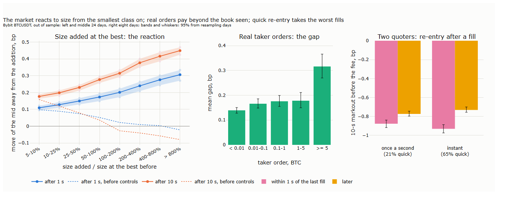
<sub><b>How to read the figure.</b> <b>Axes.</b> Left: size added relative to the queue (x), move of the mid in bp (y). Middle: taker order size (x), gap in bp (y). Right: quoter (x), 10-s markout in bp (y), one bar per kind of fill. <b>Left:</b> positive is away from the addition, up after an addition to the bid; solid lines net of matched control moments, dotted before them; 5.5 million additions. <b>Middle:</b> average price paid minus the price predicted by walking the last book, positive a cost. <b>Right:</b> the queue rule at $`a = 1`$, eight days; the label gives the share of each quoter's fills that come within 1 s of its previous fill on the same side. Out of sample; bands and whiskers: 95% from 2,000 resamples of days.</sub>

**Resting orders (H1 to H4).** On a test order that re-posts at the best, touch shows −0.29 bp after one second and the queue rule −0.76 bp, a difference of 0.47 bp (H1). Within the queue rule, 81% of fills are adverse, at −0.93 bp, against −0.05 bp for the others (H2). The unknown split does not decide the answer: at both ends of the dial and at every latency, the 10-s markout after the fee lies between −2.80 and −3.02 bp (H3). Is the replay kinder than real fills? Its fills lose 0.76 bp after one second; the resting side of real small taker orders loses 0.12 bp (H4). But the two are not alike: an order so small takes the front of the line and leaves the price where it was. The fair reading is that the replay errs on the cautious side, by an amount somewhere below 0.64 bp, which only live orders can settle.

**Orders meant as trades that rest.** The minimum-size limit orders left short at 50 ms rest at the price seen. Within 120 s, 86% are filled, at −0.63 bp after 10 s, about as an ordinary resting order. The 14% not filled missed their move: 120 s later the mid stands on average 11 bp beyond their price, in the direction they wanted.

**Market orders (H7).** Walking the last book before each real taker order predicts its price well in the typical case, a median gap of zero at every size. The mean is not zero: 0.14 bp below 0.01 BTC, rising to 0.32 bp at 5 BTC or more. Walking the book understates the cost by about as much as walking 5 BTC costs at all (0.37 bp). Even the smallest orders show most of the gap: takers tend to act when the price has just moved, after the last update of a 100 ms book. This is the liquidity mirage of Lecture 21 (§4.2), measured from the taker's side.

**The reaction to size (H8).** After size added at the best as large as the queue, the mid moves 0.25 bp away from the addition over one second and 0.38 bp over ten, net of matched controls; the curve starts at about 0.1 bp for additions of 5 to 10% of the queue and rises with size, with no threshold. Two readings need care. It is not the price rising after a large bid: the raw move is about zero, because large additions arrive on thin queues where the price would otherwise have given way, and the net number measures the fall that did not happen. And it is association, not proof of cause. By the rule fixed in advance, the reaction starts at the smallest class measured, about 0.125 BTC at the median queue, so **resting results are trusted at 0.001 and 0.01 BTC and flagged from 0.1 BTC up**.

**Two quoters.** A replay also compares designs. A quoter that reacts to every book update fills 4,000 times an hour; one that looks once a second, 1,800. Against the design's expectation, the slower one does slightly better per fill, −0.79 against −0.86 bp after 10 s, on all eight days tested. The right panel shows why: 65% of the instant quoter's fills come within a second of its previous fill on the same side, as it rejoins at once during a run of trades and is hit again, and those fills are 91% adverse. Neither pays the fee of 2 bp on any day. Quoting designs are the subject of Lecture 23.

## 5. A market that reacts

The replay of Sections 1 to 4 forgets our order at once: nobody answers it, and what it took comes straight back. This section lets the market react, and its central idea is that the reaction is made by people with rules: market makers, arbitrageurs, snipers, slicers, trend followers, stops. How each of them behaves, and what their behaviour adds up to, decides whether a market absorbs our order calmly or tips into a move that feeds on itself.

A **hybrid replay** keeps the recorded book as its background and adds what real orders of the same size were measured to do (§6): the price moves and only slowly comes back, and what we took returns only in part. The difference fits in one chart:

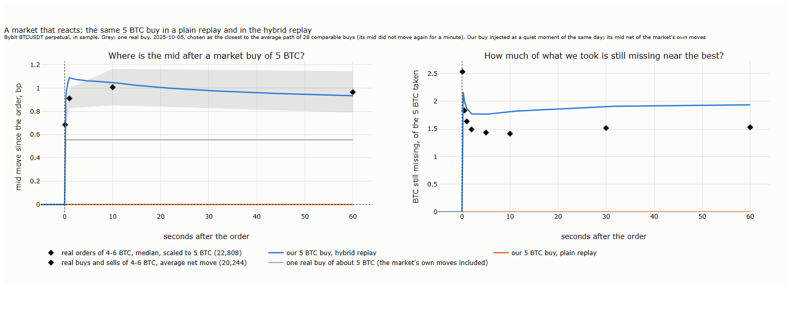
<sub><b>How to read the figure.</b> <b>Axes.</b> Both panels: seconds after the order (x). Left: the mid's move since the order, in bp (1 bp was about USD 12 on that day). Right: how much of the 5 BTC our buy took is still missing from the levels near the best ask, in BTC. Bybit BTCUSDT, in sample. <b>Left:</b> our market buy of 5 BTC injected at a quiet moment of 5 October 2025, its mid net of the market's own moves: plain replay (orange) and hybrid replay (blue). Diamonds and grey band: the average net move after real buys and sells of 4 to 6 BTC, 20,244 orders, with a 95% band over resampled days. Grey line: one real buy of 5.8 BTC on the same day. <b>Right:</b> plain replay (orange, nothing missing) and hybrid replay (blue); diamonds: the median for real orders of 4 to 6 BTC, scaled to 5 BTC.</sub>

| Seconds after the buy | Plain replay: mid | Hybrid replay: mid | Real orders of 4-6 BTC: mid | Hybrid: BTC still missing | Real orders: BTC still missing |
|---|---|---|---|---|---|
| 1 | 0 | 1.09 bp | 0.91 bp | 1.9 | 1.6 |
| 10 | 0 | 1.05 bp | 1.01 bp | 1.8 | 1.4 |
| 60 | 0 | 0.93 bp | 0.97 bp | 1.9 | 1.5 |

<sub><b>How to read the table.</b> The numbers behind the figure. Mid: the move in the direction of the order, net of the market's own moves (injected order) or of matched control moments (real orders). Missing: of the 5 BTC taken, the size not yet standing again within the same number of levels of the new best. In sample.</sub>

The plain replay is wrong in both panels. The price does not forget a 5 BTC buy: a minute later real orders of that size still leave the mid about 1 bp higher. Nor does the book give back what was taken: a minute later about 1.5 BTC of the 5 is still missing near the best. A second order sent soon after meets a dearer book: in a test run on 1 October, a second 5 BTC buy 2 s after the first cost 0.004 bp in the plain replay and 1.08 bp in the hybrid one.

The chart shows the calm end of a wider picture. The cost of a market order depends on its size and on the state of the market when it arrives: think of **one map**, cost against size and state. Where the book is deep and the traders who supply liquidity stay, the map is smooth and a push fades. Where they withdraw, or run out of capital, and others add to the move instead, the same order can tip the market into a move that feeds on itself, and the map turns steep.

### 5.1 A laboratory market

The mechanisms behind the map cannot be seen in Bybit's data, because the data never say who traded, who withdrew or whose capital ran out. They can be seen in a **laboratory market**: a small simulated exchange in which a handful of traders follow written rules, and which publishes only what Bybit publishes. It is a caricature on purpose. Physicists study magnets with a grid of arrows that no magnet resembles (the Ising model), because the grid shows how a sudden change arises from simple rules; Schelling (1971) showed with a board and two kinds of counters how mild individual preferences tip a whole neighbourhood.

The laboratory gives four things real data cannot: the **counterfactual** (copy the market at a moment and run it on with and without our order), **rare events on demand** (our 45 days hold one cascade), **instruments checked before use** (a measure is first tried where the answer is known), and **questions that transfer** to real markets. It does not give numbers about Bybit: every size, rate and threshold in it is invented, and every figure from it is marked *Invented*. Its traders, their rules and their checks are in [E28 §2](../extended/28-a-market-that-reacts/lecture.md).

The same traders produce three regimes:

| Regime | What the players do | What it adds up to | Why |
|---|---|---|---|
| Calm | Makers fill our order and lean their quotes against the position it leaves them; arbitrageurs trade the price back to its value | A push that fades within a minute: negative feedback | Each earns by taking the other side of our push, and has the capital and the quotes to do it |
| Near the tipping point | Makers pull their quotes after fast moves; arbitrageurs near their capital limits stop correcting; stops sit close to the price | A push that stays, and a cost with a fat tail | Pulling is rational for each maker when others pull; capital is finite (the limits of arbitrage, Shleifer and Vishny, 1997) |
| Cascade | Stops and forced closes fire into a thin book; others join the move | A move that feeds on itself until the fuel near the price is used up: positive feedback | Each trade sets off more than one other; afterwards the book stays thin for a while |

<sub><b>How to read the table.</b> One row per regime of the laboratory market; the same traders appear in every row, only their state and incentives change. On Bybit, the calm row is what the hybrid replay measures (§6); the second is tested by H20 and the third by 10 October (§8).</sub>

**The calm side: why a push fades.** In the laboratory, our buy of 5 BTC is filled partly by the market maker, which is left short. It moves its quotes up to shed that position, and the mid rises further for about a second; then the value traders sell into the higher price, take the position over, and the price returns towards the value. A push fades when someone takes the other side of it at a profit.

**The tipping side: three dials.** Three settings turn the laboratory towards the tipping side: the value traders' **capital**, beyond which they stop correcting the price; the market maker's **kill switch**, which pulls all its quotes for 5 s after a fast move; and a density of **stops** around the price, which a move turns into market orders in the same direction.

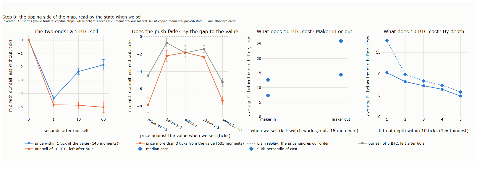
<sub><b>How to read the figure.</b> <b>Axes.</b> First panel: seconds after our sell (x), mid with our sell less without, ticks (y). Second: the price against the value when we sell (x), the move left after 60 s (y). Third and fourth: the maker in or out, and fifths of depth within 10 ticks (x), cost of a 10 BTC sell, ticks (y). <i>Invented</i>; 16 worlds × 3 seeds × 20 moments, our market sell at copied moments, pooled. Bars: ± one standard error.</sub>

Two results stand out. **A loose anchor:** when the price is already far from the value, in either direction, a push stays (a move of −7.3 to −7.9 ticks left after 60 s, against −1.8 to −2.3 when the price is near the value), because nobody is left to push back. **A fat tail:** with the maker out of the book, the median cost of a 10 BTC sell doubles (14.4 against 7.3 ticks) and its 90th percentile more than doubles. The tail, not the average, carries the risk, so this lecture reports costs as percentiles.

Three ideas from other fields make the tipping side precise; each is an analogy, tied to a measure.

- **Physics: a chain reaction.** If each trade or quote withdrawal sets off on average $`n`$ others, a push of size 1 has a total effect of about $`1/(1 - n)`$: it dies out while $`n`$ stays below 1 and runs away as $`n`$ reaches 1, as in a reactor going critical. The quantity is the branching ratio of a Hawkes process, which Lecture 21 (§6.4) measured on Bybit (median 0.84). Whether markets sit near $`n = 1`$ is disputed: Filimonov and Sornette (2012) found it rising from about 0.3 to 0.7-0.8 on E-mini S&P 500 futures, and 0.95 in the flash crash of 6 May 2010; Hardiman, Bercot and Bouchaud (2013), with a longer-memory kernel, found it close to 1 throughout.
- **Physics: slowing down before the edge.** Near a tipping point a system recovers ever more slowly from small shocks (Scheffer et al., 2009). In a book, recovery is the refill of what an order took (§6.2); a refill that slows is the textbook early warning, though not a guaranteed one.
- **Game theory: a run on liquidity.** A kill switch is rational for each maker: when others pull, the one who stays is left alone against the flow. Each maker's best move depends on the others', so the market has two stable outcomes, all stay or all pull, as in a bank run (Diamond and Dybvig, 1983). The rule that protects each maker makes the market fragile for all.

### 5.2 From calm to cascade, step by step

**Key message.** A cascade does not come from nowhere: the restoring forces wear away first, quietly, and only then does a small push set off a chain reaction that runs until its fuel is spent.

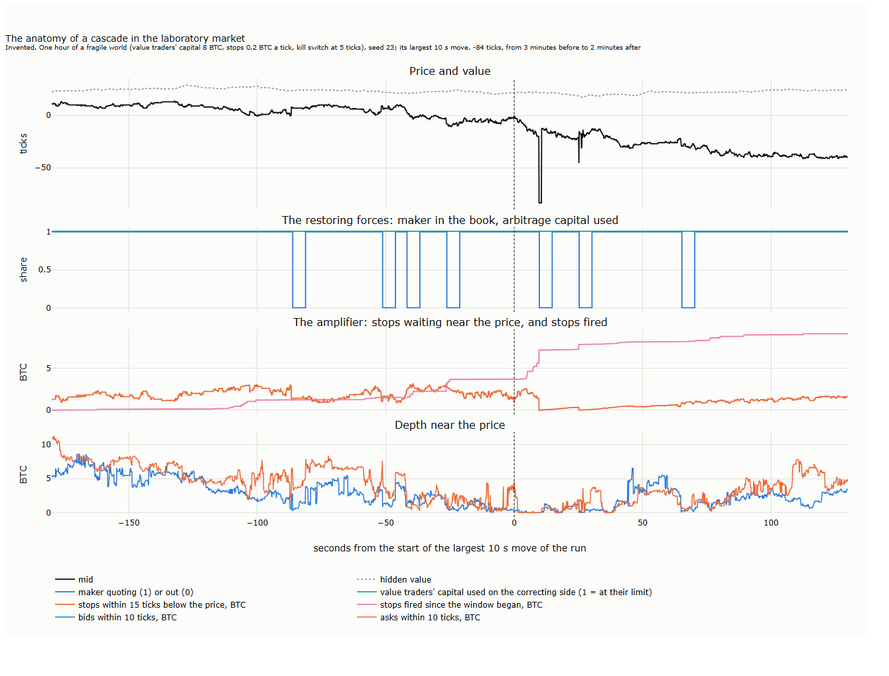
<sub><b>How to read the figure.</b> <b>Axes.</b> All panels: seconds from the start of the largest 10 s move of the run (x). Top: mid and hidden value, ticks from the mid at 0 s (y). Second: the market maker quoting (1) or out (0), and the share of their limit the value traders have used on the side that would correct the move (y). Third: stops within 15 ticks below the price, and stops fired since the window began, BTC (y). Bottom: bids and asks within 10 ticks of the mid, BTC (y). <i>Invented</i>; one hour of one fragile world.</sub>

| Stage | What the players do | What it adds up to | What could be seen |
|---|---|---|---|
| 1. Loading | The price has drifted below the value; the value traders are at their limit and stop buying | The restoring force from capital is gone, invisibly: the price looks calm | Depth near the price falling; a lasting gap to the value |
| 2. Flickering | The maker's kill switch fires again and again; stops fire in small bursts | The second restoring force flickers; each small move meets less depth | Quote pulls in bursts; depth falling further; the spread widening |
| 3. Trigger and chain reaction | A small push meets an empty bid side: stops fire, the maker is out a third of the time | Each sale sets off more | Bids near the price at zero; trades far through the book |
| 4. Exhaustion | The stops near the price are used up; the maker returns more often | The chain stops for lack of fuel, not because anyone corrects the price | Stops firing slows; depth starts to return |
| 5. Aftermath | Depth rebuilds slowly; the value traders are still at their limit | The price stays lower, far below the value | Depth well below its level before; a large lasting gap to the value |

<sub><b>How to read the table.</b> <i>Invented.</i> One row per stage of the recorded episode, our reading of it; other episodes of the same world differ in timing, not in order. Numbers in [E28 §2.3](../extended/28-a-market-that-reacts/lecture.md).</sub>

The price is the last thing to show the danger: in stages 1 and 2 it barely moves while the forces that would hold it erode. And a cascade ends when its fuel is spent, not when someone corrects it; if the capital that would correct it is still exhausted, the price stays where the cascade left it. A large enough push into a fragile book can set it off without anyone intending it. Doing it on purpose, **momentum ignition**, which the US Securities and Exchange Commission described in 2010 as trying to "ignite a rapid price move", is manipulation and illegal; in the laboratory a naive pusher who sells and buys back lost on average in every world (exercise 6).

### 5.3 Who reacts to our order, and how

**Key message.** An algorithm is engineered against other traders: each type meets our order differently, depending on whether we take liquidity (a market order) or provide it (a resting order).

| Trader | Our market order meets it | Our resting order meets it | Can we see it? |
|---|---|---|---|
| Market maker | It fills us, then leans: the price moves further for about a second and our next slice pays more. If it has pulled, we walk a thin book and land in the tail of the cost | It competes with us for the front of the queue; when it pulls in a fast move, our order is left alone at the front and filled just before the price runs through | Its pulls are visible in the book; on Bybit they predict a fatter cost tail (H20a, §6.4) |
| Value traders (arbitrageurs) | They take the other side after us and pull the price back: our push fades. Out of capital, our push stays | They fill our order when the price has moved away from the value | Not directly; the gap to another venue stands in for it, and did not work on Bybit (H20b) |
| Sniper | Competes with us after news; if it is faster, we pay the moved price | Takes our quote the moment it is stale: filled exactly when it is wrong | Not from the book: the losers of a race leave no trace (Aquilina, Budish and O'Neill, 2022) |
| Slicer (TWAP) | Trading with its side adds to its pressure; against it, it is a predictable counterparty | Fills our orders on the other side steadily, with little information in the fills | Yes: runs of equal orders at regular gaps |
| Trend followers | A push near a crossing can set them off; sending just after a whole minute meets their burst | Just after whole minutes their flow fills orders against the trend, when the price tends to continue | Yes, through the clock |
| Stops and liquidations | A large order through their levels sets them off: we pay for our own move and for theirs | An order on the other side is filled by the cascade, at prices that keep running | Not in our data: Bybit publishes no history of liquidations |

<sub><b>How to read the table.</b> One row per trader type of the laboratory market; the scalper of E28 is left out. Entries with a section reference were measured; the others follow from the traders' rules and are open questions for our data. The last column summarises what our measures recovered where the truth was known (<i>Invented</i> data); Lecture 23 tests the same footprints on Bybit.</sub>

The side we choose decides whom we meet: a resting order meets the same traders as a market order, but on their terms, filled when they want to trade, which is when it is worst for us. The traders who answer within a second, the maker and the sniper, decide the cost of a single order; those who answer on a clock or at a price level, trend followers and stops, decide what a push does over minutes. And the types that matter most for the tail of our cost, the maker who pulls and the stops that fire, are those whose withdrawal or arrival is quickest.

## 6. The reaction on our data

Section 5 showed how a push fades or tips where every rule is known. This section measures on Bybit what the hybrid replay needs: how far the price moves after real orders, whether what they took comes back, and whether other traders follow. Everything is estimated in sample, 20 September to 9 October 2025 (20 days), and tested on the 24 days after 10 October. A real order is the trades with the same millisecond and side; its move is compared with matched control moments of the same day and hour and the same state of the book and the flow ([E28 §3](../extended/28-a-market-that-reacts/lecture.md)).

### 6.1 How far does the price move?

**Key message.** The price moves in the direction of an order, far less than in proportion to its size, and the move of large orders fades within minutes.

```math
R(\tau) = c(\tau)\, S^{\delta(\tau)}
```

| Symbol | Meaning |
|---|---|
| $`R(\tau)`$ | the move of the mid in the order's direction, $`\tau`$ seconds after it, net of its controls, in bp |
| $`S`$ | the order's size in BTC |
| $`\delta(\tau)`$ | how fast the move grows with size: 1 is in proportion, 0.5 a square root, 0 no growth |
| $`c(\tau)`$ | the move of an order of 1 BTC |

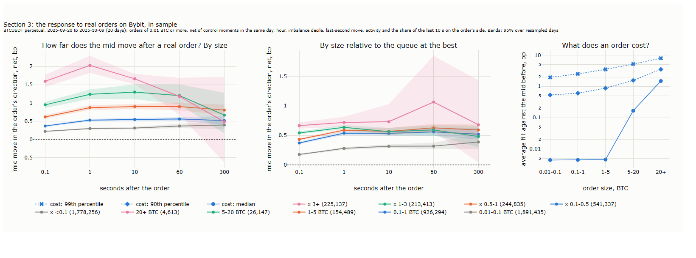
<sub><b>How to read the figure.</b> <b>Axes.</b> Left and middle: seconds after the order (x), the mid's move in the order's direction, net of controls, bp (y). Right: order size (x), cost, bp, log scale (y). BTCUSDT, 20 September to 9 October 2025; orders of 0.01 BTC or more. Left: by size class; middle: by size relative to the size at the best on the side taken; right: median, 90th and 99th percentile of cost (average fill against the mid before). Bands: 95% over resampled days.</sub>

| Order size | Orders | 1 s | 10 s | 300 s |
|---|---|---|---|---|
| 0.01-0.1 BTC | 1,891,435 | 0.30 bp | 0.31 | 0.40 |
| 1-5 BTC | 154,489 | 0.87 | 0.90 | 0.80 |
| 5-20 BTC | 26,147 | 1.24 | 1.30 | 0.67 |
| 20 BTC or more | 4,613 | 2.03 | 1.66 | 0.48 |

<sub><b>How to read the table.</b> Net move in the order's direction, in sample.</sub>

Fitted on the classes, $`\delta`$ is 0.27 at 1 s and 0.24 at 10 s: an order 10 times larger moves the price less than twice as far, flatter than the square root (δ about 0.5) that Donier and Bonart (2015) report for large orders worked over time on bitcoin. Orders of 20 BTC or more keep about a quarter of their move after five minutes; small orders' moves do not fade, because small orders come in streams on the same side (Lecture 21 §6.2), and the stream carries the price on.

**Cost is a distribution.** Below 5 BTC the median order pays nothing measurable: it fills at the best. Yet the 99th percentile is 3.5 bp for orders of 1 to 5 BTC and 8.0 bp for 20 BTC or more. An average would hide that most orders pay nothing and a few pay a lot.

### 6.2 Does what an order took come back, and do others follow?

**Key message.** The depth an order took does not return at the prices it took; it re-forms around the new best, and more slowly after larger orders. Much more trading follows an order on its side than at control moments, but most of it is a stream already under way.

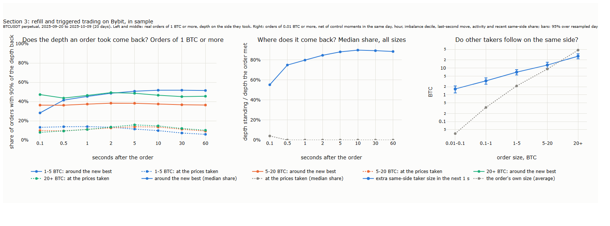
<sub><b>How to read the figure.</b> <b>Axes.</b> Left and middle: seconds after the order (x). Left: share of orders with 90% of the depth back (y); middle: depth standing over depth the order met, median (y). Right: order size (x), BTC, log scale (y). Real orders of 1 BTC or more, depth on the side they took: at the prices the order took (dotted) and over as many levels from the new best (solid). Right: extra taker size on the order's side in the next second, net of controls, and the order's own size.</sub>

At the prices an order took, nothing stands again from half a second on: the price has moved away from them. Over as many levels from the new best, 75% stands again within half a second and about 90% from five seconds on after orders of 1 to 5 BTC; after orders of 5 to 20 BTC the refill stops at about 60 to 65%, which is why the key chart's 5 BTC order still misses about 1.5 BTC a minute later.

Trading that follows an order looks large: an order of 0.01 to 0.1 BTC was followed within a second by 1.9 BTC more than its controls on the same side. What explains it is a stream already running: order signs have long memory, a buy followed by buys far longer than chance allows (Lillo and Farmer, 2004), largely because large orders are split into many pieces (Lillo, Mike and Farmer, 2005). Without trader identities, public data cannot separate a reaction from the same trader's next slices, so the replay takes its triggered trading from orders that came against the recent flow, the closest real cousins of an order of ours with no stream behind it.

### 6.3 The hybrid replay

The pieces add up to a replay that keeps the recorded book as its background:

| Layer | What it does | Estimated in |
|---|---|---|
| A. Depletion | What our order took is removed from the levels near the best | Bookkeeping |
| B. Refill | It comes back along the measured curve, by size class | §6.2 |
| C. Impact | The mid, and the book with it, moves by $`R(\tau)`$ for our size, held at its 300 s value afterwards | §6.1 |
| D. Triggered trading | Extra taker size on our side, which can fill our resting orders | §6.2 |
| E. Reaction to resting size | The reaction of H8 (§4), reported as a band, on and off | §4 |

<sub><b>How to read the table.</b> Each layer is switched on one at a time, and an order's cost is reported layer by layer. The measured move already contains everything the market did after real orders, so the mid comes from layer C alone; the levels that A and B leave empty only make our next order's walk dearer. Code in [E28's scripts](../extended/28-a-market-that-reacts/scripts/).</sub>

### 6.4 Does the hybrid replay tell the truth?

**Key message.** The hybrid replay predicts single orders better than the plain one. As first fixed, it overstated what a run of orders costs: impact that grows more slowly than size cannot be added slice by slice.

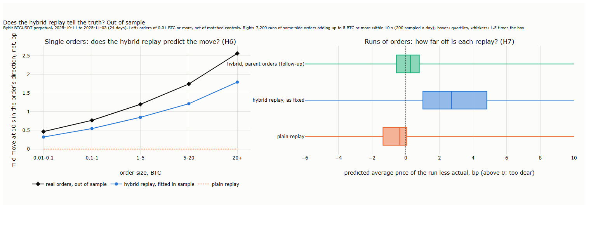
<sub><b>How to read the figure.</b> <b>Axes.</b> Left: order size (x), mid move at 10 s in the order's direction, net of controls, bp (y). Right: one row per replay (y), predicted average price of a run less its actual average price, bp (x); above 0 the replay makes the run too dear. BTCUSDT, 11 October to 3 November 2025. Left: real orders (black), the hybrid replay's prediction fitted in sample (blue) and the plain replay's (orange, zero). Right: 7,200 runs of same-side orders adding up to 5 BTC or more within 10 s; boxes: quartiles; whiskers: 1.5 times the box.</sub>

**Single orders.** The plain replay predicts no move; real orders move the price, so the hybrid replay is closer at every size (H6). It is too low by about a quarter: out of sample, real moves were 1.33 times its prediction, because the days after 10 October had a thinner book than the days it was fitted on (§8). Size in BTC predicted better than size relative to the queue (H5 fails), and the exponent held out of sample (δ = 0.23, H2).

**Runs of orders.** As fixed, the replay charged each slice of a run its own impact and added them up. With an exponent of 0.23, a small order carries a large impact per BTC, so ten slices of 0.5 BTC add up to several times the impact of one order of 5 BTC: the replay made runs too dear by 3.0 bp on average (H7 fails). The reason is arithmetic. With $`R = c\,S^{\delta}`$, $`n`$ equal slices each charged their own impact add up to $`n^{1-\delta}`$ times the impact of the whole order: for $`\delta = 0.23`$ and $`n = 10`$, about 5.9 times. A follow-up, run after the result and so not a test, charges a run the impact of its cumulative size, as impact laws for split orders are stated: the bias falls to 0.13 bp, and the error to slightly below the plain replay's.

**Refill and follow-on trading** held out of sample (H1, H4). Whether the move of large orders fades from one to five minutes is not settled (H3 fails after correction).

**A condition on layer E.** Built into a replay, the reaction to resting size of H8 offers a seller a gift: post a bid as large as the queue, sell at the ask a second later, cancel the bid. In 89% of 7,200 such round trips the version with the bid ended ahead by about 0.25 bp; on average it lost, because in the other cases the large bid was hit just before the price fell. So the layer is kept, reported as a band. The caveat is plain: a trader who could cancel just before being filled would collect the reaction every time, which is why that behaviour is banned as spoofing.

**Near the tipping point (H20).** In the fifth of moments with the most quote withdrawals in the 5 s before, orders of 1 to 5 BTC had a 90th percentile of cost of 1.62 bp, against 0.72 bp in the fifth with the fewest; the 99th percentile was 6.6 against 3.5 bp. The median barely moved, 0.015 against 0.005 bp (H20a). This is the laboratory's mechanism on real data: when makers withdraw, most orders still fill at the best, and a few walk a thin book. Withdrawals are measured before our order is sent, so they can be read in time. The laboratory's loose anchor did not carry over: with the gap between Bybit and Binance standing in for the distance from value, a push did not last measurably longer (H20b).

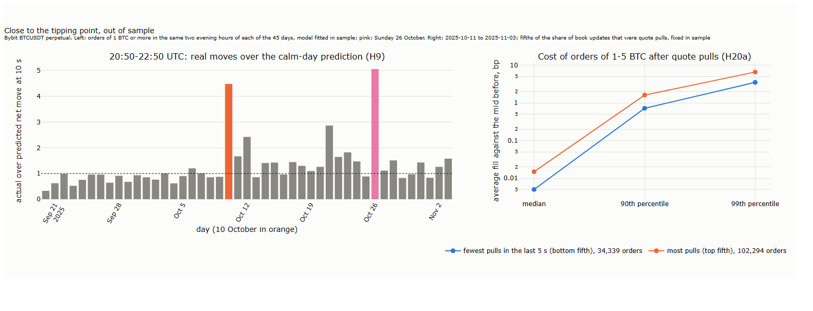
<sub><b>How to read the figure.</b> <b>Axes.</b> Left: day (x), real net move at 10 s over the move predicted from the calm days (y), orders of 1 BTC or more between 20:50 and 22:50 UTC. Right: three points of the cost distribution (x), cost of orders of 1 to 5 BTC, bp, log scale (y). Left: 10 October in orange, Sunday 26 October in pink, the dotted line where real equals predicted. Right: orders in the fifth of moments with the most quote withdrawals in the last 5 s (orange) and the fewest (blue), fifths fixed in sample; 11 October to 3 November 2025.</sub>

## 7. Verdicts

Each test was asked one question, fixed before its result. **The question it answers** is the plain question behind the test; **on our sample** gives its main number; **verdict** says whether it held after the correction for testing many hypotheses at once. All tests are out of sample, on the 24 days after 10 October unless stated.

| Hypothesis | The question it answers | On our sample | Verdict after correction |
|---|---|---|---|
| **The replay (E27 register)** | | | |
| H1 | Does the touch rule flatter a resting order? | After 1 s: touch −0.29 bp, queue rule −0.76 bp | Holds |
| H2 | Are the fills that come as the price runs through the bad ones? | After 1 s: adverse −0.93 bp, others −0.05 bp | Holds |
| H3 | Does the unknown cancellation split decide the answer? | After the fee, 10 s: −2.8 to −3.0 bp at every setting | Same sign throughout (reported, not tested) |
| H4 | Is the replay no kinder than real fills? | After 1 s: replay −0.76 bp, real small fills −0.12 bp | Holds, with a wide caveat (§4) |
| H5 | Are fills worse at the start of minutes :00 and :30? | After 1 s: −0.92 bp against −0.76 bp, on 0.9% of fills | Holds, small |
| H6 | In the cascade, were more fills adverse than on any other day? | 81%, sixth of 45 days | Fails |
| H6 | In the cascade, did each fill lose more than on any other day? | After 10 s: −1.73 bp, worst of 45 days | Holds |
| H7 | Do large market orders miss the last book by more than small ones? | Gap 0.32 bp at 5 BTC or more, 0.14 bp below 0.01 BTC | Holds |
| H8 | Does the market respond to size added at the best? | +0.25 bp after 1 s for additions as large as the queue, net of controls | Holds |
| H9 | Far from the price, does the queue rule fill more than trade-through? | 47.75% against 47.72% | Holds, of no practical size: Lecture 20's fills stand |
| **A market that reacts (E28 register)** | | | |
| H1 | Does depth return faster around the new best than at the prices taken? | 28 percentage points more orders with 90% back within 1 s | Holds |
| H2 | Does the move grow less than in proportion to size? | δ = 0.23 (95% 0.22 to 0.25) | Holds |
| H3 | Does the move of large orders fade from 60 s to 300 s? | 0.38 bp (−0.03 to 0.84) | Fails after correction |
| H4 | Do large orders draw more trading on their side? | 10.0 BTC more after 5-20 BTC than after 0.1-1 BTC | Holds, partly a stream under way |
| H5 | Is size relative to the queue the better scale? | No: size in BTC has the lower error | Fails |
| H6 | Does the hybrid replay predict single orders better than the plain one? | Lower error at 10 s | Holds |
| H7 | Does it predict runs of orders better? | No: average error 3.5 bp against 1.3, slice by slice | Fails; fixed after the result by charging cumulative size |
| H9 | Was 10 October's reaction the most out of line? | Second of 45 days | Fails after correction (§8) |
| H20a | Is the tail of the cost fatter after quote withdrawals? | 90th percentile 1.62 bp against 0.72 | Holds |
| H20b | Does a push last longer when Bybit is far from Binance? | 0.93 of the 1 s move left at 60 s against 0.89 | Fails |

<sub><b>How to read the table.</b> One row per test, numbered as in each register; the two registers number their hypotheses separately. p-values are one-sided, from 2,000 resamples of days, or for the cascade from the rank of 10 October among the 45 days. The Benjamini–Hochberg procedure at 5% is applied within each register: nine of the replay's ten tests hold, five of the reaction's ten. Full numbers and p-values: [E27 §4](../extended/27-replaying-the-exchange/lecture.md), [E28 §4](../extended/28-a-market-that-reacts/lecture.md).</sub>

Three caveats apply to all of it. Every result is on one symbol, one venue and 45 days; a hypothesis that holds here may fail elsewhere. The replay's weakest point is the one only live orders can settle: how far its resting fills are from real ones. And none of the numbers is a trading result for a strategy; they are the costs and fills a strategy would meet.

## 8. 10 October

On the evening of 10 October 2025, after a post announcing 100% US tariffs on China at 20:50:01.7 UTC, Bybit's BTCUSDT fell from about USDT 116,850 to 103,151 within 30 minutes and recovered to 113,702 (Lecture 21 §8). Here the replay puts our orders into the same two hours, 20:50 to 22:50 UTC. Two quoters of 0.001 BTC on each side run through the whole window on all 45 days, under the queue rule at 50 ms, with no limit on their position and no stop, to show what the market would have done to a quoter that did nothing about it.

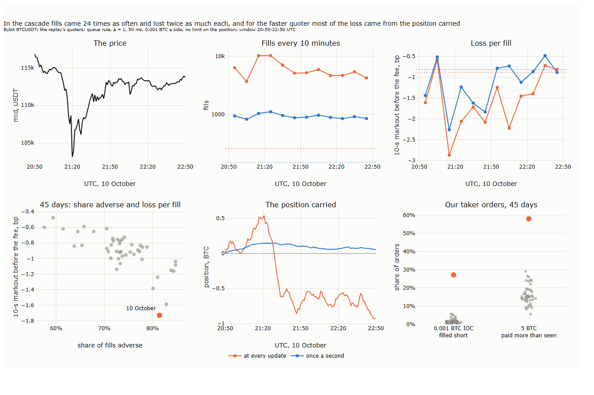
<sub><b>How to read the figure.</b> <b>Axes.</b> Top and bottom middle: time on 10 October (x). Top left: mid (y). Top middle: fills per 10 minutes (y, log). Top right: 10-s markout (y). Bottom left: share of fills adverse (x), 10-s markout (y), one dot per day. Bottom middle: position in BTC (y). Bottom right: share of orders filled short (y), one dot per day. <b>Top middle and right:</b> dotted lines are the median of the other 44 days in the same window. <b>Bottom left:</b> the quoter that reacts at every update. <b>Bottom right:</b> 50 ms; orders sampled every 10 s in the window; orange is 10 October.</sub>

| The quoter that reacts at every update | 10 October | Median of the other 44 days |
|---|---|---|
| Fills | 72,759 | 3,074 |
| Share of fills adverse | 81% | 73% |
| In the 10 s after each fill, bp | −1.72 | −0.88 |
| From the position carried after that, bp | −7.26 | +0.17 |
| Result before the fee, USDT | −7,295 | −23 |
| Largest position, BTC | 0.944 | 0.189 |

<sub><b>How to read the table.</b> Bp of the value traded. "From the position carried": everything between 10 s after each fill and the mid at 22:50. The fee of 2 bp comes on top. The once-a-second quoter lost −365 USDT on 10 October, a twentieth; full table in [E27 §5](../extended/27-replaying-the-exchange/lecture.md).</sub>

**The queue stops being the question.** In the cascade the median order joined behind 0.3 to 0.45 BTC, against 2.5 BTC in an ordinary half-hour, and almost every order was filled. The risk of a resting order is no longer that the fill does not come.

**The price moved far more than the fills lost.** The average move of the mid over 10 s was 17 times that of the median day, yet the loss per fill only doubled: it was the worst of the 45 days, while the share of adverse fills was ordinary, sixth of 45 (H6). What grew was the spread of the outcomes, 22 times as wide. On this evening the fills were not far worse on average; they were far less certain.

**The largest part of the bill is the position.** With 24 times the usual fills, buys and sells nearly balanced, but their order did the damage: the quoter was long on the way down and short on the way up, and its position reached 944 times the size of its order. That carried position cost 5,897 of the 7,295 USDT; the 10-s markout, the measure of Sections 1 to 4, saw only 19% of the loss. On ordinary evenings that measure is a fair summary.

**Orders meant as trades miss.** At 50 ms, 27% of the minimum-size IOC orders in the window were filled short, against a median of 1.5% on other days; at the worst ten minutes, 45%. Of the 5 BTC market orders, 58% paid more than they saw, and some could not be priced at all because the 200 published levels held less than 5 BTC. Set beside a move of 16 bp in 10 s, these costs are small, while a miss is not: what a taker needs in a cascade is to be filled.

**Stage by stage.** Our data cannot see capital or stops, but the timing of the book and the flow fits the stages of §5.2, with one difference: the trigger was news, not a push.

| Stage | Laboratory (§5.2) | 10 October 2025, Bybit (UTC) |
|---|---|---|
| Loading | Capital at its limit, depth thinning, price calm | Not visible: no measure of Lecture 21 warned before the post |
| Trigger | A small push into a loaded book | The tariff post at 20:50:01.7: news, not a push |
| Withdrawal | The maker flickers out | Quote pulls and refill chains flagged at 20:55; depth at 20:58 |
| Chain reaction | Stops fire into an empty book | The branching ratio flagged at 21:04; at 21:14 the first minute larger than any calm-day minute |
| Aftermath | The price stays down, depth rebuilds slowly | Orders moved the price 1.4 times as far as before for three weeks |

<sub><b>How to read the table.</b> Left: the stages of the laboratory episode. Right: the times measured on Bybit in Lecture 21 §8 and in this section; who withdrew and whose stops fired cannot be seen.</sub>

**After the cascade.** Between 20:50 and 22:50 on 10 October, orders of 1 BTC or more moved the price 4.5 times as far as the calm-day replay predicted, yet a thin Sunday evening, 26 October, reached 5.1 on a tenth of the orders, so 10 October ranks second of 45 (H9). What no test asked about is in the left panel of the last figure of §6: before 10 October the evening ratio sat below 1 (median 0.86); after it, above 1 on three evenings in four (median 1.42). The market stayed more reactive for at least three weeks. In the language of §5, after tipping the system does not return at once to where it was; and a replay calibrated before an event understates what orders cost after it, by about a third here.

**What the replay cannot say.** Whether a real connection stayed at 50 ms through the fall; what others would have done with our size; the margin behind a position of 0.944 BTC in a move of 12%; and whether any of this repeats: it is one evening on one venue.

## 9. What it means for an algorithm

The players and their stages are not only a description of the market; they are what an algorithm meets. This section draws the consequences: what to watch, what to do, and how to test.

| Stage | The signal an algorithm can read | What it should do |
|---|---|---|
| Calm | Depth at its usual level, few quote pulls, the gap to other venues small | Trade normally; size and expect cost from the hybrid replay, as a distribution (median and 90th percentile) |
| Loading | Depth falling against its usual level; a lasting gap to other venues | Cut the size of each order relative to depth; keep resting orders small; raise the cost assumption |
| Flickering | Quote pulls in bursts (the tail of cost doubles in the top fifth, H20a); the spread widening | Stop sending large market orders; slice more slowly and wait for refills; pull resting orders from the side a fall would hit |
| Chain reaction | Depth near zero on one side; trades far through the book | Do not chase and do not be the trigger; quote only if built and capitalised to absorb the flow; let the algorithm's own kill rules act |
| Aftermath | Depth returning; costs still above normal | Return gradually; recalibrate cost curves, which can stay higher for weeks (1.4 times after 10 October) |

<sub><b>How to read the table.</b> The signals with a reference are measured on our data; the actions are design suggestions, not tested results. The thresholds that turn a signal into an action belong to the strategy and must be tested as below.</sub>

Two warnings go with the table. The signals arrive late: on 10 October they came five to eight minutes after the news, so they say "the book is fragile now", not "a crash is coming". And an algorithm can be the trigger: in a loaded book our own order is the small push of stage 3, so the size rules matter most when the market looks calm and is not.

| Test | What it tests | What it cannot test |
|---|---|---|
| Hybrid replay on calm days | Normal slippage and its distribution | Anything the calm days did not contain |
| Hybrid replay through stressed windows | The algorithm on real fast paths: 10 October, the moments with the most quote pulls, the weeks after a cascade | Its own effect when it becomes a large part of the market |
| The laboratory market with the algorithm as a player | Whether it triggers a cascade, is caught in one, or survives one | Numbers: every setting is invented; it tests rules, not profits |
| Shocks of chosen size | A thinned book, multiplied impact or a burst of liquidations injected into the replay, over a grid of severities | Which severity will come |
| Limits that need no model | A maximum position, a maximum order size relative to depth, kill rules, the worst loss if every resting order is filled at the worst price | Nothing about likelihood: they bound the damage when the models are wrong |
| Live at small size | Real cost and fills, logged with the state of the book, against the replay's prediction | Fast markets until one happens |

<sub><b>How to read the table.</b> One row per kind of test, from the cheapest to the slowest. The first two use real data, the third invented data, the last three need no model of the market, or only the real market.</sub>

**Things may happen differently.** Every test assumes we know what can go wrong, and the trigger on 10 October was a post on social media, not a trade. The answer is not one more scenario but limits that hold whatever happens, and a **pre-mortem** before going live: imagine the algorithm has lost badly in a fast market, and write down how. Each answer becomes a limit, a test or a signal to watch. The capstone (Lecture 24) takes a trend bot live with exactly these limits.

## 10. Before trading an instrument: the method

**Understand deeply the microstructure of every instrument the portfolio trades, its liquidity, its impact and its slippage, in calm markets and after events, before designing how to trade it.** This lecture taught that on one instrument. The numbers are Bybit's; the method is general. We are not handing over a fish but teaching how to fish.

**The method, for any instrument traded on an exchange.**

| Step | The question | What this lecture measured on Bybit |
|---|---|---|
| 1. Matching and visibility | How are orders matched, and what can we see: the book, the trades, how often? | Price-time priority; L2 every 100 ms; trades to the millisecond; a fifth of the flow hidden inside updates (§3) |
| 2. What our order meets | **Liquidity**: depth near the price against our size, the queue, the latency gap | The queue of a few BTC; the gap by size and delay; the fills we get are mostly the bad ones (§3, §4) |
| 3. How the market reacts | **Impact**: how far the price moves with our size and how much comes back; who answers our order | δ about 0.23; refill around the new best; cumulative size for sliced orders (§6) |
| 4. What changes after events | **Slippage** in the tail, and how long costs stay higher | The tail of cost doubles after quote pulls; 1.4 times the impact for three weeks after the cascade (§6.4, §8) |

<sub><b>How to read the table.</b> One row per step of the method; the middle column is what to ask of any instrument, the right column what the answer was for our example.</sub>

**Each instrument has its own microstructure.** The steps are the same; what to check first differs.

| Instrument | How it trades | What to check first, against the Bybit example |
|---|---|---|
| **Futures** | A central limit order book on one exchange, as in our example | The matching rule: price-time, or pro-rata or mixed allocation in some interest-rate futures, which changes what queue position means; liquidity moving to the next contract at the roll; thinner overnight sessions; daily price limits and halts |
| **ETFs and stocks** | Order books on several exchanges, plus off-exchange venues | The exchange book as for any listed product (steps 1 to 4); fragmentation, so the visible book is only part of the liquidity; the closing auction, where much of the day's volume trades. For an ETF, on top: its price against the value of its holdings (the premium or discount), the creation and redemption that keep the two close, and the holdings' own liquidity, which is what lies behind the book in stress |
| **Listed options** | Order books, one per strike and expiry | Many thin books; quotes driven by the underlying |
| **Over the counter (bonds, much of currencies)** | Dealers quote privately, on request; no order book | Steps 1 to 4 have no book to work on. What a trader reads instead is dealers' **axes** (what they want to buy or sell) and **positioning** (how full dealers' and holders' books are); free public sources include the New York Fed's primary dealer positions and the CFTC's Commitments of Traders for futures |

<sub><b>How to read the table.</b> What differs by instrument; general practice, not results of ours. The first three trade on exchanges and can be studied with this lecture's method; the last cannot.</sub>

**The base layer's instruments, as questions.** Lectures 13 to 16 trade ETFs and futures, so the method applies directly. Trend trades most just after large moves, when books are thin and costs stay higher; it trades in the direction of the move, so its orders can join a cascade. Carry holds high-yield, credit and emerging-market funds, whose books are thinner, and a carry unwind is itself a crowded exit through the same thin book. Value trades least and tends to buy after falls, on the patient side of others' cascades. In the final portfolio, netting the three cuts turnover, and the kill switches that Lecture 16 (§8.2) lists as a research direction are the limits that need no model of §9. The bond and credit exposure underneath sits on over-the-counter markets: in calm markets an ETF's book and its holdings line up; in stress they can part, and the premium or discount is the sign. Each of these is a question to check on the instruments themselves, not a result of ours.

## Back to the base layer

*Food for thought.*

| | |
|---|---|
| **The idea** | Run the four steps of §10 on the base layer's own ETFs and futures before trading them: size each order against depth, stress the cost assumption after events, and pause rebalancing while the tail of cost is fat (a kill switch) |
| **What our results already say** | After bursts of quote withdrawals the 90th percentile of cost more than doubled while the median barely moved (§6.4); for three weeks after the cascade the same orders moved the price 1.4 times as far (§8); walking the last book understated what market orders paid (§4) |
| **What a test would need** | The portfolio's own fills against the book and the tape at each order, on its own instruments; the first thing that could kill it: at daily sizes, costs may be too small for any of this to matter |
| **Status** | Not tested in this course; a research direction |

<sub><b>How to read the card.</b> Food for thought, not a result: the idea, only numbers this lecture has shown, what a test would need, and its status.</sub>

## 11. Summary, exercises and reading

### 11.1 Eight takeaways

1. **The fill rule decides the picture.** The same resting order loses −0.29 bp a second after its fills under the touch rule and −0.76 bp under the queue rule, out of sample: simple rules fill more, sooner, and keep the good fills.
2. **The fills a resting order gets are mostly the bad ones.** Four queue fills in five come as the price runs through the order, at −0.93 bp after one second against −0.05 bp for the others. The unknown cancellation split barely changes the answer, because most fills do not depend on reaching the front.
3. **Latency does little on average and takes the trades that would have paid.** Minimum-size IOC orders were left short in about 1% of calm moments and a third of those followed by a move over 5 bp in their favour; real taker orders paid 0.14 to 0.32 bp beyond the last book.
4. **A replay of resting orders leans cautious and a replay of market orders leans kind.** The replay is no kinder than real small fills, by an amount only live orders can settle; walking the last book understates what market orders pay. The market responds to size from about 0.1 BTC, so resting results are flagged from there up.
5. **The market reacts, and impact grows far more slowly than size.** A 5 BTC buy leaves the price about 1 bp higher a minute later and the book short of what it took; the move grows with an exponent of about 0.23, so a sliced order must be charged on its cumulative size, not slice by slice.
6. **A market's reaction is made by its players, and near a tipping point the restoring forces weaken first.** Makers pull and arbitrage capital runs out before the price moves; the first sign is in the tail of the cost, not its average (90th percentile 1.62 against 0.72 bp after quote pulls). A cascade is a chain reaction that ends when its fuel is spent.
7. **In the cascade the danger moved.** The queue nearly vanished, fills came 24 times as often, the outcomes spread out 22 times as far, and most of an unlimited quoter's loss came from its position. Afterwards the same orders moved the price 1.4 times as far for three weeks.
8. **Understand the microstructure of every instrument a portfolio trades** (its liquidity, impact and slippage, in calm markets and after events) before designing how to trade it; the method of this lecture applies to every exchange-traded instrument, and over-the-counter markets need axes and positioning instead. Every number here is on one symbol, one venue and 45 days.

### 11.2 Exercises

- [ ] **Another day, another hour.** Redraw the key chart (§1) for another day and hour. How much does the gap between the fill rules vary?
- [ ] **Another queue model.** Rerun the queue test of §3.2 with Rigtorp's logarithmic split instead of the dial $`a`$, counting size in two different units. Does any verdict change?
- [ ] **A limit on the position.** Give the quoters of §8 a limit on their position, at several sizes. How much of the bill does each limit save on 10 October, and what does it cost on the other 44 days?
- [ ] **Why runs cannot be added up.** With $`R = c\,S^{\delta}`$, show that $`n`$ equal slices of an order of size $`S`$, each charged its own impact, add up to $`n^{1-\delta}`$ times the impact of the whole order. Compute the factor for $`\delta = 0.23`$ and $`n = 10`$ and compare it with the bias of H7 (§6.4).
- [ ] **Depth instead of pulls.** Repeat H20a with fifths of the depth at the best five levels instead of quote pulls. Which reads the tail of the cost better?
- [ ] **Ignition does not pay, naively.** In the laboratory market of E28, a pusher that sells 10 BTC and buys back 60 s later loses on average in every world. Let it place resting buys below the price before it sells, so that it collects the cascade as a maker. Does it now pay, and in which worlds? What does that say about rules against manipulation?
- [ ] **The method on your instrument.** Pick a future or an ETF you could trade and answer the four steps of §10 from public information: matching rule, depth against a typical order of yours, how the price answers, what changed after a recent event. For an ETF, add its premium or discount in a stressed week.
- [ ] **Live at small size.** Send minimum-size resting orders to a live venue or testnet for a week, log the book at each fill, and compare your fills with the replay of the same days.

### 11.3 Reading

For latency measured live, Albers, Cucuringu, Howison and Shestopaloff (2025); for live resting orders, the same authors' paper on the market maker's dilemma. For queue position from aggregated books, Rigtorp (2013) and Databento (2025), with the code of hftbacktest. For adverse fills, DeLise (2024) and Lalor and Swishchuk (2024); for why hypothetical executions mislead, Lo, MacKinlay and Zhang (2002). For impact, Donier and Bonart (2015) and the long memory of order flow, Lillo and Farmer (2004). For the tipping side, the limits of arbitrage (Shleifer and Vishny, 1997), the branching ratio (Filimonov and Sornette, 2012; Hardiman, Bercot and Bouchaud, 2013), endogenous liquidity crises (Fosset, Bouchaud and Benzaquen, 2020) and early warnings (Scheffer et al., 2009).

Full versions: [E27](../extended/27-replaying-the-exchange/lecture.md) and [E28](../extended/28-a-market-that-reacts/lecture.md).

### 11.4 Next: trading styles and market making

This lecture let the market react to our order through the types of traders in it. Lecture 23 asks whether those types can be recognised in public data, how their shares change over time and around events, and what each means for an algorithm that meets them; it then takes up market making, the strategy this lecture's quoters only introduced, with the sum a quote must pass: the half-spread, the move after the fill, the position carried and the fee.

## References

- Albers, J., Cucuringu, M., Howison, S. and Shestopaloff, A. Y. (2025). The good, the bad, and latency: exploratory trading on Bybit and Binance. *Quantitative Finance* 25(6), 919–947. — live market orders and their failure given the later return (§2.2, §3.1).
- Albers, J., Cucuringu, M., Howison, S. and Shestopaloff, A. Y. (2025). The market maker's dilemma: navigating the fill probability vs. post-fill returns trade-off. arXiv 2502.18625. — live resting orders on Binance (§2.4).
- Aquilina, M., Budish, E. and O'Neill, P. (2022). Quantifying the high-frequency trading "arms race". *Quarterly Journal of Economics* 137(1), 493–564. — the losers of a race leave no trace in book data (§5.3).
- Databento (2025). Getting queue position from L2 and order book data. Blog, 26 February 2025. — cancellations mostly from the back of the line (§2.3).
- DeLise, T. (2024). The negative drift of a limit order fill. arXiv 2407.16527. — the drift after a fill (§2.4).
- Diamond, D. W. and Dybvig, P. H. (1983). Bank runs, deposit insurance, and liquidity. *Journal of Political Economy* 91(3), 401–419. — two equilibria, all stay or all run (§5.1).
- Donier, J. and Bonart, J. (2015). A million metaorder analysis of market impact on the Bitcoin. *Market Microstructure and Liquidity* 1(2), 1550008. — square-root impact of metaorders on bitcoin (§6.1).
- Filimonov, V. and Sornette, D. (2012). Quantifying reflexivity in financial markets: toward a prediction of flash crashes. *Physical Review E* 85(5), 056108. — the branching ratio as a measure of reflexivity (§5.1).
- Fosset, A., Bouchaud, J.-P. and Benzaquen, M. (2020). Endogenous liquidity crises. *Journal of Statistical Mechanics: Theory and Experiment*, 063401. — a threshold between a stable and a crisis-prone book (§11.3).
- Hardiman, S. J., Bercot, N. and Bouchaud, J.-P. (2013). Critical reflexivity in financial markets: a Hawkes process analysis. *European Physical Journal B* 86(10). — the branching ratio close to 1 throughout (§5.1).
- hftbacktest. github.com/nkaz001/hftbacktest. — queue models, fill rules and latency in code (§2.3).
- Lalor, L. and Swishchuk, A. (2024). Market simulation under adverse selection. arXiv 2409.12721. — adverse and non-adverse fills; simulations that ignore them are "over-inflated" (§1, §2.4).
- Lillo, F. and Farmer, J. D. (2004). The long memory of the efficient market. *Studies in Nonlinear Dynamics & Econometrics* 8(3). — long memory of order signs (§6.2).
- Lillo, F., Mike, S. and Farmer, J. D. (2005). Theory for long memory in supply and demand. *Physical Review E* 71, 066122. — order splitting as the cause of that memory (§6.2).
- Lo, A. W., MacKinlay, A. C. and Zhang, J. (2002). Econometric models of limit-order executions. *Journal of Financial Economics* 65(1), 31–71. — hypothetical executions as poor proxies (§11.3).
- Rigtorp, E. (2013). Estimating order queue position. rigtorp.se/2013/06/08/estimating-order-queue-position.html. — the split of a cancellation (§2.3).
- Scheffer, M., Bascompte, J., Brock, W. A., Brovkin, V., Carpenter, S. R., Dakos, V., Held, H., van Nes, E. H., Rietkerk, M. and Sugihara, G. (2009). Early-warning signals for critical transitions. *Nature* 461, 53–59. — slower recovery before a tipping point (§5.1).
- Schelling, T. C. (1971). Dynamic models of segregation. *Journal of Mathematical Sociology* 1(2), 143–186. — simple rules, sudden collective change (§5.1).
- Securities and Exchange Commission (2010). Concept release on equity market structure. Release No. 34-61358. — momentum ignition described (§5.2).
- Shleifer, A. and Vishny, R. W. (1997). The limits of arbitrage. *Journal of Finance* 52(1), 35–55. — arbitrage fails when capital is withdrawn after losses (§5.1).

*References carried over from E27 and E28, where they were checked against their sources or standard bibliographic records (9 November 2026); quotations from the originals.*
