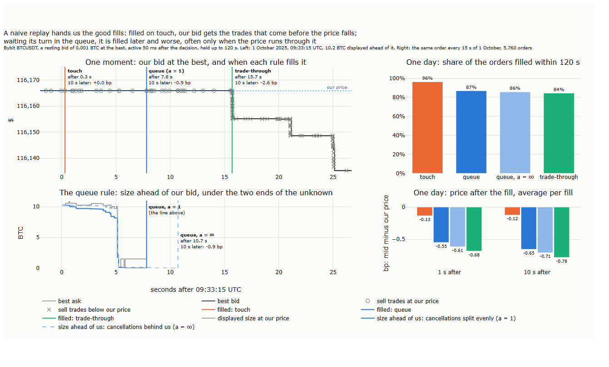
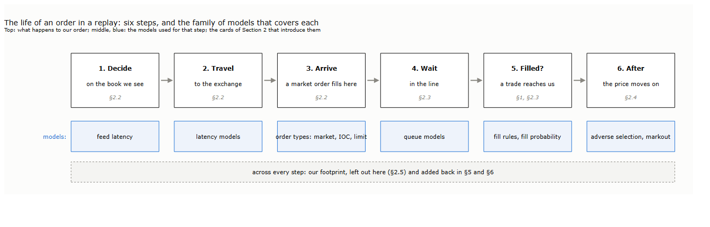
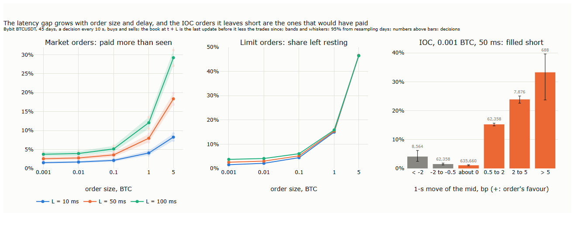
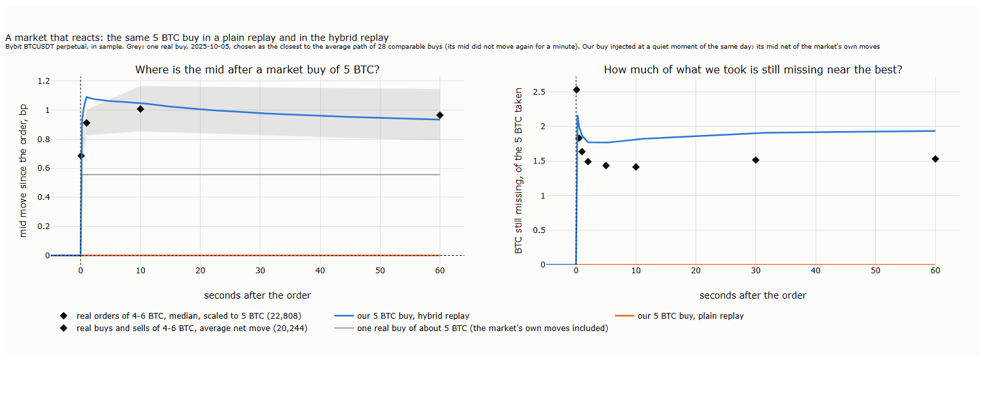
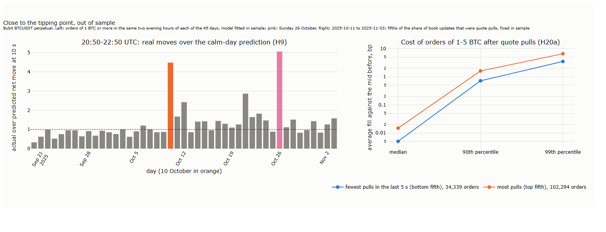

# Lecture 22: Replaying the Exchange

> A backtest of execution is only as good as its replay: the fill rule, the queue, latency and the market's reaction decide it.

Part V · Pipeline stage: execution (our own orders in the recorded market, and the market's answer to them)

---

# Three replays of one order

> The same resting order earned 0.0 bp, −0.9 bp or −2.6 bp ten seconds after its fill, depending only on the fill rule.

- **Touch:** filled by the first trade at our price, as if first in line
- **Queue:** filled once the line ahead has traded or left
- **Trade-through:** filled only when the price trades below us

---

# The life of an order in a replay

> Each step of an order's life needs its own model, and each realistic choice makes the replay less flattering.

- **Latency:** our order meets a later book than the one we decided on
- **Queue:** the book shows how long the line is, not who leaves it; one dial $a$ spans the unknown
- **Footprint:** a plain replay assumes nobody answers our order

---

# The fills we get are mostly the bad ones

> When the price runs through a resting order it is filled for certain; when it moves away, only by chance. So fills lean towards losses.

$$E[d \mid \text{fill}] = \frac{R\,P(U) - P(D)}{P(D) + R\,P(U)} < 0 \quad \text{if } R < 1$$

- Three queue fills in four are adverse: −1.01 bp after 10 s, the others −0.16 bp
- Touch makes the same orders look three times better (−0.26 bp)
- The maker fee is 2 bp: no rule comes near paying it at the minimum size

---

# Latency takes the trades that would have paid

> On average the gap costs almost nothing; what it changes is which orders win.

- Minimum-size IOC orders filled short: 1.1% when the price stood still, 33% when it then moved over 5 bp their way
- Real taker orders paid 0.14 to 0.32 bp beyond the last recorded book

---

# Does the replay tell the truth?

> The fair fill rule shows no sign of flattering; on market orders the replay is too kind; it holds for the smallest orders.

| Question | Answer |
|---|---|
| Does touch flatter? | Yes: −0.29 against −0.76 bp after 1 s |
| Does the unknown queue decide it? | No: −2.8 to −3.0 bp after the fee everywhere |
| Is the replay kinder than real fills? | No; cautious, by up to 0.64 bp |
| From what size does the market respond? | About 0.1 BTC: larger resting results flagged |

---

# A market that reacts

> The price does not forget a 5 BTC buy, and the book does not give back what it took.

- A minute later the mid is still about 1 bp higher; about 1.5 BTC of the 5 is still missing near the best
- A second 5 BTC buy 2 s later: 0.004 bp in a plain replay, 1.08 bp in the hybrid one

---

# Calm, tipping, cascade

> A market's reaction is made by its players; a push fades when someone takes the other side at a profit, and stays when nobody can.

| Regime | What the players do |
|---|---|
| Calm | Makers lean, arbitrageurs trade the price back: a push fades |
| Near the tipping point | Makers pull, arbitrage capital runs out: the tail of the cost fattens |
| Cascade | Stops fire into a thin book: a chain reaction until the fuel is spent |

- **Chain reaction:** total effect about $1/(1-n)$ for a branching ratio $n$
- **Run on liquidity:** pulling is rational for each maker, fragile for all

---

# Impact grows far more slowly than size

> An order 10 times larger moves the price less than twice as far, so a sliced order must be charged on its cumulative size.

$$R(\tau) = c(\tau)\,S^{\delta}, \qquad \delta \approx 0.23$$

- Slice by slice, ten slices cost $10^{0.77} \approx 5.9$ times one order: runs were 3.0 bp too dear
- Charged on cumulative size, the bias falls to 0.13 bp
- Cost is a distribution: median near zero, 99th percentile 3.5 bp for 1-5 BTC

---

# Near the tipping point: watch the tail

> After bursts of quote withdrawals the tail of the cost more than doubles while the median barely moves.

- 90th percentile of cost 1.62 bp against 0.72 bp; 99th, 6.6 against 3.5 bp
- Withdrawals are seen before our order is sent: a candidate kill switch

---

# 10 October

> In the cascade the queue nearly vanished, fills came 24 times as often, and most of an unlimited quoter's loss came from its position.

- Loss per fill only doubled while the price moved 17 times as far; outcomes spread 22 times as wide
- The position cost 5,897 of 7,295 USDT; the 10-s markout saw 19% of the loss
- IOC orders missed 27% of the time against 1.5%
- Afterwards orders moved the price 1.4 times as far for three weeks

---

# What it means for an algorithm

> Read the stage, size against depth, and bound what no test covers.

- **Loading and flickering:** cut order size relative to depth; slice more slowly; raise the cost assumption
- **Chain reaction:** do not chase, do not be the trigger; let kill rules act
- **Test in both regimes:** calm days, stressed windows, the laboratory, chosen shocks, limits that need no model, live at small size
- **Pre-mortem:** imagine the algorithm lost badly in a fast market; each answer becomes a limit

---

# Before trading an instrument: the method

> Understand deeply the microstructure of every instrument a portfolio trades, its liquidity, impact and slippage, before designing how to trade it.

| Step | The question |
|---|---|
| Matching and visibility | How are orders matched, and what can we see? |
| What our order meets | Depth against our size, the queue, the latency gap |
| How the market reacts | How far the price moves, how much comes back |
| What changes after events | The tail of slippage, and how long costs stay higher |

- **Futures, ETFs, stocks, listed options:** order books, the same steps; for ETFs also the premium or discount to their holdings
- **Over the counter (bonds):** no book; read dealers' axes and positioning instead

---

# Takeaways

1. **The fill rule decides the picture;** the fills a resting order gets are mostly the bad ones
2. **Latency takes the trades that would have paid;** walking the last book understates market orders' cost
3. **The market reacts:** impact grows with size to the power of about 0.23, so charge sliced orders on cumulative size
4. **Near a tipping point the tail of the cost fattens first;** after the cascade, costs stayed higher for weeks
5. **Understand each instrument's microstructure before designing its execution;** the numbers are Bybit's, the method is general
