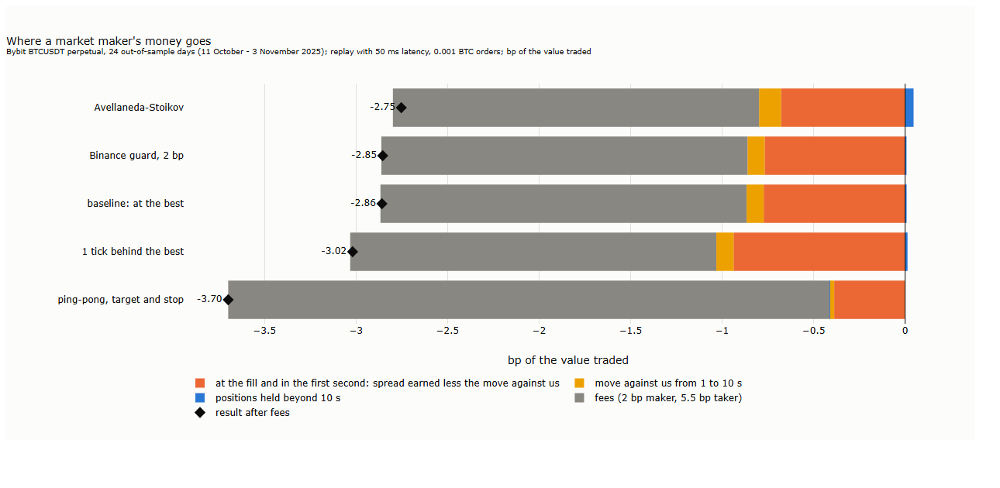
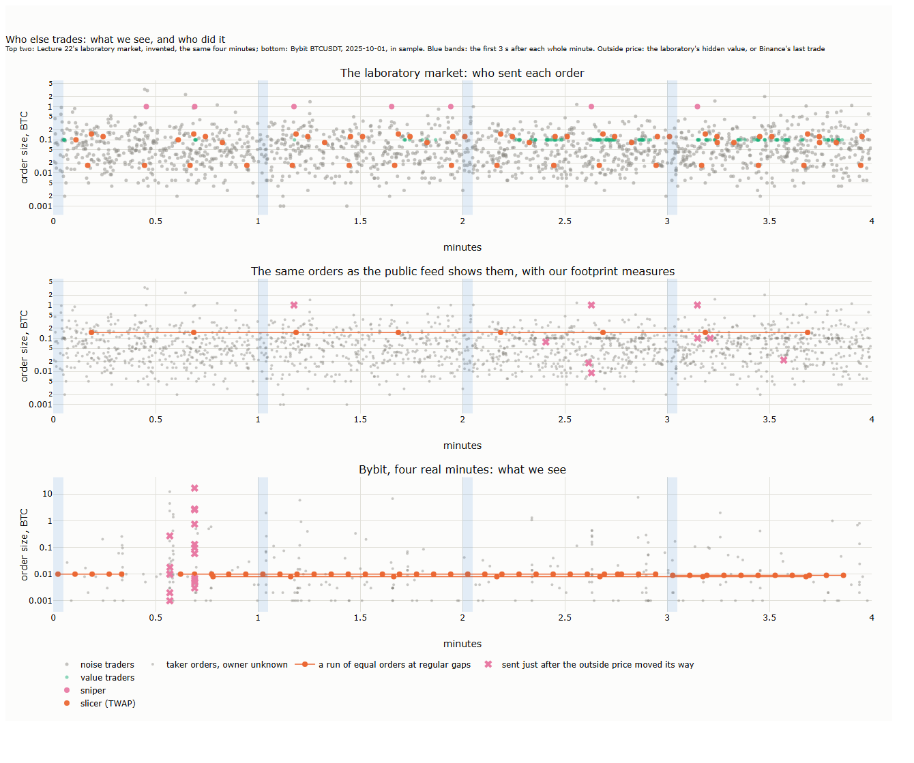
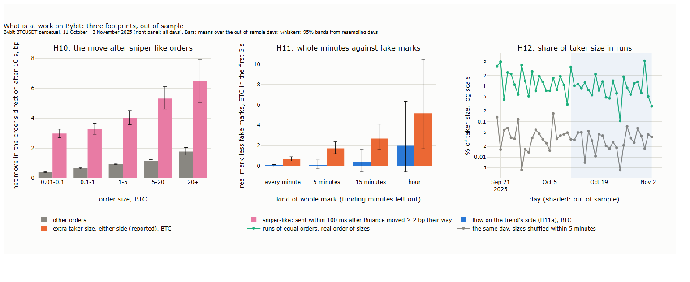
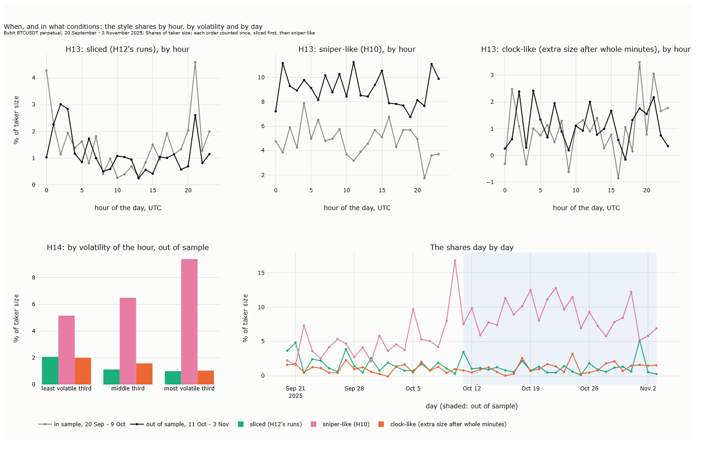
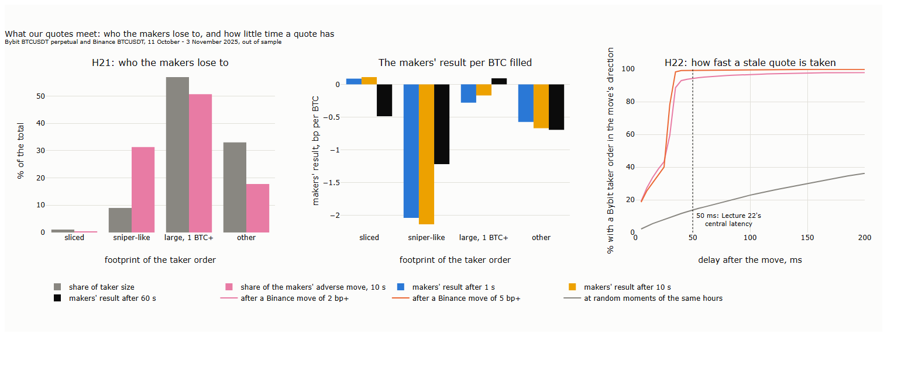
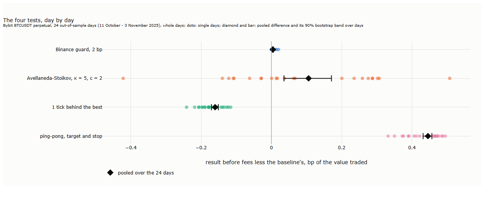
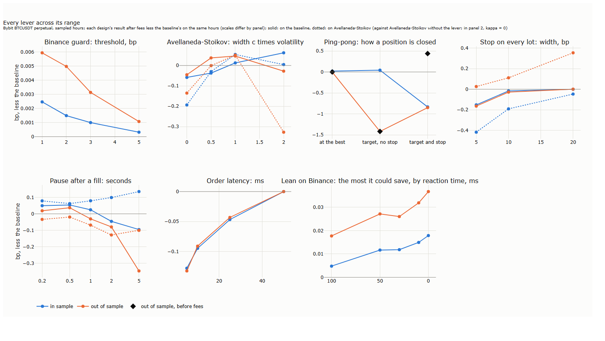
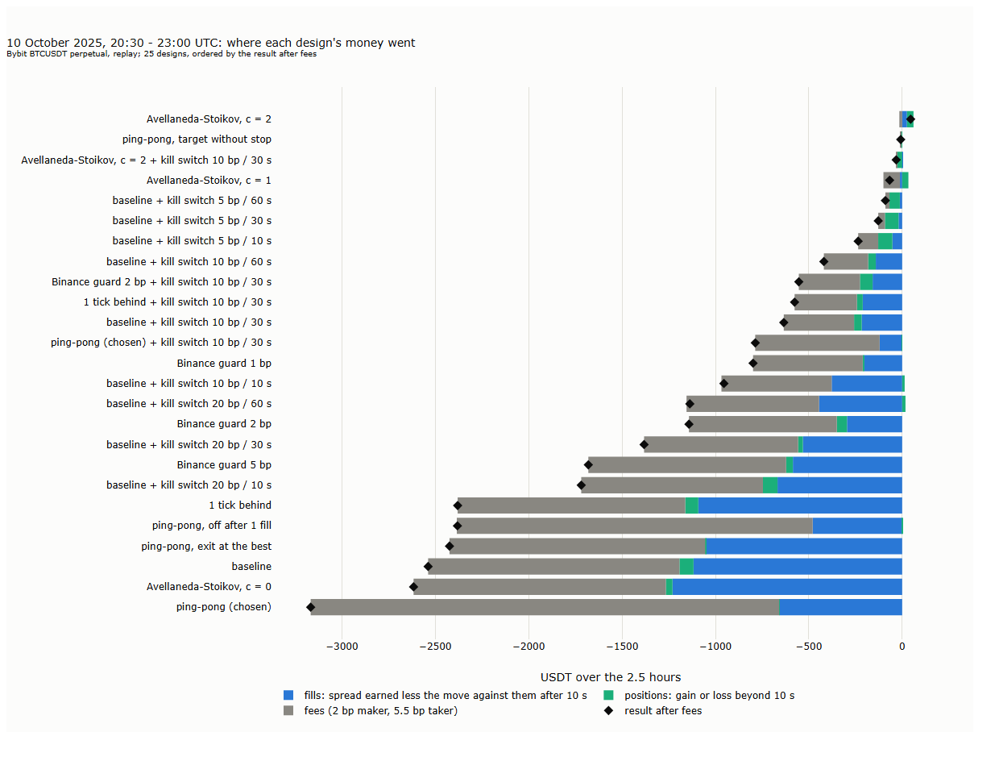
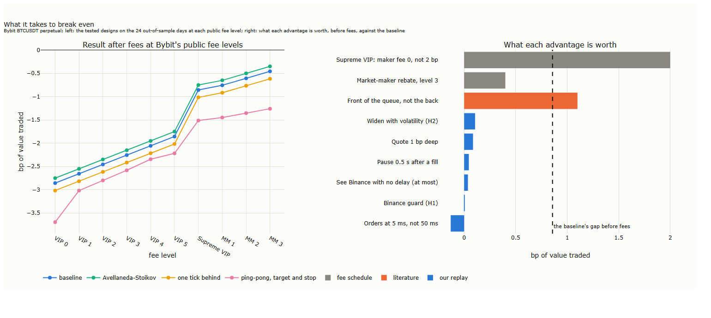

# Lecture 23: Who Else Trades, and Market Making on One Venue

*Systematic Trading: Lecture Notes (MSc) · draft, Nov 17, 2026 · Max Gnesi*

*Pipeline stage (Lecture 1 §2.1): execution (resting quotes: whom they meet, what they earn, and what they cost).*

Lecture 22 showed that a market's answer to our order is made by other traders with their own rules, and that the fills a resting order gets are mostly the bad ones. This lecture takes the next step: it puts our own quotes into Bybit's BTCUSDT perpetual and asks what market making on one venue earns. A market maker posts a bid and an ask, earns the spread when both are filled, and pays when the price moves against what it has just bought or sold. The question is not whether a clever rule beats the market, but **who takes our quotes, what a quoting rule can change, what it would take to break even, and where resting quotes earn their place when they do not pay on their own**. The data are those of Lectures 21 and 22, 20 September to 3 November 2025, with the trades of Binance beside them. The method, reading who is at work in a market before quoting in it, applies to any market with a public book and trades.

<b>How to read the figure.</b> <b>Axes.</b> Result in bp of the value traded (x), one bar per quoting rule (y), over the 24 out-of-sample days (11 October to 3 November 2025). Each bar is split into the parts of the result: <b>orange</b>, at the fill and in the first second after it, the spread earned less the move of the mid against us; <b>yellow</b>, the move against us from 1 to 10 s; <b>blue</b>, the gain or loss on positions held beyond 10 s; <b>grey</b>, fees, 2 bp of the value for a resting order and 5.5 bp for a market order (Bybit's standard tier). <b>Diamond:</b> the result after fees. The rules are described in §6. Our calculation, Bybit BTCUSDT perpetual, 0.001 BTC orders.

Every rule loses, and almost all of the loss before fees comes in the first second. A quote at the best price earns half the spread, but on bitcoin the spread is one tick, 0.1 USDT, about 0.005 bp per fill; what decides the result is that the orders which reach our quote are, on average, followed by a move against us of 0.4 to 0.9 bp within the second. The positions the rules carry beyond ten seconds cost almost nothing on average. A rule changes the result by a tenth of a basis point here and there; the gap to break even is about 0.9 bp before fees, plus the fee.

| § | Topic | Question |
|---|---|---|
| 1 | The sum a quote must pass | What does a quote earn, and what does it pay? |
| 2 | Who takes our quotes | Can trading styles be read from public data, and how well? |
| 3 | What is at work on Bybit | Are snipers, slicers and clock traders there, and when? |
| 4 | What our quotes meet | Whom do the makers lose to, and can a quote be pulled in time? |
| 5 | A quoting rule as a family of choices | Which choices define a market-making rule? |
| 6 | The designs and the tests | What does each choice change, out of sample, over a range of settings? |
| 7 | Verdicts | Which hypotheses held? |
| 8 | 10 October | Which way of quoting does best through a crash? |
| 9 | What it takes to break even | Fees, queue position, speed, hedging: what a profitable maker has that a replay cannot show |
| 10 | Where market making pays | Resting quotes as the execution of a strategy with its own edge |
| | Back to the base layer | Food for thought |
| 11 | Summary, exercises and reading | |

Sections 1 to 4 ask whom a quote meets; 5 to 8 test what a quoting rule can do about it; 9 and 10 ask what it would take to pay, and where quotes pay anyway. Everything left out is in [E29](../extended/29-trading-styles/lecture.md) and [E30](../extended/30-market-making/lecture.md), with their hypotheses fixed before any result ([E29 register](../extended/29-trading-styles/results/hypotheses.md), [E30 register](../extended/30-market-making/results/hypotheses.md)).

> **What to take away**
>
> 1. **The loss comes in the first second.** A quote at the best earns about 0.005 bp of spread and gives back about 0.8 bp within the second after its fill; positions held longer cost almost nothing.
> 2. **The makers lose mostly to the sniper.** Orders sent just after Binance moved are 9% of taker size and carry 31% of the makers' adverse move; a Bybit order usually follows a Binance move within about 30 ms, faster than a quote can be pulled.
> 3. **A quoting rule is a family of choices, and each moves the result by about a tenth of a basis point.** What helps is trading less when it is dangerous: widening with volatility, a short pause after a fill.
> 4. **Judge after fees.** A design that halves the loss before fees can be the worst after them, if it closes positions with market orders.
> 5. **No public fee level makes our designs break even.** The advantages larger than the gap, a low or negative fee and an early place in the queue, are not things a quoting rule provides.
> 6. **Resting orders pay as the execution of a strategy with an edge:** about 2.8 bp a fill against 5.5 bp for a market order, for a trader who wants the position anyway.

## 1. The sum a quote must pass

A quote's result is a sum of four terms, and the literature's two classic reasons why a spread exists fit them well: a market maker is paid for facing better-informed traders (Glosten and Milgrom, 1985), which is the move after the fill, and for carrying a position it did not choose (Ho and Stoll, 1981).

| Term of the sum | What it pays for | Our measure, 0.001 BTC at the best price |
|---|---|---|
| Half the spread | The service | About +0.005 bp |
| The move after the fill | Being picked off | About −0.8 bp within 10 s, under the queue rule (Lecture 22 §3.3) |
| The position carried | Holding what the fills left behind | Small with either sign on ordinary evenings; −7.3 bp for an unlimited quoter in the cascade (Lecture 22 §8) |
| The maker fee | The venue | −2 bp at Bybit's base tier |

<b>How to read the table.</b> Bp of the value traded. A markout is measured from our own price, so the second row already contains the first; the half-spread is shown apart because it is what the quote is paid.

The table shows why market making is the hardest strategy to backtest. Its profit, if any, is a small difference between larger terms, and the fill rule alone moves the second term by about 0.5 bp (Lecture 22 §3.3), a hundred times the half-spread. A backtest with the touch rule and a low fee can report a business where the queue rule reports none. Every result in this lecture therefore uses Lecture 22's replay: the queue rule at $`a = 1`$, orders of 0.001 BTC, post-only, 50 ms from decision to arrival.

## 2. Who takes our quotes

The second term is set by who reaches our quote. The public feed never says who traded, but trading styles leave footprints. Each footprint is first tested in Lecture 22's laboratory market (§5.1), where the answer is known, then measured on Bybit.

<b>How to read the figure.</b> <b>Axes.</b> All panels: minutes (x), size of each taker order in BTC, log scale (y). Top: four minutes of the laboratory market, each order coloured by the trader who sent it (invented). Middle: the same orders as the public feed shows them, grey, with our footprint measures: runs of equal orders at regular gaps (orange line), and orders sent within 100 ms after the outside price moved 2 ticks or more their way (crosses); the laboratory's hidden value stands in for the outside price. Bottom: four real minutes of Bybit BTCUSDT on 1 October 2025, in sample, with the same measures; Binance's last trade is the outside price, and a move of 2 bp marks an order. Blue bands: the first 3 s after each whole minute.

In the laboratory several slicers work at once. The run rule finds one of them, and every order it marks is a slicer's, but it misses the others. Of the orders sent just after the outside price moved, a third are the sniper's. **A footprint is a partial and noisy view of a style, and its quality can only be judged where the answer is known.** On Bybit the same measures find four runs of small buys in these four minutes, and a burst of large orders, up to 20 BTC, sent within 100 ms of a move on Binance.

| Style | Its footprint in public data | The rule | With the answer known (laboratory) | For a quoter |
|---|---|---|---|---|
| **Slicer (TWAP)** | Equal orders at regular gaps | One exact size, one side, eight or more in a row, gaps varying by less than a fifth | 93 to 96% of what the rule finds is the slicer's, but it finds only about 40% of the slicer's size: a floor | The most benign counterparty, uninformed about the next minute; it pushes the price its way, so lean against a run |
| **Clock trader** | A burst of flow with the trend just after whole minutes | Flow with the recent trend in the 3 s after each minute, against fake minutes 10 to 50 s away | Crowds of trend followers found from about 1% of taker size | Expect a burst at the minute; a maker may widen before it |
| **Sniper** | Orders sent just after a move elsewhere, in its direction | Within 100 ms after Binance moved 2 bp or more their way | Only a third of the orders it marks are the sniper's: a blunt tool | It decides the cost of a stale quote |
| **Maker pulling** | Quotes cancelled near the best, in bursts | Five or more of the best twenty levels on one side losing size that trades do not explain | Orders arriving while the maker is out pay twice as much at the median | The queue empties, but the fills that come are the ones the others refused |

<b>How to read the table.</b> One row per style. The laboratory results are on invented data. A fifth style, the scalper, has no footprint of its own: its echo at its exit distance is also left by a maker posting a fixed size, so public data cannot tell them apart. How each style meets our market and resting orders is in Lecture 22 §5.3. Details in [E29 §2](../extended/29-trading-styles/lecture.md).

## 3. What is at work on Bybit

**Key message.** Snipers and slicers are there; the trend crowd at the clock is not. Volatility, not the time of day, sets the mix.

Three footprints were tested on the 24 out-of-sample days, with the rules fixed in sample.

<b>How to read the figure.</b> <b>Axes.</b> Left: order size class in BTC (x), net move of the mid in the order's direction 10 s later, after matched controls, in bp (y); pink: orders sent within 100 ms after Binance's price moved 2 bp or more their way, grey: all other orders. Middle: kind of whole mark (x), the mean over the first 3 s after the mark less the same at fake marks 10 to 50 s after it, in BTC (y); blue: taker flow on the trend's side (H11a), orange: extra taker size on either side. Right: day (x), share of taker size in runs of eight or more equal orders at regular gaps, % on a log scale (y); green: as traded, grey: the same day with sizes shuffled within 5 minutes; shaded: out of sample. Whiskers: 95% bands from 2,000 resamples of the out-of-sample days. Our calculation, Bybit BTCUSDT perpetual.

**Snipers (H10).** Ten seconds after a sniper-like order the mid has moved 3.0 to 6.5 bp its way, net of matched controls, against 0.4 to 1.8 bp after other orders of the same size; weighted over the size classes the difference is 2.7 bp (95% band 2.4 to 3.0). It is there after 1 s and still after 60 s: Bybit catches up with a price that has already moved elsewhere, and does not give it back.

**Slicers (H12).** Out of sample 1.2% of taker size is in runs of equal orders, against 0.03% with the sizes shuffled, about forty times as much, and more than five times as much on every day. A third of the runs have gaps within 1 s of 30.2 s and carry 61% of the size in runs, which fits Bybit's own TWAP tool, which slices every 30 s by default.

**The clock (H11).** There is a clock, but no trend crowd. In the first 3 s after a whole minute, taker flow on the trend's side is no larger than at fake marks, and makers do not widen before the minute. What the minute brings is volume on both sides: 0.7 BTC more taker size in its first 3 s, 5.2 BTC more at whole hours.

<b>How to read the figure.</b> <b>Axes.</b> Top row: hour of the day in UTC (x), share of taker size in that hour, % (y), for the sliced, sniper-like and clock-like footprints; grey: in sample, black: out of sample. Bottom left: third of the hour's volatility, out of sample (x), share of taker size, % (y), one bar per footprint. Bottom right: day (x), the day's share of taker size, % (y), one line per footprint; shaded: out of sample.

**When, and in what conditions (H13, H14).** The hourly profiles of the styles do not repeat from one sample to the other: three to four weeks per sample are too few to fix a profile of 24 hours, so a quoter cannot plan on the hour of the day. Volatility says much more. Within the same hour of the day, the sniper-like share is 5.1%, 6.5% and 9.4% of taker size from the calmest third of hours to the most volatile. This is close to built in, since a footprint defined by a move on Binance is found more often when Binance moves more; what it adds is the size. The sniper-like share also rose from about 5% before 10 October to about 9% after it, at every level of volatility; whether this is linked to the market staying more reactive after the cascade (Lecture 22 §8) is an open question.

## 4. What our quotes meet

**Key message.** The makers lose mostly to the sniper, and a quote is rarely pulled in time: it has to be priced for the risk in advance rather than outrun it.

Every taker order fills someone's resting order. The makers' **adverse move** on a taker order is its size times the mid's move in its direction 10 s later: what the resting orders it filled have lost by then.

<b>How to read the figure.</b> <b>Axes.</b> Left: footprint of the taker order (x), % of the total (y); grey: share of taker size, pink: share of the makers' adverse move after 10 s. Middle: footprint (x), the makers' result in bp per BTC filled (y), after 1, 10 and 60 s; below zero the makers lose. Right: delay after a Binance move in ms (x), share of moves followed by then by a Bybit taker order in the move's direction, % (y); pink: moves of 2 bp or more, orange: 5 bp or more, grey: random moments of the same hours with a random direction; dotted line: 50 ms. Out of sample, 11 October to 3 November 2025. Our calculation.

**Whom do the makers lose to? (H21)** Mostly to the sniper. Sniper-like orders are 9% of taker size but carry 31% of the makers' adverse move after 10 s, 22 points more than their share of size (95% band 18 to 26). Per BTC filled, the makers lose 2.1 bp to them after 10 s. Slicers are the best counterparty: the makers earn +0.1 bp per BTC on them after 10 s, but lose 0.5 bp by 60 s as the run pushes on.

**Can a quote be pulled in time? (H22)** Rarely. After a Binance move of 2 bp or more, a Bybit taker order in the same direction followed within 50 ms in 94% of the 22,305 moves, against 14% at random moments; after moves of 5 bp or more, in 99%. The typical delay is 30 ms, and the delays pile up between 25 and 35 ms, as if many traders sent their orders as soon as a fixed travel time from Binance allowed. A cancel of ours, at the 50 ms of Lecture 22's replay, arrives too late.

From footprints to a quoting rule:

| What we found | Evidence | What the quoting rule must do |
|---|---|---|
| The makers' losses come mostly from orders sent just behind Binance | 9% of taker size, 31% of the adverse move (H10, H21) | Treat a move on Binance as the main risk to every resting quote |
| A stale quote is rarely pulled in time | 94% of 2 bp moves followed within 50 ms (H22) | Do not rely on cancelling: make a stale fill cheaper beforehand, with a wider or smaller quote when Binance is moving |
| Volatile hours bring more snipers | 5% in calm hours, 9% in volatile ones (H14) | Set spread and size by the volatility measured as it goes |
| Slicers are benign but push the price | +0.1 bp after 10 s, −0.5 bp by 60 s (H12, H21) | Lean against a run under way; do not hold its inventory long |
| The minute brings volume, not direction | +0.7 BTC in 3 s, no trend lean (H11) | Expect more fills just after the minute; nothing to predict |
| Makers pulling fattens the tail of cost | 90th percentile 1.62 against 0.72 bp (Lecture 22, H20a) | Pull with the others, or quote wide, when pulls surge |

<b>How to read the table.</b> One row per result of this lecture or Lecture 22, out of sample on Bybit. Sections 5 and 6 test what quoting rules built on them achieve.

The first two rows are the core of market making on this venue: almost every losing fill is a quote that Binance has already made stale, and speed alone does not save it. Here the informed traders of Glosten and Milgrom (1985) are, for the most part, simply the faster readers of another exchange (Budish, Cramton and Shim, 2015).

**Reading a market before quoting in it.** Lecture 22 §10 gave four steps for understanding any instrument's microstructure. A quoter adds two, in this order: **first, the leading venue**, whether the market that moves first has just moved (the price gap to it, the age of its last trade), because on Bybit it decides most of what a quote loses; **then, the styles at work now**, sniper-like orders, a run under way, the burst after the minute. Then one sentence: what we expect, and what would prove us wrong, written before looking ahead and checked afterwards.

## 5. A quoting rule as a family of choices

A market-making rule is not one strategy but a set of choices, each answering a question every maker has to answer. The table lists them, the options open at each, which we tested and what the test gave. The results are on our implementation and our sample, at 0.001 BTC and 50 ms; a different implementation can give different results, and the untested options are left open on purpose.

| Choice | The question | Options | Tested here | What it gave, before fees (§6) |
|---|---|---|---|---|
| **Price** | Where do our quotes sit? | At the best; k ticks behind it; k bp deep; around a reservation price | At the best (baseline); 1 to 5 ticks behind (H3); 1 to 10 bp deep | Behind by ticks is worse (−0.16 bp, H3 fails); 1 bp deep slightly better; deeper becomes a bet on a few fills |
| **Width** | How far apart are bid and ask? | One tick; fixed; scaled by recent volatility | Scaled by the volatility of the last 60 s (Avellaneda-Stoikov, H2) | +0.11 bp (H2 holds), mostly by trading less when the market moves |
| **Inventory** | How do we keep the position in check? | A hard limit; a lean of both quotes against the position; one position at a time (ping-pong); stops | Limit of 10 lots; lean; ping-pong (H4); stops of 1 to 20 bp | Positions held beyond 10 s cost little, so inventory control matters little; stops add taker fees and do not pay |
| **When to quote** | When do we step aside? | Always; after a move on another venue; after a large move here; after our own fill; at certain times | Binance guard (H1); kill switch (§8); pause after a fill; hour of the day | Guard about 0; pause of 0.2 to 0.5 s about +0.04 bp; kill switch large in the crash; times of day too small to use |
| **Exit** | How is a position closed? | A resting order at the best; a target; a stop or time limit at market | All three, within ping-pong (H4) | Exits at market halve the loss before fees and lose most after fees |
| **Information** | What do the quotes react to? | Our own book; the trades; another venue; a forecast | The book every 100 ms; Binance's last trade | Binance warns too little, even with no delay (§9) |
| **Speed** | How fast do our orders arrive? | 5 to 100 ms in practice | 5, 10, 25, 50 ms | Faster orders made the baseline worse: it rejoins sooner into the same sweep |
| **Size and levels** | How much, at how many prices? | One lot at one level; a ladder (Lecture 20's grid); size by queue | One lot, one level | Not tested (exercise 1) |

<b>How to read the table.</b> Each row is one decision a market maker has to make. "Options" lists the common answers; "Tested here" the ones run in this lecture; the last column the result before fees, in bp of the value traded, against the baseline. H1 to H4 are the tests fixed in advance (§6); the rest are described, not tested.

Open-source frameworks supply the machinery for all of these choices, but not the settings. Hummingbot's grid executor, which Lecture 20 used, closes positions with a stop and a time limit at market; with a stop of 1 bp, inside a minute's noise of about 5 bp, three quarters of our ping-pong's positions ended on the stop and paid the taker fee. Every number in a rule, a stop, a target, a pause, has to be set against the noise of the market at its horizon and against the fees, and shown over a range of settings rather than at one value.

## 6. The designs and the tests

Every design starts from one **baseline**: a bid at the best bid and an ask at the best ask, 0.001 BTC each, re-posted whenever the best price moves, until the position reaches 10 lots on one side. Each design changes one choice of §5 and is compared with the baseline on the same hours. Four designs were fixed as tests before any result:

| Design | What it changes |
|---|---|
| Binance guard (H1) | Withdraws the quote on the side Binance has moved against, for a gap of θ bp |
| Avellaneda-Stoikov (H2) | Quotes around the microprice (Lecture 21 §5.3), leaned by κ per lot of position, half-width c times the volatility of the last 60 s (Avellaneda and Stoikov, 2008) |
| One tick behind (H3) | Quotes k ticks behind the best |
| Ping-pong (H4) | One position at a time, closed by a resting order at the best, a target, or a target with a stop |

<b>How to read the table.</b> Settings were chosen on sampled in-sample hours, four one-hour windows a day; each chosen design was then run on all 24 out-of-sample days, whole days. Details and the two errors found and corrected after the tests, both dated, are in [E30 §3](../extended/30-market-making/lecture.md).

The measure is the result before fees in bp of the value traded, all fills of the 24 days pooled, against the baseline. For a design that only rests its orders, this number is also its **break-even maker fee**: the fee at which it would neither gain nor lose.

<b>How to read the figure.</b> <b>Axes.</b> Result before fees less the baseline's, in bp of the value traded (x); one row per tested design (y). <b>Dots:</b> single days, one per out-of-sample day. <b>Diamond and bar:</b> the difference with all 24 days pooled, and its 90% bootstrap band over days. Right of the grey line the design beats the baseline. Our calculation, Bybit BTCUSDT perpetual.

| Question | Design | Better than the baseline by, bp (90% band) | Days better | After correction | Result after fees, USDT a day | Fills an hour |
|---|---|---|---|---|---|---|
| — | Baseline: at the best | — (−0.86) | — | — | −2,093 | 2,764 |
| Does withdrawing quotes after a Binance move help? (H1) | Binance guard, 2 bp | +0.004 (0.003 to 0.006) | 24 of 24 | Holds, but tiny | −2,074 | 2,743 |
| Does widening with volatility and leaning against the position help? (H2) | Avellaneda-Stoikov, κ = 5, c = 2 | +0.11 (0.04 to 0.17) | 16 of 24 | Holds | −182 | 250 |
| Does waiting one tick behind the best help? (H3) | One tick behind | −0.16 (−0.17 to −0.15) | 0 of 24 | Fails | −1,766 | 2,208 |
| Does one position at a time, closed at a target or a stop, help? (H4) | Ping-pong, target and stop | +0.45 (0.43 to 0.46) | 24 of 24 | Holds before fees | −2,178 | 2,222 |

<b>How to read the table.</b> "Better than the baseline by" is the design's result before fees less the baseline's, all 24 days pooled; the baseline's own result is in brackets. "After correction": Benjamini–Hochberg at 5% over the four tests. "Result after fees" charges 2 bp on resting fills and 5.5 bp on market orders, in USDT a day at 0.001 BTC an order. H2's setting was chosen again after a scoring error found on 10 November; the setting chosen before it, c = 1, gives +0.085 bp (0.06 to 0.11), reported, not tested.

Three of the four tests hold, and none of them changes the picture of the key chart. The guard holds on every day by four thousandths of a basis point: real, and of no use, because a Bybit order usually follows a Binance move faster than our cancel arrives (§4). Avellaneda-Stoikov holds by a tenth of a basis point, with 8 days of 24 worse than the baseline; most of its advantage after fees comes from trading a tenth as much, so it loses 182 USDT a day where the baseline loses 2,093. One tick behind fails on every day: a quote behind the best is reached only when the price is already going through it. Ping-pong holds before fees by almost half a basis point on every day, and after fees loses more than the baseline, because 37% of its value is closed by stops at the taker fee. A test before fees answers the question it was asked; for a design that pays taker fees, it is the wrong question.

**What drove the differences.** Per resting fill, no design loses much less than the baseline in the first second. The differences come from which fills a design gets. 58% of the baseline's fills are **follow-up fills**, within a second of its previous fill on the same side, usually in the same sweep, and they lose more (−0.87 bp after 1 s, against −0.63 bp for first fills). Avellaneda-Stoikov widens when the market moves, so only a quarter of its fills are follow-ups. What helps is trading less when it is dangerous.

**The levers added after the tests.** Each was fixed and dated before its run, and is described, not tested; a lever that helps should help over a range of settings and in both samples (Lecture 7 §5).

<b>How to read the figure.</b> <b>Axes.</b> Each panel: the lever's setting (x); the design's result after fees, in bp of the value traded, less the baseline's on the same hours (y); above zero the lever helps. Scales differ by panel. <b>Blue:</b> in sample; <b>orange:</b> out of sample. <b>Solid:</b> the lever on the baseline; <b>dotted:</b> on Avellaneda-Stoikov, against Avellaneda-Stoikov without it, except in the second panel, where solid is κ = 5 and dotted κ = 0. <b>Third panel, diamonds:</b> ping-pong out of sample before fees. Panels 1 to 3: 6 in-sample and 6 out-of-sample days, four hours each; panels 4 to 7: 3 and 3 of those days. Panel 6: the baseline at each order latency less the baseline at 50 ms. Panel 7: the most that skipping fills with Binance more than 0.5 bp against us could have saved, per fill, by how long before the fill the quote could still be moved. Our calculation, Bybit BTCUSDT perpetual.

| Lever | What it gave | Reading |
|---|---|---|
| **Quotes 1 to 10 bp deep** | At 1 bp slightly better than the baseline in both samples (+0.30 and +0.09 bp) on a tenth of the fills; beyond 2 bp a few fills an hour | The extra spread is taken straight back: a deep quote is reached only by an order that sweeps the book. Beyond 2 bp it is a bet on a handful of sweeps, not market making |
| **Stops at 5 to 20 bp** | Do not pay on the baseline at any width | In the minute after a stop the mid comes back about as often as it goes on (44 to 62%): stops catch random moves, not trends. A predictable stop can also be set off on purpose, which a replay cannot show |
| **Pause of 0.2 to 0.5 s after a fill** | +0.02 to +0.05 bp in both samples | It skips the follow-up fills of a sweep; longer pauses hurt, because most quick refills are the harmless fills of a calm market |
| **Faster orders** | −0.13 bp at 5 ms against 50 ms | A faster quote rejoins the new best sooner after a sweep and is filled again by the same move. Speed is worth something only with something that sees the move coming |
| **Leaning on Binance** | At most 0.04 bp per fill, even with no delay | Binance's last trade warns too little |
| **Hour of the day** | The first 3 s after each minute are 0.15 bp worse per fill, but skipping them gains 0.01 bp; hourly profiles do not repeat | What matters is how volatile the hour is, known only as it goes |

<b>How to read the table.</b> One row per lever added after the tests; results after fees against the baseline, on sampled hours. Compact, because most are negative; full figures, including the depth chart, in [E30 §3](../extended/30-market-making/lecture.md).

## 7. Verdicts

| Hypothesis | The question it answers | On our sample | Verdict after correction |
|---|---|---|---|
| **Who else trades (E29 register)** | | | |
| H10 | Do orders sent just after Binance moved, their way, move the price more? | +2.7 bp net after 10 s (2.4 to 3.0) | Holds |
| H12 | Is there more slicing than chance gives? | 1.2% of taker size in runs against 0.03% shuffled | Holds |
| H14 | More sniper-like orders in volatile hours? | +4.6 points within the same hour of day | Holds |
| H21 | Do sniper-like orders cost the makers more than their share of size? | 31% of the adverse move on 9% of size | Holds |
| H22 | Is a quote taken within 50 ms after a Binance move more often than by chance? | 94% against 14% at random moments | Holds |
| H11a | Does flow lean with the trend just after a whole minute? | +0.03 BTC, t = 0.4 | Fails |
| H11b | Do makers widen before a whole minute? | Slightly rarer, the opposite sign | Fails |
| H13 | Do the styles come at the same hours in both samples? | Rank correlations 0.31, 0.19, −0.17 | Fails (three tests) |
| H14 | Less slicing, more clock-like flow in volatile hours? | −0.7 points; −1.4 points, the opposite sign | Fail |
| **Market making (E30 register)** | | | |
| H1 | Does withdrawing quotes after a Binance move help? | +0.004 bp | Holds, but tiny |
| H2 | Does widening with volatility and leaning against the position help? | +0.11 bp | Holds |
| H3 | Does waiting one tick behind the best help? | −0.16 bp | Fails |
| H4 | Does one position at a time, with a target and a stop, help? | +0.45 bp before fees; worse after them | Holds before fees only |

<b>How to read the table.</b> One row per test, numbered as in each register; the two registers number their hypotheses separately. All tests out of sample, 11 October to 3 November 2025; p-values one-sided from 2,000 resamples of days, except H11 (t over days, as fixed). Benjamini–Hochberg at 5% within each register: five of E29's twelve tests hold, three of E30's four. Full numbers: [E29 §5.1](../extended/29-trading-styles/lecture.md), [E30 §4](../extended/30-market-making/lecture.md).

Five of the twelve style tests hold, and four of them are about one style: the trader who takes Bybit's quotes just after Binance has moved. It is found (H10), it is more frequent when markets move (H14), it carries a third of what the makers lose (H21), and it is usually faster than a quote can be pulled (H22). The fifth is the slicer, the makers' best counterparty (H12). The clock and the time of day, which looked promising in the laboratory and in sample, did not hold. Of the quoting rules, what holds after fees is trading less when it is dangerous.

## 8. 10 October

On the evening of 10 October 2025 bitcoin fell about 13% in half an hour on Bybit's perpetual, from 117,016 USDT at 20:30 UTC to a low of 101,344 (Lecture 22 §8). Which way of quoting does best through such an evening? One evening is one case: the results are described, not tested, and a different crash may favour a different rule. The designs, four expectations and the phases of the crash were fixed before the run; every design starts flat at 20:30 and runs to 23:00, with at most 10 lots either way.

<b>How to read the figure.</b> <b>Axes.</b> USDT over the two and a half hours (x); one bar per design, ordered by the result after fees (y). Each bar is split into: <b>blue</b>, what the fills kept after 10 s, the spread earned less the move against them in that time; <b>green</b>, the gain or loss on positions held beyond 10 s; <b>grey</b>, fees, 2 bp on resting fills and 5.5 bp on market orders. <b>Diamond:</b> the result after fees. 25 designs: the five tested ones with and without the kill switch, and the variants fixed for the case study. Our calculation, Bybit BTCUSDT perpetual.

| Expectation, written before the run | Result, USDT after fees, 20:30 to 23:00 |
|---|---|
| 1. A kill switch (no new quotes for a while after a fast move) reduces the baseline's loss, more with longer pauses | Holds: from −2,538 without it to between −90 and −1,718, the loss falling as the pause grows from 10 to 60 s |
| 2. The Binance guard helps more in the crash than on normal days, and more at 1 bp than at 5 bp | Holds: −798 at 1 bp, −1,142 at 2 bp, −1,680 at 5 bp |
| 3. Widening with volatility helps Avellaneda-Stoikov, but less than the kill switch | Half holds: widening helps by far the most, −2,616 at c = 0, −67 at c = 1, +45.5 at c = 2, the only design with a gain |
| 4. Ping-pong's stops keep its position small but turn its loss into fees | Mixed: positions stayed at three lots or fewer and fees were 79% of its loss; the exit without a stop lost only 7.8, because it held a position and stopped trading |

<b>How to read the table.</b> Each expectation was written before the run; results at 0.001 BTC an order. Phase-by-phase results in [E30 §5](../extended/30-market-making/lecture.md).

Three things stand out. First, with a limit of 10 lots, the loss before fees came from the fills, not from the positions: the baseline lost 1,117 USDT on what its fills kept after 10 s and 75 USDT on positions held longer. Lecture 22 §8 showed the other side: a quoter with no limit carried a position 944 times its order, and the position made most of its bill. Second, what helped was not being there: the kill switch, and Avellaneda-Stoikov at c = 2, which widened so far that it traded 674 times in the evening against the baseline's 60,000. Third, the replay assumes that orders and data arrived as on a normal day; on the evening itself the exchange's interface may have been slow, rate-limited or refusing orders, and a rule that wins by stepping aside would also have needed its cancels to get through.

## 9. What it takes to break even

The baseline loses 0.86 bp of the value it trades before fees, and every design changes that by about a tenth of a basis point.

<b>How to read the figure.</b> <b>Axes.</b> Left: Bybit's public fee level for USDT perpetuals, from the standard tier (VIP 0) to the best level of its market-maker programme (MM 3) (x); the design's result after fees on the 24 out-of-sample days, bp of the value traded (y); above the black line the design makes money. One line per tested design; ping-pong pays the taker fee on its stops, taken at 3 bp, the best public taker fee, for the market-maker levels. Right: what each advantage is worth, in bp of the value traded (x). <b>Grey:</b> from Bybit's fee schedule; <b>orange:</b> from the literature, the difference in the move after one second between resting orders at the front of a short queue and at the back of long queues, on Binance's BTCUSDT perpetual in 2024 (Albers et al., arXiv 2502.18625); <b>blue:</b> from our replay, against the baseline before fees. <b>Dashed:</b> the baseline's loss before fees, the gap a maker paying no fee would have to close. Fee levels from Bybit's help centre, read on 11 November 2026 ([E30 sources](../extended/30-market-making/results/sources.md)).

No design breaks even at any public fee level. At the best one, a rebate of 0.4 bp for makers with 1% of all maker volume on the contract, the baseline still loses 0.46 bp and Avellaneda-Stoikov 0.35 bp; the programme also requires orders of at least ten times our size.

| What a profitable maker may have | Worth, bp of value traded | Can we measure it? |
|---|---|---|
| A low or negative maker fee | Up to 2.4 on Bybit's public schedule (2 bp to −0.4 bp); private terms unknown | From the fee schedule |
| An early place in the queue | About 1 (live orders on Binance, Albers et al., 2025) | No: our replay joins at the back; the true queue is not in public data (Lecture 22 §2.3) |
| A faster view of the market | Unknown | No: our book arrives every 100 ms; Bybit's live feed sends the best price every 10 ms |
| Hedging on another venue | Unknown | No: it needs the other venue's book at the moment of the hedge, which the free archives do not hold for our period |
| A forecast of the next second | Below 0.04 from Binance's trades | Partly: Binance's book, not only its trades, may lead by more (exercise 3) |
| A rule that trades less when it is dangerous | About 0.1 | Yes: §6 |

<b>How to read the table.</b> One row per advantage; the middle column against a gap of about 0.9 bp before fees.

Everything a quoting rule can change on our data is worth a tenth of a basis point or less, and faster orders alone are worth less than nothing. Two things are worth more than the gap: the fee level, which is a matter of volume and negotiation, not of the rule; and the place in the queue. **What we cannot see** could change the results in either direction: how other traders react to our quotes (Lecture 22 §5), stop hunting, interface delays and rate limits, and the exchange's private arrangements with designated market makers.

## 10. Where market making pays

A maker in our seat does not break even. Yet not everyone who posts resting orders is a market maker: a trader who wants a position has a reason to rest an order even if it loses against the mid, because a resting order is the cheaper way in. On our data the arithmetic is simple. A resting order that is filled costs the maker fee, 2 bp, plus the move against it in the first second, about 0.8 bp: about 2.8 bp. A market order of the same small size costs the taker fee, 5.5 bp, plus half a spread of one tick and thousandths of a basis point of slippage (Lecture 22 §3.1): about 5.5 bp. For a trader who wants the position anyway, the resting order saves about 2.7 bp per trade, more than three times the loss that makes market making unprofitable on its own.

The catch is that a resting order is not always filled, and the fills it misses are the ones a trader with a view wanted most: when the price runs away in the direction of the trade, the order is left behind and has to be chased (Lecture 22 §4). Lecture 20 (§5) measured the balance for a trend rule on BTCUSDT: an order worked patiently over a minute, re-posted every few seconds and chased if not filled, cut the rule's trading costs by about 40%. That is market making in the service of a strategy with its own edge, and it is where the machinery of this lecture, the quotes, the pause after a fill, stepping aside when the market moves, earns its place.

Lecture 20's grid reached the same place from the other end. Resting its orders 25 to 100 bp apart and holding inventory for hours, it would have needed a rebate of 1.4 to 3.9 bp per dollar filled to break even (Lecture 20 §14); quoting at the best and holding for seconds, the designs here would need 0.75 to 0.86 bp. The two are not measured alike, five years of Binance trades with fills only when the price traded through, against six weeks of Bybit's book with a queue, but both fall short of the best public rebate of 0.4 bp, and in both the machinery is worth more than the strategy.

Two directions are left open. A maker can lean on another market that moves first, quoting on one venue and hedging or pulling on another; answering whether that pays needs both venues' books at the same moments, which a reader can record from the venues' free public feeds. And a trend rule can run through a maker, quoting while the market stays in its range and switching to market orders when it breaks out: the capstone (Lecture 24) takes a trend bot live and executes it this way.

## Back to the base layer

*Food for thought.*

| | |
|---|---|
| **The idea** | Rebalance the base layer passively: let the daily portfolio's trades rest at the best price for a while instead of crossing the spread, and step aside when the market moves fast |
| **What our results already say** | On bitcoin a resting fill costs about 2.8 bp against 5.5 bp for a market order (§10); worked patiently, a trend rule's orders cost about 40% less (Lecture 20 §5); a maker loses about 0.8 bp in the first second after a fill (§1), so quoting for its own sake does not pay, and a market-making overlay is hard |
| **What a test would need** | The portfolio's own orders replayed against the book of each ETF or future it trades, with the queue rule; the first thing that could kill it: the fills a resting order misses are the ones the trade wanted most |
| **Status** | Not tested in this course; a research direction |

<b>How to read the card.</b> Food for thought, not a result: the idea, only numbers this lecture has shown, what a test would need, and its status.

## 11. Summary, exercises and reading

### 11.1 Eight takeaways

1. **The loss comes in the first second.** At the best price on bitcoin the spread is one tick, about 0.005 bp; the orders that reach our quote are followed by a move against us of about 0.8 bp within the second, and positions held longer cost almost nothing (§1).
2. **Styles leave footprints, partial and noisy.** A run of equal orders, an order just after a move elsewhere, a burst after the minute; each catches part of a style, and its quality can only be judged where the answer is known (§2).
3. **Snipers and slicers are there; the trend crowd at the clock is not.** Orders sent just after Binance moved move Bybit's price 2.7 bp more than others of their size; runs of equal orders are forty times what chance gives; volatility, not the time of day, sets the mix (§3).
4. **The makers lose mostly to the sniper, and a quote is rarely pulled in time.** A tenth of taker size carries a third of the makers' adverse move, and a Bybit order usually follows a Binance move within about 30 ms (§4).
5. **A quoting rule is a family of choices, and each moves the result by about a tenth of a basis point.** Widening with volatility and a short pause after a fill help a little; a guard on Binance, stops, quoting behind the best, faster orders and the time of day do not (§5, §6).
6. **Judge after fees.** Ping-pong with a stop halves the loss before fees and is among the worst designs after them, because its stops are market orders (§6). In the crash, the rules that stepped aside lost least (§8).
7. **No public fee level makes our designs break even.** The gap is about 0.9 bp before fees; the advantages larger than that, a low or negative fee and an early place in the queue, are not things a quoting rule provides (§9).
8. **Resting orders pay as the execution of a strategy with an edge:** about 2.8 bp a fill against 5.5 bp for a market order, for a trader who wants the position anyway (§10). Every number here is on one symbol, one venue and six weeks.

### 11.2 Exercises

- [ ] **Levels and size.** The one choice of §5 not tested: quote three levels a side, 1, 2 and 3 bp deep, with Lecture 20's paired re-arming. Does a ladder do better than the single quote at 1 bp, after fees, in both samples?
- [ ] **Two levers together.** Add the pause of 0.5 s to Avellaneda-Stoikov with c = 1 and c = 2. Are the two gains additive, or do they remove the same follow-up fills?
- [ ] **Binance's book, not its trades.** Record Binance's best bid and ask live for a few days (its public websocket feed is free), together with Bybit's, and repeat the diagnostic of §6 with Binance's mid instead of its last trade. Does the book lead by more?
- [ ] **Your fee level.** Take the fee level you could reach and the results of §6. Which design does best there, and at what taker fee would ping-pong's stops start to pay?
- [ ] **Who leads?** Repeat H22 the other way round: after a 2 bp move on Bybit, how often does a Binance order follow within 50 ms? What does the asymmetry say about where prices are formed?
- [ ] **Another threshold.** Repeat H10 and H21 with moves of 1 and 5 bp on Binance and lookbacks of 50 and 200 ms. Is the makers' loss to the sniper stable, or a product of the 2 bp choice?
- [ ] **A run as it starts.** First in the laboratory with the slicer known, then on Bybit: recognise a run at its third slice and predict the next. Does the price move less on a slice that could be expected?
- [ ] **Your own market.** Read an hour of ETHUSDT on Bybit with the steps of Lecture 22 §10 and §4 of this lecture, write the read before looking ahead, then run the baseline and Avellaneda-Stoikov on it for a week. Is the loss in the first second the same size relative to the tick?

### 11.3 Reading

For the spread as the price of facing informed traders, Glosten and Milgrom (1985); for the dealer's position, Ho and Stoll (1981). For quoting around the position, Avellaneda and Stoikov (2008), and with a limit on the position, Guéant, Lehalle and Fernandez-Tapia (2013). For stale quotes picked off after a public move, Budish, Cramton and Shim (2015), and for races that leave no trace, Aquilina, Budish and O'Neill (2022). For live resting orders and the value of a place in the queue, Albers, Cucuringu, Howison and Shestopaloff (2025). For scalpers as one-level market makers, Silber (1984).

Full versions: [E29](../extended/29-trading-styles/lecture.md) and [E30](../extended/30-market-making/lecture.md).

### 11.4 Next: the capstone

Part V has read the tape (Lectures 18 to 20), the book (Lecture 21), our orders in it (Lecture 22) and the traders we meet (this lecture). The capstone puts them to work: the base layer's trend rule run automatically, from backtest to production, on a free testnet or paper account, with its orders executed as §10 suggests and its fills checked against the tape and the backtest, with the limits that need no model of Lecture 22 §9.

## References

- Albers, J., Cucuringu, M., Howison, S. and Shestopaloff, A. Y. (2025). The market maker's dilemma: navigating the fill probability vs. post-fill returns trade-off. arXiv 2502.18625. — live resting orders on Binance; the value of the place in the queue (§9).
- Aquilina, M., Budish, E. and O'Neill, P. (2022). Quantifying the high-frequency trading "arms race". *Quarterly Journal of Economics* 137(1), 493–564. — the losers of a race leave no trace in book data (§2).
- Avellaneda, M. and Stoikov, S. (2008). High-frequency trading in a limit order book. *Quantitative Finance* 8(3), 217–224. — the quoting rule of H2 (§6).
- Budish, E., Cramton, P. and Shim, J. (2015). The high-frequency trading arms race: frequent batch auctions as a market design response. *Quarterly Journal of Economics* 130(4), 1547–1621. — stale quotes picked off after a public move (§4).
- Bybit (2026). Trading Fee Structure; Introduction to the Market Maker Incentive Program. Bybit help centre, read on 11 November 2026. — the fee levels of §9.
- Glosten, L. R. and Milgrom, P. R. (1985). Bid, ask and transaction prices in a specialist market with heterogeneously informed traders. *Journal of Financial Economics* 14(1), 71–100. — the spread as the price of trading with the informed (§1, §4).
- Guéant, O., Lehalle, C.-A. and Fernandez-Tapia, J. (2013). Dealing with the inventory risk: a solution to the market making problem. *Mathematics and Financial Economics* 7(4), 477–507. — Avellaneda and Stoikov's problem with a limit on the position (§11.3).
- Ho, T. and Stoll, H. R. (1981). Optimal dealer pricing under transactions and return uncertainty. *Journal of Financial Economics* 9(1), 47–73. — the spread and the dealer's position (§1).
- Silber, W. L. (1984). Marketmaker behavior in an auction market: an analysis of scalpers in futures markets. *Journal of Finance* 39(4), 937–953. — scalpers as one-level market makers (§2).

*References carried over from E29 and E30, checked at source on 9 and 11 November 2026; Ho and Stoll (1981), Guéant, Lehalle and Fernandez-Tapia (2013, online 2012) and Silber (1984) checked against Crossref on 17 November 2026.*
