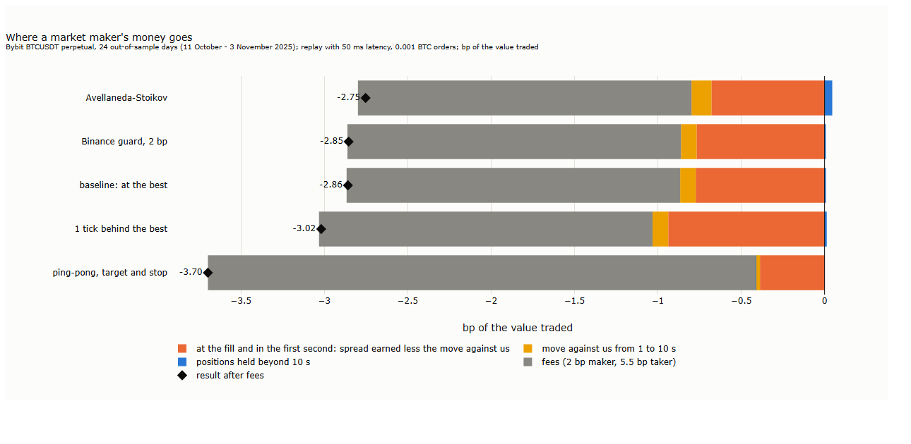
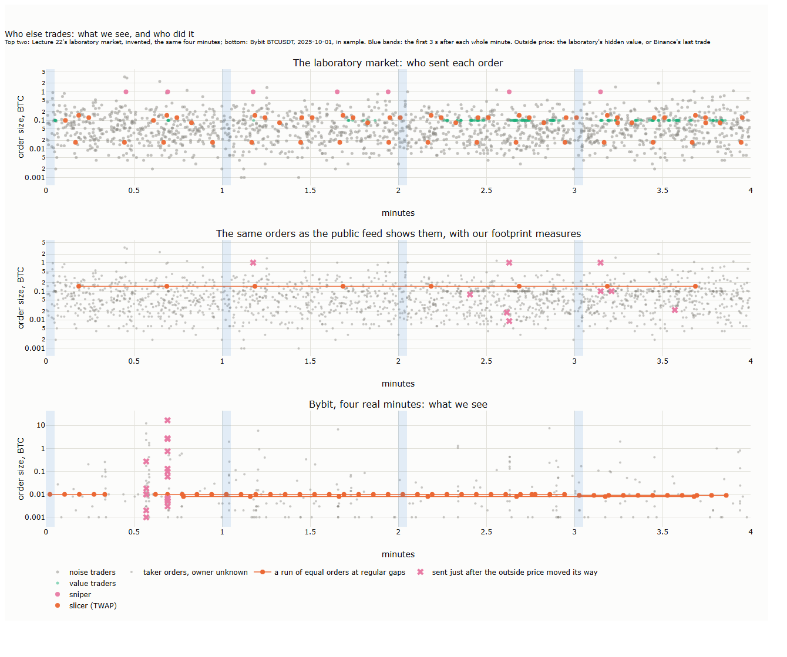
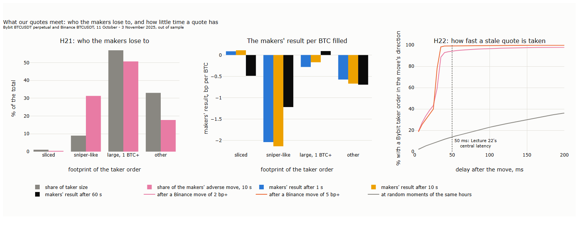
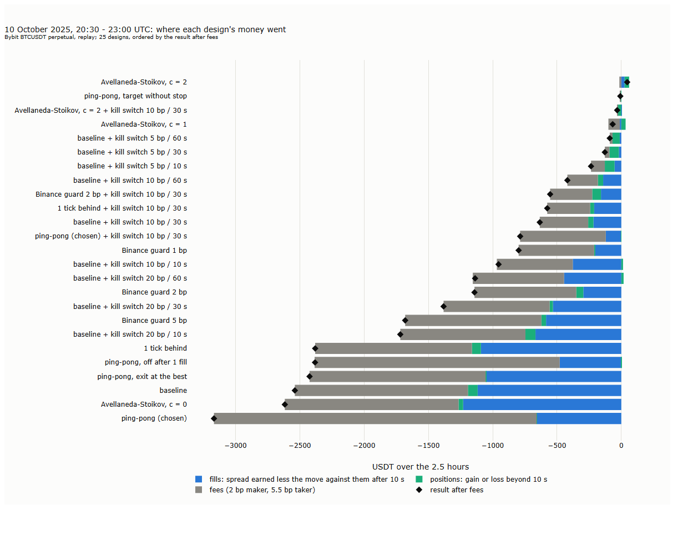
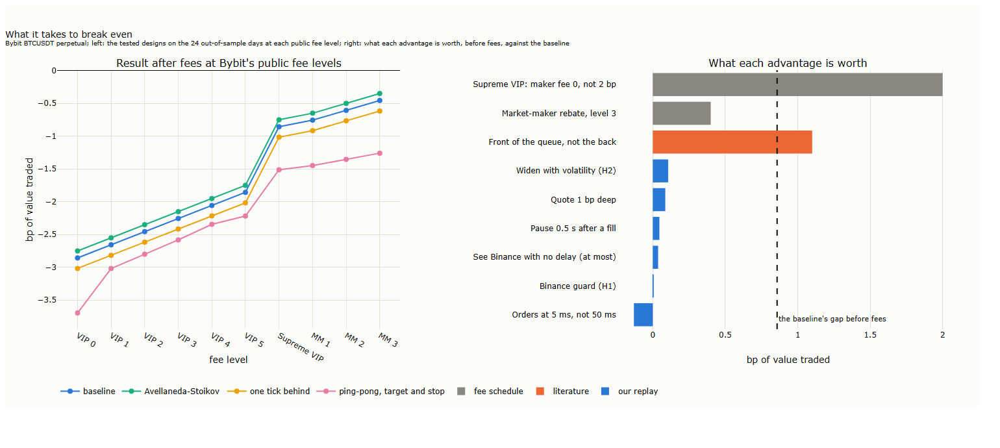

# Lecture 23: Who Else Trades, and Market Making on One Venue

> Who takes our quotes, what a quoting rule can change, what it would take to break even, and where resting quotes earn their place.

Part V · Pipeline stage: execution (resting quotes: whom they meet, what they earn, and what they cost)

---

# Where a market maker's money goes

> Every rule loses, and almost all of the loss before fees comes in the first second after a fill.

---

# The sum a quote must pass

> Market making's profit, if any, is a small difference between larger terms.

| Term | What it pays for | 0.001 BTC at the best |
|---|---|---|
| Half the spread | The service | +0.005 bp |
| The move after the fill | Being picked off | about −0.8 bp |
| The position carried | Holding what the fills left | small; large in a cascade |
| The maker fee | The venue | −2 bp |

- Spread for facing the informed (Glosten-Milgrom), and for carrying a position (Ho-Stoll)
- The fill rule alone moves the second term by about 0.5 bp

---

# Who takes our quotes

> Trading styles leave footprints in public data, partial and noisy; their quality can only be judged where the answer is known.

---

# Four footprints

> A run of equal orders, an order just after a move elsewhere, a burst after the minute, quotes pulled in bursts.

| Style | Footprint | For a quoter |
|---|---|---|
| Slicer | Equal orders at regular gaps | The best counterparty; lean against the run |
| Clock trader | A burst just after whole minutes | Volume, not direction |
| Sniper | Orders just after Binance moved | Decides the cost of a stale quote |
| Maker pulling | Quotes cancelled in bursts | The fills that come are the ones others refused |

---

# What is at work on Bybit

> Snipers and slicers are there; the trend crowd at the clock is not. Volatility, not the time of day, sets the mix.

- **Snipers:** orders sent just after Binance moved move Bybit's price 2.7 bp more than others of their size
- **Slicers:** runs of equal orders forty times what chance gives
- **The clock:** more volume after each minute, but no lean with the trend
- **Volatility:** sniper-like share 5% in calm hours, 9% in volatile ones

---

# What our quotes meet

> The makers lose mostly to the sniper, and a quote is rarely pulled in time.

- Sniper-like orders: 9% of taker size, 31% of the makers' adverse move
- After a 2 bp Binance move, a Bybit order follows within 50 ms in 94% of cases, typically in 30 ms
- So price the stale quote in advance: wider or smaller when Binance is moving

---

# A quoting rule is a family of choices

> Price, width, inventory, when to quote, exit, information, speed, size: each a choice, each moving the result by about a tenth of a basis point.

| Choice | What it gave, before fees |
|---|---|
| Width scaled by volatility | +0.11 bp, by trading less when the market moves |
| Pause 0.2-0.5 s after a fill | about +0.04 bp |
| One tick behind | −0.16 bp |
| Guard on Binance | about 0 |
| Stops, faster orders, time of day | do not help |

---

# The tests, after fees

> What helps is trading less when it is dangerous; a design that halves the loss before fees can be the worst after them.

| Design | Before fees vs baseline | After fees, USDT a day |
|---|---|---|
| Baseline at the best | (−0.86 bp) | −2,093 |
| Avellaneda-Stoikov | +0.11 bp | −182 |
| Binance guard | +0.004 bp | −2,074 |
| One tick behind | −0.16 bp | −1,766 |
| Ping-pong, target and stop | +0.45 bp | −2,178 |

- Ping-pong's stops are market orders: 37% of its value pays the taker fee

---

# 10 October

> Through the crash, the rules that stepped aside lost least.

- Kill switch: loss from −2,538 to as little as −90 USDT
- Avellaneda-Stoikov widening with volatility: +45.5 USDT, the only gain
- With a limit of 10 lots, the fills, not the positions, made the loss

---

# What it takes to break even

> No public fee level makes our designs break even; what would is not in the quoting rule.

- A low or negative fee: up to 2.4 bp; an early place in the queue: about 1 bp
- A quoting rule: about 0.1 bp

---

# Where market making pays

> Resting orders pay as the execution of a strategy with its own edge.

- A resting fill: 2 bp fee + 0.8 bp move ≈ 2.8 bp; a market order ≈ 5.5 bp
- The catch: the fills a resting order misses are the ones the trade wanted most
- A trend rule worked patiently over a minute: costs about 40% lower (Lecture 20)
- The capstone executes its trend bot this way

---

# Back to the base layer

> Food for thought: rebalance the base layer passively, and step aside when the market moves fast.

- Quoting for its own sake does not pay; resting the portfolio's own trades might
- A test needs the portfolio's orders replayed against each instrument's book, with the queue rule
- Not tested in this course; a research direction

---

# Takeaways

1. **The loss comes in the first second:** about 0.8 bp against 0.005 bp of spread
2. **The makers lose mostly to the sniper,** and a quote is rarely pulled in time
3. **Each choice of a quoting rule moves the result by about a tenth of a basis point;** trading less when it is dangerous helps
4. **Judge after fees;** no public fee level makes our designs break even
5. **Resting orders pay as the execution of a strategy with an edge**
