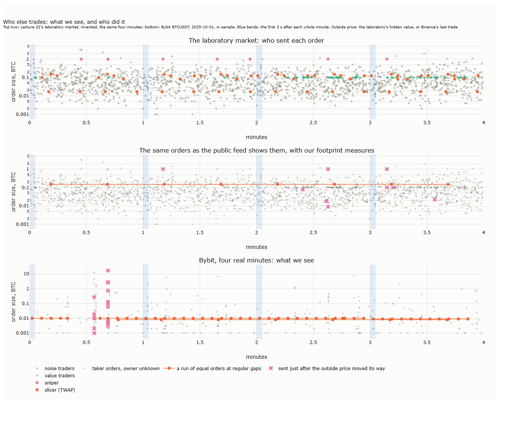
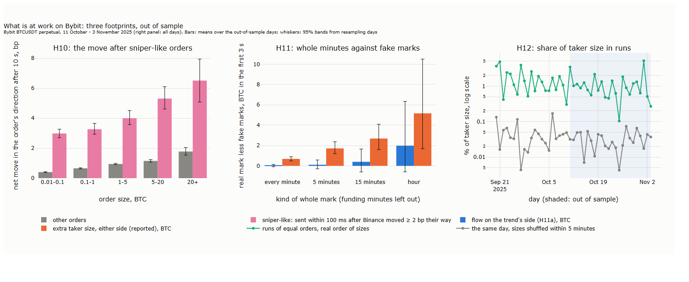
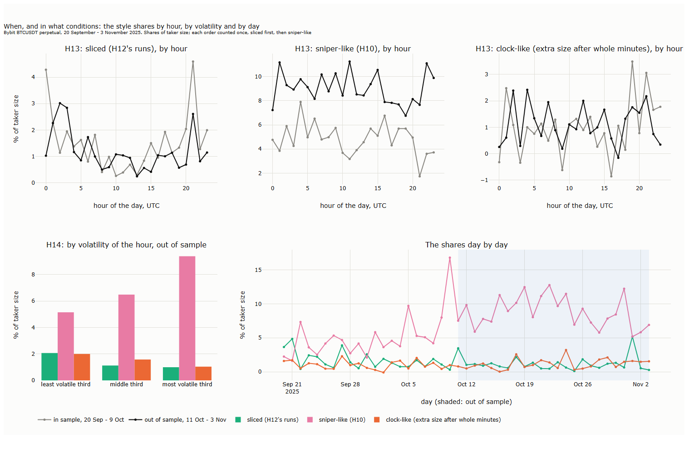
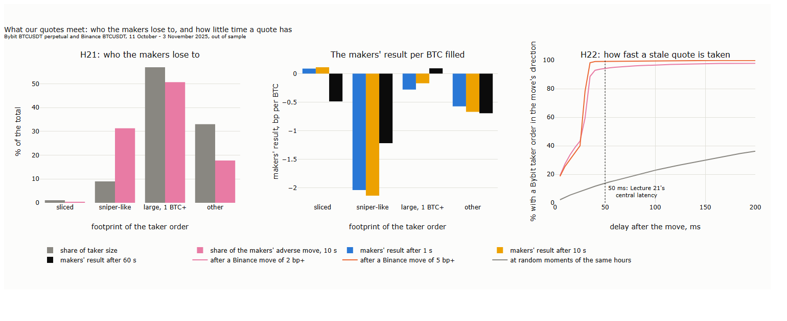

# Lecture 23: Who Else Trades: Reading Trading Styles from Public Data

*Systematic Trading: Lecture Notes (MSc) · draft, Nov 9, 2026 · Max Gnesi*

Lecture 22 showed that a market's reaction to our order is made by other traders with their own rules. This short lecture asks which of them are at work on Bybit's BTCUSDT perpetual, when and in what conditions, and how much public data can tell, as the bridge to the market-making strategy of Lecture 24: a quoter has to know whom its quotes will meet. The public feed never says who traded, but trading styles leave footprints. Each footprint is first tested in Lecture 22's laboratory market, where the answer is known, then measured on 20 September to 3 November 2025. The hypotheses were fixed before any result was computed, and every change is dated ([results/hypotheses.md](results/hypotheses.md)).

## 1. What we see, and who did it

The idea of the lecture fits in one chart: the same minutes once as the traders sent them, once as the public feed shows them.

<b>How to read the figure.</b> <b>Axes.</b> All panels: minutes (x), size of each taker order in BTC, log scale (y). Top: four minutes of Lecture 22's laboratory market, each order coloured by the trader who sent it (invented). Middle: the same orders as the public feed shows them, grey, with our footprint measures: runs of equal orders at regular gaps (orange line), and orders sent within 100 ms after the outside price moved 2 ticks or more their way (crosses); the laboratory's hidden value stands in for the outside price. Bottom: four real minutes of Bybit BTCUSDT on 1 October 2025, in sample, with the same measures; Binance's last trade is the outside price, and a move of 2 bp marks an order. Blue bands: the first 3 s after each whole minute.

In the laboratory several slicers work at once. The run rule finds one of them, and every order it marks is a slicer's, but it misses the others. Of the orders sent just after the outside price moved, a third are the sniper's. A footprint is a partial and noisy view of a style, and its quality can only be judged where the answer is known. On Bybit the same measures find four runs of small buys in these four minutes, three of 0.009 to 0.01 BTC every 5 s and one of 0.008 BTC every 29 s, and a burst of large orders, up to 20 BTC, sent within 100 ms of a move on Binance.

The lecture runs as follows:

| § | Step | Question |
|---|---|---|
| 1 | What we see, and who did it | Can trading styles be read from public data at all? |
| 2 | Four footprints | How is each style recognised, and how well, where the answer is known? |
| 3 | What is at work on Bybit | Do snipers, clock traders and slicers leave their footprints here? (H10, H11, H12) |
| 4 | When, and in what conditions | Do the styles come at regular times, and do volatile hours change the mix? (H13, H14) |
| 5 | What our quotes meet | Whom do the makers lose to, and can a quoter step aside in time? (H21, H22) |
| 6 | What it means for our strategy | What a quoter should watch, and a checklist for reading a market |

## 2. Four footprints

Each style gets the same short card: the footprint, the rule that measures it, what the laboratory showed with the answer known, what the rule misses, and what it means for a quoter. The laboratory and its traders are those of Lecture 22, §2; its results here are on invented data.

| § | Style | Its footprint in public data | Tested in |
|---|---|---|---|
| 2.1 | Slicer (TWAP) | Equal orders at regular gaps | Lecture 22's laboratory, step 4; H12 |
| 2.2 | Clock trader | A burst of flow with the trend just after whole minutes | Step 5; H11 |
| 2.3 | Sniper | Orders sent just after a move elsewhere, in its direction | Step 3; H10 |
| 2.4 | Maker pulling | Quotes cancelled near the best, in bursts | Lectures 18 and 22; Lecture 22, H20a |
| – | Scalper | None of its own: its echo at the exit distance is also left by a maker posting a fixed size, so public data cannot tell them apart (a one-level market maker, Silber, 1984) | Step 6; not tested |

### 2.1 The slicer

**Key message.** A large order cut into equal slices at a fixed interval leaves a run of identical orders; a run of eight or more is rarely chance, but most slicing goes unseen.

**The rule.** Taker orders of one exact size on one side, eight or more in a row, whose gaps vary by less than a fifth of their mean, at least 1 s apart (H12). Bybit's own TWAP tool slices every 30 s by default.

**With the answer known.** In the laboratory, 93 to 96% of what the rule finds is the slicer's, for gaps exactly regular or randomised by up to a fifth; with no slicer, it finds almost nothing (0.01% of taker size). It finds only about 40% of the slicer's size: slices too small to stand out, and sizes that other traders also use, are missed. A first version with five slices found as much in shuffled data as in real slicing, and was changed before any real data were used ([Lecture 22, step 4](../22-a-market-that-reacts/figures/22_sim_step4.png)).

**What it misses.** Slicers that vary their size, follow volume instead of the clock, or post resting orders. The share it reports is a floor.

**For a quoter.** A slicer is the most benign counterparty there is: steady flow on one side that knows nothing about the next minute. It also pushes the price its way, slice after slice, so a quote against it should lean.

### 2.2 The clock trader

**Key message.** Traders who decide at the close of a bar act together just after whole minutes; their footprint is in the clock, not in their rule.

**The rule.** At each whole minute, taker flow in the direction of the recent trend over the next 3 s, against the same measure at fake minutes 10 to 50 s away (H11a); and the share of quotes wider than one tick in the 2 s before the minute, which rises if market makers expect the burst (H11b).

**With the answer known.** In the laboratory, crowds of trend followers acting at bar closes are found from about 1% of taker size, and a maker that widens before the minute is found clearly. The first version of H11, flow after the mid crosses its average, found nothing even where trend followers were known to trade: others took their flow back at once. That measure was replaced before any real data were used ([Lecture 22, step 5](../22-a-market-that-reacts/figures/22_sim_step5.png)).

**What it misses.** Rules that do not wait for a bar close, and any rule whose direction does not match the simple trend we measure.

**For a quoter.** The seconds after a whole minute bring a burst of one-sided flow. A quote that stands then is filled by traders who move together; a maker may step back or widen before the mark, as H11b asks.

### 2.3 The sniper

**Key message.** A fast trader that sees a move elsewhere first takes the quotes that have not yet caught up; its footprint is timing.

**The rule.** Orders sent within 100 ms after Binance's price moved 2 bp or more in their direction (H10). If they are informed about a price that has already moved, their move afterwards should be larger than other orders' of the same size.

**With the answer known.** In the laboratory a sniper that sees the hidden value first earns from stale quotes, and the maker's margin per BTC falls from 1.15 to 0.36 ticks as its quotes refresh more slowly, from every 0.1 s to every 5 s ([Lecture 22, step 3](../22-a-market-that-reacts/figures/22_sim_step3.png)). The timing rule is a blunt tool: in the key chart, only a third of the orders it marks are the sniper's, because other traders also trade after moves.

**What it misses.** The races themselves: the losers' orders fail and leave no trace in the book (Aquilina, Budish and O'Neill, 2022). And moves elsewhere that come from other venues than Binance.

**For a quoter.** The sniper decides the cost of a stale quote. Every move on Binance is a moment when a resting order on Bybit is wrong and can be taken; refreshing faster than the sniper is the only defence, and it is not cheap.

### 2.4 The maker pulling

**Key message.** Market makers withdraw their quotes when the price moves fast; the withdrawal is visible in the book, and it makes the tail of everyone's cost fatter.

**The rule.** A pull is a book update in which five or more of the best twenty levels on one side lose size that trades do not explain (Lecture 18). On Bybit pulls are in 7% of updates after a quiet second and 79% after a move of more than 5 bp (Lecture 18).

**With the answer known.** In the laboratory a maker with a kill switch steps out after fast moves, and orders arriving while it is out pay twice as much at the median and more than twice in the tail. On Bybit, out of sample, orders of 1 to 5 BTC arriving after the most pulls had a 90th percentile of cost of 1.62 bp against 0.72 after the fewest (Lecture 22, H20a).

**What it misses.** Who pulled: one large maker or many small ones look the same.

**For a quoter.** A maker that pulls is a competitor stepping aside, which is both a risk and a chance: the queue empties, but the fills that come are the ones the others refused.

## 3. What is at work on Bybit

Three footprints were tested on the 24 out-of-sample days, 11 October to 3 November 2025, with the rules of §2 fixed in sample. Two are clearly there; the third shows a clock, but not the trend crowd it was meant to find.

<b>How to read the figure.</b> <b>Axes.</b> Left: order size class in BTC (x), net move of the mid in the order's direction 10 s later, after matched controls, in bp (y); pink: orders sent within 100 ms after Binance's price moved 2 bp or more their way, grey: all other orders. Middle: kind of whole mark (x), the mean over the first 3 s after the mark less the same at fake marks 10 to 50 s after it, in BTC (y); blue: taker flow on the trend's side (H11a), orange: extra taker size on either side. Right: day (x), share of taker size in runs of eight or more equal orders at regular gaps, % on a log scale (y); green: as traded, grey: the same day with sizes shuffled within 5 minutes; shaded: out of sample. Whiskers: 95% bands from 2,000 resamples of the out-of-sample days. Our calculation, Bybit BTCUSDT perpetual.

**Do orders sent just after a move on Binance move the price more? (H10)** Yes, in every size class. Ten seconds after a sniper-like order the mid has moved 3.0 to 6.5 bp its way, net of matched controls, against 0.4 to 1.8 bp after other orders of the same size; weighted over the classes the difference is 2.7 bp (95% band 2.4 to 3.0). The difference is there already after 1 s (2.7 bp) and still after 60 s (2.2 bp): Bybit catches up with a price that has already moved, and does not give it back. Such orders are 3.4% of taker orders and 9% of taker size. They pay for their speed: 2.3 to 2.5 bp from the mid against 0.2 to 0.8 bp for other orders up to 20 BTC, because they arrive while the book is still moving; the move that follows them is larger still.

**Is there a clock, and does it follow the trend? (H11)** There is a clock, but no trend crowd. In the first 3 s after a whole minute, taker flow on the trend's side is no larger than at fake marks (H11a, t = 0.4), and makers do not widen before the minute (H11b; if anything, wide quotes are slightly rarer then). What the minute brings is volume on both sides: 0.7 BTC more taker size in the first 3 s than at fake marks (t = 6.4), rising to 5.2 BTC at whole hours, against an average of 2.9 BTC in any 3 s; and the spread widens *after* the mark (t = 4.4).

**Are there more runs of equal orders than chance gives? (H12)** Many more. Out of sample 1.2% of taker size is in runs, against 0.03% with the sizes shuffled within 5 minutes, about forty times as much, and more than five times as much on every one of the 45 days. The share varies from 0.1% to 5.2% a day: a few large slicers make a day. Of the 3,215 runs found out of sample, a third have gaps within 1 s of 30.22 s, and they carry 61% of the size in runs; this fits Bybit's own TWAP tool, which slices every 30 s by default, but cannot prove it. With 40% of a known slicer found in the laboratory (§2.1), the true share is higher.

| Plain question | Measure | Out of sample | p (one-sided) | Verdict |
|---|---|---|---|---|
| Do orders sent just after Binance moved, their way, move the price more? | Net R(10 s), sniper-like less other, same size class | +2.7 bp (2.4 to 3.0) | < 0.001 | Holds |
| Does flow lean with the trend just after a whole minute? | Flow with the trend, first 3 s, real less fake marks | +0.03 BTC, t = 0.4 | 0.34 | Fails |
| Do makers widen before a whole minute? | Share of quotes wider than a tick, 2 s before, real less fake | −0.04 points, t = −5.5 | 1.00 | Fails (opposite sign) |
| Is there more slicing than chance gives? | Share of taker size in runs, real less shuffled | +1.2 points (0.8 to 1.6) | < 0.001 | Holds |

<b>How to read the table.</b> Each row is one hypothesis fixed before the data were used (H10, H11a, H11b, H12). Brackets: 95% bands from 2,000 resamples of days. H10 and H12: bootstrap over days; H11: one-sided t over the 24 days, as fixed. p-values before the correction over all twelve, which comes with §5. Our calculation.

**For a quoter.** The three footprints say different things about the fills a resting order will get. A fill from a sniper-like order is the worst there is: the price goes on 3 to 6 bp against the quote, and it comes just after Binance moved, which a quoter can see as well. A slicer's fills are the best: small, regular and uninformed about the next minute, but all on one side for as long as the run lasts. The clock does not bring a crowd that knows the trend, it brings volume: a quote standing at the whole minute is filled more often, and the spread opens after the burst, not before it. Lecture 24 starts from these three facts.

## 4. When, and in what conditions

§3 asked whether the styles are there; this section asks when. Each taker order is counted once, as sliced if it belongs to a run, else sniper-like, else large (1 BTC or more), else other; the clock-like share is the extra taker size in the first 3 s after each whole minute, against seconds 10 to 49 of the same minute. All are shares of taker size, and shares of footprints, not of traders. An hour's volatility is the square root of the sum of squared 1-minute changes of the log mid; its thirds are fixed in sample, for each hour of the day separately, so that a volatile hour is volatile for its time of day.

<b>How to read the figure.</b> <b>Axes.</b> Top row: hour of the day in UTC (x), share of taker size in that hour, % (y), for the sliced, sniper-like and clock-like footprints; grey: in sample, black: out of sample. Bottom left: third of the hour's volatility, out of sample (x), share of taker size, % (y), one bar per footprint. Bottom right: day (x), the day's share of taker size, % (y), one line per footprint; shaded: out of sample. The clock-like share is an excess over the quiet seconds and can be below zero. Our calculation, Bybit BTCUSDT perpetual.

**Do the styles come at the same hours every month? (H13)** Not clearly. The sliced share has the most stable profile: in both samples it peaks at 21:00 UTC and is high in the first hours after midnight, and the rank correlation between the two profiles is 0.31, but with only 20 and 24 days behind each hour that is not enough (p = 0.10). The clock-like profile is noise around 1% (0.19, p = 0.09). The sniper-like profile is nearly flat, so its hours cannot be ranked (−0.17, p = 0.70): what changed is its level, not its timing. Three to four weeks per sample are too few to fix a profile of 24 hours; a quoter cannot plan on the hour of the day.

**Do volatile hours change the mix? (H14)** For the sniper, strongly. Within the same hour of the day, the most volatile third of hours has a sniper-like share 4.6 points higher than the least volatile third (95% band 3.3 to 6.2); the shares are 5.1%, 6.5% and 9.4% from calm to volatile. This is close to built in: a footprint defined by a move on Binance is found more often when Binance moves more, which is why it was expected; what it adds is the size. The sliced share falls from 2.1% in calm hours to 1.0% in volatile ones, as expected, but the difference within the same hours is not clear (−0.7 points, p = 0.19). The clock-like share falls too, from 2.0% to 1.0%, the opposite of the hypothesis (p = 1.00): in a volatile hour so much else trades that the burst at the minute no longer stands out.

**A change of style, noted.** The sniper-like share rose from about 5% of taker size before 10 October to about 9% after it, and was 2.5 to 3 points higher than in sample within each third of volatility (bottom right); whether this is linked to the market staying more reactive after the cascade (Lecture 22, §5) is an open question.

| Plain question | Measure | Out of sample | p (one-sided) | Verdict |
|---|---|---|---|---|
| Does slicing come at the same hours in both samples? | Spearman correlation, 24-hour profiles | 0.31 (−0.12 to 0.59) | 0.10 | Fails |
| Do sniper-like orders come at the same hours? | Same | −0.17 (−0.46 to 0.27) | 0.70 | Fails |
| Does the clock-like burst come at the same hours? | Same | 0.19 (−0.09 to 0.50) | 0.09 | Fails |
| Is there less slicing in volatile hours? | Share, most less least volatile third, same hour of day | −0.7 points (−2.0 to 0.7) | 0.19 | Fails |
| Are there more sniper-like orders in volatile hours? | Same | +4.6 points (3.3 to 6.2) | < 0.001 | Holds |
| Is there more clock-like flow in volatile hours? | Same | −1.4 points (−2.6 to −0.6) | 1.00 | Fails (opposite sign) |

<b>How to read the table.</b> One row per p-value of H13 and H14, as fixed before the data were used. Brackets: 95% bands from 2,000 resamples of days (for H13, of the days of both samples). p-values before the correction over all twelve. Our calculation.

**For a quoter.** The time of day says little; volatility says much. In a volatile hour almost one taker order in ten by size comes just behind a move on Binance, and since 10 October that share has been higher at every level of volatility. A quoting rule should therefore watch Binance and the hour's volatility, not the clock on the wall.

## 5. What our quotes meet

Every taker order fills someone's resting order. This section turns §3 round and asks what each footprint costs the makers, and whether a quoter that sees Binance move can pull its quote before it is taken. The two tests replaced two others on runs as they start, which concern about 1% of taker size; the change was made and dated before any of their results ([results/hypotheses.md](results/hypotheses.md)).

The makers' **adverse move** on a taker order is its size times the mid's move in its direction 10 s later, gross: what the resting orders it filled have lost by then. The makers' **result** per BTC is what the taker paid from the mid less that move. A **Binance move** is a Binance trade 2 bp or more from the last price at least 100 ms before it, the first in 1 s.

<b>How to read the figure.</b> <b>Axes.</b> Left: footprint of the taker order (x), % of the total (y); grey: share of taker size, pink: share of the makers' adverse move after 10 s. Middle: footprint (x), the makers' result in bp per BTC filled (y), after 1, 10 and 60 s; below zero the makers lose. Right: delay after a Binance move in ms (x), share of moves followed by then by a Bybit taker order in the move's direction, % (y); pink: moves of 2 bp or more, orange: 5 bp or more, grey: random moments of the same hours with a random direction; dotted line: 50 ms. Out of sample, 11 October to 3 November 2025. Our calculation.

**Whom do the makers lose to? (H21)** Mostly to the sniper. Sniper-like orders are 9% of taker size but carry 31% of the makers' adverse move after 10 s, 22 points more than their share of size (95% band 18 to 26). Per BTC filled, the makers lose 2.1 bp to them after 10 s: the taker pays 3.2 bp from the mid, and the mid moves 5.3 bp its way. Against other footprints the makers lose much less: 0.7 bp per BTC to the small orders of "other", 0.2 bp to large orders. The slicer is the only one the makers earn on, a tenth of a basis point after 10 s, which the price's drift in the slicer's direction takes back by 60 s (−0.5 bp). In sample the pattern was the same, with sniper-like orders 5% of size and 20% of the adverse move.

**Can a quoter step aside in time? (H22)** Rarely. After a Binance move of 2 bp or more, a Bybit taker order in the same direction followed within 50 ms in 94% of the 22,305 moves, against 14% at random moments; after moves of 5 bp or more, in 99%. The typical delay is 30 ms, and the delays pile up between 25 and 35 ms, as if many traders sent their orders as soon as a fixed travel time from Binance allowed; where the two exchanges' servers stand is not in our data. More than a quarter of the moves were followed within 10 ms, where a few milliseconds of difference between the two exchanges' clocks matter, so that number is the least certain. A quoter that sees Binance move and needs 50 ms to cancel has usually been filled already.

| Plain question | Measure | Out of sample | p (one-sided) | Verdict |
|---|---|---|---|---|
| Do sniper-like orders cost the makers more than their share of size? | Share of the adverse move less share of size | +22 points (18 to 26) | < 0.001 | Holds |
| Is a quote taken within 50 ms after a Binance move more often than by chance? | Share within 50 ms, after moves less random moments | +80 points (79 to 83) | < 0.001 | Holds |

<b>How to read the table.</b> One row per hypothesis (H21, H22), fixed before their data were computed. Brackets: 95% bands from 2,000 resamples of days. Our calculation.

### 5.1 All twelve tests, corrected

| Test | Plain question | p | q | Verdict after correction |
|---|---|---|---|---|
| H10 | Do orders sent just after Binance moved move the price more? | < 0.001 | 0.001 | Holds |
| H12 | Is there more slicing than chance gives? | < 0.001 | 0.001 | Holds |
| H14 | More sniper-like orders in volatile hours? | < 0.001 | 0.001 | Holds |
| H21 | Do sniper-like orders cost the makers more than their share? | < 0.001 | 0.001 | Holds |
| H22 | Is a quote taken within 50 ms after a Binance move? | < 0.001 | 0.001 | Holds |
| H13 | The clock-like burst at the same hours? | 0.09 | 0.16 | Fails |
| H13 | Slicing at the same hours? | 0.10 | 0.16 | Fails |
| H14 | Less slicing in volatile hours? | 0.19 | 0.28 | Fails |
| H11a | Flow with the trend after a whole minute? | 0.34 | 0.45 | Fails |
| H13 | Sniper-like orders at the same hours? | 0.70 | 0.84 | Fails |
| H11b | Makers widen before a whole minute? | 1.00 | 1.00 | Fails |
| H14 | More clock-like flow in volatile hours? | 1.00 | 1.00 | Fails |

<b>How to read the table.</b> All twelve p-values of Lecture 23, out of sample, sorted. q: the Benjamini-Hochberg adjusted p-value over the twelve; a test holds if q is below 0.05. A bootstrap p of zero is entered as 1/2,000. Our calculation.

Five tests hold, and four of them are about one style: the trader who takes Bybit's quotes just after Binance has moved. It is found (H10), it gets more frequent when markets move (H14), it carries a third of what the makers lose (H21), and it is usually faster than a quote can be pulled (H22). The fifth is the slicer, the makers' best counterparty (H12). The clock and the time of day, which looked promising in the laboratory and in sample, did not hold.

**For a quoter.** The single most important thing a quoter on Bybit must handle is the move on Binance. Watching Binance and pulling in time is not enough on its own, because in half the cases the first order in the move's direction arrives within 30 ms; what is left is to quote so that a stale fill costs less: wider or smaller when Binance is moving, and when the hour is volatile. Lecture 24 starts from here.

## 6. What it means for our strategy

Lecture 24 builds a market maker on Bybit's BTCUSDT perpetual. This lecture has said who its quotes will meet; this section turns that into what its quoting rule must handle, and into a short routine for reading a market before quoting in it.

### 6.1 From footprints to a quoting rule

| What we found | Evidence | What the quoting rule must do | How Lecture 24 can check it |
|---|---|---|---|
| The makers' losses come mostly from orders sent just behind Binance | 9% of taker size, 31% of the makers' adverse move; −2.1 bp per BTC filled (H10, H21) | Treat a move on Binance as the main risk to every resting quote | Markouts of its own fills, split by whether Binance had just moved |
| A stale quote is rarely pulled in time | 94% of 2 bp moves followed within 50 ms by a Bybit order their way; half within 30 ms (H22) | Do not rely on cancelling: make a stale fill cheaper beforehand, with a wider or smaller quote when the price gap to Binance is open or Binance is moving | The same quoting rule at 10, 50 and 100 ms of latency (Lecture 21) |
| Volatile hours bring more of them | Sniper-like share 5% in calm hours, 9% in volatile ones (H14) | Set spread and size by the hour's volatility, measured as it goes | Results by third of volatility |
| Slicers are the best counterparty, but push the price their way | Earn +0.1 bp per BTC after 10 s, lose 0.5 by 60 s (H12, H21) | Lean the quotes against a run under way; do not hold its inventory for long | Inventory and result during runs |
| The whole minute brings volume, not direction | +0.7 BTC in 3 s, no trend lean, spread wider after (H11) | Expect more fills just after the minute; nothing to predict | Fill rates by second of the minute |
| Makers pulling fattens the tail of cost | 90th percentile of cost 1.62 against 0.72 bp (Lecture 22, H20a) | Pull with the others, or quote wide, when pulls surge; the fills that come then are the ones the others refused | Results after the most pulls |

<b>How to read the table.</b> One row per result of this lecture or Lecture 22, out of sample on Bybit. The last column is a check the capstone can run on its own fills; none of it is a result yet. Our calculation.

The ordering matters. The first two rows are the core of market making on this venue: almost every losing fill is a quote that Binance has already made stale, and speed alone does not save it. Glosten and Milgrom (1985) put the same thing in theory: a market maker sets its spread to pay for the trades it loses to the informed. Here the informed are, for the most part, simply the faster readers of another exchange (Budish, Cramton and Shim, 2015).

### 6.2 Reading a market before quoting in it

The same six questions apply to any market with a public book and trades. Each is answered with a measure from Part IV, using only what was known at the moment.

| Step | Question | What to look at | From |
|---|---|---|---|
| 1. The state | Is there anything to trade against, and which way does it lean? | Spread, depth, imbalance at the best | Lectures 18, 19 |
| 2. The flow | Who is pushing, and how hard? | Taker size and its imbalance, and how much it moves the price | Lecture 20 |
| 3. The other venue | Has the leading market just moved? | The price gap to the leading venue, the age of its last trade | §5 (H22) |
| 4. The styles | What is at work now? | Sniper-like orders, a run under way, the burst after the minute | §3 |
| 5. The circumstances | Is this an ordinary hour? | Volatility and quote pulls against their usual values | §4, Lecture 22 (§5) |
| 6. The read | What do we expect, and what would prove us wrong? | One sentence, written before looking ahead, then checked | |

<b>How to read the table.</b> A routine, not a test: whether a read predicts anything was not tested here. Step 3 is new in this lecture and comes before the styles, because on Bybit it decides most of what a quote loses.

## 7. Summary, exercises and reading

### 7.1 Takeaways

1. **Styles leave footprints, partial and noisy.** A run of equal orders, an order just after a move elsewhere, a burst after the minute; each catches part of a style, and its quality can only be judged where the answer is known (§1, §2).
2. **Snipers and slicers are there; the trend crowd at the clock is not.** Orders sent just after Binance moved move Bybit's price 2.7 bp more than others of their size, and runs of equal orders are forty times what chance gives; flow after the minute does not lean with the trend (§3).
3. **Volatility, not the time of day, sets the mix.** The sniper-like share rises from 5% in calm hours to 9% in volatile ones; hourly profiles did not repeat out of sample (§4).
4. **The makers lose mostly to the sniper.** A tenth of taker size carries a third of the makers' adverse move (§5).
5. **A quote is rarely pulled in time.** After a move on Binance, a Bybit order its way usually follows within 30 ms; a quoter has to price the risk in advance rather than outrun it (§5).
6. **For the capstone: price the stale quote.** Watch Binance and the hour's volatility, lean against runs, and expect volume, not direction, after the minute (§6).

### 7.2 Exercises

- [ ] **Does one style set off another?** (H15, not tested here.) Fit Lecture 20's Hawkes process with one type per footprint and compare the cross-effects with labels shuffled within 5-minute blocks. Does a sniper-like order set off others, or do both answer the same move?
- [ ] **A run as it starts.** (H16, H17, not tested here.) First in the laboratory with the slicer known, then on Bybit: recognise a run at its third slice and predict the next. How often does it come within 100 ms of the prediction, and does the price move less on a slice that could be expected?
- [ ] **Round numbers.** Is there more depth at prices that are multiples of 1,000 USDT than 3 to 10 ticks either side (Lecture 18 saw walls at 111,000)? Does the price stop there more often?
- [ ] **Who leads?** Repeat H22 the other way round: after a 2 bp move on Bybit, how often does a Binance order follow within 50 ms? What does the asymmetry say about where prices are formed?
- [ ] **Another threshold.** Repeat H10 and H21 with moves of 1 and 5 bp on Binance and look-backs of 50 and 200 ms. Is the share of the makers' loss stable, or a product of the 2 bp choice?
- [ ] **Your own market.** Apply the six steps of §6.2 to an hour of ETHUSDT on Bybit, write the read before looking ahead, and check it.

### 7.3 Reading list

The references of §2 to §6, each with what it is used for.

- Aquilina, M., Budish, E. and O'Neill, P. (2022). Quantifying the high-frequency trading "arms race". *Quarterly Journal of Economics* 137(1), 493-564. — in book data the losers of a race leave no trace (§2.3).
- Avellaneda, M. and Stoikov, S. (2008). High-frequency trading in a limit order book. *Quantitative Finance* 8(3), 217-224. — the quoting rule Lecture 24 starts from (§6).
- Budish, E., Cramton, P. and Shim, J. (2015). The high-frequency trading arms race: frequent batch auctions as a market design response. *Quarterly Journal of Economics* 130(4), 1547-1621. — stale quotes picked off after a public move (§2.3, §6.1).
- Glosten, L. R. and Milgrom, P. R. (1985). Bid, ask and transaction prices in a specialist market with heterogeneously informed traders. *Journal of Financial Economics* 14(1), 71-100. — the spread as the price of trading with the informed (§6.1).
- Kim, C. and Hansen, P. R. (2026). The quarter-hour effect: periodic algorithmic trading and return predictability in cryptocurrency futures. arXiv 2607.09426, preprint. — bursts at minute, five-minute and quarter-hour marks (§2.2, §3).
- Silber, W. L. (1984). Marketmaker behavior in an auction market: an analysis of scalpers in futures markets. *Journal of Finance* 39(4), 937-953. — scalpers as one-level market makers (§2).

*References as checked for Lectures 21 and 22, on 9 November 2026.*
