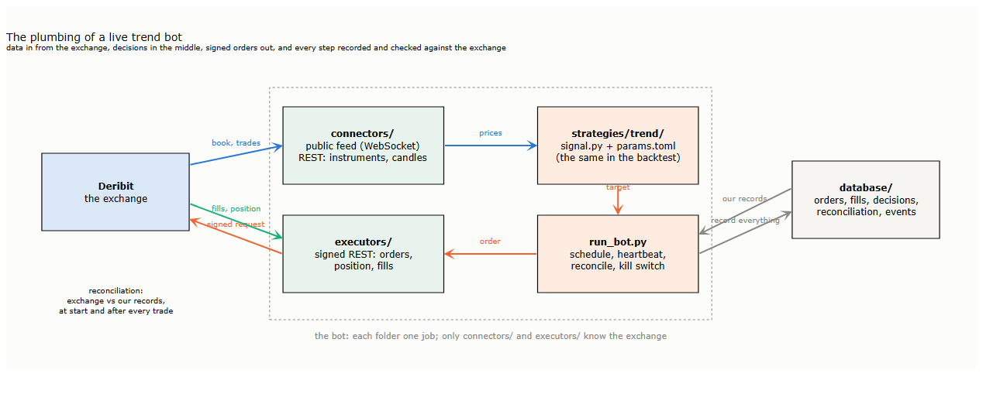
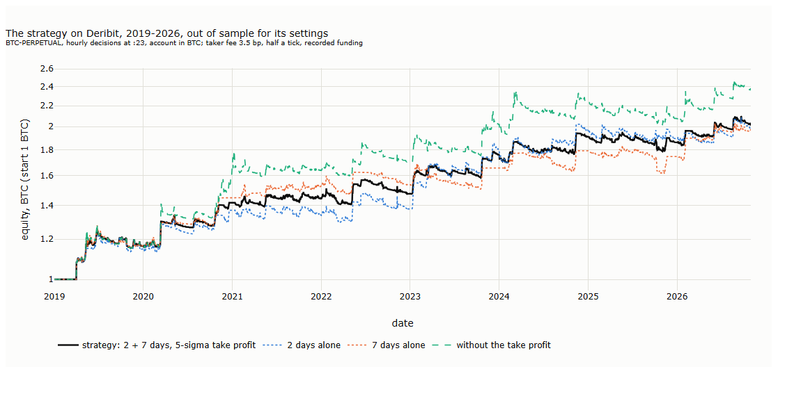

# Lecture 24: A Live Trend Bot: From Backtest to Production

*Systematic Trading: Lecture Notes (MSc) · draft, Nov 18, 2026 · Max Gnesi*

*Pipeline stage (Lecture 1 §2.1): all five stages at once, in production: data, signal, sizing, execution and risk, and the feedback loop that checks them.*

Every lecture so far ended with a backtest. This one ends with a program that trades on its own. It takes a simple trend strategy on Deribit's bitcoin perpetual, tests it on seven years of history, and then runs it live on Deribit's free test exchange, hour after hour, with every decision, order and fill recorded and checked against the exchange. The strategy is deliberately simple and not tuned: designing a good strategy is each reader's own work, and the earlier lectures give the tools. What this lecture teaches is the part no backtest shows: **the plumbing**. How a program talks to an exchange, how it proves who it is, what it must remember, how it notices that its picture of its own account is wrong, and what it does when the connection drops, the computer sleeps or the program crashes. A strategy is a few dozen lines; the plumbing decides whether it trades what the backtest says. The code is in [`capstone/`](../../capstone/README.md), and every section points to the file that does what the section explains.


<sub><b>How to read the figure.</b> A diagram, not data. Boxes: the exchange (left), the bot's folders (inside the dotted frame) and the database (right). Arrows: what flows between them; blue, market data in; orange, decisions and orders out; green, fills and the position back from the exchange; grey, records written to and read from the database. Only `connectors/` and `executors/` know which exchange they talk to; everything else would stay the same on another exchange.</sub>

Market data comes in through the connectors; the strategy turns prices into a target position; the bot's loop sends the order through the executor, which signs it; fills and the position come back; and everything is written to the database and compared with what the exchange says. The rest of the lecture walks through each box and arrow.

| § | Topic | Question |
|---|---|---|
| 1 | From backtest to live | What does a backtest assume that a live system must provide? |
| 2 | How a program talks to an exchange | What are REST and WebSocket, public and private, and how is a live order book kept? |
| 3 | Keys and signing | How does the exchange know it is us, and how do we keep the key safe? |
| 4 | The architecture | Why one job per folder, and what does that buy? |
| 5 | The database | What must be recorded, in which tables, and why? |
| 6 | Reconciliation | How does the bot notice that its picture of the account is wrong? |
| 7 | Crashes and disconnects | Heartbeats, reconnects, retries, restarts, sleep: what can go wrong, and what the bot does |
| 8 | The strategy | What the bot trades, and how its hourly bars are built |
| 9 | Backtest and live test | What the history says, and what the first live decisions taught |
| 10 | Running it 24 hours a day | A server, a container that restarts itself, and a checklist |
| | Back to the base layer | The ideas of Part V, collected |
| 11 | Summary, exercises and reading | |
| | The end of the course | |

> **What to take away**
>
> 1. **The plumbing decides whether a strategy trades what its backtest says.** Our first live run failed twice before any money moved: a request timed out and the database refused a second thread. Neither would ever show in a backtest.
> 2. **Two ways to talk to an exchange:** REST asks one question and gets one answer (orders, the account); a WebSocket stays open and streams (prices, the book, our fills). A live order book is a snapshot plus a chain of changes; one missing link and the copy is wrong.
> 3. **Sign, never send a secret.** A key pair keeps the private half on our machine; the exchange holds only the public half. Minimal permissions, never withdrawals; secrets never in code, chats or logs.
> 4. **Record everything, and reconcile:** trust the exchange for trading, but never silently accept a difference between what we think happened and what it says. On a difference, stop and let a person decide.
> 5. **Plan for failure:** heartbeats, reconnects that wait longer each time, reads retried but orders never retried blindly, labels that prevent a double order after a restart, a kill switch for the plumbing. A trend follower needs no drawdown stop.
> 6. **Verify every claim about the exchange live.** The fee actually charged (5 bp) differed from the published one (3.5 bp); a venue refused an account from our country; the exchange's candles opened at the previous close. All three were found by checking, not assuming.

## 1. From backtest to live

A backtest is a promise made under assumptions. A live system has to keep the promise without them.

| The backtest assumes | Live, someone has to provide | Where in this lecture |
|---|---|---|
| Prices arrive, complete and on time | A connection that stays up, notices when it is not, and repairs itself | §2, §7 |
| Orders are filled at the price assumed | An order that is sent, signed, accepted and filled, at a price we then measure | §2, §3, §9 |
| The position is what the strategy decided | A record of every fill, checked against the exchange | §5, §6 |
| Nothing breaks | A program that survives timeouts, disconnects, crashes, restarts and a sleeping computer | §7, §10 |
| The fee is the published fee | The fee actually charged, read from each fill | §9 |

The gap between the two columns is where live systems lose money without the strategy being wrong. Part V measured some of it on the market side (Lecture 22: fills, latency, a market that reacts); this lecture deals with the side inside our own program.

**Why Deribit.** The order-book lectures used Bybit's data. The capstone was built for Bybit too, until Bybit's test exchange refused an account from our country for regulatory reasons. Exchanges are not available everywhere: check before building on one. We moved to **Deribit**, whose test exchange ("testnet") is free and open to us, and whose bitcoin perpetual, `BTC-PERPETUAL`, is among the most liquid. The move cost one folder, `connectors/`; the rest of the bot did not change. That is the architecture of §4 at work.

**The contract.** `BTC-PERPETUAL` is an **inverse** contract: amounts are in US dollars, in steps of 10 USD, while profit, loss and margin are in bitcoin. A position of `A` dollars held from price `p0` to `p1` earns

```math
\text{P\&L (BTC)} = A\left(\frac{1}{p_0} - \frac{1}{p_1}\right)
```

| Symbol | Meaning |
|---|---|
| $`A`$ | the position in USD, positive long, negative short |
| $`p_0, p_1`$ | the price when the position was opened, and now |

**What "inverse" means.** The price is quoted in dollars per bitcoin, but the collateral and every payment are in bitcoin: the contract is the inverse of an ordinary, **linear** one (a USDT-settled perpetual, say), which is quoted, margined and paid in dollars. It exists so that a trader who holds only bitcoin can trade without ever holding dollars. **Why the 1/p.** The inverse payoff makes hedging bitcoin static. Hold $`N`$ bitcoin and short an inverse contract of $`A = N p_0`$ dollars: at any later price $`p_1`$ the bitcoin is worth $`N p_1`$ dollars and the short pays $`-N p_0 (1/p_0 - 1/p_1)`$ BTC, worth $`-N p_1 + N p_0`$ dollars, so the total is $`N p_0`$ whatever the price. The contract's convexity in bitcoin is the mirror image of the bitcoin holding's convexity in dollars, and the hedge is set once and never adjusted. A contract that paid a fixed number of bitcoin per dollar of price move would leave the hedge convex, its ratio drifting with the price, to be rebalanced at a cost; a linear USDT contract is static only because it is paid in dollars, which needs dollar collateral. Three consequences matter for a bot:

| Consequence | Example | Why it matters |
|---|---|---|
| The same dollar move pays different amounts of bitcoin | Long 10,000 USD from 50,000: at 55,000 it earns +0.018182 BTC, at 45,000 it loses −0.022222 BTC; both are 1,000 USD at the exit price | Profit in BTC is not linear in the price; the backtest must use the formula, not position × return |
| The collateral moves with the position | A long holds bitcoin twice, the position and the margin, so its margin shrinks exactly when it loses; a short of the same size as the margin cancels the bitcoin exposure, a synthetic dollar | Liquidation comes sooner for longs and later for shorts, because the collateral is bitcoin; with dollar collateral it would be symmetric. With collateral worth 1/L of the position, a long on dollar collateral is wiped out after a fall of 1/L, a long on bitcoin collateral (any inverse contract, or a linear one margined in bitcoin) after a fall of 1/(L+1) (50% instead of 100% at 1×, 9.1% instead of 10% at 10×), a short on bitcoin collateral after a rise of 1/(L−1); exchanges liquidate earlier still, at the maintenance margin; the hard limit of §7, 3 times equity, is measured in BTC |
| The account is measured in bitcoin | The backtest's Sharpe ratio of 0.99 is a Sharpe ratio in BTC; in dollars the account also rises and falls with the bitcoin price | Compare it with other strategies only in the same unit, or convert |

<sub><b>How to read the table.</b> One row per consequence of settling in bitcoin, with a worked example (notebook §2) and what it changes for the bot.</sub>

**What counts as collateral depends on the margin mode.** By default Deribit margins each currency separately (segregated margin), so a bitcoin contract is backed by the bitcoin in the account, the case above. With cross collateral, other currencies such as USDC can back it too, at a haircut, and a mixed account lies between the dollar and the bitcoin case; the profit and loss of an inverse contract is still settled in bitcoin, so the account needs bitcoin to settle a loss. Deribit has no isolated margin for a single position: to give a strategy its own margin, use a subaccount, as the bot does (§3). Margin modes and their names differ between exchanges and change over time; check the exchange's own documentation (Deribit, *Margin types and usage*, consulted 18 November 2026).

So the account, live and in the backtest, is kept in BTC. Checked live on 17 November 2026: tick 0.5 USD, contract 10 USD, minimum 10 USD, on the real exchange and the testnet alike.

## 2. How a program talks to an exchange

**Key message.** There are two ways to talk to an exchange. **REST**: our program asks one question and gets one answer. **WebSocket**: our program opens a line that stays open, and the exchange keeps sending as things happen.

| | REST | WebSocket |
|---|---|---|
| **What it is** | A request to an address (an *endpoint*), one answer back, usually in JSON | A connection opened once; we subscribe to channels and the exchange streams updates |
| **Everyday picture** | Phoning a shop to ask a price | A news ticker that keeps scrolling |
| **Used for** | Placing, amending and cancelling orders; our position, balance and fills; instrument details; past candles | The order book, the trades, prices; our own orders and fills as they happen |
| **What can go wrong** | Too many requests (rate limits); a timeout, after which we do not know whether an order arrived | The line drops silently; an update is lost and our copy of the book is wrong; data go stale while the line looks alive |
| **In our code** | [`connectors/deribit_rest.py`](../../capstone/connectors/deribit_rest.py), [`executors/gateway.py`](../../capstone/executors/gateway.py) | [`connectors/deribit_public_feed.py`](../../capstone/connectors/deribit_public_feed.py) |

<sub><b>How to read the table.</b> One column per way of talking to an exchange. REST was described by Fielding (2000); the WebSocket protocol is the standard RFC 6455 (Fette and Melnikov, 2011). Deribit speaks both with the same message format, JSON-RPC: a method name, parameters, and an answer that holds either a result or an error.</sub>

**Public and private.** Market data is **public**: anyone can read it, with no account. Our orders, fills and balance are **private**: each request proves it is ours (§3). The bot reads public data from the real exchange, for the real market, and sends private requests to the testnet, where the money is play money.

**A live order book.** The exchange first sends a **snapshot**, the whole book, then only **changes**: the new size at each price that changed, where size zero means the level is gone. Our program keeps its own copy by applying each change. On Deribit every change carries its own number and the number of the change before it (`change_id`, `prev_change_id`); if a change does not follow the last one we applied, a change was lost, our copy is wrong, and it must not be traded on: the bot marks the book invalid and reconnects, which brings a fresh snapshot. This is the book Lecture 21 rebuilt from files, now arriving live. In the code, [`connectors/order_book.py`](../../capstone/connectors/order_book.py) knows no exchange at all: it takes a snapshot and a list of changes, and each connector translates its exchange's format into that. Bybit numbers its changes one by one; Deribit chains them; only the translation differs.

**What a connector is.** An adapter between the exchange's language and the bot's. It opens and keeps alive the connections, translates the exchange's messages into the bot's own objects (a book, a trade, an instrument, an order), and knows the exchange's peculiarities: what "amount" means, the tick and lot sizes, the price band outside which orders are refused (about ±3% around the mark price on `BTC-PERPETUAL`, checked live). Nothing above the connector needs to know which exchange it is talking to.

**Verify, do not assume.** Every claim about the exchange in the code is marked with the date it was checked live. Two examples of why. Deribit's book channels at full speed need a login; the public ones send every 100 ms. And when our bars, built from the live trade feed, were compared with the exchange's own one-minute candles, they matched exactly on Deribit; on Bybit they matched in everything but the open, because Bybit opens each candle at the previous candle's close. Neither convention is wrong; only a check shows which one a source uses.

## 3. Keys and signing

**Key message.** The exchange must know that a private request is ours, without our secret ever travelling over the network. We **sign** each request; the exchange checks the signature.

| Question | Plain answer |
|---|---|
| **What is an API key?** | A login for programs: it says who is calling, and its permissions say what the caller may do: read, trade, withdraw |
| **What does signing mean?** | We compute a signature from the request and a secret, and send only the signature. A timestamp and a random number make every signature single-use, so a copied one cannot be replayed |
| **Shared secret (HMAC)** | The exchange creates a secret and keeps a copy; the signature is a keyed hash (RFC 2104; Krawczyk, Bellare and Canetti, 1997). Simple, but there are two copies of the secret: a leak on either side is a leak |
| **Key pair (Ed25519)** | We create a pair on our own machine. The **private** key never leaves it; the exchange gets only the **public** key, which can check a signature but never make one (Bernstein et al., 2012). A leak on the exchange's side reveals nothing that can sign |
| **Permissions** | The bot needs reading and trading only, **never withdrawals**. A stolen trading key can lose money through bad trades; a stolen withdrawal key can empty the account |
| **Where the key lives** | Outside the code: a settings file (`capstone/configs/.env`) and a keys folder that git never sees, readable only by us. Never in code, chats, screenshots or logs |
| **Logs and error messages** | Scrubbed before they are written or shown: an error message can carry a secret. In the author's own trading system, a failed login once put a secret onto a web page and into two logs; since then every log line passes through a scrubber |
| **A test that enforces it** | The conformance test fails if a secret file is tracked by git or a program logs without scrubbing |
| **Rotation and leaks** | Replace keys regularly. On a leak: revoke the key first, then investigate |

<sub><b>How to read the table.</b> One row per question a beginner should be able to answer before letting a program trade. In the code: [`executors/deribit_auth.py`](../../capstone/executors/deribit_auth.py) (signing), [`security/redact.py`](../../capstone/security/redact.py) (scrubbing), [`tests/test_step1.py`](../../capstone/tests/test_step1.py) (conformance).</sub>

**The key in practice.** We created an Ed25519 pair on our machine with two `openssl` commands, pasted the public half into the testnet's API page, and pointed the bot's settings at the private file. One more step mattered: we created a **subaccount** on the testnet for the bot alone, with its own funds and positions. The same testnet account already ran other strategies, and a bot that shares an account with others cannot reconcile its position (§6): it would see positions it did not open.

**An IP restriction** limits a key to one internet address. On a home computer, whose address the provider changes from time to time, it would lock us out at random; on a server with a fixed address it should be switched on (§10). The exchange's page also warned that IP restrictions do not cover private WebSocket requests: another reason to keep permissions minimal.

**Check what you were given.** Our first login reported more permissions than we had asked for: writing on the account, and block trading and block quotes. Block trades are private trades with a chosen counterparty at an agreed price, away from the book: a known way to move money out of an account without any withdrawal permission, by trading with an accomplice at a deliberately bad price. We narrowed the key on the exchange's page to trading plus reading elsewhere. The bot's account check now applies one rule, no write permission beyond trading and no wallet access at all, and warns until it holds: the program cannot, and should not, change its own permissions.

**Limits in our code protect against our bugs, not against a thief.** The gateway's limits, such as the cap of 3 times equity (§7) or a list of allowed instruments, stop our own program from sending a wrong order. Someone who steals the key sends requests straight to the exchange and never runs our code, so only the exchange's limits count: the key's permissions, the IP restriction where there is a fixed address, and above all **how much the subaccount holds**. Even a key that can only trade can move money out: the thief posts bad prices on a thinly traded instrument, a far-dated option say, and trades against them from an account of their own. So the bot's subaccount holds only the money the strategy needs, and the rest stays elsewhere. Reconciliation (§6) flags a change in the bot's own position that the bot did not make; it does not look at other instruments or at orders without the bot's label, so a theft through an option would go unnoticed until the equity fell (exercise 11.2). Even a perfect alarm comes too late for the first theft: the thief needs one market order against a price posted in advance, done in milliseconds, long before any check can cancel it. Only limits set beforehand prevent the loss; an alarm only shortens the time until the key is revoked.

## 4. The architecture

**Key message.** One job per folder, and each folder may call only the ones below it. That makes each part testable alone, and makes the exchange replaceable.

| Folder | Its one job | Knows the exchange? |
|---|---|---|
| `connectors/` | Talk to the exchange's public side and understand its API: book, trades, candles, instruments | Yes |
| `executors/` | Sign and send private requests: orders, the account, fills. Plain mechanism, no decisions | Yes |
| `strategies/trend/` | Turn prices into a target position; settings in `params.toml` | No |
| `backtest/` | Replay the strategy's own code on history | No |
| `run_bot.py` | The live loop: schedule, heartbeat, reconciliation, guards | No (only through the two above) |
| `database/` | Remember everything; numbered migrations | No |
| `security/` | Keep secrets out of every message | No |

<sub><b>How to read the table.</b> One row per folder of [`capstone/`](../../capstone/README.md), in the order data flows through them. The third column is the point: two folders know Deribit; swapping the exchange means rewriting those two.</sub>

Three consequences. **The backtest and the live bot share the strategy's code** ([`strategies/trend/signal.py`](../../capstone/strategies/trend/signal.py)), so they cannot decide differently. **Policy stays out of the mechanism:** the executor sends what it is told and never "improves" an order; whether to trade, how much and when belongs to the strategy and the loop. And **the exchange is replaceable:** when Bybit refused us, only the connectors were rewritten.

**Settings are data, not code.** Every number of the strategy lives in [`params.toml`](../../capstone/strategies/trend/params.toml); the rules live in [`params.py`](../../capstone/strategies/trend/params.py): the allowed range of each setting, and rejection of unknown names, so a typo cannot pass as a default. A value outside its range stops the bot with a clear message; nothing is ever corrected silently. A reader changes values; changing a range is a deliberate code change.

## 5. The database

**Key message.** A trading program must be able to answer, at any time and after any crash: what did I decide, what did I send, what was filled, at what price, and does the exchange agree? So it records everything, and records it so that it can be checked.

| Table | One row per | Why it exists |
|---|---|---|
| `orders` | Order, with its current state | What we sent, under our own label, and what became of it |
| `order_status_history` | Change of an order's state | When each change happened: the audit trail. An order has one current state but many changes |
| `fills` | Execution | What was actually traded, at what price and fee. An order can fill in pieces; the exchange's execution id makes counting a fill twice impossible |
| `decisions` | Hourly decision | The signal, the target, and the **price at the moment of the decision**: slippage is measured against it |
| `position_snapshots`, `reconciliation_events` | Check against the exchange | Our position and orders against the exchange's, and whether they agreed (§6) |
| `equity_snapshots` | Minute | The account's equity as the exchange reports it |
| `bot_events` | Event | Starts, stops, heartbeats, skips, reconnects, errors, pauses |
| `bars_1m` | Minute | The market data the recorder kept |

<sub><b>How to read the table.</b> The tables of [`database/migrations/`](../../capstone/database/migrations/), in the order an hour of trading touches them. Three tables, not one, for orders: one current state, many changes, many fills.</sub>

**Migrations, not hand-typed schemas.** The tables are created by numbered SQL files (`0001_orders_fills.sql`, `0002_...`), applied in order, each exactly once, by [`database/migrate.py`](../../capstone/database/migrate.py), which records what it applied. Point the settings at a new database, run it, and the schema is identical, on a laptop or a server.

**Exact money.** Prices, sizes and fees are Python `Decimal`, never `float`: 0.0002 as a float is not exactly 0.0002, and a database would store the error. Our test writes a fee of 0.00000077 BTC and checks that it comes back exactly.

**SQLite or Postgres.** The default is SQLite: one file, nothing to install. Postgres, a database server, suits several programs writing at once; one setting (`DATABASE_URL`) switches. The bot reads the database from more than one thread (the heartbeat and the decisions), so the connection is shared with a lock: one statement at a time. Our first live run failed exactly there (§7).

## 6. Reconciliation

**Key message.** Trust the exchange for trading, but never silently accept a difference between what we think happened and what the exchange says. On a difference, stop and let a person decide.

| Step | What is compared | When |
|---|---|---|
| 1 | Our open orders (by label) against the exchange's open orders | At start, after every trade |
| 2 | Our position, the sum of our recorded fills, against the exchange's position | At start, after every trade |
| 3 | Leftover open orders of ours from a previous run | At start: cancelled, and recorded |

<sub><b>How to read the table.</b> The checks of `reconcile()` in [`run_bot.py`](../../capstone/run_bot.py) and [`database/store.py`](../../capstone/database/store.py). Each check writes a row to `reconciliation_events`, agreeing or not.</sub>

Why not just believe the exchange's position and carry on? Because a difference is a symptom. A fill we did not record means our records are incomplete: some message was lost, or another program trades on the account. A position we recorded but the exchange does not have means an order we think filled did not. In both cases the bot's next decision would start from a wrong picture, and it might compound the error. So on any difference the bot **pauses** and says why; it does not "fix" the difference itself. The exchange is the truth about the account; our records are the truth about what we meant to do; a difference between them is something a person must look at.

Our live run shows the check doing its job, and passing: after the first trade, our recorded fills summed to −22,720 USD and the exchange reported −22,720 USD, with no open orders on either side. When the bot was later stopped and restarted, the start-up check found the same position on both sides and carried on.

## 7. Crashes and disconnects

**Key message.** Everything that can fail will, at the worst moment. Each failure gets its own small mechanism, and the strategy is never asked to cope with a broken picture.

| What can fail | What the bot does | In the code |
|---|---|---|
| The line goes quiet but looks open | **Heartbeat:** Deribit sends a "test request" every 10 s and we must answer; if no message at all arrives for 30 s, the bot treats the line as dead and reconnects | `deribit_public_feed.py` |
| The connection drops | **Reconnect with backoff:** wait 1 s, then 2, 4, up to 30 s between attempts, so a struggling exchange is not hammered; resubscribe on every new connection | `deribit_public_feed.py` |
| An update is lost | **Gap check** on the chain of change numbers; the book is marked invalid and a fresh snapshot fetched | `order_book.py` |
| One message is malformed | Handled inside its own `try`; counted and skipped; the loop goes on | `deribit_public_feed.py` |
| A request times out | **Reads are retried** (1 s, then 2 s): asking twice is harmless. **Orders are never retried automatically:** after a timeout we do not know whether the order arrived, and sending it again could trade twice. The failure is recorded and the next reconciliation shows what happened | `deribit_rest.py`, `gateway.py` |
| The bot crashes or is stopped mid-hour | **No double orders:** each hour's order carries a label with its hour (`cap-2026111815`); after a restart an hour already recorded is never sent again; the start-up reconciliation checks the rest | `run_bot.py` |
| The computer sleeps | A decision that comes more than 10 minutes late is not acted on as if it were on time: the bot decides at once on the **latest finished hour**, so a signal that flipped while the computer slept is traded, not left waiting | `run_bot.py` |
| Prices are stale | If the last price is older than the decision, the bot skips the hour rather than trade on old data | `run_bot.py` |
| The bot itself stops working | **Its own heartbeat:** once a minute it records equity, position and the feed's health; a health check (§10) reads it | `run_bot.py`, `tools/healthcheck.py` |
| Something is wrong that the bot cannot fix | **A kill switch for the plumbing:** trading pauses on a silent feed or invalid book, on reconciliation drift, after repeated order errors, or when a file named `STOP` appears; a person restarts | `run_bot.py` |
| A bug produces a huge order | **A hard limit:** the position never exceeds 3 times equity, whatever the signal says | `run_bot.py`, `engine.py` |

<sub><b>How to read the table.</b> One row per failure, with the mechanism that handles it and the file where it lives. The heartbeat, the backoff, the gap check and the habit of handling each message separately follow the author's own Deribit trading system; the rest were added for this bot.</sub>

**No drawdown stop.** Many bots stop themselves after losing a set share of their capital. A trend follower should not: its drawdowns are part of how it earns, and a stop would often exit just before the recovery (Lecture 14: switching trend off rarely beats staying in). The kill switch here guards the **plumbing**, not the strategy: it stops trading when the machine's picture of the world may be wrong, not when the market is unkind.

**What our tests caught.** The first dry run, in which the bot decides but sends nothing, failed twice. A request to Deribit timed out, and the bot crashed: the connector had no retry. Then the database refused to be used from the bot's second thread. Both were fixed in minutes, and neither could have appeared in a backtest, which runs in one thread and never waits for a network. Run the plumbing first, with nothing at stake.

## 8. The strategy

**Key message.** A simple, untuned trend strategy, fixed with its expectations before any result ([results/hypotheses.md](results/hypotheses.md)). It is a vehicle for the plumbing, not a recommendation.

*Hold Deribit's BTC perpetual long or short in the direction of an hourly trend, blended from two speeds in the region Lecture 20 found working, sized by six months of volatility, and cut a speed's trade once it has gained 5 sigma.*

| Part | Rule | Source |
|---|---|---|
| Signal | EWMAC on hourly closes: fast minus slow average, divided by the volatility of price changes; **fast spans 2 and 7 days**, slow span 4 times the fast; each scaled by its average size, then blended equally | Lecture 20's speed curve: 2 days on its plateau, 7 days at its slower edge, still positive |
| Size | Signal × 10% annual target ÷ the volatility of hourly returns over the past **6 months** | Lecture 9; a long window, so a calm spell does not lever the position up |
| Take profit | Per speed: once the open gain since its signal last changed reaches **5 sigma** of that speed's risk, the speed goes flat until its signal changes | Lecture 8 §4.8 |
| Stop | None beyond the signal: a reversed trend reverses the position | Lecture 23: stops inside the noise mostly pay fees |
| Buffer | Trade only when the target is more than 10% of its average size away from the position | Lecture 20 |
| Decision time | **23 minutes past each hour, plus a random delay of 0 to 120 s** | Away from round times, where bursts and wider spreads cluster (Lectures 21-23); random, so the timing cannot be predicted and traded against |
| Execution | **Market orders.** A trend follower wants to trade with the move; a resting order fills when the price comes back to it and misses when the trend runs | Tested against a patient entry (§9) |

<sub><b>How to read the table.</b> Every number is a setting in [`params.toml`](../../capstone/strategies/trend/params.toml), checked by [`params.py`](../../capstone/strategies/trend/params.py); the code is [`signal.py`](../../capstone/strategies/trend/signal.py). Change a value, run the backtest again: that is where a reader's own strategy begins.</sub>

**How the :23 hours are built.** Deribit's candles start on the round hour, so there are no hourly bars that end at :23 to download. They are built from **one-minute candles**: the price at 14:23:00 is the close of the minute that started at 14:22, and the hourly return runs from 13:23 to 14:23. The signal needs only closing prices, so no hourly open, high or low is ever built. "An hour" is a choice of grid, and any grid can be built from finer bars. The decision at 14:23 therefore uses every price up to 14:23; there is no delay beyond the random 0 to 120 s, which the backtest models too: it fills each order at the close of the minute in which the delay ends (14:23 or 14:24), plus half a tick against us and the fee. A real order sent at 14:23:40 fills at that moment's price, not at 14:24:00; over random delays this averages out, and an exact model would need tick data. The live bot builds its closes in exactly the same way ([`connectors/history.py`](../../capstone/connectors/history.py), [`backtest/engine.py`](../../capstone/backtest/engine.py)).

## 9. Backtest and live test

**The backtest.** Deribit's one-minute candles and hourly funding, January 2019 to October 2026: 4,119,840 minutes, none missing, 68,664 hourly decisions ([`backtest/download.py`](../../capstone/backtest/download.py), [`run_backtest.py`](../../capstone/backtest/run_backtest.py)). The settings were chosen in Lecture 20 on other exchanges' data, so the whole sample is out of sample for them. The account is kept in BTC; the taker fee, half a tick and the recorded funding are charged.


<sub><b>How to read the figure.</b> <b>Axes.</b> x: date; y: equity in BTC, starting at 1 BTC, log scale. Black: the strategy (2 and 7 days, 5-sigma take profit); dotted blue and orange: each speed alone; dashed green: the strategy without the take profit. The flat start in early 2019 is the warm-up of the signal's scale and volatility windows. Our calculation, BTC-PERPETUAL, decisions at :23, taker fee 3.5 bp, half a tick and funding.</sub>

| | Strategy | 2 days alone | 7 days alone | Without take profit |
|---|---|---|---|---|
| Sharpe ratio | **0.99** | 0.83 | 0.87 | 0.79 |
| Return a year, in BTC | 9.8% | 9.5% | 9.4% | 12.1% |
| Volatility | 9.9% | 11.8% | 10.9% | 16.0% |
| Worst month | **−3.8%** | −5.8% | −6.2% | −4.2% |
| Largest drawdown | −9.9% | −9.0% | −13.1% | −15.4% |

<sub><b>How to read the table.</b> One column per variant, 2019 to October 2026. The rivals were fixed before the run; differences are judged against 90% bands from resampling months ([results/backtest.json](results/backtest.json)).</sub>

Against the expectations written before the run:

- **Two speeds beat one, on the bad months.** The blend's worst month (−3.8%) is clearly milder than either speed's; its Sharpe ratio is above both, but by less than the noise.
- **The 5-sigma take profit kept the Sharpe ratio** (without it: 0.79, a difference inside its band) and cut volatility from 16% to 10% and the largest drawdown from −15% to −10%. It did not raise skew, as Lecture 8 had led us to expect.
- **Patient execution changed nothing.** Resting first and crossing after a minute filled 68% of orders as a maker and cut fees by 40%, but the fills it missed cost about as much: on Deribit's small gap between maker and taker fees, a trend follower may as well take.
- **Waiting for a better price inside the delay window changed nothing worth having.** Trading early when the price had moved 10 to 40 bp our way altered the Sharpe ratio by at most 0.01. A reason worth knowing: if prices over two minutes are a fair game, no rule for choosing *when* to trade inside a window improves the expected price (the optional stopping theorem); a gain would need short-term predictability.
- **By year** the strategy ran 1.41, 1.80, 0.29, 0.26, 2.06, 1.01, −0.26 (2025) and 1.34 (2026 to October): strong in some years, weak or negative in others, as trend is.
- **An open question.** Deciding at round hours instead of :23 did better, by 0.08 (band 0.01 to 0.18). But minute candles cannot see the extra cost of trading in the crowded first seconds of the hour, so this comparison flatters the round hours; it is reported, not acted on.

**The live test.** The bot was first run once without sending anything, then once for real on the testnet subaccount, then left to run every hour ([`run_bot.py`](../../capstone/run_bot.py)).

| Step | What happened | What it taught |
|---|---|---|
| Dry run, first attempt | A request to Deribit timed out; the bot crashed | Reads must be retried; orders must not be |
| Dry run, second attempt | The database refused use from the bot's second thread | Shared resources need a lock |
| Dry run, third attempt | Reconciliation, history, feed and decision all worked: "sell about 22,830 USD"; nothing sent | Test the whole loop with nothing at stake |
| First live decision | Sold 22,720 USD at market, one fill at 63,522.0 against an arrival price of 63,523.75: 0.28 bp | The arrival price came from the real exchange's feed and the fill from the testnet, whose price tracks it closely but is not the same book |
| Records against the exchange | Position −22,720 USD in our fills and on the exchange; no open orders on either side | Reconciliation passed |
| The fee | **5 bp charged, not the 3.5 bp published** in the instrument's details | Read the fee from your fills. At 5 bp the backtest's Sharpe ratio is 0.97 instead of 0.99 |
| Restart | Stopped hard and restarted; the start-up check found the same position on both sides; next hour: "hold", within the buffer | A crash is survivable when the records are complete |

<sub><b>How to read the table.</b> The steps of 18 November 2026 in order, with what each showed. Every number is from the bot's own records ([results/hypotheses.md](results/hypotheses.md)).</sub>

The live run is too short to say anything about the strategy; that is not its purpose. It shows that the machine trades what the backtest decides, records what it did, and agrees with the exchange about the result.

## 10. Running it 24 hours a day

A trend bot that decides every hour must be running every hour. A personal computer sleeps, restarts for updates and is switched off; the bot copes with that (§7), but it does not trade while the computer is off. For running it for real, it belongs on a **server**: a computer that is always on, rented by the month from a cloud provider or kept at home. Two ways to keep it running there, both of which restart it after a crash.

**A container (Docker).** A container packs the program with its exact Python and libraries into an **image** that runs the same on any machine: what worked on the laptop works on the server. The capstone includes three small files:

| File | What it does |
|---|---|
| [`Dockerfile`](../../capstone/Dockerfile) | Builds the image: a small Python base, the libraries of `requirements.txt`, the capstone's code. **No data and no secrets** go into it; a `.dockerignore` keeps them out |
| [`docker-compose.yml`](../../capstone/docker-compose.yml) | Runs it: **`restart: unless-stopped`** starts the bot again after a crash, and after a reboot once Docker starts with the machine; the data folder lives outside the container, so the records survive it; the **private key is mounted read-only** from outside, never copied in; logs rotate instead of filling the disk |
| [`tools/healthcheck.py`](../../capstone/tools/healthcheck.py) | Docker's health check: the container is marked unhealthy if the bot's minute heartbeat stops |

<sub><b>How to read the table.</b> The three files a reader needs to run the bot in a container. Commands: `docker compose -f capstone/docker-compose.yml up -d --build` to start, `... logs -f` to watch, `... down` to stop.</sub>

A restart is safe by design, because every start begins with reconciliation and every order carries its hour's label: a bot that crashes in the middle of an hour comes back, checks the account, and never sends the same hour twice. What we tested: the image builds; it contains no data, settings file or key; the tests pass inside it; and the read-only account check, run inside it with the key mounted from outside, logged in and saw the bot's position. We did not run the bot itself in the container, because it would have traded the same account as the bot already running, and every order would have gone out twice.

Is a container worth it? On a server, yes: the same environment everywhere, a restart policy in one line, and an image that moves between machines. On a laptop, not necessarily: Docker Desktop runs a virtual machine that takes 1 to 2 GB of memory, for a bot that needs about 100 MB. On a Linux server there is also a lighter way: a **service** of the operating system (systemd) with `Restart=always`, which restarts the program after a crash with no container at all.

**Before going to a server**, a short checklist:

| Item | Why |
|---|---|
| Switch on the key's **IP restriction** for the server's fixed address | A stolen key is then useless elsewhere |
| Run the bot as a **service or container that restarts itself** | Crashes happen; nobody watches at 3 a.m. |
| Keep **logs and the database on disk that survives restarts**, and back the database up | They are the record of what the bot did |
| Keep the server's **clock synchronised** | Signatures carry a timestamp; a drifting clock gets requests refused |
| **Alert** a person on a pause, a drift or a failed health check | A paused bot that nobody notices is a strategy that stopped |
| **Rotate keys**, and know how to revoke one | Keys leak; the response must be quick |

<sub><b>How to read the table.</b> One row per step, with the reason for it. None is needed on the testnet; all are before real money.</sub>

## Back to the base layer

Each lecture of Part V ended with one idea for the base layer of Lectures 1 to 16, as food for thought. Collected, with what the capstone adds:

| Lecture | The idea | What the capstone adds | Status |
|---|---|---|---|
| 18 | Execute the daily portfolio's rebalancing in the market's deep hours | Decisions at :23 plus a random delay, away from round times; trading at round hours looked better in the backtest, which cannot see their extra cost | A research direction |
| 19 | Rebalance with resting orders that chase their misses | For an hourly trend on Deribit's fees, patient execution changed nothing: lower fees, offset by missed fills | Tested for the trend bot; open for slower portfolios |
| 20 | Intraday trend as another arrow next to the slow trend | This bot is that arrow: an hourly trend at 2 and 7 days, Sharpe ratio about 1 on Deribit 2019-2026, out of sample for its settings | Built; not combined with the base layer |
| 21 | Read the book to time executions, and to pause when liquidity thins | The bot pauses on an invalid book or a silent feed; it does not time its orders by the book | A research direction |
| 22 | Understand each instrument's microstructure before trading it | Done for one instrument: its contract type, fees (published and charged), price band and tick, checked live | The method, applied once |
| 23 | Rebalance passively instead of crossing the spread | As for 19 | As for 19 |

<sub><b>How to read the table.</b> One row per Part V lecture: its "Back to the base layer" idea, what this lecture's bot shows about it, and its status. None of the ideas was combined with the base layer in this course; all remain open research directions (Lecture 16 §8.2).</sub>

## 11. Summary, exercises and reading

### 11.1 Eight takeaways

1. **The plumbing decides whether a strategy trades what its backtest says.** The strategy is a few dozen lines; connecting, signing, recording, reconciling and recovering are the rest, and none of it shows in a backtest.
2. **REST asks, WebSocket streams.** A live order book is a snapshot plus a chain of changes; one missing link, and the copy must not be traded on.
3. **Sign, never send a secret;** keep the private key on your machine, permissions minimal, never withdrawals; scrub every log; let a test enforce it.
4. **One job per folder.** Only the connectors and the executor know the exchange; the backtest and the live bot share the strategy's code; settings are data with checked ranges.
5. **Record everything, reconcile always.** Orders, their history, fills, decisions with their arrival prices; on any difference with the exchange, stop and let a person decide.
6. **Plan for failure:** heartbeats, reconnects with backoff, reads retried and orders never retried blindly, hour labels against double orders, catching up after sleep, a kill switch for the plumbing and a hard limit against bugs. No drawdown stop for a trend follower.
7. **Verify live.** A venue refused us; the fee charged was not the fee published; candles differed in how they open. Each was found by checking.
8. **Run it where it can run.** A server, a container or service that restarts itself, logs and records that survive, a clock in sync, alerts to a person, and the key's IP restriction switched on.

### 11.2 Exercises

- [ ] **Your own strategy.** Change the settings in `params.toml` within their ranges, or write your own `signal.py`, and run the backtest. Judge it out of sample, against the noise, as in Lectures 7 and 12.
- [ ] **A volatility filter.** Lecture 20's volatility ratio is in the backtest engine (`vol_switch`). Does pausing in violent hours help a trend rule, as it helped the grid? Fix the test and its expectation before you run it.
- [ ] **Where does it earn?** Split the backtest's hours by volatility level and direction (high or low against the past year; rising or falling against a month ago). Choose a filter on 2019-2022 only and judge it on 2023-2026.
- [ ] **A dashboard.** Read the database (it may be read while the bot writes) and draw a page: health, position, decisions, fills, reconciliation, equity. Read-only: the page never trades.
- [ ] **Another exchange.** Write a connector for a venue open to you. Which folders change? Which claims about its API must you verify live?
- [ ] **Your fills, your costs.** After a week of running, compare each fill with the arrival price, using the testnet's own book rather than the real exchange's. What is the slippage, and what fee was charged?
- [ ] **The private feed.** Replace the fill polling with Deribit's private WebSocket for orders and trades. What changes in the plumbing, and what must be reconciled?
- [ ] **A service.** Run the bot as a systemd service on a Linux machine (or in WSL), with `Restart=always`, and kill it on purpose. Check that it comes back and reconciles.
- [ ] **An alarm for a stolen key.** Extend `reconcile()` so that it also lists every open order and position on the subaccount, on any instrument and with or without the bot's label, and compares the equity with the last snapshot; any order, position or fall in equity the bot cannot explain stops the bot and alerts a person. Test it on the testnet by placing an order by hand.

### 11.3 Reading

For REST as an architecture, Fielding (2000); for the WebSocket protocol, RFC 6455 (Fette and Melnikov, 2011); for keyed signatures, RFC 2104 (Krawczyk, Bellare and Canetti, 1997), and for Ed25519, Bernstein et al. (2012). For the exchange itself, Deribit's API documentation, and for the strategy's ingredients, Lectures 8, 9, 20 and 22 of this course.

## The end of the course

Twenty-four lectures ago, the course began with one rule written on a card: hold gold when its price is higher than a year ago. Writing the card was the easy part; the chain of questions behind it was the course. Data, and what a bar hides (Lectures 2 to 4). Trend, what it captures, how to compare systems fairly and how to size them (5 to 10). Markets, speeds and weights, and a portfolio that combines trend with carry and value (11 to 16). Research with an assistant that is fast and fallible (17). The tape, the book, our own orders in it, and the traders on the other side (18 to 23). And now a machine that trades, records and checks itself.

Three habits run through all of it. **Fix the question before the answer:** hypotheses first, settings chosen on one sample and judged on another. **Measure against the noise:** most differences between good ideas are smaller than their uncertainty, and the honest verdict is often "no difference". **Verify, do not assume:** the data, the references, the fee, the venue, and every claim in these notes. The notes give results on our samples; the open questions are invitations. The next strategy is yours to build.

## References

- Bernstein, D. J., Duif, N., Lange, T., Schwabe, P. and Yang, B.-Y. (2012). High-speed high-security signatures. *Journal of Cryptographic Engineering* 2(2), 77-89. — Ed25519 (§3).
- Deribit (2026). API documentation, docs.deribit.com, and live checks of 17-18 November 2026 recorded in the capstone's code. — the exchange's methods, channels and contract details (§1-§3).
- Deribit (2026). *Margin types and usage* and *Isolated margin availability*, support.deribit.com (consulted 18 November 2026). — segregated and cross margin; subaccounts as the way to isolate a strategy's margin (§1).
- Fette, I. and Melnikov, A. (2011). *The WebSocket Protocol*. RFC 6455, IETF. — the protocol of the streaming connection (§2).
- Fielding, R. T. (2000). *Architectural Styles and the Design of Network-based Software Architectures*. Doctoral dissertation, University of California, Irvine. — REST (§2).
- Krawczyk, H., Bellare, M. and Canetti, R. (1997). *HMAC: Keyed-Hashing for Message Authentication*. RFC 2104, IETF. — the shared-secret signature (§3).

*References checked at source on 18 November 2026: Crossref for Bernstein et al., the RFC Editor for the RFCs, the author's page at UC Irvine for Fielding.*
