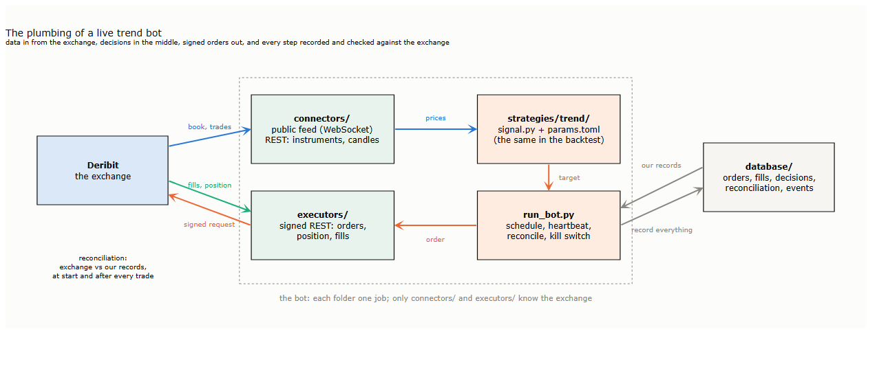
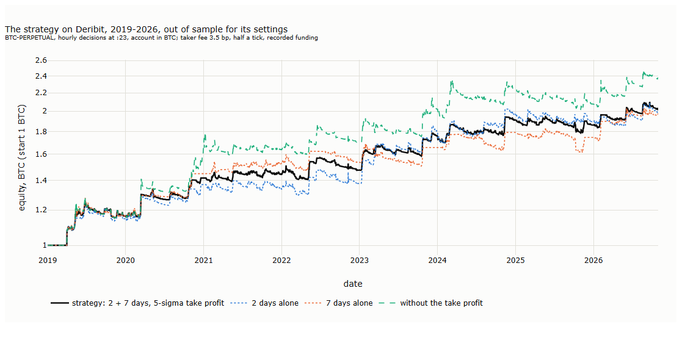

# Lecture 24: A Live Trend Bot

> A strategy is a few dozen lines; the plumbing decides whether it trades what the backtest says.

Capstone · Pipeline stage: all five stages at once, in production

---

# The plumbing of a live trend bot

> Data in from the exchange, decisions in the middle, signed orders out, and every step recorded and checked against the exchange.

---

# From backtest to live

> A backtest assumes what a live system must provide.

| The backtest assumes | Live, someone has to provide |
|---|---|
| Prices arrive, complete and on time | A connection that notices when it is not, and repairs itself |
| Orders fill at the price assumed | A signed order, accepted, filled, and measured |
| The position is what the strategy decided | A record of every fill, checked against the exchange |
| Nothing breaks | Survival of timeouts, disconnects, crashes, sleep |

---

# REST and WebSocket

> REST asks one question and gets one answer; a WebSocket stays open and streams.

| | REST | WebSocket |
|---|---|---|
| Picture | Phoning a shop | A scrolling news ticker |
| Used for | Orders, account, fills, candles | Book, trades, prices, our fills |
| Fails by | Timeouts, rate limits | Silent drops, lost updates, stale data |

- **A live order book:** a snapshot, then a chain of changes; one missing link and the copy must not be traded on
- **Public** data needs no account; **private** requests prove they are ours

---

# Keys and signing

> Sign each request; never send the secret.

- **Key pair (Ed25519):** the private key stays on our machine; the exchange holds only the public key
- **Permissions:** read and trade only, **never withdrawals**
- **Where it lives:** a settings file and a keys folder git never sees; never in code, chats or logs
- **Scrub every log:** a failed login once put a secret on a page and into two logs
- **A subaccount** for the bot alone, so its position can be reconciled

---

# One job per folder

> Only the connectors and the executor know the exchange; the backtest and the live bot share the strategy's code.

| Folder | Its one job |
|---|---|
| `connectors/` | Public data: book, trades, candles, instruments |
| `executors/` | Signed requests: orders, account, fills |
| `strategies/trend/` | Prices to a target position; `params.toml` |
| `run_bot.py` | Schedule, heartbeat, reconciliation, guards |
| `database/` | Remember everything; numbered migrations |

- Bybit refused an account from our country: we moved to Deribit by rewriting one folder

---

# Record everything, reconcile always

> Trust the exchange for trading, but never silently accept a difference.

- **Tables:** orders, their history, fills, decisions with arrival prices, reconciliation, equity, events
- **Exact money:** `Decimal`, never `float`
- **Reconcile** our open orders and our position (the sum of our fills) against the exchange, at start and after every trade
- **On a difference: pause and let a person decide**; never "fix" it silently

---

# Plan for failure

> Everything that can fail will; each failure gets its own small mechanism.

| Failure | What the bot does |
|---|---|
| Quiet line | Heartbeat; silence for 30 s means dead: reconnect |
| Dropped connection | Reconnect, waiting 1, 2, 4, up to 30 s |
| Timeout | Reads retried; **orders never retried blindly** |
| Crash mid-hour | Hour labels: an hour is never traded twice |
| Computer slept | Decide at once on the latest finished hour |
| Picture may be wrong | Kill switch for the plumbing; no drawdown stop |

---

# The strategy: simple on purpose

> An untuned trend rule, fixed before any result: a vehicle for the plumbing.

- **Signal:** EWMAC on hourly closes, fast spans **2 and 7 days**, blended
- **Size:** 10% target over **6 months** of volatility
- **Take profit:** a speed goes flat after a **5-sigma** gain, until its signal turns
- **Timing:** at **:23** plus a random 0-120 s, away from round times
- **Execution:** market orders; a trend follower trades with the move
- **The :23 hours are built from one-minute candles:** an hour is a choice of grid

---

# The backtest: Deribit 2019-2026

> Sharpe ratio about 1, out of sample for its settings; two speeds soften the worst months.

---

# What the rivals showed

> Most ideas change nothing beyond the noise, and that is a result.

| Rival | Result |
|---|---|
| One speed only | Worse worst month (−5.8%, −6.2% vs −3.8%) |
| No take profit | Same Sharpe; volatility 16% vs 10% |
| Patient execution | Same Sharpe: fees saved, fills missed |
| Waiting inside the window | At most +0.01 (optional stopping) |
| Round hours | +0.08, but the cost of crowding is not modelled |

---

# The live test

> The plumbing failed twice before any money moved; then it traded, recorded and agreed with the exchange.

- **Dry runs:** a timeout crashed the bot; the database refused a second thread; both fixed
- **First trade:** sold 22,720 USD at 63,522.0, 0.28 bp from the arrival price
- **Reconciled:** −22,720 USD in our fills and on the exchange
- **The fee charged was 5 bp, not the 3.5 bp published:** read it from your fills
- **Restarted:** same position found, next hour "hold"

---

# Running it 24 hours a day

> On a server, in a container or service that restarts itself after a crash.

- **Docker:** the same program and libraries everywhere; `restart: unless-stopped`; no data or secrets in the image; key mounted read-only; heartbeat health check
- **Restarts are safe** because every start reconciles and every hour has a label
- **Lighter on Linux:** a systemd service with `Restart=always`
- **Before going to a server:** IP restriction, a clock in sync, backups, alerts, key rotation

---

# Takeaways

1. **The plumbing decides** whether a strategy trades what its backtest says
2. **REST asks, WebSocket streams;** a book is a snapshot plus a chain of changes
3. **Sign, never send a secret;** minimal permissions, scrubbed logs
4. **Record everything, reconcile always;** on a difference, a person decides
5. **Plan for failure;** no drawdown stop for a trend follower
6. **Verify live:** the venue, the fee, the data

---

# The end of the course

> Fix the question before the answer. Measure against the noise. Verify, do not assume.

- From one rule on a card (Lecture 1) to a machine that trades, records and checks itself
- The notes give results on our samples; the open questions are invitations
- **The next strategy is yours to build**
