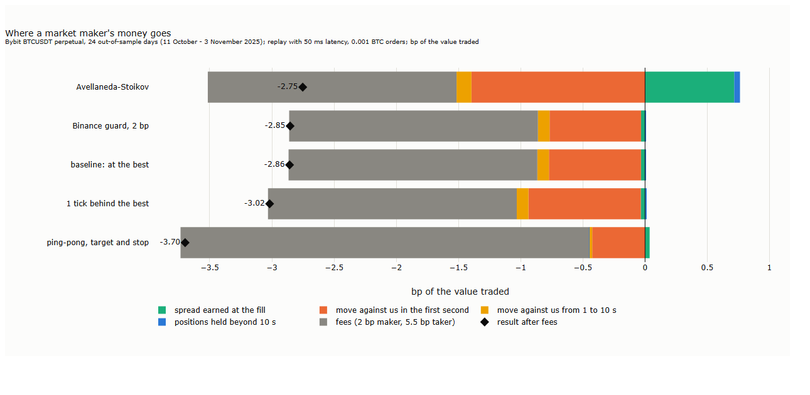
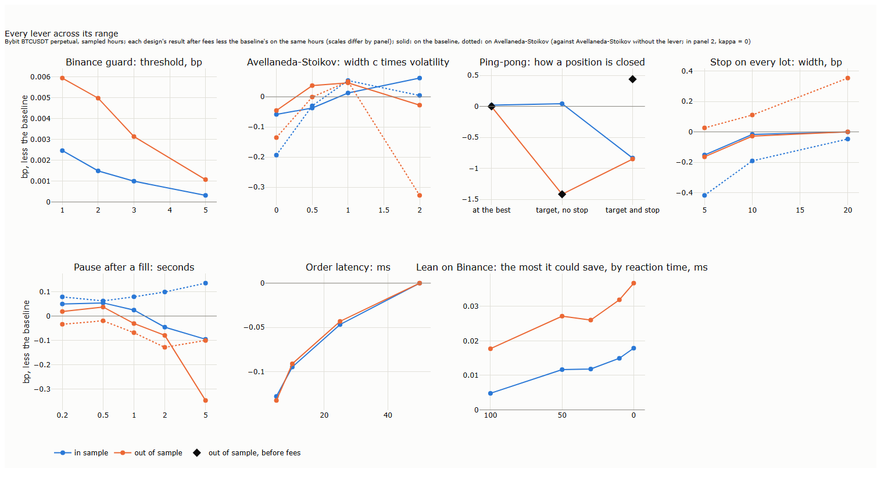
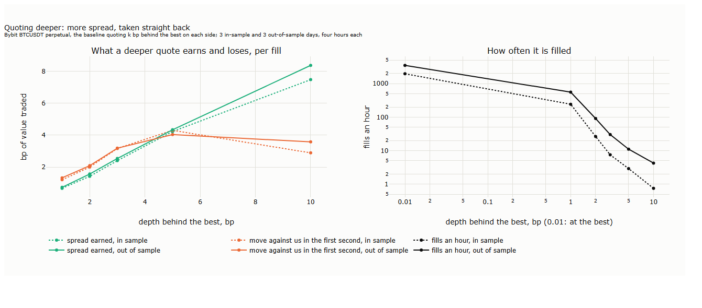

# Lecture 24: Market Making on One Venue: What It Takes to Break Even

*Systematic Trading: Lecture Notes (MSc) · draft, Nov 12, 2026 · Max Gnesi*

Lecture 23 showed whom a quote on Bybit's BTCUSDT perpetual meets: mostly ordinary flow, and now and then a trader who takes the quote just after Binance has moved. This lecture puts our own quotes into that market. A market maker posts a bid and an ask, earns the spread when both are filled, and pays when the price moves against what it has just bought or sold. The question is not whether a clever rule beats the market, but what it takes to break even, what a profitable maker must have that a replay of public data cannot show, and where resting quotes earn their place when they do not pay on their own: as the way a strategy with its own edge, a trend rule or a relative-value trade, gets into and out of its positions. Every design runs in Lecture 21's replay of the exchange, with 50 ms between a decision and its arrival, on 20 September to 3 November 2025; the hypotheses were fixed before any result was computed, and every change is dated ([results/hypotheses.md](results/hypotheses.md)).

## 1. Where a market maker's money goes

The lecture's result fits in one chart: five ways of quoting, and where each one's money went.

<b>How to read the figure.</b> <b>Axes.</b> Result in bp of the value traded (x), one bar per quoting rule (y), over the 24 out-of-sample days (11 October to 3 November 2025). Each bar is split into the parts of the result: <b>orange</b>, at the fill and in the first second after it, the spread earned less the move of the mid against us; <b>yellow</b>, the move against us from 1 to 10 s; <b>blue</b>, the gain or loss on positions held beyond 10 s; <b>grey</b>, fees, 2 bp of the value for a resting order and 5.5 bp for a market order (Bybit's standard tier). <b>Diamond:</b> the result after fees. The rules are described in §3. Our calculation, Bybit BTCUSDT perpetual, 0.001 BTC orders.

Every rule loses, and almost all of the loss before fees comes in the first second. A quote at the best price earns half the spread, but on bitcoin the spread is one tick, 0.1 USDT, about 0.005 bp per fill; what decides the result is that the orders which reach our quote are, on average, followed by a move against us of 0.4 to 0.9 bp within the second. The positions the rules carry beyond ten seconds cost nothing on average, which is why stops do not help (§3). Fees then add 2 bp on every unit of value for a rule that only rests, and more for one that closes with market orders: ping-pong halves the loss before fees, but 37% of what it trades goes through its stops at the taker fee, and after fees it does worst.

Seen this way, a rule changes the result by a tenth of a basis point here and there, and the gap to break even is about 0.9 bp before fees, plus whatever fee is paid. The rest of the lecture asks where that gap could be closed:

| § | Step | Question |
|---|---|---|
| 1 | Where the money goes | What does a quote earn, and what does it lose? |
| 2 | A quoting rule as a family | Which choices define a market-making rule, and which did we test? |
| 3 | The designs | What does each choice change: guard, depth, inventory skew, ping-pong, stops? (H1 to H4) |
| 4 | Tests | Which designs beat the baseline out of sample, and over what range of settings? |
| 5 | 10 October 2025 | Which rule does best through a crash, and where does each lose? A case study |
| 6 | What it takes to break even | Fees, rebates, speed, queue position and hedging, against the 0.9 bp gap; what we cannot see |
| 7 | Where market making pays | Resting quotes as the execution of another strategy: what they save against market orders, and what they cost |

## 2. A quoting rule as a family of choices

A market-making rule is not one strategy but a set of choices, each answering a question that every maker has to answer. The table lists them, the options open at each, which we tested and what the test gave. The results are on our implementation and our sample, Bybit's BTCUSDT perpetual at 0.001 BTC and 50 ms; a different implementation can give different results, and the untested options are left open on purpose.

| Choice | The question | Options | Tested here | What it gave, before fees (§3, §4) |
|---|---|---|---|---|
| **Price** | Where do our quotes sit? | At the best; k ticks behind it; k bp deep; around a reservation price | At the best (baseline); 1 to 5 ticks behind (H3); 1 to 10 bp deep | Behind by ticks is worse (−0.16 bp, H3 fails); 1 bp deep slightly better; deeper becomes a bet on a few fills |
| **Width** | How far apart are bid and ask? | One tick; fixed; scaled by recent volatility | Scaled by the volatility of the last 60 s (Avellaneda-Stoikov, H2) | +0.11 bp out of sample (H2 holds), mostly by trading less when the market moves |
| **Inventory** | How do we keep the position in check? | A hard limit; a lean of both quotes against the position; one position at a time (ping-pong); stops | Limit of 10 lots; lean (Avellaneda-Stoikov); ping-pong (H4); stops of 1 to 20 bp | Positions held beyond 10 s cost little, so inventory control matters little; stops add taker fees and do not pay |
| **When to quote** | When do we step aside? | Always; after a move on another venue; after a large move here; after our own fill; at certain times | Binance guard (H1); kill switch (10 October); pause after a fill; hour of the day, round times | Guard about 0; pause of 0.2 to 0.5 s about +0.04 bp; kill switch large in the crash; times of day too small to use |
| **Exit** | How is a position closed? | A resting order at the best; a target; a stop or time limit at market | All three, within ping-pong (H4) | Exits at market halve the loss before fees and lose most after fees |
| **Information** | What do the quotes react to? | Our own book; the trades; another venue; a forecast | The book every 100 ms; Binance's last trade | Binance warns too little, even with no delay (§6) |
| **Speed** | How fast do our orders arrive? | 5 to 100 ms in practice | 5, 10, 25, 50 ms | Faster orders made the baseline worse: it rejoins sooner into the same sweep |
| **Size and levels** | How much, at how many prices? | One lot at one level; a ladder of levels (Lecture 17's grid); size by queue | One lot, one level | Not tested |

<b>How to read the table.</b> Each row is one decision a market maker has to make. "Options" lists the common answers; "Tested here" the ones run in this lecture; the last column the result before fees, in bp of the value traded, against the baseline (one lot at the best on both sides, re-posted at every book update), on the 24 out-of-sample days for H1 to H4 and on the sampled hours otherwise. H1 to H4 are the tests fixed in advance (§4); the rest are described, not tested.

Open-source frameworks supply the machinery for all of these choices, but not the settings. Hummingbot's grid executor, which Lecture 17 used, closes positions with a stop and a time limit at market; with a stop of 1 bp, inside a minute's noise of about 5 bp, three quarters of our ping-pong's positions ended on the stop and paid the taker fee (§3). Every number in a rule, a stop, a target, a pause, has to be set against the noise of the market at its horizon and against the fees, and its result shown over a range of settings rather than at one value.

## 3. The designs

Every design starts from one **baseline**: a bid at the best bid and an ask at the best ask, 0.001 BTC each, re-posted whenever the best price moves, until the position reaches 10 lots on one side. Each design changes one choice of §2 and is compared with the baseline on the same hours. Four designs were fixed as tests before any result (H1 to H4, §4); the others were added after the tests, as the results raised new questions, and are described, not tested; each is dated in [results/hypotheses.md](results/hypotheses.md) before its run.

| Design | What it changes | Fixed |
|---|---|---|
| Binance guard (H1) | Withdraws the quote on the side Binance has moved against, for a gap of θ bp | Before the tests |
| Avellaneda-Stoikov (H2) | Quotes around the microprice, leaned by κ per lot of position, half-width c times the volatility of the last 60 s | Before the tests |
| One tick behind (H3) | Quotes k ticks behind the best | Before the tests |
| Ping-pong (H4) | One position at a time, closed by a resting order at the best, a target, or a target with a stop | Before the tests |
| Deeper quotes | 1 to 10 bp behind the best | After the tests |
| Stops | Close any lot at market once the mid is 5 to 20 bp against it | After the tests |
| Pause | No new quote on a side for 0.2 to 5 s after a fill there | After the tests |
| Speed | Orders arriving 5 to 50 ms after the decision | After the tests |
| Lean on Binance | The most that skipping fills with Binance against us could save | After the tests (diagnostic, on saved fills) |

The figure shows each lever across its range of settings, after fees, against the baseline on the same hours. A lever that helps should help over a range of settings and in both samples; one good setting is not enough (Lecture 7, §5).

<b>How to read the figure.</b> <b>Axes.</b> Each panel: the lever's setting (x); the design's result after fees, in bp of the value traded, less the baseline's on the same hours (y); above zero the lever helps. Scales differ by panel. <b>Blue:</b> in sample; <b>orange:</b> out of sample. <b>Solid:</b> the lever on the baseline; <b>dotted:</b> on Avellaneda-Stoikov, against Avellaneda-Stoikov without it, except in the second panel, where solid is κ = 5 and dotted κ = 0. <b>Third panel, diamonds:</b> ping-pong out of sample before fees. Panels 1 to 3: 6 in-sample and 6 out-of-sample days, four hours each; panels 4 to 7: 3 and 3 of those days. Panel 6: the baseline at each order latency less the baseline at 50 ms. Panel 7: the most that skipping fills with Binance more than 0.5 bp against us could have saved, per fill, by how long before the fill the quote could still be moved. Our calculation, Bybit BTCUSDT perpetual.

**Binance guard.** Withdrawing a quote when Binance has moved against it should spare the fills that follow a move there. It helps by less than a hundredth of a basis point at every threshold. Lecture 23 found the reason: after a Binance move of 2 bp, a Bybit taker order in its direction follows within 50 ms in 94% of cases, faster than our cancel arrives.

**Avellaneda-Stoikov.** The quotes sit around the microprice, lean against the position, and widen with recent volatility. Widening is what matters: the design trades a tenth as often as the baseline and stays out of the busiest moments. On the sampled hours the gain is about +0.05 bp at c = 1 in both samples and mixed elsewhere; on the 24 test days c = 2 is +0.11 bp (§4). The lean against the position matters little, because the position matters little (§1).

**Behind and deeper.** A quote one to five ticks behind the best earns nothing more, since five ticks are 0.05 bp, and is filled only when the price trades through it: it loses more than the baseline (H3, §4). A quote whole basis points deep does earn more spread, and the figure below shows what happens to it.

<b>How to read the figure.</b> <b>Axes.</b> Left: depth of the quote behind the best, bp (x); per fill, in bp of the value traded (y). Right: depth, bp, log scale, 0.01 standing for the baseline at the best (x); fills an hour, log scale (y). <b>Green:</b> the spread earned, the mid just before the fill less the fill price. <b>Orange:</b> the move of the mid against us in the first second. <b>Black:</b> fills an hour. <b>Dotted:</b> in sample; <b>solid:</b> out of sample. 3 in-sample and 3 out-of-sample days, four hours each. Our calculation, Bybit BTCUSDT perpetual.

The spread earned rises with depth, and the move against us rises almost as fast, because a deep quote is reached only by an order that sweeps the book, and such orders tend to know where the price is going. At 1 bp the two nearly cancel and the result is slightly better than the baseline in both samples (+0.30 and +0.08 bp), on a tenth of the fills. Beyond 2 bp fills fall to a few an hour, and the result is set by the positions held afterwards: whether the price came back after a sweep, which it did in sample and did not out of sample. That is a bet on a handful of events, not market making.

**Ping-pong.** One position at a time, closed before the next is opened. Closed by a resting order at the best, it does as the baseline does. Closed by a target 1 bp away, it holds positions that the price runs away from and loses most. Closed by the same target with a stop 1 bp against or after 60 s, it halves the loss before fees (diamonds), because it no longer holds positions into moves; but the stop sits inside a minute's noise, about 5 bp, so three quarters of its positions end on the stop, 37% of its value pays the taker fee of 5.5 bp, and after fees it is the worst of the three. A stop pays only where the taker fee is less than about 1.2 bp above the maker fee; on Bybit's schedule the difference is 3 to 3.5 bp (§6).

**Stops with room for noise.** Set at 5 to 20 bp, beyond a minute's noise, a stop is hit rarely and does not pay on the baseline at any width. In the minute after a stop fires, the mid comes back about as often as it goes on (in 44 to 62% of cases, for every variant with more than 50 stops), so the stops catch random moves, not trends. On Avellaneda-Stoikov a 20 bp stop helps out of sample, almost all of it on one day, 21 October, when the design held a position into a move; it is insurance against a rare event, not a source of return. A stop at a fixed, predictable level can also be set off on purpose, which the replay cannot show.

**Pause after a fill.** A sweep that fills our quote cannot be cancelled away: by the time the trade is seen, the fill is done. What can be avoided is walking back into the same move. A pause of 0.2 to 0.5 s on the side just filled helps in both samples, by +0.02 to +0.05 bp: it skips the follow-up fills of a sweep. Longer pauses hurt, because 62% of the baseline's fills come within a second of the previous one on the same side, and most of them are the steady, harmless fills of a calm market.

**Speed.** Faster orders made the baseline worse: −0.13 bp at 5 ms against 50 ms, with two thirds more fills. A faster quote returns sooner to the new best price after a sweep and is filled again by the same move; in the replay it also returns on a book seen up to 100 ms earlier. Speed is worth something only together with something that sees the move coming. Binance does not: even with no delay at all, skipping the fills with Binance against us would have saved at most 0.04 bp per fill.

**The time of day.** Neither the hour nor the second of the minute repeats well enough to use: the first three seconds after each minute are 0.15 bp worse per fill, but skipping them gains 0.01 bp, and the hourly profile on the first twelve test days does not predict the last twelve (rank correlation 0.32, p = 0.12). What matters is how volatile the hour is, and that is known only once it is over.

> **How we ran it.** All designs run in Lecture 21's replay: Bybit's book every 100 ms and trades to the millisecond, queue rule Q2 with a = 1, orders of 0.001 BTC, post-only, 50 ms from decision to arrival, and a cancelled order live for 50 ms after the cancel. Days are run in half-hour windows; a design's position carries over between consecutive windows and starts flat after a gap. To keep the runs short, settings were chosen and compared on **sampled hours**: four one-hour windows a day (02:00, 08:00, 14:00, 20:00 UTC) on 6 in-sample and 6 out-of-sample days, three of each for the designs added after the tests; the tests of §4 run the chosen settings on all 24 out-of-sample days. Two errors were found and corrected after the tests, both dated: open positions at the end of a sampled hour were first valued at the day's last price (corrected 10 November; H2's choice changed), and a ping-pong lot closed by a stop could be closed again by its cancelled resting order (corrected 11 November; H4 redone). The position limit of 10 lots can be exceeded by one, when a cancelled order is filled within its 50 ms.
