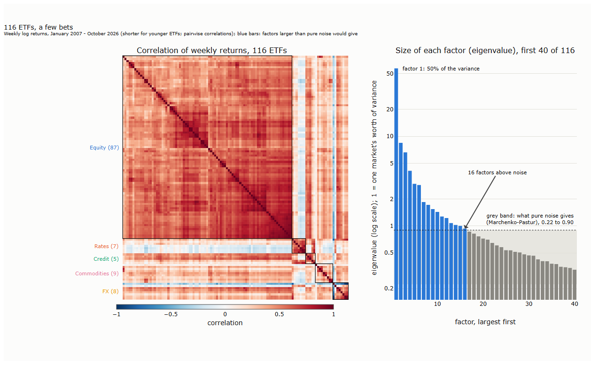
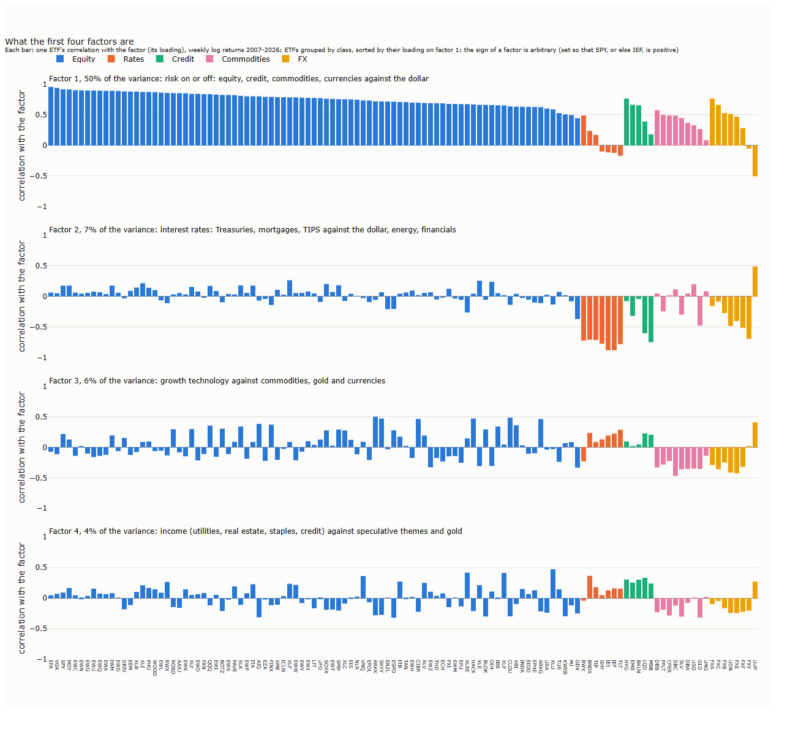
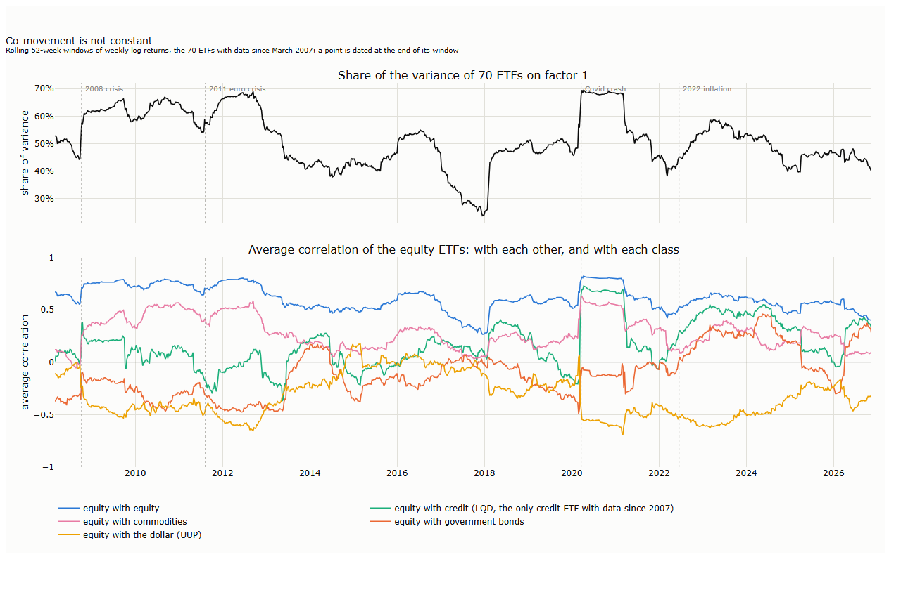

# Lecture 25: Choosing the Markets

*Systematic Trading: Lecture Notes (MSc) · draft, Nov 13, 2026 · Max Gnesi*

Parts III and IV went down to single trades and the order book of one market. That was not a detour from portfolios: it is how we learned what trading costs, how fast prices react and how a large order should be worked, which is what a portfolio that rebalances once a day or once a week needs from execution. This part goes back to daily data and builds that portfolio. Its first question comes before any weight: **which markets should be in it at all?** We start from 116 exchange-traded funds listed in the United States, covering equity countries, sectors and themes, government bonds, credit, commodities and currencies, and ask which of them form a universe that is diverse and tradable, chosen without looking at any strategy's results. The plan was fixed before any result was computed, and every change made after seeing results is dated and labelled ([results/hypotheses.md](results/hypotheses.md)).

## 1. 116 ETFs, a few bets

The lecture's result fits in one chart: the 116 ETFs move together far more than their number suggests.


<sub><b>How to read the figure.</b> <b>Axes.</b> Left: every pair of ETFs, rows and columns in the same order; colour is the correlation of their weekly returns (red: move together, blue: move apart). ETFs are grouped by class (boxes), and within a class related markets sit next to each other. Right: the 40 largest factors of the same correlation matrix (x, largest first) and their size, the eigenvalue (y, log scale), in units of one market's variance; blue bars are larger than pure noise would give, the grey band is the range pure noise gives (§3.3). Weekly log returns, January 2007 to November 2026, pairwise for younger ETFs; our calculation.</sub>

The equity block is one large red square: 87 ETFs of countries, sectors and themes that mostly rise and fall together. Bonds sit pale or blue against it, and the dollar (the thin blue line inside FX) moves against almost everything. On the right, one factor carries half of all the variance, and only 16 of 116 stand out from noise.

Counting bets makes the same point. The **effective number of bets** (Meucci, 2009; defined in §3.6) asks how many independent sources of risk a portfolio holds. With equal risk in each of the 116 ETFs it holds about one: the equity block drowns everything else. Spread the risk equally across classes instead, and the count rises, but only as far as the classes allow:

**Table 1.1. Effective number of bets, 2007-2026**

| Universe, risk spread equally | Effective bets |
|---|---|
| Each of the 116 ETFs | 1.07 |
| The 87 equity ETFs alone | 1.00 |
| Equity and government bonds, equal risk per class | 2.91 |
| … and commodities | 3.37 |
| … and currencies | 2.47 |
| … and credit (all five classes) | 2.51 |
| One ETF per class (SPY, IEF, HYG, DBC, UUP) | 2.82 |

<sub><b>How to read the table.</b> Each row is a set of ETFs with risk spread equally (first two rows: per ETF; others: per class, then equally within it). The effective number of bets runs from 1 (everything is one bet) to the number of markets (all independent). Weekly log returns, January 2007 to November 2026; our calculation.</sub>

Within a class, more ETFs add almost nothing: 87 equity ETFs make one bet. What adds bets is a new class: bonds and commodities lift the count, while currencies as a block lower it, because most currency ETFs are long a currency against the dollar and so move with equity when markets are calm. Five ETFs, one per class, hold about as many bets as all 116. The rest of the lecture turns this into a rule for choosing the markets:

| § | Step | Question |
|---|---|---|
| 2 | The data | Which ETFs, which prices, and why must the closes be synchronous? |
| 3 | Correlation, factors and noise | What moves together, through which factors, and how much of it is noise? |
| 4 | The same market? | When are two markets the same bet: correlation, or trend phases too? |
| 5 | The methods as a family | Which ways of choosing markets exist, and what did each show here? |
| 6 | Slots per class | How many markets should each class get? |
| 7 | Filling the slots | Which markets fill them, judged out of sample? |
| 8 | The universe and its limits | The chosen markets, the yearly review, and what the free data cannot do |

## 2. The data

### 2.1 116 ETFs

All data are free: daily adjusted closes and volume from Yahoo Finance, through the open-source `yfinance` package, from the first trading day of each ETF to 12 November 2026 ([scripts/l25_fetch.py](scripts/l25_fetch.py)). ETFs were chosen over futures because the free futures data we used in Lecture 11 do not have reliable volume, and the volume is what tells us whether a market can be traded. The cost is that we trade a fund rather than the market itself, a small contamination stated in §8.

**Table 2.1. The universe**

| Group | ETFs | Examples |
|---|---|---|
| US equity | 4 | SPY, QQQ, MDY, IWM |
| US sectors | 11 | XLK (technology), XLE (energy), XLU (utilities) |
| Developed countries | 17 | EWJ (Japan), EWG (Germany), EWU (United Kingdom) |
| Emerging countries | 15 | EWT (Taiwan), EWZ (Brazil), INDA (India), FXI (China) |
| Regions | 4 | EFA (developed outside the US), EEM (emerging), VGK (Europe) |
| Themes | 34 | SMH (semiconductors), BOTZ and ROBO (robotics), AIQ (AI), HACK (cyber security), ICLN (clean energy), GDX (gold miners), ARKK |
| Real estate | 2 | VNQ (US), RWX (international) |
| Government bonds | 7 | SHY (1-3 years), IEF (7-10 years), TLT (20+ years), TIP (inflation-linked) |
| Credit | 5 | LQD (investment grade), HYG (high yield), EMB (emerging debt) |
| Commodities | 9 | GLD (gold), USO (oil), UNG (natural gas), DBC (broad), DBA (agriculture) |
| Currencies | 8 | UUP (the dollar), FXE (euro), FXY (yen) |

<sub><b>How to read the table.</b> The 116 ETFs with data, by group; the first seven groups form the equity class (87 ETFs). Two ETFs of the original list, RSX (Russia) and IRBO (AI and robotics), have closed and are missing from the free data.</sub>

Three things about these funds matter later. First, **only survivors** are in the data: funds that closed, often after poor results, are gone, which flatters the themes most (Elton, Gruber and Blake, 1996). Second, they hold different things: most hold the securities directly, eight hold futures and roll them (the commodity funds, UUP and UDN), and six hold currency deposits. Third, they differ hugely in trading: the median daily dollar volume over the last year ranges from USD 41 billion for SPY to USD 0.37 million for EWK (Belgium); 29 of the 116 trade less than USD 10 million a day, which is why §6 sets a liquidity floor.

### 2.2 Why the closes must be synchronous

Every statistic in this lecture compares markets over the same interval, and that needs prices taken at the same moment. Tokyo's stock market closes in the afternoon local time, some fourteen hours before New York's. News that arrives after Tokyo's close moves New York the same day but Tokyo only the next day. Measured close to close, the two markets then seem less related on the same day than they are, and one seems to lead the other by a day: with asynchronous closes, "the returns appear to have predictability and correlations are understated" (Burns, Engle and Mezrich, 1998).

How much this matters depends on what is done with the returns:

| Use | Synchronous closes needed? | Why |
|---|---|---|
| Time-series trend following, each market on its own (Part II) | No | Each market's signal uses only its own prices |
| Correlations, risk of a portfolio, choosing markets (this part) | Yes | Understated correlations make a portfolio look more diversified than it is |
| Cross-sectional momentum, ranking markets against each other | Yes, and more | A market that closed earlier has not yet priced the last hours of news, so its rank is off by a stale piece of return; the ranking then partly sorts markets by their closing time |

ETFs listed in New York solve most of this: all 116 close at 16:00 New York time. Their prices are discovered during New York hours even when the home market is shut, because traders price the fund on what they expect the home market to do. Our measurement shows it ([scripts/l25_sync.py](scripts/l25_sync.py)):

**Table 2.2. Correlation with SPY, daily and weekly, 2007-2026**

| ETF | Daily | Weekly | Daily, ETF one day after SPY |
|---|---|---|---|
| EWJ (Japan) | 0.77 | 0.74 | −0.11 |
| EWH (Hong Kong) | 0.70 | 0.63 | −0.14 |
| FXI (China) | 0.67 | 0.59 | −0.16 |
| EWT (Taiwan) | 0.74 | 0.68 | −0.15 |
| EWG (Germany) | 0.82 | 0.81 | −0.08 |
| EWZ (Brazil) | 0.67 | 0.62 | −0.08 |
| QQQ (United States, control) | 0.92 | 0.92 | −0.11 |

<sub><b>How to read the table.</b> Correlation of log returns with SPY's. "Daily" and "Weekly": over the same day or Friday-to-Friday week. Last column: the ETF's daily return against SPY's return of the day before. With stale prices, the weekly correlation would be higher than the daily one and the last column positive. Our calculation; all 16 ETFs measured are in results/sync.json.</sub>

For Asian funds, whose home markets are closed during the whole New York session, the daily correlation is not lower than the weekly one but higher, and the next-day correlation is negative, about as negative as QQQ's, a fund of US shares that has no timing gap at all. The negative value is a feature of daily returns in general (a little short-term reversal), not of stale prices. The fund price, not the home market's close, is what we trade and measure. What remains is a different issue: while the home market is shut, the fund can trade away from the value of its holdings, at a premium or a discount (§8).

We still use **weekly returns**, Friday close to Friday close. A week spreads single-day quirks, such as a holiday that closes a home market but not New York, over five days, and three years of weekly data, 156 weeks, are enough to estimate the correlations we need while staying recent.

## 3. Correlation, factors and noise

### 3.1 Correlation

The correlation of two markets' weekly returns is their covariance divided by the product of their volatilities (Lecture 3, §8.1):

```math
\rho_{ij} = \frac{\mathrm{cov}(r_i, r_j)}{\sigma_i\,\sigma_j}
```

where $`r_i`$ is market $`i`$'s weekly log return and $`\sigma_i`$ its standard deviation. It measures how the weekly **shocks** of two markets move together; as Lecture 3 (§8.4) showed, it is blind to their drift, which is why §4 adds a second measure. For $`N`$ markets the correlations form an $`N \times N`$ matrix $`C`$, the left panel of the key chart. With markets of different ages, each pair uses the weeks both traded, and the matrix is then adjusted to the nearest valid one (all eigenvalues at least zero), a small change here.

### 3.2 Factors: principal components

A correlation matrix of 116 markets has 6,670 numbers. Principal component analysis compresses them into a few independent **factors**, each a mix of the markets, ordered by how much of the movement they explain.

| Step | Calculation | Meaning |
|---|---|---|
| Decompose | $`C = \sum_{k=1}^{N} \lambda_k\, e_k e_k^{\top}`$ | Split the co-movement into $`N`$ independent directions |
| Size of factor $`k`$ | eigenvalue $`\lambda_k`$; the $`\lambda_k`$ sum to $`N`$ | How many markets' worth of variance the factor carries; 1 is one market's worth |
| Share of factor $`k`$ | $`\lambda_k / N`$ | Its share of all the variance |
| Recipe of factor $`k`$ | eigenvector $`e_k`$ | The weights of the markets in the factor portfolio |
| Loading of market $`i`$ | $`e_{ik}\sqrt{\lambda_k}`$ | The correlation of market $`i`$ with factor $`k`$: how strongly it moves with it |

The first factor of our 116 ETFs has $`\lambda_1 = 57.5`$: half the variance of all 116 markets moves as one. The next three carry 8.5, 6.6 and 4.1 markets' worth. A factor's sign is arbitrary: a factor and its mirror image are the same.

### 3.3 How much of it is noise?

Even 116 unrelated markets would show factors of different sizes, because correlations estimated from a finite sample are never exactly zero. Random-matrix theory says how large such noise factors get. For $`N`$ markets and $`T`$ weeks of independent returns, the eigenvalues fall in a band (Laloux et al., 1999; Plerou et al., 2002):

```math
\lambda_{\pm} = \sigma^2 \left(1 \pm \sqrt{N/T}\right)^2, \qquad \sigma^2 = 1 - \lambda_1 / N
```

Here $`N/T`$ is the number of markets per week of data: the more markets per observation, the wider the band. $`\sigma^2`$ is the variance left after the first factor (Laloux et al., 1999): the market factor is plainly real, so the noise band is set for what remains. With $`N = 116`$ and $`T = 1{,}037`$ weeks, the band runs from 0.22 to 0.90. Sixteen factors lie above it; the other 100 are indistinguishable from noise. The band is approximate here, since younger ETFs have fewer than 1,037 weeks, but the gap between the first factor (57.5) and the band is not.

This gives a first count of the bets on offer: **16 factors above noise**, of which the first four carry most. It also warns that a method using all 116 factors, as an unconstrained portfolio optimiser does, is fitting noise in most of them.

### 3.4 What the factors are


<sub><b>How to read the figure.</b> <b>Axes.</b> One panel per factor; each bar is one ETF (x, grouped by class and sorted by their loading on factor 1), its height the ETF's correlation with the factor (y, from −1 to 1). Colour shows the class. The sign of a factor is arbitrary; it is set so that SPY (or else IEF) is positive. Weekly log returns 2007-2026; our calculation.</sub>

| Factor | Share | Positive side | Negative side | Reading |
|---|---|---|---|---|
| 1 | 50% | All equity (loading 0.45 to 0.96), credit, commodities, currencies against the dollar | The dollar (−0.51) | Risk on or off |
| 2 | 7% | The dollar, energy, financials | Treasuries, mortgages, TIPS (−0.7 to −0.9) | Interest rates |
| 3 | 6% | Cyber security, cloud, ARK funds, the dollar | Commodities, gold, currencies | Growth technology against real assets |
| 4 | 4% | Utilities, real estate, staples, credit | Speculative themes (crypto, AI, gaming), gold, silver | Income against speculation |

<sub><b>How to read the table.</b> Share: the factor's eigenvalue over 116. Positive and negative side: the ETFs with the largest loadings of each sign. Reading: our label for what the two sides have in common.</sub>

Factor 1 is the market as a whole, and a broad equity fund represents it well; to cover factors 2 to 4, a universe needs bonds, the dollar and commodities, not more equity funds. Two cautions. The shares depend on what is in the list: factor 1 carries half the variance partly because 87 of the 116 funds are equity, which is one reason §6 chooses within classes. And beyond the first two or three, factors are mixtures whose recipes change from one sample to the next; reading them as fixed economic forces goes further than the data allow.

### 3.5 Co-movement is not constant

A correlation matrix estimated over 20 years is an average over calm years and crises. Estimated over one year at a time, it moves a lot.


<sub><b>How to read the figure.</b> <b>Axes.</b> Time (x); each point is a 52-week window ending on that date. Top: the share of the variance of the 70 ETFs with data since March 2007 carried by factor 1 (y). Bottom: the average correlation (y) of the equity ETFs among the 70 with each other (blue) and with government bonds (orange), credit (green, LQD only), commodities (pink) and the dollar (UUP, yellow). Dotted lines mark four events. Our calculation.</sub>

Three things stand out:

- **Diversification fails when it is needed.** Factor 1's share averaged 45% in the windows ending in September 2008 and 61% in those ending in November and December 2008; it rose from 51% before the Covid crash to 69% in April 2020. In the calm of 2017 it fell to 24%. The step shapes are a feature of the window: a crash week lifts the line when it enters and drops it 52 weeks later when it leaves.
- **The bond hedge is not permanent.** Equity and government bonds were negatively correlated in 89% of the windows from 2008 to 2021 (from −0.49 to +0.17); in 2022, with inflation, the sign flipped, and it was positive in 86% of the windows from 2022 to 2024, up to +0.46. A universe chosen on the earlier years would have counted on a hedge that was not there.
- **The dollar was the steadiest offset.** Its correlation with equity was negative in 93% of the windows, as low as −0.69, and only briefly positive (+0.18 in early 2015).

The lesson for choosing markets is that the choice must be revisited: the universe is reviewed once a year on the past three years only (§6), and a market that has stopped diversifying can leave.

### 3.6 Counting bets

The effective number of bets of §1 turns the factors into one number for a given portfolio (Meucci, 2009). With weights $`w`$ on the correlation matrix, which is the same as inverse-volatility weights on the markets:

| Step | Calculation | Meaning |
|---|---|---|
| Exposure to factor $`k`$ | $`e_k^{\top} w`$ | How much of factor $`k`$ the portfolio holds |
| Risk from factor $`k`$ | $`(e_k^{\top} w)^2 \lambda_k`$ | Exposure squared times the factor's size |
| Risk share $`p_k`$ | risk from factor $`k`$ over the sum over all factors | Which factors the portfolio's risk comes from |
| Effective bets | $`\exp\left(-\sum_k p_k \ln p_k\right)`$ | 1 if all risk comes from one factor; $`N`$ if it is spread evenly over $`N`$ |

The measure takes a long-only view: two markets that move opposite each other hedge one another and raise the count. A trend follower, who can be short either one, holds the same bet in both, which is why §4 and §7 also measure overlap with the sign ignored.
