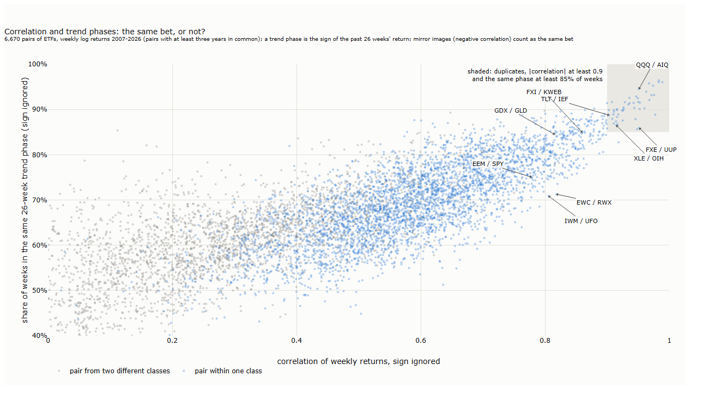
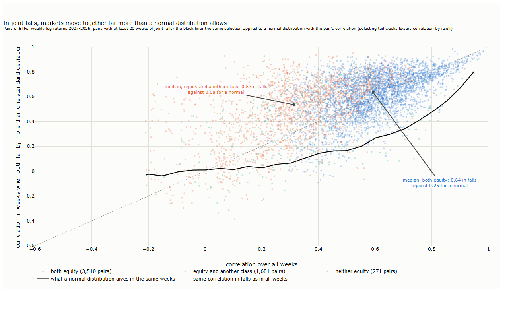
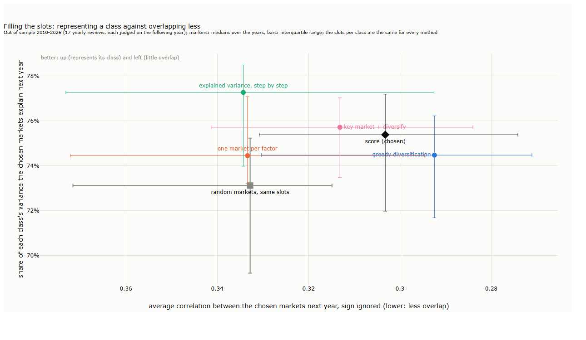
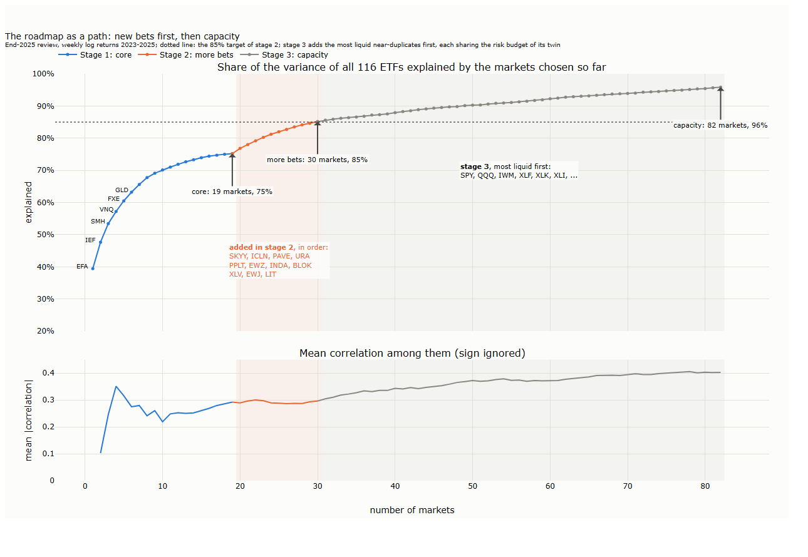
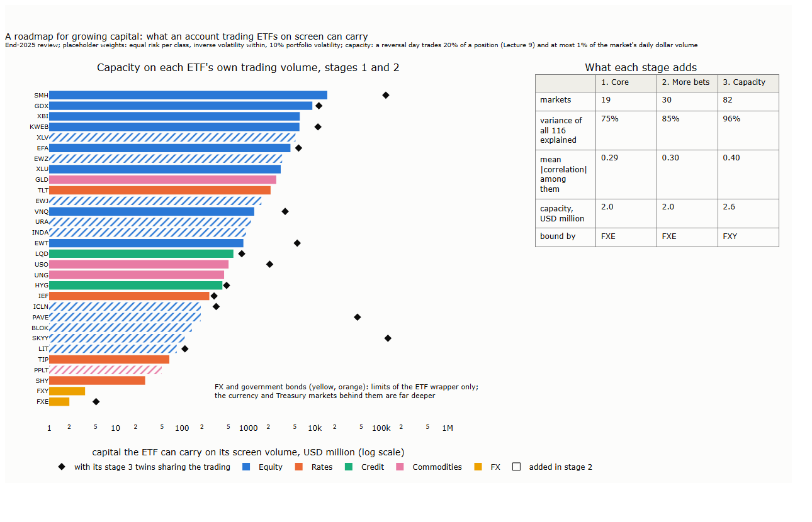

# Lecture 25: Choosing the Markets

*Systematic Trading: Lecture Notes (MSc) · draft, Nov 13, 2026 · Max Gnesi*

Parts III and IV went down to single trades and the order book of one market. That was not a detour from portfolios: it is how we learned what trading costs, how fast prices react and how a large order should be worked, which is what a portfolio that rebalances once a day or once a week needs from execution. This part goes back to daily data and builds that portfolio. Its first question comes before any weight: **which markets should be in it at all?** We start from 116 exchange-traded funds listed in the United States, covering equity countries, sectors and themes, government bonds, credit, commodities and currencies, and ask which of them form a universe that is diverse and tradable, chosen without looking at any strategy's results. The plan was fixed before any result was computed, and every change made after seeing results is dated and labelled ([results/hypotheses.md](results/hypotheses.md)).

## 1. 116 ETFs, a few bets

The lecture's result fits in one chart: the 116 ETFs move together far more than their number suggests.


<sub><b>How to read the figure.</b> <b>Axes.</b> Left: every pair of ETFs, rows and columns in the same order; colour is the correlation of their weekly returns (red: move together, blue: move apart). ETFs are grouped by class (boxes), and within a class related markets sit next to each other. Right: the 40 largest factors of the same correlation matrix (x, largest first) and their size, the eigenvalue (y, log scale), in units of one market's variance; blue bars are larger than pure noise would give, the grey band is the range pure noise gives (§3.3). Weekly log returns, January 2007 to November 2026, pairwise for younger ETFs; our calculation.</sub>

The equity block is one large red square: 87 ETFs of countries, sectors and themes that mostly rise and fall together. Bonds sit pale or blue against it, and the dollar (the thin blue line inside FX) moves against almost everything. On the right, one factor carries half of all the variance, and only 16 of 116 stand out from noise.

Counting bets makes the same point. The **effective number of bets** (Meucci, 2009; defined in §3.6) asks how many independent sources of risk a portfolio holds. With equal risk in each of the 116 ETFs it holds about one: the equity block drowns everything else. Spread the risk equally across classes instead, and the count rises, but only as far as the classes allow:

**Table 1.1. Effective number of bets, 2007-2026**

| Universe, risk spread equally | Effective bets |
|---|---|
| Each of the 116 ETFs | 1.07 |
| The 87 equity ETFs alone | 1.00 |
| Equity and government bonds, equal risk per class | 2.91 |
| … and commodities | 3.37 |
| … and currencies | 2.47 |
| … and credit (all five classes) | 2.51 |
| One ETF per class (SPY, IEF, HYG, DBC, UUP) | 2.82 |

<sub><b>How to read the table.</b> Each row is a set of ETFs with risk spread equally (first two rows: per ETF; others: per class, then equally within it). The effective number of bets runs from 1 (everything is one bet) to the number of markets (all independent). Weekly log returns, January 2007 to November 2026; our calculation.</sub>

Within a class, more ETFs add almost nothing: 87 equity ETFs make one bet. What adds bets is a new class: bonds and commodities lift the count, while currencies as a block lower it, because most currency ETFs are long a currency against the dollar and so move with equity when markets are calm. Five ETFs, one per class, hold about as many bets as all 116. The rest of the lecture turns this into a rule for choosing the markets:

| § | Step | Question |
|---|---|---|
| 2 | The data | Which ETFs, which prices, and why must the closes be synchronous? |
| 3 | Correlation, factors and noise | What moves together, through which factors, and how much of it is noise? |
| 4 | The same market? | When are two markets the same bet: correlation, or trend phases too? |
| 5 | The methods as a family | Which ways of choosing markets exist, and what did each show here? |
| 6 | Slots per class | How many markets should each class get? |
| 7 | Filling the slots | Which markets fill them, judged out of sample, and which universe results for 2026? |
| 8 | A roadmap for growing capital | Which markets to add as capital grows, what the funds can carry, and what the free data cannot do |

This lecture is the first of three steps that the whole part keeps in the same order:

| Step | Uses | Never uses |
|---|---|---|
| 1. Markets (this lecture) | Market returns, liquidity, trend phases | Strategy profits |
| 2. Weights (later lectures) | Volatility and correlation of the strategy's positioned returns (position times market return), costs, constraints | Strategy averages or Sharpe ratios |
| 3. Evaluation | Strategy profit and loss, out of sample, against simple baselines | Feeding results back into steps 1 and 2 |

<sub><b>How to read the table.</b> Each step may use only the information in its "Uses" column. Choosing markets or weights by past strategy profits would pick the markets where the strategy was lucky (Lecture 7, "is it real?"); Lecture 9's rule that sizing uses only risk and cost information extends here to the whole portfolio.</sub>

Why each step uses what it uses:

- **Markets without profits.** If we chose the markets where trend following made the most, we would choose the markets where it was luckiest, and the backtest of the portfolio would inherit that luck. Markets are chosen on their own properties: whether they can be traded, how they move with each other, how often their trends agree. None of these says whether a strategy earned money on them.
- **Weights from risk, not from averages.** A strategy's average return is the least precise number in a backtest: a Sharpe ratio measured over 26 years has a standard error of about 0.2 (Lecture 7, §5; Lo, 2002), as large as most gaps between trend systems, and DeMiguel, Garlappi and Uppal (2009) estimate that for 25 assets about 3,000 months of data would be needed before weights built on estimated means beat equal weights. Volatilities and correlations are measured far more precisely, so the weights use only them.
- **But the risk is the strategy's, not the market's.** A trend portfolio does not hold the markets; it holds positioned returns, the position times the market's return, and their risk differs from the markets' own. Two markets with a correlation of 0.8 whose trend positions often disagree give strategy streams that are much less correlated; two markets that move in opposite directions, held long one and short the other, can give streams that move together. The volatility and correlation of positioned returns come from positions and prices alone and say nothing about whether the strategy earned money, so step 2 may use them. Section 4 measures this overlap.
- **Profits judge, they do not choose.** Strategy profit and loss enters only at step 3, out of sample and against baselines such as equal weights. If the evaluation leads to a change in step 1 or 2, the change is dated and judged again on later data, as in this lecture's [hypotheses log](results/hypotheses.md).

## 2. The data

### 2.1 116 ETFs

All data are free: daily adjusted closes and volume from Yahoo Finance, through the open-source `yfinance` package, from the first trading day of each ETF to 12 November 2026 ([scripts/l25_fetch.py](scripts/l25_fetch.py)). ETFs were chosen over futures because the volume of the free futures data used in Lecture 11 is not fully trustworthy (some contracts repeat the same volume on consecutive days), and the volume is what tells us whether a market can be traded; ETFs also let us cover many more equity countries and themes. The cost is that we trade a fund rather than the market itself, a small contamination stated in §8.

**Table 2.1. The universe**

| Group | ETFs | Examples |
|---|---|---|
| US equity | 4 | SPY, QQQ, MDY, IWM |
| US sectors | 11 | XLK (technology), XLE (energy), XLU (utilities) |
| Developed countries | 17 | EWJ (Japan), EWG (Germany), EWU (United Kingdom) |
| Emerging countries | 15 | EWT (Taiwan), EWZ (Brazil), INDA (India), FXI (China) |
| Regions | 4 | EFA (developed outside the US), EEM (emerging), VGK (Europe) |
| Themes | 34 | SMH (semiconductors), BOTZ and ROBO (robotics), AIQ (AI), HACK (cyber security), ICLN (clean energy), GDX (gold miners), ARKK |
| Real estate | 2 | VNQ (US), RWX (international) |
| Government bonds | 7 | SHY (1-3 years), IEF (7-10 years), TLT (20+ years), TIP (inflation-linked) |
| Credit | 5 | LQD (investment grade), HYG (high yield), EMB (emerging debt) |
| Commodities | 9 | GLD (gold), USO (oil), UNG (natural gas), DBC (broad), DBA (agriculture) |
| Currencies | 8 | UUP (the dollar), FXE (euro), FXY (yen) |

<sub><b>How to read the table.</b> The 116 ETFs with data, by group; the first seven groups form the equity class (87 ETFs). Two ETFs of the original list, RSX (Russia) and IRBO (AI and robotics), have closed and are missing from the free data.</sub>

Three things about these funds matter later. First, **only survivors** are in the data: funds that closed, often after poor results, are gone, which flatters the themes most (Elton, Gruber and Blake, 1996). Second, they hold different things: most hold the securities directly, eight hold futures and roll them (the commodity funds, UUP and UDN), and six hold currency deposits. Third, they differ hugely in trading: the median daily dollar volume over the last year ranges from USD 41 billion for SPY to USD 0.37 million for EWK (Belgium); 29 of the 116 trade less than USD 10 million a day, which is why §6 sets a liquidity floor.

### 2.2 Why the closes must be synchronous

Every statistic in this lecture compares markets over the same interval, and that needs prices taken at the same moment. Tokyo's stock market closes in the afternoon local time, some fourteen hours before New York's. News that arrives after Tokyo's close moves New York the same day but Tokyo only the next day. Measured close to close, the two markets then seem less related on the same day than they are, and one seems to lead the other by a day: with asynchronous closes, "the returns appear to have predictability and correlations are understated" (Burns, Engle and Mezrich, 1998).

How much this matters depends on what is done with the returns:

| Use | Synchronous closes needed? | Why |
|---|---|---|
| Time-series trend following, each market on its own (Part II) | No | Each market's signal uses only its own prices |
| Correlations, risk of a portfolio, choosing markets (this part) | Yes | Understated correlations make a portfolio look more diversified than it is |
| Cross-sectional momentum, ranking markets against each other | Yes, and more | A market that closed earlier has not yet priced the last hours of news, so its rank is off by a stale piece of return; the ranking then partly sorts markets by their closing time |

ETFs listed in New York solve most of this: all 116 close at 16:00 New York time. Their prices are discovered during New York hours even when the home market is shut, because traders price the fund on what they expect the home market to do. Our measurement shows it ([scripts/l25_sync.py](scripts/l25_sync.py)):

**Table 2.2. Correlation with SPY, daily and weekly, 2007-2026**

| ETF | Daily | Weekly | Daily, ETF one day after SPY |
|---|---|---|---|
| EWJ (Japan) | 0.77 | 0.74 | −0.11 |
| EWH (Hong Kong) | 0.70 | 0.63 | −0.14 |
| FXI (China) | 0.67 | 0.59 | −0.16 |
| EWT (Taiwan) | 0.74 | 0.68 | −0.15 |
| EWG (Germany) | 0.82 | 0.81 | −0.08 |
| EWZ (Brazil) | 0.67 | 0.62 | −0.08 |
| QQQ (United States, control) | 0.92 | 0.92 | −0.11 |

<sub><b>How to read the table.</b> Correlation of log returns with SPY's. "Daily" and "Weekly": over the same day or Friday-to-Friday week. Last column: the ETF's daily return against SPY's return of the day before. With stale prices, the weekly correlation would be higher than the daily one and the last column positive. Our calculation; all 16 ETFs measured are in results/sync.json.</sub>

For Asian funds, whose home markets are closed during the whole New York session, the daily correlation is not lower than the weekly one but higher, and the next-day correlation is negative, about as negative as QQQ's, a fund of US shares that has no timing gap at all. The negative value is a feature of daily returns in general (a little short-term reversal), not of stale prices. The fund price, not the home market's close, is what we trade and measure. What remains is a different issue: while the home market is shut, the fund can trade away from the value of its holdings, at a premium or a discount (§8).

We still use **weekly returns**, Friday close to Friday close. A week spreads single-day quirks, such as a holiday that closes a home market but not New York, over five days, and three years of weekly data, 156 weeks, are enough to estimate the correlations we need while staying recent.

## 3. Correlation, factors and noise

### 3.1 Correlation

The correlation of two markets' weekly returns is their covariance divided by the product of their volatilities (Lecture 3, §8.1):

```math
\rho_{ij} = \frac{\mathrm{cov}(r_i, r_j)}{\sigma_i\,\sigma_j}
```

where $`r_i`$ is market $`i`$'s weekly log return and $`\sigma_i`$ its standard deviation. It measures how the weekly **shocks** of two markets move together; as Lecture 3 (§8.4) showed, it is blind to their drift, which is why §4 adds a second measure. For $`N`$ markets the correlations form an $`N \times N`$ matrix $`C`$, the left panel of the key chart. With markets of different ages, each pair uses the weeks both traded, and the matrix is then adjusted to the nearest valid one (all eigenvalues at least zero), a small change here.

### 3.2 Factors: principal components

A correlation matrix of 116 markets has 6,670 numbers. Principal component analysis compresses them into a few independent **factors**, each a mix of the markets, ordered by how much of the movement they explain.

| Step | Calculation | Meaning |
|---|---|---|
| Decompose | $`C = \sum_{k=1}^{N} \lambda_k\, e_k e_k^{\top}`$ | Split the co-movement into $`N`$ independent directions |
| Size of factor $`k`$ | eigenvalue $`\lambda_k`$; the $`\lambda_k`$ sum to $`N`$ | How many markets' worth of variance the factor carries; 1 is one market's worth |
| Share of factor $`k`$ | $`\lambda_k / N`$ | Its share of all the variance |
| Recipe of factor $`k`$ | eigenvector $`e_k`$ | The weights of the markets in the factor portfolio |
| Loading of market $`i`$ | $`e_{ik}\sqrt{\lambda_k}`$ | The correlation of market $`i`$ with factor $`k`$: how strongly it moves with it |

The first factor of our 116 ETFs has $`\lambda_1 = 57.5`$: half the variance of all 116 markets moves as one. The next three carry 8.5, 6.6 and 4.1 markets' worth. A factor's sign is arbitrary: a factor and its mirror image are the same.

### 3.3 How much of it is noise?

Even 116 unrelated markets would show factors of different sizes, because correlations estimated from a finite sample are never exactly zero. Random-matrix theory says how large such noise factors get. For $`N`$ markets and $`T`$ weeks of independent returns, the eigenvalues fall in a band (Laloux et al., 1999; Plerou et al., 2002):

```math
\lambda_{\pm} = \sigma^2 \left(1 \pm \sqrt{N/T}\right)^2, \qquad \sigma^2 = 1 - \lambda_1 / N
```

Here $`N/T`$ is the number of markets per week of data: the more markets per observation, the wider the band. $`\sigma^2`$ is the variance left after the first factor (Laloux et al., 1999): the market factor is plainly real, so the noise band is set for what remains. With $`N = 116`$ and $`T = 1{,}037`$ weeks, the band runs from 0.22 to 0.90. Sixteen factors lie above it; the other 100 are indistinguishable from noise. The band is approximate here, since younger ETFs have fewer than 1,037 weeks, but the gap between the first factor (57.5) and the band is not.

This gives a first count of the bets on offer: **16 factors above noise**, of which the first four carry most. It also warns that a method using all 116 factors, as an unconstrained portfolio optimiser does, is fitting noise in most of them.

### 3.4 What the factors are


<sub><b>How to read the figure.</b> <b>Axes.</b> One panel per factor; each bar is one ETF (x, grouped by class and sorted by their loading on factor 1), its height the ETF's correlation with the factor (y, from −1 to 1). Colour shows the class. The sign of a factor is arbitrary; it is set so that SPY (or else IEF) is positive. Weekly log returns 2007-2026; our calculation.</sub>

| Factor | Share | Positive side | Negative side | Reading |
|---|---|---|---|---|
| 1 | 50% | All equity (loading 0.45 to 0.96), credit, commodities, currencies against the dollar | The dollar (−0.51) | Risk on or off |
| 2 | 7% | The dollar, energy, financials | Treasuries, mortgages, TIPS (−0.7 to −0.9) | Interest rates |
| 3 | 6% | Cyber security, cloud, ARK funds, the dollar | Commodities, gold, currencies | Growth technology against real assets |
| 4 | 4% | Utilities, real estate, staples, credit | Speculative themes (crypto, AI, gaming), gold, silver | Income against speculation |

<sub><b>How to read the table.</b> Share: the factor's eigenvalue over 116. Positive and negative side: the ETFs with the largest loadings of each sign. Reading: our label for what the two sides have in common.</sub>

Factor 1 is the market as a whole, and a broad equity fund represents it well; to cover factors 2 to 4, a universe needs bonds, the dollar and commodities, not more equity funds. Two cautions. The shares depend on what is in the list: factor 1 carries half the variance partly because 87 of the 116 funds are equity, which is one reason §6 chooses within classes. And beyond the first two or three, factors are mixtures whose recipes change from one sample to the next; reading them as fixed economic forces goes further than the data allow.

### 3.5 Co-movement is not constant

A correlation matrix estimated over 20 years is an average over calm years and crises. Estimated over one year at a time, it moves a lot.


<sub><b>How to read the figure.</b> <b>Axes.</b> Time (x); each point is a 52-week window ending on that date. Top: the share of the variance of the 70 ETFs with data since March 2007 carried by factor 1 (y). Bottom: the average correlation (y) of the equity ETFs among the 70 with each other (blue) and with government bonds (orange), credit (green, LQD only), commodities (pink) and the dollar (UUP, yellow). Dotted lines mark four events. Our calculation.</sub>

Three things stand out:

- **Diversification fails when it is needed.** Factor 1's share averaged 45% in the windows ending in September 2008 and 61% in those ending in November and December 2008; it rose from 51% before the Covid crash to 69% in April 2020. In the calm of 2017 it fell to 24%. The step shapes are a feature of the window: a crash week lifts the line when it enters and drops it 52 weeks later when it leaves.
- **The bond hedge is not permanent.** Equity and government bonds were negatively correlated in 89% of the windows from 2008 to 2021 (from −0.49 to +0.17); in 2022, with inflation, the sign flipped, and it was positive in 86% of the windows from 2022 to 2024, up to +0.46. A universe chosen on the earlier years would have counted on a hedge that was not there.
- **The dollar was the steadiest offset.** Its correlation with equity was negative in 93% of the windows, as low as −0.69, and only briefly positive (+0.18 in early 2015).

The lesson for choosing markets is that the choice must be revisited: the universe is reviewed once a year on the past three years only (§6), and a market that has stopped diversifying can leave.

### 3.6 Counting bets

The effective number of bets of §1 turns the factors into one number for a given portfolio (Meucci, 2009). With weights $`w`$ on the correlation matrix, which is the same as inverse-volatility weights on the markets:

| Step | Calculation | Meaning |
|---|---|---|
| Exposure to factor $`k`$ | $`e_k^{\top} w`$ | How much of factor $`k`$ the portfolio holds |
| Risk from factor $`k`$ | $`(e_k^{\top} w)^2 \lambda_k`$ | Exposure squared times the factor's size |
| Risk share $`p_k`$ | risk from factor $`k`$ over the sum over all factors | Which factors the portfolio's risk comes from |
| Effective bets | $`\exp\left(-\sum_k p_k \ln p_k\right)`$ | 1 if all risk comes from one factor; $`N`$ if it is spread evenly over $`N`$ |

The measure takes a long-only view: two markets that move opposite each other hedge one another and raise the count. A trend follower, who can be short either one, holds the same bet in both, which is why §4 and §7 also measure overlap with the sign ignored.

## 4. The same market?

Two ETFs are the same bet for a trend follower when they hold the same position most of the time, not merely when their weekly returns are correlated. Correlation measures shocks and removes the drift (§3.1); over the months a trend lasts, the drift decides the sign of the position.

### 4.1 Trend phases and concordance

We use the measure of Lecture 3 (§8.4). A market's **trend phase** in a week is the sign of its log return over the past 26 weeks, about the 126 trading days of Lecture 3. The **concordance** of two markets is the share of weeks they are in the same phase (Harding and Pagan, 2002). For a trader who can be long or short, a market that always does the opposite of another is the same bet held the other way round, so we ignore the sign: concordance is the larger of the share of weeks in the same phase and the share in opposite phases.


<sub><b>How to read the figure.</b> <b>Axes.</b> Each dot is a pair of ETFs: correlation of weekly log returns, sign ignored (x), against the share of weeks both are in the same 26-week trend phase, sign ignored (y). Blue: both ETFs in the same class; grey: different classes. Shaded corner: pairs counted as duplicates (§4.2). 6,670 pairs with at least three years in common, 2007-2026; our calculation.</sub>

**Table 4.1. Correlation and trend agreement, 2007-2026**

| Correlation, sign ignored | Pairs | Same phase, median | Pairs in the same phase less than 80% of weeks | Drift of a hedge, median |
|---|---|---|---|---|
| 0.9 and above | 48 | 90% | 0% | 1.6% a year |
| 0.8 to 0.9 | 245 | 83% | 28% | 3.2% a year |
| 0.7 to 0.8 | 566 | 78% | 68% | 3.1% a year |
| 0.5 to 0.7 | 2,279 | 70% | 94% | 3.7% a year |
| below 0.5 | 3,532 | 60% | 100% | 3.6% a year |

<sub><b>How to read the table.</b> Pairs grouped by their correlation. "Same phase": concordance as defined in §4.1. "Drift of a hedge": the absolute yearly return left when one ETF is hedged with the other by regression (Lecture 3, §8.4). Our calculation.</sub>

Above a correlation of 0.9, correlation is enough: those pairs share their trend phase in at least 83% of the weeks, as QQQ and AIQ (0.95; 94%) or TLT and IEF (0.90; 89%). Below it, correlation alone misleads. IWM and UFO (small US companies and a space fund) correlate at 0.81 yet share their phase in only 71% of the weeks; Canada and international real estate (EWC, RWX), 0.82 and also 71%. Even in agreement, the size of the moves can differ: gold miners and gold (GDX, GLD) correlate at 0.82 and share 84% of their phases, but GDX hedged with GLD lost 11.6% a year. For a trend follower they mostly hold the same direction; for a long-only investor they are very different holdings.

**Example: the euro and the dollar, 2023-2025.** FXE holds euros; UUP is long the dollar against a basket in which the euro weighs most. Their weekly correlation was −0.96 in every three-year window, the mirror image of each other. Yet in 2023-2025 both rose, UUP by 3.6% a year and FXE by 4.8%, and their trend phases agreed as mirrors in only 55% of the weeks, against 93% in 2020-2022. Both funds earn interest, UUP on the Treasury bills held as collateral for its futures and FXE on its euro deposits; with rates at 3% to 5% and an exchange rate that moved little, the interest decided the sign of the 26-week return, and both trended up. The weekly correlation removed exactly the part that set the position: a trend rule on these two funds was long both, not long one and short the other. (Our measurement; the interest income as the cause is our reading.) The same income enters every trend signal computed on the total return of a bond or currency ETF, unlike the futures excess returns of Lecture 11.

### 4.2 The duplicate rule

Two markets count as **duplicates** when their correlation is at least 0.9 in size **and** they share their trend phase, sign ignored, in at least 85% of the weeks of the review window. Of a duplicate pair, only the more liquid can be a member. Requiring both conditions keeps the pairs between 0.8 and 0.9 that trend differently, and lets two mirror-image funds be different bets in years when their drifts part, as FXE and UUP did.

## 5. The methods as a family

The literature offers many ways to choose markets from a correlation matrix. We fixed seven before any result ([results/hypotheses.md](results/hypotheses.md)) and ran all of them on the same weekly returns, at yearly reviews from 2009 to 2025, each on the past three years only.

| Method | The question it answers | What it showed here |
|---|---|---|
| **Hierarchical clustering** on the distance $`\sqrt{2(1-\rho)}`$ (Mantegna, 1999; Onnela et al., 2003); average, complete and Ward linkage, cut at correlations of 0.70 to 0.90 | Which markets form groups? | Clear groups: European countries (12 ETFs at 0.8), the US broad market with cyclical sectors, technology with AI and robotics, cyber security with cloud, clean energy. But no plateau: 13 groups at 0.5, 22 at 0.6, 49 at 0.7, 68 at 0.8 (average linkage, 2007-2026), so the threshold must come from a purpose |
| **Random-matrix cleaning** (Laloux et al., 1999) before clustering | Which correlations are noise? | Useful to count factors (16 above noise, §3.3), not to cluster: cleaning lowers very high pairwise correlations, so above 0.8 every market stood alone (116 groups) |
| **Greedy diversification** (Choueifaty and Coignard, 2008) | Which market adds most diversification? | Low overlap out of sample in every year, but it drifts to the edges (no broad equity fund except its starting market) and, with the sign kept, counts a mirror image as a hedge |
| **Graphical lasso** (Friedman, Hastie and Tibshirani, 2008) | Which markets carry information no other has? | No stable answer: SPY is a portfolio of the sector funds, so partial correlations are nearly undefined; no market became isolated at any penalty |
| **Minimum spanning tree** (Mantegna, 1999) | Which markets are central, which peripheral? | Regional funds are the hubs (EEM and VGK with 11 links each, MDY 10, EFA 9); 64 of 116 markets are leaves, and 8 of the 10 markets greedy diversification held in 2025 are leaves, as Onnela et al. (2003) found for optimised portfolios |
| **Downside correlation** (Longin and Solnik, 2001) | Do markets move together more in falls? | Yes, far more than chance (§5.1) |
| **Effective number of bets** (Meucci, 2009) and the portfolio diversification index (Rudin and Morgan, 2006) | How many independent bets? | 1.07 bets with equal risk per ETF, 2.5 with equal risk per class; the index gives 17.7, close to the 16 factors above noise (§1, §3) |

<sub><b>How to read the table.</b> One row per method fixed before the run; "What it showed here" is our result on the 116 ETFs, 2007-2026. A majority vote of the first three methods, also fixed in advance, kept almost everything (28 markets at the first review, 80 by 2025) and was dropped.</sub>

The methods answer different questions, so they are not rivals to be put to a vote; each has a role. The factors say how many bets there are; the duplicate rule says which markets are interchangeable; a score of representativeness, diversification and liquidity chooses among the rest (§7); the tree and downside correlation check the result.

### 5.1 In joint falls, markets move together


<sub><b>How to read the figure.</b> <b>Axes.</b> Each dot is a pair of ETFs: correlation over all weeks (x) against correlation in the weeks when both fell by more than one standard deviation (y). Blue: both equity; orange: equity and another class; green: neither. Black line: what a normal distribution with the pair's correlation gives in the same weeks. Dotted diagonal: the same correlation in falls as in all weeks. Pairs with at least 20 weeks of joint falls, 2007-2026; our calculation.</sub>

Selecting the weeks in which both markets fall lowers the measured correlation by itself, because it cuts away most of the spread of both returns: under a normal distribution, a pair correlated at 0.6 shows only about 0.25 in its joint falls. The yardstick is therefore the black line, not the diagonal. Against it the pairs sit far higher: equity pairs correlate at 0.64 in joint falls against 0.25 for a normal distribution (medians), and equity with other classes at 0.53 against 0.08. Diversification across classes weakens most in the weeks it is needed, as in the rolling chart of §3.5.

The same selection effect misleads when the weeks are chosen by one market. Clustering only the 115 weeks in which SPY fell by more than one standard deviation gives 77 groups at 0.8, against 68 over all weeks, as if markets moved together less in sell-offs. Selecting SPY's worst weeks cuts SPY's spread and so lowers every correlation measured in them. Forbes and Rigobon (2002) show the mirror image of this effect: correlations measured in high-volatility periods are biased upward, and "heteroskedasticity biases tests for contagion".

## 6. Slots per class

The classes are fixed first, and each class gets a number of slots before any market is chosen. Choosing across all 116 at once lets equity crowd out the rest: one correlation threshold that keeps eleven equity groups keeps a single government bond.

| Rule | Value | Why |
|---|---|---|
| Classes | Equity, government bonds, credit, commodities, currencies | The bets come from the classes (§1) |
| Slots per class | The number of the class's factors above the noise band (§3.3), from its own correlation matrix | As many markets as the class has independent bets |
| At least | 2 per class | A class must not rest on one fund; with the floor, currencies once held only UUP from 2018 to 2024 |
| At most | 30 in all | With 156 weeks per review, more markets than about a fifth of the weeks makes the correlations unreliable for the weights that follow |
| Liquidity floor | Median daily dollar volume over the past year of at least USD 10 million | A market a small account can trade on screen; below it a market enters only to meet the minimum of 2, flagged as thin |
| Review | Once a year, on the past three years only | Co-movement changes (§3.5) |
| Leaving | A member leaves if it is redundant, below the floor or over its class's slots at two reviews in a row, or when its data end | No market flips in and out on one noisy year |

<sub><b>How to read the table.</b> The rules for how many markets each class gets and when one leaves. The slots per class, the minimum and the floor were set after the first run and are dated in results/hypotheses.md.</sub>

Over the 17 reviews the slots came to 6 to 8 for equity, 2 to 4 for government bonds, 2 for credit, 3 to 4 for commodities and 2 to 4 for currencies: 16 to 21 markets in all, close to the 16 factors above noise. A second count agrees: within each class, the diversification gained by each extra market falls below 2% at about the number of slots, a median of 3 for government bonds and commodities and 2 for credit; in equity it flattens a little earlier, at 5 against 7 slots.

## 7. Filling the slots

### 7.1 A score, ranked top to bottom

Within a class, three things make a market worth a slot, and they pull in different directions:

| Pillar | Measured as | What it buys |
|---|---|---|
| **Representativeness** | How much more of the class's variance the chosen markets explain with it | The class's main trend |
| **Diversification** | How much it raises the class's diversification ratio, $`N / \sqrt{\sum_{ij} \lvert\rho_{ij}\rvert}`$, sign ignored | New bets |
| **Liquidity** | Log of its median daily dollar volume over the past year | Low cost, capacity, fast price discovery |

Each candidate gets a percentile rank on each pillar among the candidates of its class, and its **score** is the weighted average of the three ranks: a quarter representativeness, a half diversification, a quarter liquidity. The best market is added, the rest are ranked again, since diversification depends on what is already in, and so on. The result is one list per class, ranked top to bottom; the class's slots take the top of it. The first market of a class has nothing to diversify against and is scored on representativeness and liquidity alone, which makes it the class's **key market**: a broad, liquid stand-in for the class's first factor.

Percentile ranks put dollars, correlations and ratios on one scale, so that no single number, such as SPY's USD 41 billion a day, swamps the others; the price is that being 35 times more liquid counts the same as being one place higher. The weights are a choice, so they were varied (§7.3).

### 7.2 Out of sample

Each way of filling the slots was run at every review from 2009 to 2025 and judged on the following year, against 300 random selections with the same number of markets in each class.


<sub><b>How to read the figure.</b> <b>Axes.</b> Average correlation between the chosen markets in the year after each review, sign ignored (x, reversed: left is less overlap), against the share of each class's variance they explain in that year (y). Markers: medians over the 17 reviews; bars: interquartile range across years. Grey square: random selections in the same slots. Our calculation.</sub>

**Table 7.1. Ways of filling the slots, out of sample 2010-2026**

| Method | Variance of the class explained | Overlap | Overlap of trend-positioned returns | Median liquidity, USD a day |
|---|---|---|---|---|
| Greedy diversification | 0.745 (16) | **0.292** (16) | 0.194 (14) | 260 m (17) |
| One market per factor | 0.745 (16) | 0.333 (13) | 0.201 (14) | 150 m (16) |
| Explained variance, step by step | **0.773** (17) | 0.334 (10) | 0.204 (12) | 260 m (16) |
| Key market, then greedy diversification | 0.757 (17) | 0.313 (15) | 0.207 (11) | 200 m (16) |
| **Score (chosen)** | 0.754 (17) | 0.303 (16) | **0.191** (14) | **400 m** (17) |
| Random, same slots | 0.73 | 0.33 | 0.21 | 90 m |

<sub><b>How to read the table.</b> Medians over the 17 years after each review; in brackets, the number of years the method did better than the median of 300 random selections in the same slots. "Overlap": mean correlation between the chosen markets, sign ignored. "Trend-positioned": the same for each market's weekly return times the sign of its past 26-week return, the risk a trend follower holds (§1). Liquidity at the review. Our calculation.</sub>

The slots do most of the work: random markets in the same slots already explain 73% of each class's variance the next year, and the best method adds four points. Between the methods the gaps are small and run along a trade-off. Explained variance represents each class best and overlaps most; greedy diversification overlaps least and drifts to the edge of each class. The score sits between them on both, has the lowest overlap of trend-positioned returns, and holds markets about twice as liquid as any other method. The year-to-year spread (the bars in the chart) is larger than these gaps, which is why the count of years against random selections, made year by year, is the better guide.

### 7.3 How much the weights matter

| Weights (representativeness, diversification, liquidity) | Explained | Overlap | Trend-positioned | Liquidity |
|---|---|---|---|---|
| A third each | 0.750 | 0.306 | 0.195 | 400 m |
| 0.5, 0.25, 0.25 | 0.756 | 0.327 | 0.204 | 270 m |
| **0.25, 0.5, 0.25 (chosen)** | 0.754 | 0.303 | 0.191 | 400 m |
| 0.2, 0.6, 0.2 | 0.756 | 0.303 | 0.197 | 400 m |
| 0.2, 0.5, 0.3 | 0.754 | 0.303 | 0.191 | 400 m |
| 0.25, 0.25, 0.5 | 0.757 | 0.322 | 0.201 | 530 m |
| 0.15, 0.7, 0.15 | 0.758 | 0.312 | 0.192 | 280 m |

<sub><b>How to read the table.</b> The score run with other weights, judged as in Table 7.1 (medians over 17 years). Our calculation.</sub>

Every weighting explains 75% to 76%; the weights mainly move overlap and liquidity. Diversification weights from 0.5 to 0.6 give the same result, the lowest overlap at full liquidity; at 0.7 the score starts taking thinner markets and overlap rises again. The chosen weights sit in the middle of that flat region, not at its best point.

### 7.4 The universe at the end of 2025

| Class | Markets, in the order of the ranking |
|---|---|
| Equity | SPY, GDX (gold miners), SMH (semiconductors), XLV (health care), FXI (China), EWT (Taiwan), XLU (utilities), EWZ (Brazil) |
| Government bonds | TLT (20+ years), SHY (1-3 years), TIP (inflation-linked), BNDX (bonds outside the US, hedged to the dollar) |
| Credit | LQD (investment grade), HYG (high yield) |
| Commodities | USO (oil), GLD (gold), UNG (natural gas) |
| Currencies | FXE (euro), FXY (yen), UUP (the dollar) |

<sub><b>How to read the table.</b> The 20 markets chosen at the end-2025 review for 2026, by the score with weights 0.25, 0.5, 0.25. The currency funds trade little and are the first to bind as capital grows (§8).</sub>

## 8. A roadmap for growing capital

The universe of §7 suits a small account. As capital grows, markets can be added, first for new bets with falling gains and then, once the bets are held, only to spread the trading. The same rankings give the order.

| Stage | What is added | Rule |
|---|---|---|
| **1. Core** | The universe of §7.4 | The top of each class's ranked list |
| **2. More bets** | Markets that still add to what the core explains | One at a time, the market above the floor and not a duplicate that raises most the share of the variance of all 116 ETFs explained, until 85% is explained |
| **3. Capacity** | Near-duplicates of members | Every other market above the floor, most liquid first, each sharing the risk budget of its closest member and splitting its trading |


<sub><b>How to read the figure.</b> <b>Axes.</b> Number of markets chosen so far (x) against the share of the variance of all 116 ETFs they explain (top, y) and the mean correlation among them, sign ignored (bottom, y). Shading: the three stages; dotted line: the 85% target of stage 2. End-2025 review, weekly log returns 2023-2025; our calculation.</sub>

The core's first market, SPY, explains 35% of all 116; with the dollar, investment-grade credit, China, gold miners and oil it passes 60%, and its 20 markets reach 75%. Stage 2 needs ten more to reach 85%: Europe, US small companies, nuclear energy, clean energy, platinum, ARK's innovation fund, India, cyber security, Japan and US real estate. The mean correlation among the chosen markets moves only from 0.27 to 0.30: these are new bets. Stage 3 adds 52 markets for eleven more points, and the mean correlation climbs to 0.40: duplicates, held for capacity, not for diversification. Because 87 of the 116 ETFs are equity, "85% of the 116" rewards equity; a list balanced across classes would fill stage 2 differently.

How much capital each stage can carry depends on the instruments, and here the ETFs' own trading volume misleads.


<sub><b>How to read the figure.</b> <b>Axes.</b> Left: the capital each market of stages 1 and 2 can carry on its own screen volume (x, USD million, log scale), one bar per ETF (y), coloured by class; hatched: added in stage 2; diamonds: with its stage 3 near-duplicates sharing the trading. Right: what each stage adds. Placeholder weights: equal risk per class, inverse volatility within, 10% portfolio volatility; a full trend reversal trades 20% of a position in a day (Lecture 9's slow rule traded partially, λ = 0.1), at most 1% of the ETF's median daily dollar volume. Our calculation.</sub>

On their screen volume, the currency funds cap the whole portfolio at about USD 3 million, and short-dated, inflation-linked and foreign bonds at USD 20 to 60 million: a low-volatility market needs a large position for its share of risk, and these funds trade little. Equity and commodity funds can carry hundreds of millions or more. But an ETF's screen volume is not the size of its market, and it misleads in both directions:

- **It understates the deep markets.** FXE trades about USD 11 million a day on screen, but the euro is the second most traded currency in the world, and a fund's shares can be created and redeemed against its holdings by authorised participants, so a large order need not go through the screen at all. For currencies and Treasuries, the limit in the chart is the wrapper's, not the market's.
- **It can overstate the shallow ones.** A theme fund can trade heavily on screen while holding small companies. A large position in it becomes a large stake in those companies, and then the underlying shares set the limit.

The next step for a growing account is therefore to change the instrument where the wrapper binds, for example currencies through futures or forwards and short-dated bonds through Treasury futures. These are different instruments, with rolls, margin and no income, so their correlations, trend phases and costs would have to be measured again; our free data cannot do that for futures volume. Large funds go further and trade as many markets as they can, not for bets, which stop growing early, but to spread their trading and its impact; that trade-off belongs to the lecture on constraints and capacity.

**What the free data cannot do.** Four limits apply to everything in this lecture. Only surviving funds are in the data (§2.1), which flatters the themes most. We trade a fund, not the market: a fund of foreign shares can trade at a premium or a discount to the value of its holdings while the home market is shut, and every fund charges a fee. The total return of a bond or currency fund includes its interest income, which enters any trend signal computed on it (§4.1). And screen volume is a poor measure of capacity in both directions (above). None of these changes which classes and how many markets; each would shift individual choices.

## 9. Summary

### 9.1 Takeaways

1. **Bets come from classes, not from the number of funds.** 87 equity ETFs make one bet; one ETF per class holds about as many bets as all 116 (§1).
2. **Few factors are real.** 16 of 116 lie above the noise band of random-matrix theory; the first is risk on or off and carries half the variance (§3).
3. **Co-movement changes.** Factor 1's share jumps in crises and the bond hedge flipped in 2022, so the universe is reviewed every year on recent data (§3.5).
4. **Correlation misses the drift.** Two markets are the same trend bet only if they also share their trend phases; mirror images with different interest income can trend the same way (§4).
5. **Selection effects bias correlations.** Joint falls must be read against what a normal distribution gives in the same weeks, and weeks chosen by one market's falls understate co-movement (§5.1).
6. **Methods have roles, not votes.** Factors count the bets, the duplicate rule removes copies, a score chooses, the tree and downside correlation check (§5).
7. **The slots do most of the work.** Among ways to fill them, a score of representativeness, diversification and liquidity, ranked top to bottom, keeps diversification and doubles liquidity, over a flat region of weights (§7).
8. **Capacity depends on the instrument.** ETF screen volume understates deep markets and can overstate shallow ones (§8).

### 9.2 Exercises

- [ ] Recompute Table 1.1 with equal risk per group of Table 2.1 (eleven groups) instead of per class. How many bets do the themes add?
- [ ] Show that the eigenvalues of a correlation matrix sum to $`N`$, and that the loading $`e_{ik}\sqrt{\lambda_k}`$ is the correlation of market $`i`$ with factor $`k`$.
- [ ] Simulate 116 independent weekly series of 1,037 weeks and plot their eigenvalues against the Marchenko-Pastur band. How many exceed its top by chance? Repeat with 156 weeks.
- [ ] Construct two price series with a weekly correlation of −0.95 whose 26-week trend phases agree, as mirrors, less than 60% of the time. What has to be true of their drifts? Compare with FXE and UUP in 2023-2025 (§4.1).
- [ ] Rerun the duplicate rule with trend phases of 13 and 52 weeks. Which pairs change status?
- [ ] Replace the score's percentile ranks with z-scores. Does SPY still lead the equity list, and what happens to the liquidity of the selection?
- [ ] Rerun §7.2 with reviews every two years and windows of five years. Which result changes most?
- [ ] For the stage 1 universe, find the capital at which each market binds if the participation limit is 5% instead of 1%, and if a reversal trades the whole position in one day.

### 9.3 Reading list

- Burns, P., Engle, R. F. and Mezrich, J. J. (1998). Correlations and volatilities of asynchronous data. *Journal of Derivatives* 5(4), 7-18. — why closes must be synchronous (§2.2).
- Choueifaty, Y. and Coignard, Y. (2008). Toward maximum diversification. *Journal of Portfolio Management* 35(1), 40-51. — the diversification ratio (§5, §7).
- DeMiguel, V., Garlappi, L. and Uppal, R. (2009). Optimal versus naive diversification: how inefficient is the 1/N portfolio strategy? *Review of Financial Studies* 22(5), 1915-1953. — why weights do not use estimated means (§1).
- Elton, E. J., Gruber, M. J. and Blake, C. R. (1996). Survivor bias and mutual fund performance. *Review of Financial Studies* 9(4), 1097-1120. — survivorship (§2.1).
- Forbes, K. J. and Rigobon, R. (2002). No contagion, only interdependence: measuring stock market comovements. *Journal of Finance* 57(5), 2223-2261. — selection effects in crisis correlations (§5.1).
- Friedman, J., Hastie, T. and Tibshirani, R. (2008). Sparse inverse covariance estimation with the graphical lasso. *Biostatistics* 9(3), 432-441. — the graphical lasso (§5).
- Harding, D. and Pagan, A. (2002). Dissecting the cycle: a methodological investigation. *Journal of Monetary Economics.* — concordance (§4.1).
- Laloux, L., Cizeau, P., Bouchaud, J.-P. and Potters, M. (1999). Noise dressing of financial correlation matrices. *Physical Review Letters* 83(7), 1467-1470. — the noise band and its scaling (§3.3).
- Lo, A. (2002). The statistics of Sharpe ratios. *Financial Analysts Journal* 58(4), 36-52. — the standard error of a Sharpe ratio (§1).
- Longin, F. and Solnik, B. (2001). Extreme correlation of international equity markets. *Journal of Finance* 56(2), 649-676. — correlation in falls (§5).
- Mantegna, R. N. (1999). Hierarchical structure in financial markets. *European Physical Journal B* 11(1), 193-197. — the spanning tree and hierarchical tree of markets (§5).
- Marti, G., Nielsen, F., Bińkowski, M. and Donnat, P. (2021). A review of two decades of correlations, hierarchies, networks and clustering in financial markets. In *Progress in Information Geometry*, Springer, 245-274. — survey of the methods of §5.
- Meucci, A. (2009). Managing diversification. *Risk*, 74-79. — the effective number of bets (§3.6).
- Onnela, J.-P., Chakraborti, A., Kaski, K., Kertész, J. and Kanto, A. (2003). Dynamics of market correlations: taxonomy and portfolio analysis. *Physical Review E* 68(5), 056110. — the distance $`\sqrt{2(1-\rho)}`$; optimised portfolios on the leaves of the tree (§5).
- Plerou, V., Gopikrishnan, P., Rosenow, B., Amaral, L. A. N., Guhr, T. and Stanley, H. E. (2002). Random matrix approach to cross correlations in financial data. *Physical Review E* 65(6), 066126. — factors above the noise band (§3.3).
- Rudin, A. M. and Morgan, J. S. (2006). A portfolio diversification index. *Journal of Portfolio Management* 32(2), 81-89. — the portfolio diversification index (§5).

The bibliographic details above were checked against Crossref, RePEc or the publishers' pages ([results/sources.md](results/sources.md)), except Meucci (2009), whose volume and issue are not confirmed, and Lo (2002) and Harding and Pagan (2002), cited as in Lectures 7 and 3. *References are given from memory and should be checked against the originals before circulation.*
