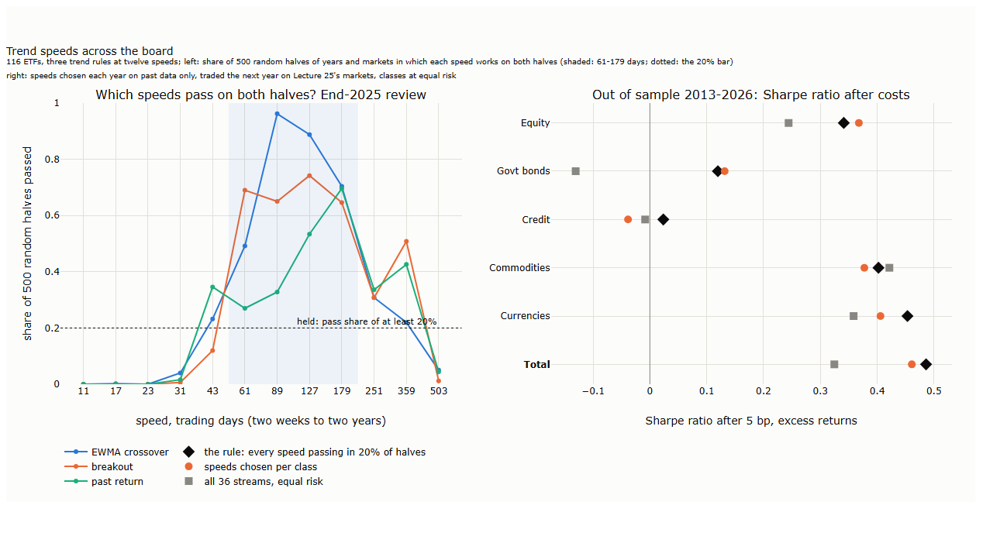
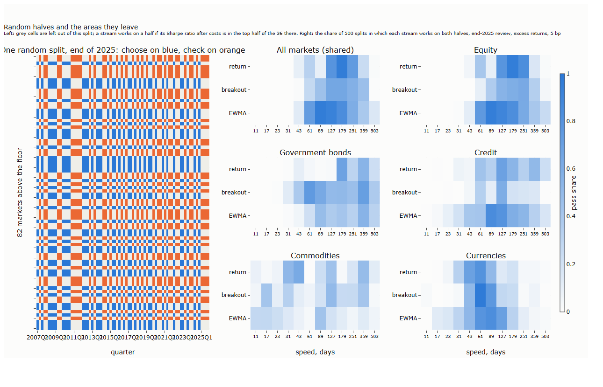
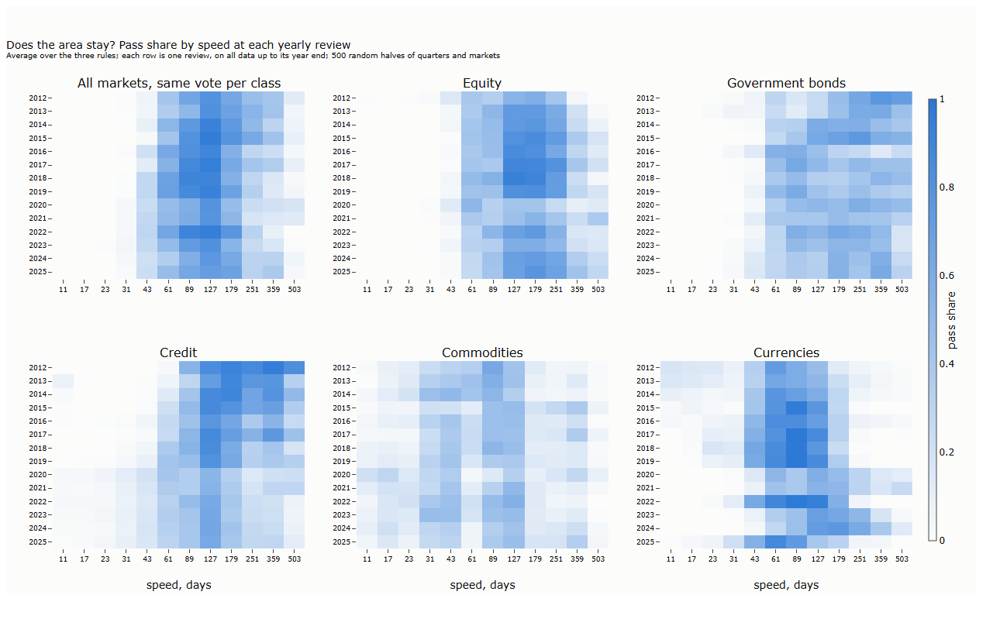

# Lecture 26: Trend Speeds That Work Across the Board

*Systematic Trading: Lecture Notes (MSc) · draft, Nov 13, 2026 · Max Gnesi*

Lecture 25 chose the markets without looking at any strategy's results. This lecture takes the next step of the portfolio part's workflow: it chooses the **speeds** of the trend rules that will trade them. It is the one step that may look at how a strategy performed, so it is also where a portfolio is most easily fitted to the accidents of the past. The question is how to choose speeds that work across the board, on all asset classes and their markets, and how much the choice is worth once it is judged on years it never saw. The plan was fixed before any result was computed, and every change made after seeing results is dated and labelled ([results/hypotheses.md](results/hypotheses.md)).

## 1. Speeds that work across the board

The lecture's result fits in one chart.


<sub><b>How to read the figure.</b> <b>Axes.</b> Left: twelve trend speeds from two weeks to two years (x, trading days) against the share of 500 random halves of years and markets in which each speed works on both halves (y), one line per trend rule, at the end-2025 review. Shaded: 61 to 179 days; dotted: the bar of 20% above which a speed is held. Right: Sharpe ratio after costs, out of sample 2013-2026 (x), per asset class and in total (y), for the rule (black diamonds), speeds chosen separately for each class (orange) and all 36 streams held equally (grey squares). Excess returns over cash, 5 bp per trade; our calculation.</sub>

Speeds of two to five weeks almost never pass: they trade too often for what they earn. Speeds of three to nine months (61 to 179 days) pass in most random halves, for all three rules. Beyond a year the pass share falls but does not vanish, and the rule keeps the slow speeds that still pass. Chosen each year on past data only, the speeds that pass did better the following years than holding all 36 (Sharpe ratio 0.49 against 0.32 over 2013-2026), mostly by leaving out the fast speeds; choosing separately for each asset class did not do better than one set for all (0.46).

| § | Step | Question |
|---|---|---|
| 2 | Overfitting, carefully | What can be guarded against in advance, and what cannot? |
| 3 | The streams | Which rules, which speeds, which returns and costs? |
| 4 | The rule | How do random halves of years and markets choose speeds, and what if markets disagree? |
| 5 | The areas | Which speeds pass, class by class, and do they stay? |
| 6 | Super-long speeds | Why do very slow trends work in US equity and not elsewhere? |
| 7 | Out of sample | Does the rule beat holding everything, or choosing per class? |

This lecture is step 2 of the workflow of Lecture 25 (§1): it uses strategy performance, but only in sample, to choose a region of speeds rather than a point, and it is judged out of sample.

## 2. Overfitting, carefully

"Overfitting" is easy to say and hard to define in advance. A choice is overfitted only if the future differs from the past in a way that makes it fail, and we do not know how the future will differ. Two different things hide behind the word, and only one of them can be measured beforehand.

| | What it is | Measurable in advance? | What we do about it |
|---|---|---|---|
| **Dependence on the sample** | The choice reflects the particular history we happened to see: one crash, one market's luck. An equally likely history would have given a different choice | Yes: rerun the choice on other slices of the same past and see whether it holds | Keep only what holds on most slices (§4) |
| **A future unlike the past** | The structure changes: interest-rate regimes, who trades, how crowded a speed is. Even a choice that is stable in the past can fail | No | Prefer choices with a mechanism; review every year; judge the result out of sample (§7). Spreading over speeds does not help here on average (see below) |

**Moving away from today's best does not protect against an unknown future.** If we do not know which way the future will differ, a speed away from the past's best is as likely to do worse as to do better: its expected gain is zero. Spreading over a region does something narrower. It narrows the spread of outcomes, losing less if the best speed moves and earning a little less if it stays. Only two things act on the second kind of overfitting: a mechanism, which says why a speed should keep working, and the yearly review, which follows the change after it shows. Neither prevents it.

Seen this way, choosing the best speed for each market is the extreme case of the first kind: each choice rests on one market's history, the least evidence there is. One set of speeds for a whole asset class rests on all its markets, one set for all classes on all of them. The defences against the first kind follow from that:

| Defence | In this lecture |
|---|---|
| Few free choices, much evidence behind each | One set of speeds for all markets, each asset class with the same vote |
| Robust across markets | A speed must work across the markets of a random half, not on one market |
| Robust across periods | It must also work on random halves of the years |
| Regions, not points | Every speed that passes often enough is held, not the single best |
| Out of sample | Chosen each year on past data only, judged on the years after |

These are not new ideas. The classic studies of trend following apply one rule to every market: Moskowitz, Ooi and Pedersen (2012) use the same 12-month lookback for 58 futures, and Hurst, Ooi and Pedersen (2017) combine 1-, 3- and 12-month trends with equal weights across 67 markets since 1880. Choosing what is kept on many random halves of the data is the idea of stability selection (Meinshausen and Bühlmann, 2010), whose authors note that the result varies "surprisingly little" with the cut-off.

## 3. The streams

### 3.1 Speeds and rules

**Speeds.** Twelve horizons from two weeks to two years, each about 1.4 times (the square root of 2) the one before: 11, 17, 23, 31, 43, 61, 89, 127, 179, 251, 359 and 503 trading days. Each is a prime number. Two reasons:

- Rules that look back over a fixed window, such as a past return or a breakout, are blind to cycles of exactly their length and its fractions. Two windows of which one is a multiple of the other share those blind spots; two primes share none.
- Many traders use round lookbacks (20, 50, 100, 200 days) and calendar lengths (21, 63, 252). A rule on 197 or 251 days changes its position on different days than the crowd's, which matters for execution (Lecture 24 showed how predictable orders get picked off).

What makes two speeds different is mainly their ratio, not their divisibility: 59 and 61 are both prime and almost the same rule. So the grid is spaced by ratio first and made of primes second.

**Rules.** Three trend rules from Lecture 6, each taking a position of +1 (long) or −1 (short) at the close of each day, computed with `trading_models`:

| Rule | At speed h |
|---|---|
| EWMA crossover | Sign of the exponential average of the log price with span h/4 minus that with span h |
| Breakout | Long after a new h-day high, short after a new h-day low, flat after crossing back over the h/2-day channel (the Turtle rule) |
| Past return | Sign of the h-day return |

Three rules at twelve speeds give **36 streams** for each market.

### 3.2 Positions, returns and costs

| Step | Rule | Why |
|---|---|---|
| Position | The rule's sign times 10% divided by the market's yearly volatility over the past six months (an exponential average of squared daily returns, span 126 days) | Each market carries about the same risk (Lecture 9); six months matches positions held for months, where a short window would lever quiet markets up in calm spells (§7) |
| Trading | Each day, close a tenth of the gap between the position and its target (Lecture 9) | Cuts turnover without giving up the signal |
| Return | The position times the market's return **over cash**: the fund's total return less the 3-month Treasury bill rate | What a trend position adds, as a futures position earns |
| Cost | 5 bp of the value traded on every trade | Liquid funds trade at spreads of a fraction of a basis point; 5 bp allows for thinner funds and some impact (10 and 20 bp are reported) |

**Why returns over cash.** The funds' prices are total returns: interest, coupons and dividends are reinvested. A trend follower's positions are often levered (a calm bond fund is held at several times its value to reach a 10% volatility) and often short. Written for the whole account, with $`w_i`$ the position in fund $`i`$ and $`r_f`$ the cash rate:

```math
r_{\text{account}} = \sum_i w_i\,\mathrm{TR}_i + r_f\Big(1 - \sum_i w_i\Big) = r_f + \sum_i w_i\,(\mathrm{TR}_i - r_f)
```

Unused capital and the proceeds of short sales earn the cash rate; borrowed money for positions beyond the capital costs it. The account therefore earns the cash rate once, plus each position times its return over cash, and the second part is what separates one speed from another. Measured on total returns instead, a levered bond position collects interest on money it never paid for: at 89 days the government bond streams' Sharpe ratio is 0.60 on total returns and 0.28 over cash, credit's 0.52 and 0.34 (our calculation, all funds of the class with equal risk, 2007-2026). Real borrowing costs a little more than the bill rate and shorting a fund carries a fee; both bite only on leverage beyond the capital and are left to the lecture on constraints and costs.

**Example: why fast speeds fail.** On IEF (Treasuries of 7 to 10 years), the fastest EWMA crossover (11 days) earned a Sharpe ratio of 0.32 before costs over 2007-2026, as much as the slow speeds (0.30 at 89 days, 0.31 at 251); it traded so often that costs of 5 bp took 1.5% a year and left 0.08. The 89- and 251-day crossovers paid 0.5% and 0.2% a year and kept 0.25 and 0.29. The fast speeds' failure here is a matter of cost, not of an absence of trend (our calculation, returns over cash).

## 4. The rule

**For all markets at once, 500 times, split the years and the markets at random into two halves, see which speeds work on one half and still work on the other, and hold, with equal risk, every speed that passes in at least 20% of the splits.**

| Term | Meaning |
|---|---|
| Half | A random half of the quarters of the past (scattered over the whole history, not one block) and a random half of the markets |
| Works | The stream's Sharpe ratio after costs, averaged over the half's markets, is in the top half of the 36 streams |
| Vote | Each asset class has the same total weight in that average; within a class, a market counts in proportion to the logarithm of its daily dollar volume, so that SPY counts about twice as much as the smallest country fund, not a thousand times |
| Passes | Works on the half where it is found and on the other half too |
| Held | Every stream that passes in at least 20% of the 500 splits, with equal risk |

The rule is run at every year end from 2012, on all data up to that date, and its choice is traded the following year.


<sub><b>How to read the figure.</b> <b>Axes.</b> Left: quarters of the past (x) by markets above the liquidity floor (y) for one of the 500 splits at the end-2025 review; blue cells are the half where speeds are found, orange cells the half where they are checked, grey cells are left out of this split. Right: for each speed (x, trading days) and rule (y), the share of the 500 splits in which it passed, for all markets with the same vote per class and for each class alone. Our calculation.</sub>

Each split hides a different half of the past and of the markets, so a speed that worked because of one crisis, or in one market, passes only when that crisis or market falls on both sides, which happens rarely. The pass share is the share of the 500 alternative histories in which the speed held. The bar of 20% keeps every speed that holds in a fair minority of them: the core speeds, which pass in most splits, and the speeds that only some markets and periods favour. Why that is the right side to err on is a question of the first kind (dependence on the sample): a speed that passes in a fifth of alternative histories is not clearly worse, only less certain.

**Example: markets that disagree.** Over 2007-2026 SPY's trend paid best at the slowest speeds (an EWMA crossover earned a Sharpe ratio of 0.56 at 359 days and 0.18 at 61), while Europe's (EFA) paid only at medium speeds (0.16 at 61 days, −0.12 at 359). Choosing each market's best speed would need to know in advance which market behaves like which; the rule does not. It holds the speeds that pass across random halves of markets, here every EWMA speed from 43 to 359 days, so it holds both the region SPY favoured and the one EFA favoured. On each market alone the blend earns less than that market's best speed in hindsight (0.37 for SPY, 0.03 for EFA), which is the price of not knowing in advance which speed each market will favour.

## 5. The areas


<sub><b>How to read the figure.</b> <b>Axes.</b> Speed (x, trading days) by yearly review (y), one panel for all markets with the same vote per class and one per class; colour is the pass share averaged over the three rules, from white (never passes) to blue (always). Each row uses all data up to its year end. Our calculation.</sub>

| Group | Where speeds pass | Over time |
|---|---|---|
| All markets, same vote per class | 61 to 179 days, lighter out to 359 | Steady from 2012 to 2025 |
| Equity | 127 to 251 days, lighter at 61-89 | Steady |
| Government bonds | Broad, 61 to 503 days, strongest at the slow end | Slower in the early reviews |
| Credit | 127 to 359 days in the early reviews | Narrows towards 127 days after 2020 |
| Commodities | Scattered between 23 and 127 days | No clear area |
| Currencies | 43 to 127 days, sharply | Shifts slower in 2022-2024, back by 2025 |

<sub><b>How to read the table.</b> Our reading of the chart above.</sub>

The rule holds 16 to 20 of the 36 streams at each review, and keeps 82% to 100% of them from one year to the next. Thirteen are held at every review from 2012 to 2025: all three rules at 61, 89, 127 and 179 days, and the EWMA crossover at 251. Nothing faster than 43 days is ever held. Between 12% and 37% of the streams held are slower than a year (251 days and more), held because they pass in enough splits, not as a bet on any scenario (§6).

The classes do lean differently: bonds and credit slower, currencies and commodities faster. The mechanism hypothesis written before the run (bonds slower than commodities, policy cycles against supply shocks) is consistent with the chart. Whether these differences are worth choosing speeds per class is tested in §7.

## 6. Super-long speeds in US equity

A common view is that equities need very long moving averages. On US large companies the data agree: SPY's EWMA crossover earned 0.56 at 359 and 503 days against 0.26 at 89 days, and QQQ's 0.65 at 359 days. But at 503 days SPY was long on 90% of the days, and buying and holding it earned 0.54: the slow rule is close to holding US equity, with an exit in the large falls. It harvests the US equity drift of 2007-2026, which Lecture 5 separated from timing. Outside the US the same speeds lost: −0.13 for EFA, −0.39 for emerging markets (EEM) and −0.10 for Europe (VGK) at 503 days, where markets drifted much less and a slow rule sat long through years of sideways prices.

So super-long speeds do not work across the board, and the rule gives them a small share rather than the bulk. Two points follow. A trend follower who wants US equity's drift should hold it as a deliberate long bias, decided in the allocation lectures, rather than through speeds that fail elsewhere. Whether the share in slow speeds should be larger is not something we can settle by appeal to the future. Other markets may come to drift like the US, or the US like the rest. Since we do not know which, adding slow speeds for that scenario is a bet with no expected gain, not insurance. The rule's share follows the evidence of the past instead; the yearly review moves it if the evidence changes.

## 7. Out of sample

Each version was chosen at every year end from 2012 on past data only and traded the following year on Lecture 25's markets, with every market at equal risk within its class and every class at equal risk. The comparisons were fixed before or dated during the work ([results/hypotheses.md](results/hypotheses.md)).

**Table 7.1. Sharpe ratio after costs, out of sample 2013-2026**

| Version | Equity | Govt bonds | Credit | Commodities | Currencies | Total | Worst drawdown |
|---|---|---|---|---|---|---|---|
| **The rule (20% of halves, one set, same vote per class)** | 0.34 | 0.12 | 0.02 | 0.40 | 0.45 | **0.49** | −22.2% |
| Weighted by pass share | 0.36 | 0.10 | 0.02 | 0.41 | 0.44 | 0.48 | −22.9% |
| Speeds chosen per class | 0.37 | 0.13 | −0.04 | 0.38 | 0.41 | 0.46 | −22.9% |
| Intersection (passes in 90% of halves) | 0.36 | 0.05 | −0.05 | 0.54 | 0.43 | 0.48 | −20.4% |
| Union (passes at least once) | 0.33 | 0.07 | 0.02 | 0.41 | 0.43 | 0.46 | −21.9% |
| All 36 streams, equal risk | 0.24 | −0.13 | −0.01 | 0.42 | 0.36 | 0.32 | −22.6% |

<sub><b>How to read the table.</b> Sharpe ratio of the daily returns over cash after 5 bp costs, 2013-2026, per class and for the five classes at equal risk; worst drawdown of the total. Every row uses the same markets, sizes and costs; only the choice of speeds differs. Our calculation.</sub>

| The rule against… | Difference in total Sharpe ratio | 90% band (block bootstrap over months) |
|---|---|---|
| All 36 streams | +0.16 | +0.03 to +0.29 |
| Speeds chosen per class | +0.03 | −0.05 to +0.09 |
| Weighted by pass share | +0.00 | −0.02 to +0.03 |
| Union | +0.03 | −0.03 to +0.08 |

<sub><b>How to read the table.</b> Difference of the total Sharpe ratios out of sample, 2013-2026, with its 90% band from 2,000 resamples of calendar months. A band that excludes zero means the difference is unlikely to be luck. Our calculation.</sub>

Three results, all expected before the run:

1. **Choosing helps, by leaving out what fails.** The rule beats holding all 36 streams by 0.16, and the band excludes zero. The gain comes mostly from government bonds and equity, where the fast speeds lose: in bonds all 36 streams lost (−0.13) while the rule earned 0.12.
2. **Choosing per class does not do better than one set for all.** No class beat the shared set after the Benjamini-Hochberg correction across the five classes, and the total differs by 0.03. This is a fair test: each class is judged on its own markets, and every class has the same vote in the shared set. It does not show that classes never differ: with 5 to 9 funds in most classes and 14 years, a benefit below about 0.1 in Sharpe ratio cannot be detected here.
3. **Among sensible versions of the rule, the version hardly matters.** Weighting by pass share, a union, an intersection, square-root votes: all within a few hundredths. Finding the area matters; the point inside it does not.

Two frameworks were checked in the same way. Sizing positions by volatility over 36 days, each stream's own speed or six months gave the rule 0.47, 0.50 and 0.49: the six months used here is the simplest, and a short window was a real hazard in quiet markets (in a calm spell of early 2026 the 36-day version held the high-yield fund HYG at three to five times its value, and lost about 11% in a year when HYG fell less than 3%). And credit is the class where the rule earned least (0.02): a credit fund's rise is mostly coupon income, which a long position collects and a trend rule gives back when it is short (HYG's price fell 18% from 2013 to 2026 while it paid 5.4% a year).

What these numbers leave for later lectures: how much each class and market should weigh (the allocation lectures), whether larger markets should carry more risk, and how the trend portfolio sits next to simply holding the markets. The second kind of overfitting of §2, a future unlike the past, remains, and nothing here removes it: the rule is reviewed every year, which follows a change after it shows but does not foresee it.

## 8. Summary

### 8.1 Takeaways

1. **Overfitting has two parts.** Dependence on the sample can be measured in advance by rerunning a choice on other slices of the past; a future unlike the past cannot. Moving away from today's best speed does not help against it on average, because we do not know which way the future goes. Spreading only narrows the range of outcomes; mechanism and the yearly review are what remain (§2).
2. **One rule, one sentence.** Hold every speed that works on one random half of years and markets and still works on the other, in at least 20% of 500 splits (§4).
3. **Medium speeds work across the board.** Three to nine months pass in nearly every review; two to five weeks never do, because costs eat them; beyond a year only some markets pay (§5).
4. **Super-long speeds in US equity are drift, not timing.** They track buying and holding and fail where markets drifted less (§6).
5. **Choosing helps by leaving out what fails**; choosing per class or the fine details of the rule add nothing measurable on our data (§7).
6. **Framework choices matter more than they look.** Returns over cash, not total returns; volatility over months, not weeks (§3, §7).

### 8.2 Exercises

- [ ] Rerun the rule with 100, 500 and 2,000 splits. From how many does the set of held speeds stop changing?
- [ ] Replace the 20% bar by 10%, 30% and 50%. Plot the number of streams held and the out-of-sample Sharpe ratio against the bar. Where is the result flat?
- [ ] Choose each market's best speed in sample (2007-2016) and trade it in 2017-2026. Compare with the rule chosen on the same years. How much of the in-sample advantage survives?
- [ ] Without any backtest: for each class, find the horizons where returns persist most (the variance ratio of h-day returns), hold all three rules there, and compare with the rule out of sample. Can speeds be chosen without looking at profits?
- [ ] Put the trend signals on total returns and the profits on returns over cash. Which classes change most, and why does credit behave differently from currencies?
- [ ] Size positions by volatility over 21, 63, 126 and 252 days. Plot the rule's Sharpe ratio and its worst year against the window. Which classes are most sensitive?

### 8.3 Reading list

- Bailey, D. H., Borwein, J. M., López de Prado, M. and Zhu, Q. J. (2017). The probability of backtest overfitting. *Journal of Computational Finance* 20(4), 39-69. — overfitting measured by splitting the history (§2; Lecture 7).
- Hurst, B., Ooi, Y. H. and Pedersen, L. H. (2017). A century of evidence on trend-following investing. *Journal of Portfolio Management* 44(1), 15-29. — one blend of 1-, 3- and 12-month trends for 67 markets since 1880 (§2).
- Meinshausen, N. and Bühlmann, P. (2010). Stability selection. *Journal of the Royal Statistical Society Series B* 72(4), 417-473. — keeping what is chosen on many random halves of the data (§2, §4).
- Moskowitz, T. J., Ooi, Y. H. and Pedersen, L. H. (2012). Time series momentum. *Journal of Financial Economics* 104(2), 228-250. — one 12-month rule for 58 futures (§2).

The details above were checked at source ([results/sources.md](results/sources.md)). *References are given from memory and should be checked against the originals before circulation.*
