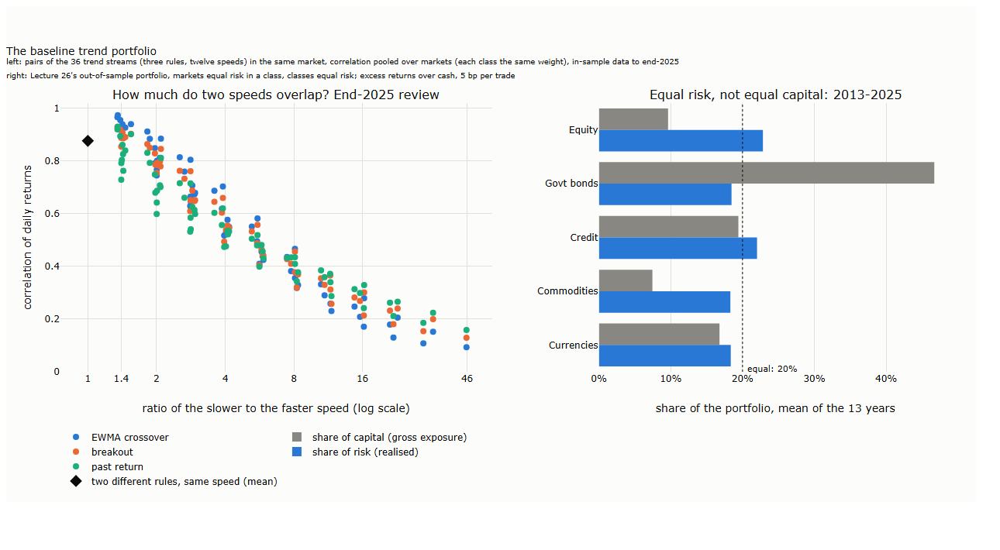

# Lecture 27: The Baseline Trend Portfolio

*Systematic Trading: Lecture Notes (MSc) · draft, Nov 14, 2026 · Max Gnesi*

Lecture 25 chose the markets and Lecture 26 the speeds of the trend rules that trade them. This lecture puts the two together into one portfolio: it blends the speeds inside each market, the markets inside each asset class, the classes into one account, and scales the total. Each step uses the same method, **equal risk**, and each could be done differently. The result is the **baseline**: the portfolio every later lecture changes in one part and must beat out of sample. The lecture's question is which choices matter at each step and what each costs, not which portfolio is best. The plan was fixed before any result was computed, and every change made after seeing results is dated and labelled ([results/hypotheses.md](results/hypotheses.md)).

## 1. Equal risk at every level

The lecture's result fits in one chart.


<sub><b>How to read the figure.</b> <b>Axes.</b> Left: the ratio of the slower to the faster speed of two trend streams in the same market (x, log scale) against the correlation of their daily returns (y), pooled over the markets with each asset class the same weight, data to end-2025; one dot per pair of speeds, coloured by rule; the black diamond is the mean over pairs of different rules at the same speed. Right: each asset class's share of the portfolio's gross exposure (grey) and of its realised risk (blue, x), mean over the years 2013-2025; dotted: an equal share of 20%. Excess returns over cash, 5 bp per trade; our calculation.</sub>

Two trend streams in the same market overlap by how far apart their speeds are, not by which rule they use. Two speeds a step apart (a ratio of 1.4) are 0.84 to 0.93 correlated; a ratio of 8 brings it to about 0.4 and the extremes of the grid (a ratio of 46) to 0.1 to 0.2. Different rules at the same speed overlap by 0.88. Held together, Lecture 26's 20 streams in a market amount to about **1.4 independent bets**. Across classes the opposite happens: the classes carry about the same risk (18% to 23%) with very different capital, because a calm government bond fund must be held at several times the size of an equity fund to carry the same risk (47% of the gross exposure against 10%).

| § | Step | Question |
|---|---|---|
| 2 | Speeds inside a market | How should streams that overlap this much be blended, and does anything beat equal weights? |
| 3 | Markets and classes | Equal risk or equal capital? Asset classes or groups found in the data? |
| 4 | The total | Scale to a volatility target or hold leverage constant? |
| 5 | Taking profits | Does closing a trend after a large gain help? |
| 6 | Crises | Which speeds work in crises, and how does today's portfolio fare in them? |

**The workflow.** Lecture 25 (§1) set the order for the whole portfolio part: markets first, then weights from risk only, and the strategy's profit and loss last, as the judge.

| Step | Uses | Lecture |
|---|---|---|
| Markets | Liquidity, history, overlap | 25 |
| Speeds | Strategy performance, in sample, as a region rather than a point | 26 |
| Weights | Risk only: volatilities, correlations, costs | **27** (baseline), 30 (other methods) |
| Judge | Profit and loss, out of sample | every lecture |

Profit and loss never feeds back into the weights silently: where a weight depends on past performance (maximum Sharpe ratio in §2, speed timing in §2.4), the lecture says so and shows the cost.

**The baseline in one sentence.** *Hold Lecture 26's speeds with equal risk in each market, the markets with equal risk in each asset class, the classes with equal risk, and scale the total each year to 10% volatility on its past three years.* All weights are set at each year end from 2012 on past data only and traded the following year; the results are out of sample, 2013-2026, on Lecture 25's markets (Sharpe ratio 0.49 after costs).

**Two steps, not one.** The portfolio is built in two steps: the speeds inside each market (§2), then the markets and classes (§3). A single step would weigh every stream in every market at once, here 20 streams in each of about 20 markets: some 400 weights from a 400 × 400 correlation matrix estimated on three years of data. Two steps are a **convention** with two reasons behind it:

- **Evidence.** The speeds' overlap is much the same in every market (it follows the speed ratio, left panel), so it can be estimated once on all markets pooled; a weight per stream and market would rest on one market's history, the least evidence there is (Lecture 26 §2).
- **Separate questions.** How to blend speeds is a question about the trend rules; how to blend markets is a question about the assets. Two steps keep each answer readable and each check separate.

When the speeds' overlap is the same in every market, the two steps give the same portfolio as one step with that structure imposed. When it is not, one step can use the differences, at the price of estimating far more numbers. Large funds that run one optimisation over all their streams do so with heavy constraints that bring back much of this structure. A one-step allocation is an exercise (§7.2).

## 2. Speeds inside a market

### 2.1 The methods

Lecture 26 held every speed that passed in at least 20% of random halves, with equal risk each. Equal weights are consistent with the rest of the portfolio only if every stream is equally useful. The streams are not: neighbouring speeds overlap by 0.9, and fast speeds cost more to trade. Four ways to blend them, from the simplest to the most demanding:

| Method | Weights from | What it assumes | Label |
|---|---|---|---|
| Equal weight per stream | Nothing | Every stream equally useful and equally distinct | Convention |
| Equal risk contributions | The streams' correlations | Every stream equally useful; overlap differs | Definition (Maillard, Roncalli and Teïletche, 2010) |
| Equal risk, net of costs | Correlations and each stream's cost | Every stream equally useful **before** costs | Our proposal |
| Maximum Sharpe ratio | Correlations and past Sharpe ratios after costs | Past Sharpe ratios predict the future | Definition (Markowitz) |

**Equal risk contributions.** Each stream contributes the same share of the blend's risk. With $`C`$ the streams' correlation matrix (the streams are first scaled to the same volatility) and $`w`$ the weights, stream $`i`$ contributes $`w_i\,(Cw)_i`$ to the blend's variance. The weights solve

```math
\min_{w > 0}\; \tfrac12\, w^\top C\, w \;-\; \sum_i b_i \log w_i ,
```

whose solution has risk contributions proportional to the budgets $`b_i`$ (all equal here), then normalised to sum to one. A stream that overlaps much with the others gets a smaller weight; a stream that adds something different gets a larger one.

**Equal risk, net of costs.** The budget of each stream is cut by what it costs to trade: $`b_i = \text{prior} - c_i`$, where the prior is a Sharpe ratio before costs assumed the same for every stream (0.3; 0.2 and 0.5 reported) and $`c_i`$ is the stream's **marginal cost** in the blend, in Sharpe-ratio units a year. The marginal cost is what the stream adds to the blend's trading, not what it would cost alone: when a fast and a slow stream trade against each other, their trades net inside the market's combined position and neither pays in full. At the speeds held here the costs are small (0.003 to 0.03 Sharpe-ratio units a year at the end-2025 review). The method is written in general because at higher frequency, where costs are a large share of the gross return, the same budget would move weights decisively away from the fast streams.

**Maximum Sharpe ratio.** The weights that maximise the blend's past Sharpe ratio after costs, long only. It is the only method that uses the streams' past performance, and Michaud (1989) called it an *error maximiser*: it puts the most weight on the streams whose past Sharpe ratio was overestimated the most. It is shown as a warning, not as a candidate.

### 2.2 Results

| Method | Sharpe ratio, out of sample 2013-2026 | Independent bets per market (end-2025) | Streams with more than 1% weight (end-2025) |
|---|---|---|---|
| Equal weight per stream (baseline) | 0.486 | 1.39 | 20 of 20 |
| Equal risk contributions | 0.482 | 1.41 | 20 of 20 |
| Equal risk, net of costs (prior 0.2 / 0.3 / 0.5) | 0.483 / 0.482 / 0.482 | 1.41 | 20 of 20 |
| Maximum Sharpe ratio | 0.455 | 1.29 | 5 of 20 |

<sub><b>How to read the table.</b> Each method blends the held speeds inside every market; the rest of the portfolio (markets, classes, total) is the baseline's. Sharpe ratio after 5 bp per trade, excess returns over cash. Independent bets: the number of uncorrelated streams of equal risk that would give the blend's diversification, $`(\sum_i w_i)^2 / w^\top C w`$ with the streams at unit risk. Our calculation.</sub>

Equal weights, equal risk contributions and the cost-adjusted budgets give the same portfolio in practice: the equal-risk weights at the end-2025 review range from 4.5% to 5.8% around the equal 5%. Their correlations leave little to choose: when every pair of neighbours overlaps by about 0.9, no weighting finds a second independent bet that is not there. Maximum Sharpe ratio concentrates on five streams that changed from year to year (at the 2012 review mostly the 179-day crossover, at 2018 the 89-day crossover and the 127-day breakout) and earned 0.03 less.

**Reading.** On our sample the choice between the three risk-based methods does not matter, and equal weights are the simplest. The result is specific to streams that overlap this much and cost this little: with distinct strategies, or at speeds where costs bite, equal risk contributions and cost budgets would move the weights, and that is where Lecture 30 takes them up.

### 2.3 Streams that are not always in the market

The breakout rule is flat after the price crosses back over its half-length channel (Lecture 26 §3.1), so its streams are **part-time**: on Lecture 25's markets the held breakout speeds had a signal on 71% of days over 2007-2026 (median over markets and speeds). This raises a question that has no single answer: are the flat days zeros or missing?

| Purpose | Flat days count as | Why | Label |
|---|---|---|---|
| Profit and loss of the account | Zero return | The capital is there and earns cash (zero over cash) | Definition |
| How the strategy behaves while it trades (volatility, correlation with other streams) | Missing | Zeros would dilute the volatility and pull correlations towards zero | Convention |
| Risk budget in the portfolio | Either: on average or while active | A choice with known trade-offs | Our proposal (Lecture 29) |

The two give different numbers. The breakout streams earned a Sharpe ratio of 0.20 over all days and 0.26 on the days with a signal (median over markets and speeds), consistent with Lecture 7 §4.3: the Sharpe ratio over the whole period is roughly the Sharpe ratio while invested times the square root of the share of time invested ($`0.26 \times \sqrt{0.71} \approx 0.22`$). The difference is not an edge; it is the idle capital, which Lecture 7 §4.3 showed can be used elsewhere.

In the baseline the breakout streams are blended as they are, with zeros on flat days: their volatility is measured on all days and their risk is the average risk. Strategies that are in the market much less often, and how to combine them with strategies that always are, are the subject of Lectures 28 and 29.

### 2.4 Timing the speeds

Could the weights move with what has worked lately within the held set? Two opposite rules are both plausible:

- **Momentum.** Tilt towards the speeds that did best over the past three or six months: if a speed suits the current market, it may keep suiting it.
- **Reversal.** Tilt towards the speeds that did worst: the held speeds all work over the long run, so a recent laggard may be due to catch up.

Each tilts the equal weights at the start of every quarter by the speeds' rank over the past three or six months, at half or full strength (weights between zero and twice equal), within Lecture 26's held set only, so it never brings in a speed that was not chosen. Reweighting pays 5 bp on the change in each position.

| Tilt | Lookback | Sharpe ratio difference to equal weights | 90% band |
|---|---|---|---|
| Momentum, half / full | 3 months | −0.06 / −0.11 | −0.08 to −0.03 / −0.16 to −0.06 |
| Momentum, half / full | 6 months | −0.05 / −0.10 | −0.07 to −0.03 / −0.14 to −0.06 |
| Reversal, half / full | 3 months | +0.02 / +0.04 | −0.00 to +0.05 / −0.01 to +0.09 |
| Reversal, half / full | 6 months | +0.03 / +0.05 | +0.00 to +0.05 / +0.00 to +0.10 |

<sub><b>How to read the table.</b> Each row tilts the speed weights inside every market each quarter by the rank of each held speed's recent Sharpe ratio; the rest of the portfolio is the baseline's. Difference to equal weights in Sharpe ratio after costs, out of sample 2013-2026; 90% band from a block bootstrap over calendar months. Our calculation.</sub>

Momentum lost clearly; reversal gained a little, and two of its four bands only just exclude zero. With eight variants tried and no mechanism beyond "the held speeds catch up", this is weak evidence, and the baseline keeps equal weights. A third way conditions on the state of the market rather than on past performance; Goulding, Harvey and Mazzoleni (2023) blend fast and slow trends by whether they agree, which marks turning points. A version of it did not hold here: leaning towards fast speeds in volatile markets and slow speeds in calm ones looked promising on the ETFs (calm: slow speeds led; storms: fast speeds led) but did not survive a test on the capstone futures (difference −0.02, 90% band −0.07 to +0.03; [results/hypotheses.md](results/hypotheses.md)).

**Is there anything to time?** A descriptive check, with nothing fitted: in each market, rank the held speeds by their Sharpe ratio in one window and again in the next. The rank correlation between the two is −0.03 for one-year windows and −0.02 for three-year windows (47% and 49% of market-window pairs positive). Neither persistence, which momentum needs, nor reversal is measurable. Momentum's losses are therefore mostly its own costs and concentration: it reweights each quarter on differences that do not persist. With no reversal measurable either, reversal's small gain has no mechanism behind it on our data; it stays an open question (§7.2).
