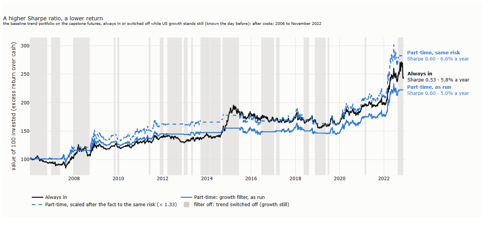
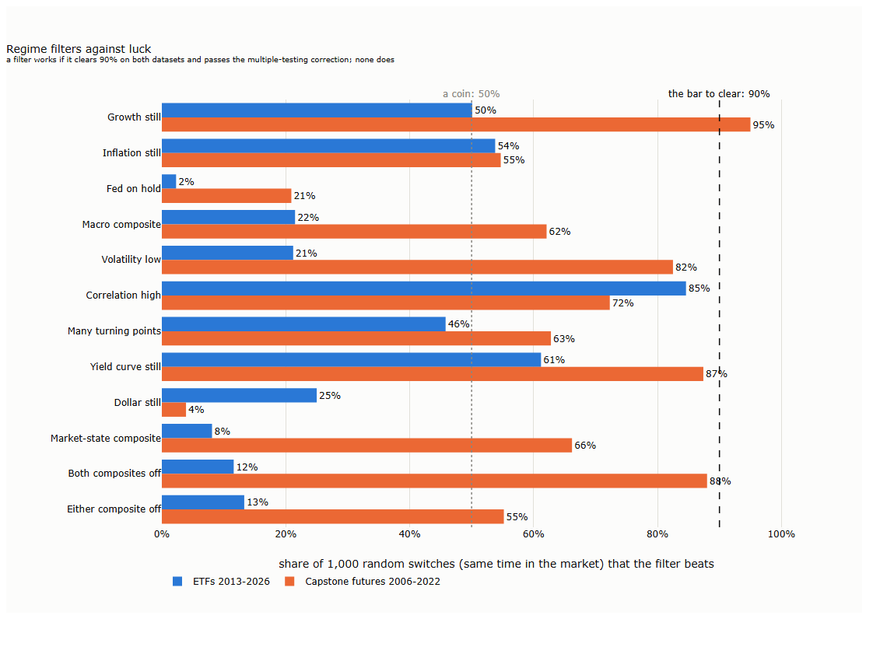
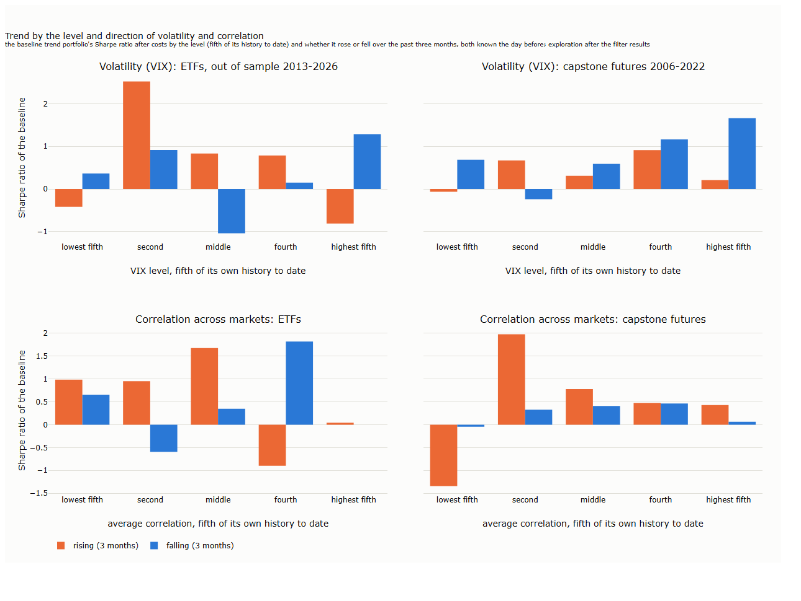
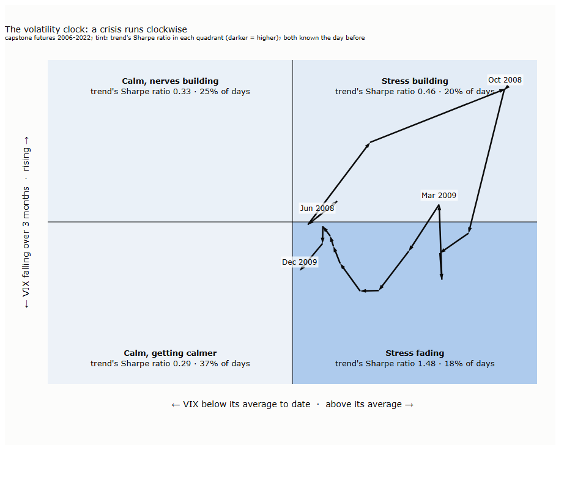
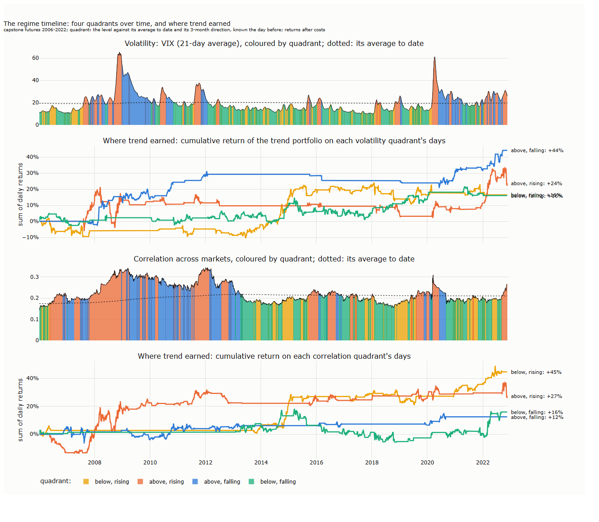

# Lecture 28: Part-Time Strategies

*Systematic Trading: Lecture Notes (MSc) · draft, Nov 15, 2026 · Max Gnesi*

Lecture 27's baseline trend portfolio is always in the market. A **regime filter** turns it into a **part-time strategy**: it steps aside when the economy or the markets are in a state where trend is expected to fail. This lecture asks whether that works with information known on the day, and, before that, how a strategy that is out of the market part of the time should be compared with one that never is. Two families of regime variables are tested side by side: **macro** (growth, inflation, the Fed; monthly, published late, revised) and **market state** (volatility, correlation, turning points, the yield curve, the dollar; daily, never revised). The scale is the opposite of Part IV's: there a strategy saw millions of events a day and a test had thousands of independent trials; here a regime lasts months, and twenty years hold a handful of episodes. The plan was fixed before any result was computed, and every change made after seeing results is dated and labelled ([results/hypotheses.md](results/hypotheses.md)).

## 1. Regime information as a switch

Trend loses money in some regimes. There are two answers to that, and the course takes them in turn.

| | Switching trend (this lecture) | Adding strategies to trend (Lecture 29) |
|---|---|---|
| Question | Does the regime tell us **when trend works**? | Is there a strategy that **earns when trend does not**? |
| What changes | Trend is turned on and off | New return streams (carry, value) are held next to trend, always in |
| What the regime does | Sets the switch | Nothing is switched: the regimes only show where each strategy earned |
| Judged against | Always-in and random switching with the same time in the market | What it adds to trend, against random strategies |
| Idle capital | Stays idle: a switch can only take away | None: every strategy is always in |

**Why both, and why in this order.** The two lectures do not repeat each other. A switch needs a forecast: it must know, on the day, that trend is about to do badly. A second strategy needs no forecast: if it earns for a different reason, it tends to earn when trend does not, whatever the regime. *Analogy (labelled):* a fisherman can stay in port when a storm is forecast (a switch), or also own an umbrella shop (a second business); the shop earns in storms without anyone forecasting them.

The switch comes first because it is the natural first idea, and because its result motivates the second. It continues Lecture 8, which tested filters on single markets; here the filter switches the whole portfolio. A switch can only take away: while trend is off its capital is idle, so even a switch that raises the Sharpe ratio lowers the return (key chart below). It can never earn in the regimes where trend fails. A second strategy can, and that is Lecture 29's question. Lecture 29 reuses the regime quadrants built here only to show where each strategy earned; nothing is switched there.

**The rule in one sentence** (our proposal). *Trade trend while the regime is moving; step aside while it stands still*, where for each variable the unfavourable state was fixed before any result (§3). Off means the whole portfolio's target position is zero; it is reached a tenth of the way each day, like every position since Lecture 26, and every change costs 5 bp.

The lecture's central point fits in one chart: the best regime filter we found, against always-in.


<sub><b>How to read the figure.</b> <b>Axes.</b> x: time, 2006 to 18 November 2022 (the capstone futures run out market by market in December 2022); y: the value of 100 invested, excess return over cash, after costs. Black: the baseline trend portfolio, always in. Solid blue: the same portfolio switched off while US growth stands still (the growth filter of §2.3), as it would have been run. Dashed blue: the solid blue line scaled after the fact to the same volatility as always-in (× 1.33), a comparison, not a strategy that could have been run. Grey bands: the periods the filter was off. At the right: each line's Sharpe ratio and excess return a year. Our calculation.</sub>

Switched off for 41% of the time, the part-time strategy has the higher Sharpe ratio (0.60 against 0.53) and the smaller losses, yet ends with less money (5.0% a year against 5.8%): its capital is idle during the grey bands. It earns more only when scaled up to the same risk. Whether that is worth it depends on what the idle capital could do, and on whether the filter's timing is information or luck (§2).

Over all twelve filters and both datasets, under the verdict fixed in advance (beat 90% of random switches with the same time in the market on both datasets, Benjamini-Hochberg at 10% within each family), **no filter works** on our data. Even this one beats 95% of its random switches on the futures but only 50% on the ETFs. The lecture shows how this was measured and what the data say about why, so that readers can judge the evidence themselves.

| § | Topic | Question |
|---|---|---|
| 2 | Comparing part-time with always-in | Which numbers answer which question, and what does each hide? |
| 3 | The regime variables | What do macro and market-state variables measure, and what does data revised later do to them? |
| 4 | The scan | Does trend earn less on the days a regime stands still? |
| 5 | The filters against luck | Does switching on these regimes beat always-in and random switching? |
| 6 | Why | What drives the patterns that appear, and do they repeat on years not used to find them? |
| 7 | One class at a time | A worked example: commodity trend by the shape of the futures curve |
| 8 | Summary | Takeaways, exercises, reading |

## 2. Comparing a part-time strategy with always-in

A part-time strategy and an always-in strategy do not use their capital the same way, so no single number compares them. Lecture 7 (§4.3) showed the basic arithmetic for a system in the market a share $`p`$ of the time:

```math
\text{Sharpe ratio, all days} \;\approx\; \text{Sharpe ratio while on} \times \sqrt{p}, \qquad \text{return per unit of capital} \;\approx\; p \times \text{return while on}.
```

This section builds on it for a portfolio switched by a regime: which questions to ask, in which order, and what each answer leaves out.

### 2.1 The bar a switch must clear

A filter that knew nothing would leave the Sharpe ratio while on unchanged and lower the Sharpe ratio over all days by the factor $`\sqrt{p}`$. To match always-in over all days, the strategy must earn a Sharpe ratio while on of at least the always-in Sharpe ratio divided by $`\sqrt{p}`$:

| Share of days on, $`p`$ | 90% | 75% | 60% | 50% |
|---|---|---|---|---|
| Sharpe ratio needed while on, as a multiple of always-in | 1.05 | 1.15 | 1.29 | 1.41 |
| For the ETF baseline (0.49) | 0.51 | 0.56 | 0.63 | 0.69 |

<sub><b>How to read the table.</b> Each column is a filter that keeps trend on for the given share of days. The middle row is $`1/\sqrt{p}`$: how much better than always-in the days kept must be for the part-time strategy to match always-in over all days. The bottom row applies it to the ETF baseline. A definition, from the formula above.</sub>

The bar rises quickly: a filter that is off half the time must pick days on which trend earns a Sharpe ratio 41% higher than its average. Random filters show the bar in practice: switched on and off at random with the same time in the market, their median Sharpe ratio sits close to what the formula predicts. For the growth filter of §2.3 (on 59% of days on the futures) the formula gives 0.53 × √0.59 = 0.41 and its random filters' median is 0.41; on the ETFs (on 54% of days) 0.36 against 0.33.

The formula is a guide, not an identity. Positions move a tenth of the way each day, so the portfolio is still partly invested in the first days of an off spell and not yet fully invested in the first days of an on spell; switching also costs. The **random filter** with the same time in the market, the same spell lengths and the same attachment (Lecture 8 §4.5) includes all of this, which is why it, not the formula, is the yardstick of the verdict.

### 2.2 Six questions, six numbers

| Question | Number | Label | What it can hide |
|---|---|---|---|
| Does the account do better? | Sharpe ratio over all days | Definition (Lecture 7) | Where the change comes from: being out alone lowers it by $`\sqrt{p}`$ |
| Is trend better on the days it is held? | Sharpe ratio while on | Definition (Lecture 7) | The idle capital: a high number can come with a low return |
| What does the account earn as it is run? | Excess return a year per unit of capital | Definition | Risk: a lower return at much lower risk can be the better strategy |
| What would it earn at the same risk? | Return and worst drawdown, scaled after the fact to the always-in volatility | Convention (comparison only) | That running it needs leverage on the days on, and that the scale uses the whole sample |
| Is the timing information or chance? | Share of random filters with the same time in the market that it beats | Lecture 8 §4.5 | Nothing on its own about size: a filter can beat luck and still lose to always-in |
| Does it add what always-in cannot give? | Alpha: the intercept of its returns regressed on always-in's, with its t-statistic | Definition (Lecture 8, step 4) | Few independent episodes: macro regimes give wide bands |

<sub><b>How to read the table.</b> One row per question a reader may ask of a part-time strategy, the number that answers it, whether that number is a definition or a convention, and what it leaves out. No row settles the comparison alone.</sub>

The order matters. The first two numbers describe the strategy; the next two say what it does to an account; the last two say whether the timing carries information. A filter can pass the first and fail the fifth: it then earns its higher Sharpe ratio from being out of the market at random times, which any coin would do.

### 2.3 One running example: the growth filter on the futures

The growth filter switches trend off while US industrial production growth is still: the size of the 12-month change in its year-on-year growth rate is in the bottom third of its history to date, on data as first published (§3). It is the filter that came closest to working, so it shows every number of §2.2 at once.

| | Always in | Growth filter (part-time) |
|---|---|---|
| Share of days on | 100% | 59% |
| Sharpe ratio while on | 0.53 | 0.67 |
| Sharpe ratio over all days | 0.53 | **0.60** |
| Volatility | 11.0% | 8.3% |
| Excess return a year, as run | **5.8%** | 5.0% |
| Excess return a year, scaled to 11.0% volatility (× 1.33) | 5.8% | 6.6% |
| Worst drawdown, as run / scaled to 11.0% | −20.9% | −12.7% / −16.8% |
| Random filters with the same time in the market: median, 95th percentile | | 0.41, 0.60 |
| Share of random filters beaten | | 95% |
| Alpha over always-in, a year (t-statistic) | | 1.5% (1.2) |
| The same filter on the ETFs: Sharpe ratio over all days, random filters beaten | 0.49 | 0.33, 50% |

<sub><b>How to read the table.</b> Capstone futures 2006 to November 2022, after costs; excess returns over cash; idle days earn zero excess return. "Scaled" multiplies the part-time strategy's daily returns by the ratio of the two volatilities over the whole sample (1.33), a comparison, not a strategy that could have been run. The last row is the same filter on the ETFs, 2013-2026. Our calculation.</sub>

The example shows the trade-off a part-time strategy brings. Over all days its Sharpe ratio is higher than always-in's (0.60 against 0.53), its drawdowns smaller and it beats 95% of random filters; **yet it earns less**: 5.0% a year against 5.8%, because 41% of the time its capital is idle. It earns more only when scaled up to the same risk, which means running it with a third more leverage on the days it is on, or giving its idle budget to something else. On the ETFs the same rule beats half its random filters, no better than a coin.

### 2.4 What the comparison cannot settle

Which of the two deserves the capital depends on what the idle capital can do. Lecture 7 (§4.3) laid out the cases: with committed capital and limited leverage, return per unit of capital decides; with capital that can be moved, the Sharpe ratio while on and the fit with the rest of the portfolio decide. A portfolio switched by a regime makes the second case concrete: the idle budget can be given to another strategy that does well in the regimes where trend is off. That is the question of Lecture 29, which uses the same regimes as strategies.

This lecture reports all six numbers for every filter and keeps its own reading short and labelled.

## 3. The regime variables

### 3.1 Two families

| | Macro variables | Market-state variables |
|---|---|---|
| What they measure | The economy and policy | Prices themselves |
| Updated | Monthly, published weeks late | Daily, known at the close |
| Revised later | Yes: only data as published at the time are used | Never |
| Independent episodes in twenty years | A handful | Many |
| Strength / weakness | A mechanism / late, revised, few episodes | Timely / noisy, overlaps with trend's own signal |

<sub><b>How to read the table.</b> The two kinds of regime variable tested in this lecture, compared on how they are measured and what that implies for a test. Our summary.</sub>

Every variable has an **unfavourable state**, fixed before any result with its reason (our proposal, following the literature where it exists). For most it is "still": the regime is not moving, so trend has little to follow.

| Family | Variable | Measured as | Off when | Why |
|---|---|---|---|---|
| Macro | Growth | US industrial production, year-on-year growth; the size of its 12-month change | Bottom third of its history | A stable economy gives few persistent moves |
| Macro | Inflation | US CPI, year-on-year; the size of its 12-month change | Bottom third | Trend earned in inflation shocks of either sign and least in stable inflation (Neville et al., 2021) |
| Macro | Fed | Fed funds target (upper bound from December 2008) | No change in six months (on hold) | A moving policy rate drives persistent moves in rates, currencies and risk assets |
| Market | Volatility | VIX, 21-day average | Bottom third | The "still" reading of the rule; earlier evidence says volatility does not predict trend (Lecture 8; Goulding, Harvey and Mazzoleni, 2023) |
| Market | Correlation | Average absolute pairwise correlation of the baseline's markets over six months | Top third | Many trends become one bet and reverse together (Hurst, Ooi and Pedersen, 2017) |
| Market | Turning points | Share of markets whose 1-month and 12-month returns disagree in sign | Top third | Disagreement between fast and slow trends marks turns (Goulding, Harvey and Mazzoleni, 2023) |
| Market | Yield curve | 10-year minus 2-year Treasury yield; the size of its 12-month change | Bottom third | A still curve gives rates little to trend on |
| Market | Dollar | Broad trade-weighted dollar; the size of its 12-month change in percent | Bottom third | A still dollar gives currencies and commodities little to trend on |

<sub><b>How to read the table.</b> One row per regime variable: what is measured, the state in which the filter switches trend off, and the reason fixed in advance. "Bottom (top) third of its history" means of the variable's own history up to the day before (at least five years for market-state variables; the full history of the data vintage in use for macro variables). Every input is lagged one trading day. Composites: macro off when at least two of three are off; market state off when at least three of five are; "both agree" off when both composites are, "either" when one is.</sub>

### 3.2 Data as first published, and the price of look-ahead

Macro data are revised for years after first publication, so a test on today's data uses numbers nobody had at the time. Industrial production and CPI are therefore taken from the Philadelphia Fed's Real-Time Data Set (free): one vintage a month, each holding the full history as it was known then, used from the 16th of its month. The Fed's target rate is never revised.

How much does this matter? The growth × inflation quadrant (whether each is rising or falling over twelve months) is a common way to describe the macro regime. On revised data, **19% of days on the ETFs and 22% on the futures fall in a different quadrant** than on data as first published, and the trend portfolio's Sharpe ratio by quadrant changes with them:

| Quadrant | ETFs: first published | ETFs: revised | Futures: first published | Futures: revised |
|---|---|---|---|---|
| Growth down, inflation down | 0.50 | 0.26 | 0.08 | 0.08 |
| Growth down, inflation up | 0.12 | −0.04 | **1.12** | **0.41** |
| Growth up, inflation down | 0.26 | 0.28 | 0.37 | 0.32 |
| Growth up, inflation up | **0.77** | **1.17** | **0.46** | **1.18** |

<sub><b>How to read the table.</b> Rows: the four growth × inflation quadrants, each the sign of the 12-month change in US industrial production growth and in CPI inflation. Cells: the baseline trend portfolio's Sharpe ratio after costs on the days in that quadrant, with the quadrant read from data as first published (as a trader would have seen it) or from today's revised data. Bold: pairs that differ by 0.4 or more. ETFs 2013-2026, futures 2006-2022. Our calculation.</sub>

On revised data the futures' best quadrant moves from "growth down, inflation up" to "growth up, inflation up". A regime map drawn on revised data describes a history no trader saw. This is a demonstration fixed in the plan, not a hypothesis; the quadrants are not used as a filter, because the literature gives no clear direction for trend by quadrant.

## 4. The scan: does trend earn less when the regime stands still?

Before switching anything, the scan splits the baseline's days by each variable's state and compares the Sharpe ratio on the two sides. Nothing is traded; the scan shows whether there is anything for a switch to find.


<sub><b>How to read the figure.</b> <b>Axes.</b> y: one row per regime variable (the first three macro, on data as first published; the rest market state); x: the baseline trend portfolio's Sharpe ratio after costs on the days the filter would keep trend on, minus on the days it would switch trend off. A bar to the right means trend did better while the regime moved, as the rule expects; to the left, while it stood still (for correlation and turning points: while markets were not crowded and turning). Blue: ETFs 2013-2026; orange: capstone futures 2006-2022. Star: the 90% band of the difference (block bootstrap over months) excludes zero. Fixed thresholds; every regime known the day before. Our calculation.</sub>

**Result.** No variable separates the days in the planned direction on both datasets with a 90% band (block bootstrap over months) that excludes zero. Two separate in the **opposite** direction:

- **Dollar.** Trend earned more when the dollar stood still: ETFs 1.06 against 0.11, futures 1.31 against 0.28; both bands exclude zero.
- **Fed.** Trend earned more with the Fed on hold: ETFs 1.13 against 0.01 (band excludes zero); futures 0.70 against 0.36.

The yield curve goes the planned way on the futures (still 0.07, moving 0.71; band of the difference −0.16 to 1.41) but not on the ETFs. Growth, inflation, turning points and correlation show no clear difference.

**ETFs against futures.** The two datasets seem to disagree on several variables. On the years they share, 2013-2022, they do not: the two baselines are 0.77 correlated and give nearly the same picture for growth, the Fed, volatility, correlation and the dollar. The differences come from the futures' years 2006-2012, when several relations ran the other way (volatility still −0.66 against moving 0.90). The effect of a regime on trend changes between periods; with a handful of macro episodes, this is what a reader should expect.

## 5. The filters against luck

Each filter now switches the baseline off in its unfavourable state, with the costs and the gradual attachment of §1, and is judged by the six numbers of §2.


<sub><b>How to read the figure.</b> <b>Axes.</b> y: one row per filter (macro first, then market state, then the two combinations of both families); x: the share of 1,000 random switches, with the same time in the market and the same spell lengths, whose Sharpe ratio after costs the filter beats. Blue: ETFs 2013-2026; orange: capstone futures 2006-2022. Dotted line: 50%, what a coin would do; dashed line: 90%, the bar fixed in advance, to be cleared on both datasets. Fixed thresholds. Our calculation.</sub>

**Verdict (as fixed): no filter works.** None beats 90% of its random filters on both datasets, and none passes Benjamini-Hochberg at 10% within its family.

| | ETFs 2013-2026 | Capstone futures 2006-2022 |
|---|---|---|
| Always in | 0.49 | 0.53 |
| Filters above always-in | none | growth still (0.60), both agree (0.54), yield curve still (0.54) |
| Best against luck | correlation high: 0.52, beats 85% | growth still: beats 95% (on the ETFs: 50%) |
| Worst against luck | Fed on hold: −0.05, beats 2% | dollar still: 0.24, beats 4% |
| Threshold grid (quarter, third, half) | every filter below always-in at every threshold except correlation (0.48, 0.52, 0.51) | growth 0.51, **0.60**, 0.52: above always-in at one of three |

<sub><b>How to read the table.</b> Sharpe ratios after costs over all days. "Beats" is the share of the filter's 1,000 random filters with a lower Sharpe ratio. The threshold grid moves the cut-off between the bottom quarter, third and half of the variable's history (top quarter, third and half for correlation and turning points). Our calculation; every filter and every measure in [results/filters.json](results/filters.json).</sub>

The three expectations fixed in the plan:

1. **Market-state filters react sooner but trade more** — met. Turning points switch 40 to 47 times a year; on the ETFs that filter's alpha over always-in is −1.9% a year (t-statistic −2.6).
2. **Macro filters switch rarely and late** — met. They switch one to three times a year, so each result rests on a few long spells.
3. **Both families together beat either alone** — not met. Neither combination beats its random filters on both datasets.

The two variables that separated the scan the "wrong" way, the dollar and the Fed, are the worst filters: they switch trend off on the days the scan showed were good. Reversing them after seeing this would be a new hypothesis found in the data, not a result (Lecture 8 §4.6).

## 6. Why: exploring the patterns

This section is **exploration after the results**, labelled as such. It asks what drives the patterns of §4 and whether a refined version repeats on data it was not found in.

### 6.1 The Fed and the dollar

**Fed on hold.** On the ETFs the pattern is one episode. The Fed was on hold all year in 2013-2015 and 2021, years of zero rates, and 2014 alone gave +24.9% on hold days. Every asset class earned a little more on hold days, so no single market explains it. On the futures 2006-2012 the relation ran the other way: the fast cuts of 2007-2008 were good for trend. A regime label that stands for one or two episodes describes history; it does not identify a mechanism.

**Dollar still.** Here the pattern is spread over many years: still days beat moving days in 2017-2021 and 2024-2026, mostly through equity and currency trends, and the sign is the same in all three windows of §4 (ETFs, futures, shared years). Why sharp dollar moves coincide with weak trend returns is an **open question** (§8.2).

### 6.2 Level and direction

A level alone may hide what matters: whether volatility or correlation is building up or fading. Splitting each variable's level into fifths of its history to date, and each fifth into days after a 3-month rise or fall:


<sub><b>How to read the figure.</b> <b>Axes.</b> x: the level of the VIX (top) or of the average correlation across markets (bottom), as a fifth of its own history to date; y: the baseline trend portfolio's Sharpe ratio after costs on the days in that cell. Orange: the level rose over the past three months; blue: it fell. Left: ETFs 2013-2026; right: capstone futures 2006-2022. Both known the day before. Cells hold between 0% and 32% of days. Our calculation.</sub>

- **Volatility.** Rising volatility helps at moderate levels and stops helping at the highest (ETFs: −0.42, 2.52, 0.83, 0.79, −0.81 from the lowest to the highest fifth; futures −0.07, 0.67, 0.31, 0.91, 0.21). The best cell on both datasets is the highest fifth while volatility falls, after a spike (1.29 and 1.66).
- **Correlation.** Rising correlation from a low or middle level is the best cell on both (ETFs: the middle fifth, 1.68; futures: the second fifth, 1.98). Unlike volatility, correlation falling from its highest level is not good.

### 6.3 Four quadrants, and two ways to see them

Five fifths and two directions make ten cells, some with almost no days. Four quadrants are simpler: the level above or below its own average to date, rising or falling over three months. In plain words:

| Quadrant | Volatility | Correlation across markets |
|---|---|---|
| Below average, rising | Calm, but nerves are building | Markets still move apart, but start to move together |
| Above average, rising | Stress is building | One common driver is taking over |
| Above average, falling | Stress is fading after a shock | The common driver is losing its grip |
| Below average, falling | Calm and getting calmer | Markets go their own ways |

<sub><b>How to read the table.</b> One row per quadrant; each cell describes in market terms what the quadrant means for volatility (VIX) or for the average correlation across the portfolio's markets. Our wording.</sub>

Two charts show the quadrants: the **volatility clock** shows how a crisis moves through them; the **regime timeline** shows when each quadrant occurred and where trend earned. Both use the capstone futures.

**The volatility clock.**


<sub><b>How to read the figure.</b> <b>Axes.</b> x: the VIX below (left) or above (right) its own average to date; y: the VIX falling (down) or rising (up) over the past three months. Each quadrant is named in plain words and shows the trend portfolio's Sharpe ratio after costs on its days, 2006-2022, and its share of days; a darker tint means a higher Sharpe ratio. Black line: the VIX month by month from June 2008 to December 2009, arrows pointing forward in time. Both coordinates known the day before. Our calculation.</sub>

| Step | Look at | What it tells you |
|---|---|---|
| 1 | The four quadrant names | The four states of the market's nerves, from calm to stress and back |
| 2 | The number in each quadrant | What trend earned in that state over the whole sample, and how much evidence it rests on (share of days) |
| 3 | The black line, following the arrows | How one crisis moved through the states, month by month |

In June 2008 the VIX sits near its average. By October 2008 it is far above and still climbing (top right, stress building). Through 2009 it stays high but falls (bottom right, stress fading), and by December 2009 it is back near the centre. A crisis runs **clockwise**: building, peak, fading, calm. *Analogy (labelled):* the chart is what physicists call a phase portrait, the position of a system against its speed; a variable that swings up and back down traces a clockwise loop in it, as a pendulum does. Trend earned most in "stress fading" (1.48), after the positions built during the shock had turned in its direction.

What the clock cannot show: how long each visit lasted, and whether the numbers would hold on other years (§6.4 checks this).

**The regime timeline.**


<sub><b>How to read the figure.</b> <b>Axes.</b> x: time, 2006 to November 2022, shared by all panels. First panel, y: the VIX (21-day average, black line) with its average to date (dotted); the area under the line is coloured by the quadrant of that day. Second panel, y: the trend portfolio's daily returns after costs added up over the days of each volatility quadrant only (one line per quadrant, same colours; the final total written at the right). Third and fourth panels: the same for correlation across markets. Our calculation.</sub>

| Step | Look at | What it tells you |
|---|---|---|
| 1 | The colour under the line | Which quadrant the market was in on each day; above the dotted line means "above average" |
| 2 | A line in the panel below | It moves only on its own quadrant's days: flat stretches are days spent in other quadrants |
| 3 | Read down from a coloured spell | Which line moved during that spell, and in which direction |
| 4 | The totals at the right | Where trend's money came from over the whole sample; compare with the share of days in the clock |

For example, volatility was above average and rising (orange) from July to December 2008. Reading down, the orange line first falls, from +13% to −1% between July and September, as markets turned against the positions held, then climbs back to +13% in the October-December crash, once the positions had turned. The blue spells of 2010-2011 (high and fading) are where the blue line climbs, from +14% to +29%. One quadrant can hold both a loss and a gain within the same episode. Over the whole sample, volatility above average and falling gave +44% on 18% of days; below average and falling, +16% on 37% of days. For correlation, below average and rising gave +45%, earned steadily from 2014 on rather than in one episode.

What the timeline cannot show: whether a line's rise could have been known in advance. The quadrant on each day was known the day before, but which quadrant would pay was learned only by looking at the whole chart.

### 6.4 Two statements, checked on untouched years

From the ETFs and the futures, two statements were fixed **before** a third sample was loaded:

- **E1.** Correlation below its average and rising is the best of the four correlation quadrants (trends start to line up).
- **E2.** With volatility above its average, trend earns more while volatility falls than while it rises (after a spike positions pay; while volatility still climbs they are whipsawed).

The third sample is 1990-2005, years no test of this course had used for this question: a 12-market trend portfolio from free long series (four equity indices, two US Treasury maturities, four currencies, crude oil and natural gas) with the baseline's rules, Sharpe ratio 0.64; for volatility, the VXO, the original VIX. It is cruder than the baseline (spot and price series), so the check is about the ranking of the quadrants, not the size of the Sharpe ratios.


<sub><b>How to read the figure.</b> <b>Axes.</b> x: the four quadrants, the level against its own average to date and its direction over three months, both known the day before; y: the trend portfolio's Sharpe ratio after costs on the days in that quadrant (label: share of days). Top: volatility (VIX; VXO for 1990-2005); bottom: correlation across the portfolio's markets. Columns: ETFs 2013-2026 and futures 2006-2022, where the statements were found; 1990-2005, where they were checked. Blue: the quadrants named by E1 and E2. Our calculation.</sub>

**Result.** Neither statement repeats. E2: above-falling 0.58 against above-rising 0.82 (difference −0.24; 90% band −1.43 to +0.99). E1: the best correlation quadrant of 1990-2005 is above-rising (1.35); below-rising earns 0.40, 0.29 below the rest (band −1.55 to +0.97). Every band is about one Sharpe-ratio unit wide on each side.

*A correction, dated 2026-11-15.* E1 was fixed as holding on both datasets. Drawing this chart showed that on the ETFs the best correlation quadrant was above-falling (2.15, on 3% of days), not below-rising (1.10): E1 held on the futures only. The check on 1990-2005 is unaffected.

**Our reading (labelled).** On our data, quadrant patterns in volatility and correlation are specific to the period in which they were found. The lesson is the method: look, state the pattern before checking it, check it on years it was not found in, and report what happened.

## 7. One class at a time: commodity curves

Every filter so far switched the whole portfolio. Some regimes belong to one asset class only. The shape of a commodity futures curve is one: it says something about oil or wheat, nothing about bonds. This section is a worked example of a **per-class** regime, labelled exploratory and kept outside the Benjamini-Hochberg families (decided before any result, 2026-11-15).

**Backwardation and contango** (definitions). A commodity curve is in **backwardation** when the nearest futures contract is priced above the next one, and in **contango** when it is priced below. Contango is the normal state of a well-supplied, storable commodity: the later contract pays for storage and financing. Backwardation usually signals scarce inventories, when holding the physical good today is worth more than holding it later (the theory of storage; Gorton, Hayashi and Rouwenhorst, 2013). A long futures position in a backwardated market also earns the roll: as the contract approaches expiry its price tends to rise towards the higher spot price. A long trend position then has carry on its side; a short one has it against.

**Measured as.** For each commodity of the capstone futures and each day, the front contract is the nearest one more than five trading days before its last day in the data, and the next is the following contract; the gap is the log of front over next, annualised. Backwardation means a positive gap, known the day before. Each market's trend stream (Lecture 26's held speeds, after costs) is split by its own curve state; the commodity sleeve (the seven markets at equal risk) is split by whether most of its markets are backwardated. Nothing is switched.


<sub><b>How to read the figure.</b> <b>Axes.</b> x: one group per commodity, and the commodity sleeve at the right, each labelled with the share of days its curve was in backwardation; y: the Sharpe ratio after costs of the market's trend stream on the days its curve was in backwardation (blue) or in contango (orange). Capstone futures 2006 to November 2022; curve state known the day before. Our calculation.</sub>

**Result.**

- **Crude oil** is the clearest case: its trend stream earned a Sharpe ratio of 0.81 in backwardation and −0.10 in contango (difference 0.91; 90% band 0.13 to 1.74), with the curve backwardated on 30% of days.
- **Gold and wheat** go strongly the other way (−1.83 and −2.39 in backwardation; bands exclude zero), but their curves were backwardated on only 6% and 5% of days: a few short episodes.
- **Natural gas, corn, soybeans and cocoa** show no clear difference.
- **The sleeve** had most of its markets backwardated on only 7% of days: −0.33 against 0.06 (band −1.59 to +0.86). Over the whole period the commodity trend sleeve itself earned little (0.03).

Two cautions. Seven markets were scanned with no correction for multiple tests, so one or two bands excluding zero is close to what chance alone would produce. And for seasonal commodities (natural gas, the grains), the gap between neighbouring contracts mixes scarcity with the seasons: a winter gas contract is dearer than a spring one in any year. Comparing contracts a year apart removes that (exercise 3).

**Our reading (labelled).** The example shows how a regime can matter for one class and not for the portfolio: in crude oil, trend did better when the curve signalled scarcity, consistent with trend and carry pulling the same way. Whether to use the curve as a switch for one class, or as a strategy of its own (commodity carry), is the step from this lecture to the next.

## 8. Summary

### 8.1 Takeaways

1. **A part-time strategy is compared on several numbers, not one.** Out of the market a share $`1-p`$ of the time, a filter with no information lowers the Sharpe ratio over all days by $`\sqrt{p}`$; a filter must beat random switching with the same time in the market to show information; a higher Sharpe ratio can come with a lower return, because the capital is idle while the filter is off (§2).
2. **Macro data must be used as first published.** On revised data, a fifth of the days fall in a different growth × inflation quadrant, and the ranking of the quadrants changes (§3.2).
3. **On our data, no regime filter beat random switching on both datasets**, macro or market state, alone or combined. The relations seen in the scan changed between periods (§4, §5).
4. **Patterns found after looking need data they were not found in.** Volatility and correlation quadrants looked consistent on 2006-2026 and did not repeat on 1990-2005 (§6).
5. **Some regimes belong to one class.** Crude oil trend did better when its curve was backwardated; the portfolio-wide version of the question has little to say (§7).

**From switch to strategy.** This lecture asked the regimes *when* to hold trend, and on our data they could not say better than chance. A switch could not have done more than that: switched off, trend's capital sits idle and earns nothing. Lecture 29 takes the other answer: it holds, next to trend, two strategies that earn for different reasons, **carry** and **value**, the cross-asset styles of Asness, Moskowitz and Pedersen (2013), and judges each by what it adds to trend. This lecture's quadrants are reused there only to show where each strategy earned, above all in the regimes where trend lost.

### 8.2 Exercises

1. **Per-class switching.** Switch only the bond and commodity sleeves off on the inflation filter, keep the rest always in, and report the six numbers of §2 against random per-class switches.
2. **Halving instead of switching off.** Repeat §5 with the filters halving the position instead of closing it. How do the six numbers change, and why does the bar of §2.1 move?
3. **A cleaner curve.** Measure the commodity curve between contracts a year apart (removing the seasons) and redo §7. Fix your expectation for each market before running it.
4. **Trend with or against carry.** Split each commodity's trend returns by whether the trend position and the curve agree (long in backwardation, short in contango) or disagree. Is the crude-oil result of §7 a result about agreement with carry?
5. **The dollar, an open question.** Trend earned more when the dollar stood still, in every window of §4. Write down one mechanism, derive one testable prediction from it (for example: fast dollar moves coincide with many markets reversing at once), fix it, and test it on the 1990-2005 portfolio of §6.4.

### 8.3 Reading

- Lecture 7 §4.3 (Sharpe ratios of strategies not always in the market), Lecture 8 §4.5-§4.6 (the random filter; confirmation out of sample), Lecture 27 (the baseline).
- Croushore, D. and Stark, T. (2001). A real-time data set for macroeconomists. *Journal of Econometrics* 105(1), 111-130. The Philadelphia Fed's vintages used in §3.2.
- Benjamini, Y. and Hochberg, Y. (1995). Controlling the false discovery rate. *Journal of the Royal Statistical Society B* 57(1), 289-300.
- Hurst, B., Ooi, Y. H. and Pedersen, L. H. (2017). A century of evidence on trend-following investing. *Journal of Portfolio Management* 44(1), 15-29.
- Goulding, C., Harvey, C. R. and Mazzoleni, M. (2023). Momentum turning points. *Journal of Financial Economics* 149(3), 378-406.
- Neville, H., Draaisma, T., Funnell, B., Harvey, C. R. and Van Hemert, O. (2021). The best strategies for inflationary times. Working paper, SSRN 3813202.
- Gorton, G., Hayashi, F. and Rouwenhorst, K. G. (2013). The fundamentals of commodity futures returns. *Review of Finance* 17(1), 35-105.
- Levine, A., Ooi, Y. H., Richardson, M. and Sasseville, C. (2018). Commodities for the long run. *Financial Analysts Journal* 74(2), 55-68. Commodity futures and their curves over more than a century.
