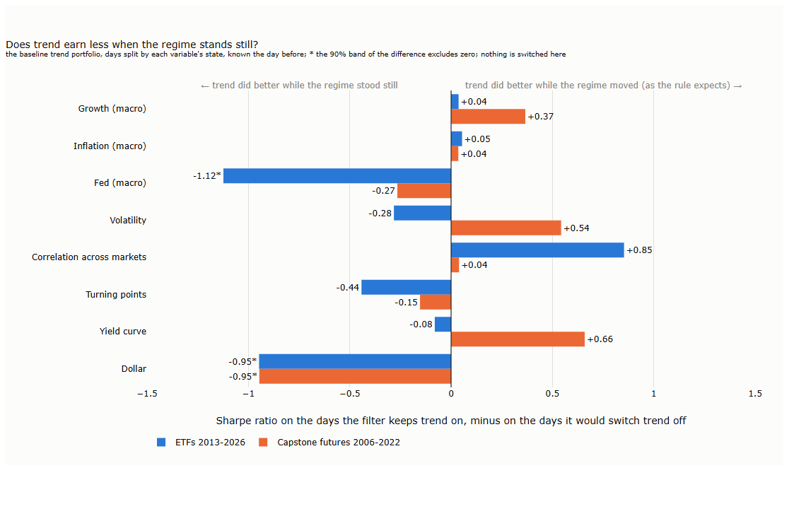
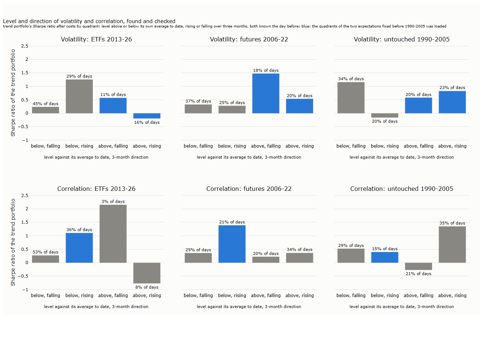

# Lecture 28: Part-Time Strategies

*Systematic Trading: Lecture Notes (MSc) · draft, Nov 15, 2026 · Max Gnesi*

Lecture 27's baseline trend portfolio is always in the market. A **regime filter** turns it into a **part-time strategy**: it steps aside when the economy or the markets are in a state where trend is expected to fail. This lecture asks whether that works with information known on the day, and, before that, how a strategy that is out of the market part of the time should be compared with one that never is. Two families of regime variables are tested side by side: **macro** (growth, inflation, the Fed; monthly, published late, revised) and **market state** (volatility, correlation, turning points, the yield curve, the dollar; daily, never revised). The scale is the opposite of Part IV's: there a strategy saw millions of events a day and a test had thousands of independent trials; here a regime lasts months, and twenty years hold a handful of episodes. The plan was fixed before any result was computed, and every change made after seeing results is dated and labelled ([results/hypotheses.md](results/hypotheses.md)).

## 1. Regime information as a switch

The same regime information can be used in two ways.

| | As a switch (this lecture) | As a strategy (Lecture 29) |
|---|---|---|
| Question | When should trend be held? | Does the regime itself earn a return? |
| What the regime does | Turns an existing strategy on and off | Sets the positions of a new strategy next to trend |
| Result | A part-time version of trend | A second return stream, judged by what it adds to trend |
| Idle capital | Stays idle | Used by the second strategy |

The switch comes first because it is the natural first idea and continues Lecture 8, which tested filters on single markets; here the filter switches the whole portfolio. This lecture also builds the regime series (known the day before, macro data as first published) that Lecture 29 reuses without testing them again.

**The rule in one sentence** (our proposal). *Trade trend while the regime is moving; step aside while it stands still*, where for each variable the unfavourable state was fixed before any result (§3). Off means the whole portfolio's target position is zero; it is reached a tenth of the way each day, like every position since Lecture 26, and every change costs 5 bp.

The lecture's result fits in one chart.


<sub><b>How to read the figure.</b> <b>Axes.</b> x: the share of days a filter keeps the baseline trend portfolio on; y: the portfolio's Sharpe ratio after costs over all days, idle days included (they earn the cash rate, zero excess return). Left: ETFs, out of sample 2013-2026; right: capstone futures 2006-2022. Dots: one per filter at its fixed threshold (blue: macro; orange: market state; green: both families combined). Dotted line: always in. Dashed curve: what time in the market alone gives, the always-in Sharpe ratio times the square root of the share of days on (Lecture 7 §4.3). Grey bars: 1,000 random switches per filter with the same time in the market and the same spell lengths, from their median to their 95th percentile. Our calculation.</sub>

The dots lie around the dashed curve: most of what a filter does to the Sharpe ratio over all days is explained by the time it spends out of the market, not by when it is out. On the ETFs every filter is below always-in (0.49). On the futures (always-in 0.55), four come near it or above it (growth still 0.63, both composites agreeing 0.56, the yield curve still 0.56, volatility low 0.54), and growth beats 95% of its random switches there; the same filter beats 50% of them on the ETFs. Under the verdict fixed in advance (beat 90% of random switches on both datasets, Benjamini-Hochberg at 10% within each family), **no filter works** on our data. The lecture shows how this was measured and what the data say about why, so that readers can judge the evidence themselves.

| § | Topic | Question |
|---|---|---|
| 2 | Comparing part-time with always-in | Which numbers answer which question, and what does each hide? |
| 3 | The regime variables | What do macro and market-state variables measure, and what does data revised later do to them? |
| 4 | The scan | Does trend earn less on the days a regime stands still? |
| 5 | The filters against luck | Does switching on these regimes beat always-in and random switching? |
| 6 | Why | What drives the patterns that appear, and do they repeat on years not used to find them? |
| 7 | One class at a time | A worked example: commodity trend by the shape of the futures curve |

## 2. Comparing a part-time strategy with always-in

A part-time strategy and an always-in strategy do not use their capital the same way, so no single number compares them. Lecture 7 (§4.3) showed the basic arithmetic for a system in the market a share $`p`$ of the time:

```math
\text{Sharpe ratio, all days} \;\approx\; \text{Sharpe ratio while on} \times \sqrt{p}, \qquad \text{return per unit of capital} \;\approx\; p \times \text{return while on}.
```

This section builds on it for a portfolio switched by a regime: which questions to ask, in which order, and what each answer leaves out.

### 2.1 The bar a switch must clear

A filter that knew nothing would leave the Sharpe ratio while on unchanged and lower the Sharpe ratio over all days by the factor $`\sqrt{p}`$. To match always-in over all days, the strategy must earn a Sharpe ratio while on of at least the always-in Sharpe ratio divided by $`\sqrt{p}`$:

| Share of days on, $`p`$ | 90% | 75% | 60% | 50% |
|---|---|---|---|---|
| Sharpe ratio needed while on, as a multiple of always-in | 1.05 | 1.15 | 1.29 | 1.41 |
| For the ETF baseline (0.49) | 0.51 | 0.56 | 0.63 | 0.69 |

<sub><b>How to read the table.</b> Each column is a filter that keeps trend on for the given share of days. The middle row is $`1/\sqrt{p}`$: how much better than always-in the days kept must be for the part-time strategy to match always-in over all days. The bottom row applies it to the ETF baseline. A definition, from the formula above.</sub>

The bar rises quickly: a filter that is off half the time must pick days on which trend earns a Sharpe ratio 41% higher than its average. The random filters of the key chart show the bar in practice: their medians sit close to the dashed curve. For the growth filter of §2.3 (on 59% of days on the futures) the formula gives 0.55 × √0.59 = 0.42 and its random filters' median is 0.43; on the ETFs (on 54% of days) 0.36 against 0.33.

The formula is a guide, not an identity. Positions move a tenth of the way each day, so the portfolio is still partly invested in the first days of an off spell and not yet fully invested in the first days of an on spell; switching also costs. The **random filter** with the same time in the market, the same spell lengths and the same attachment (Lecture 8 §4.5) includes all of this, which is why it, not the formula, is the yardstick of the verdict.

### 2.2 Six questions, six numbers

| Question | Number | Label | What it can hide |
|---|---|---|---|
| Does the account do better? | Sharpe ratio over all days | Definition (Lecture 7) | Where the change comes from: being out alone lowers it by $`\sqrt{p}`$ |
| Is trend better on the days it is held? | Sharpe ratio while on | Definition (Lecture 7) | The idle capital: a high number can come with a low return |
| What does the account earn as it is run? | Excess return a year per unit of capital | Definition | Risk: a lower return at much lower risk can be the better strategy |
| What would it earn at the same risk? | Return and worst drawdown, scaled after the fact to the always-in volatility | Convention (comparison only) | That running it needs leverage on the days on, and that the scale uses the whole sample |
| Is the timing information or chance? | Share of random filters with the same time in the market that it beats | Lecture 8 §4.5 | Nothing on its own about size: a filter can beat luck and still lose to always-in |
| Does it add what always-in cannot give? | Alpha: the intercept of its returns regressed on always-in's, with its t-statistic | Definition (Lecture 8, step 4) | Few independent episodes: macro regimes give wide bands |

<sub><b>How to read the table.</b> One row per question a reader may ask of a part-time strategy, the number that answers it, whether that number is a definition or a convention, and what it leaves out. No row settles the comparison alone.</sub>

The order matters. The first two numbers describe the strategy; the next two say what it does to an account; the last two say whether the timing carries information. A filter can pass the first and fail the fifth: it then earns its higher Sharpe ratio from being out of the market at random times, which any coin would do.

### 2.3 One running example: the growth filter on the futures

The growth filter switches trend off while US industrial production growth is still: the size of the 12-month change in its year-on-year growth rate is in the bottom third of its history to date, on data as first published (§3). It is the filter that came closest to working, so it shows every number of §2.2 at once.

| | Always in | Growth filter (part-time) |
|---|---|---|
| Share of days on | 100% | 59% |
| Sharpe ratio while on | 0.55 | 0.72 |
| Sharpe ratio over all days | 0.55 | **0.63** |
| Volatility | 11.1% | 8.3% |
| Excess return a year, as run | **6.1%** | 5.3% |
| Excess return a year, scaled to 11.1% volatility (× 1.34) | 6.1% | 7.0% |
| Worst drawdown, as run / scaled to 11.1% | −21.8% | −12.5% / −16.5% |
| Random filters with the same time in the market: median, 95th percentile | | 0.43, 0.64 |
| Share of random filters beaten | | 95% |
| Alpha over always-in, a year (t-statistic) | | 1.7% (1.4) |
| The same filter on the ETFs: Sharpe ratio over all days, random filters beaten | 0.49 | 0.33, 50% |

<sub><b>How to read the table.</b> Capstone futures 2006-2022, after costs; excess returns over cash; idle days earn zero excess return. "Scaled" multiplies the part-time strategy's daily returns by the ratio of the two volatilities over the whole sample (1.34), a comparison, not a strategy that could have been run. The last row is the same filter on the ETFs, 2013-2026. Our calculation.</sub>

The example shows the trade-off a part-time strategy brings. Over all days its Sharpe ratio is higher than always-in's (0.63 against 0.55), its drawdowns smaller and it beats 95% of random filters; **yet it earns less**: 5.3% a year against 6.1%, because 41% of the time its capital is idle. It earns more only when scaled up to the same risk, which means running it with a third more leverage on the days it is on, or giving its idle budget to something else. On the ETFs the same rule beats half its random filters, no better than a coin.

### 2.4 What the comparison cannot settle

Which of the two deserves the capital depends on what the idle capital can do. Lecture 7 (§4.3) laid out the cases: with committed capital and limited leverage, return per unit of capital decides; with capital that can be moved, the Sharpe ratio while on and the fit with the rest of the portfolio decide. A portfolio switched by a regime makes the second case concrete: the idle budget can be given to another strategy that does well in the regimes where trend is off. That is the question of Lecture 29, which uses the same regimes as strategies.

This lecture reports all six numbers for every filter and keeps its own reading short and labelled.

## 3. The regime variables

### 3.1 Two families

| | Macro variables | Market-state variables |
|---|---|---|
| What they measure | The economy and policy | Prices themselves |
| Updated | Monthly, published weeks late | Daily, known at the close |
| Revised later | Yes: only data as published at the time are used | Never |
| Independent episodes in twenty years | A handful | Many |
| Strength / weakness | A mechanism / late, revised, few episodes | Timely / noisy, overlaps with trend's own signal |

<sub><b>How to read the table.</b> The two kinds of regime variable tested in this lecture, compared on how they are measured and what that implies for a test. Our summary.</sub>

Every variable has an **unfavourable state**, fixed before any result with its reason (our proposal, following the literature where it exists). For most it is "still": the regime is not moving, so trend has little to follow.

| Family | Variable | Measured as | Off when | Why |
|---|---|---|---|---|
| Macro | Growth | US industrial production, year-on-year growth; the size of its 12-month change | Bottom third of its history | A stable economy gives few persistent moves |
| Macro | Inflation | US CPI, year-on-year; the size of its 12-month change | Bottom third | Trend earned in inflation shocks of either sign and least in stable inflation (Neville et al., 2021) |
| Macro | Fed | Fed funds target (upper bound from December 2008) | No change in six months (on hold) | A moving policy rate drives persistent moves in rates, currencies and risk assets |
| Market | Volatility | VIX, 21-day average | Bottom third | The "still" reading of the rule; earlier evidence says volatility does not predict trend (Lecture 8; Goulding, Harvey and Mazzoleni, 2023) |
| Market | Correlation | Average absolute pairwise correlation of the baseline's markets over six months | Top third | Many trends become one bet and reverse together (Hurst, Ooi and Pedersen, 2017) |
| Market | Turning points | Share of markets whose 1-month and 12-month returns disagree in sign | Top third | Disagreement between fast and slow trends marks turns (Goulding, Harvey and Mazzoleni, 2023) |
| Market | Yield curve | 10-year minus 2-year Treasury yield; the size of its 12-month change | Bottom third | A still curve gives rates little to trend on |
| Market | Dollar | Broad trade-weighted dollar; the size of its 12-month change in percent | Bottom third | A still dollar gives currencies and commodities little to trend on |

<sub><b>How to read the table.</b> One row per regime variable: what is measured, the state in which the filter switches trend off, and the reason fixed in advance. "Bottom (top) third of its history" means of the variable's own history up to the day before (at least five years for market-state variables; the full history of the data vintage in use for macro variables). Every input is lagged one trading day. Composites: macro off when at least two of three are off; market state off when at least three of five are; "both agree" off when both composites are, "either" when one is.</sub>

### 3.2 Data as first published, and the price of look-ahead

Macro data are revised for years after first publication, so a test on today's data uses numbers nobody had at the time. Industrial production and CPI are therefore taken from the Philadelphia Fed's Real-Time Data Set (free): one vintage a month, each holding the full history as it was known then, used from the 16th of its month. The Fed's target rate is never revised.

How much does this matter? The growth × inflation quadrant (whether each is rising or falling over twelve months) is a common way to describe the macro regime. On revised data, **19% of days on the ETFs and 22% on the futures fall in a different quadrant** than on data as first published, and the trend portfolio's Sharpe ratio by quadrant changes with them:

| Quadrant | ETFs: first published | ETFs: revised | Futures: first published | Futures: revised |
|---|---|---|---|---|
| Growth down, inflation down | 0.50 | 0.26 | 0.06 | 0.12 |
| Growth down, inflation up | 0.12 | −0.04 | **1.12** | **0.39** |
| Growth up, inflation down | 0.26 | 0.28 | 0.44 | 0.28 |
| Growth up, inflation up | **0.77** | **1.17** | **0.50** | **1.25** |

<sub><b>How to read the table.</b> Rows: the four growth × inflation quadrants, each the sign of the 12-month change in US industrial production growth and in CPI inflation. Cells: the baseline trend portfolio's Sharpe ratio after costs on the days in that quadrant, with the quadrant read from data as first published (as a trader would have seen it) or from today's revised data. Bold: pairs that differ by 0.4 or more. ETFs 2013-2026, futures 2006-2022. Our calculation.</sub>

On revised data the futures' best quadrant moves from "growth down, inflation up" to "growth up, inflation up". A regime map drawn on revised data describes a history no trader saw. This is a demonstration fixed in the plan, not a hypothesis; the quadrants are not used as a filter, because the literature gives no clear direction for trend by quadrant.

## 4. The scan: does trend earn less when the regime stands still?

Before switching anything, the scan splits the baseline's days by each variable's state and compares the Sharpe ratio on the two sides. Nothing is traded; the scan shows whether there is anything for a switch to find.


<sub><b>How to read the figure.</b> <b>Axes.</b> x: the baseline trend portfolio's Sharpe ratio after costs; y: one row per regime variable (shaded: macro, data as first published; unshaded: market state). Blue dot: the days the filter would keep trend on (regime moving); orange cross: the days it would switch trend off (regime still; for correlation and turning points, crowded and turning); dotted: all days. Left: ETFs 2013-2026; right: capstone futures 2006-2022. Fixed thresholds; every regime known the day before. Our calculation.</sub>

**Result.** No variable separates the days in the planned direction on both datasets with a 90% band (block bootstrap over months) that excludes zero. Two separate in the **opposite** direction:

- **Dollar.** Trend earned more when the dollar stood still: ETFs 1.06 against 0.11, futures 1.27 against 0.32; both bands exclude zero.
- **Fed.** Trend earned more with the Fed on hold: ETFs 1.13 against 0.01 (band excludes zero); futures 0.69 against 0.41.

The yield curve goes the planned way on the futures (still 0.09, moving 0.73; band of the difference −0.15 to 1.43) but not on the ETFs. Growth, inflation, turning points and correlation show no clear difference.

**ETFs against futures.** The two datasets seem to disagree on several variables. On the years they share, 2013-2022, they do not: the two baselines are 0.75 correlated and give nearly the same picture for growth, the Fed, volatility and the dollar. The differences come from the futures' years 2006-2012, when several relations ran the other way (volatility still −0.59 against moving 0.97). The effect of a regime on trend changes between periods; with a handful of macro episodes, this is what a reader should expect.

## 5. The filters against luck

Each filter now switches the baseline off in its unfavourable state, with the costs and the gradual attachment of §1, and is judged by the six numbers of §2.


<sub><b>How to read the figure.</b> <b>Axes.</b> x: Sharpe ratio after costs over all days; y: one row per filter (shaded top: macro; middle: market state; shaded bottom: both families). Blue dot: the filter at its fixed threshold. Grey: 1,000 random filters with the same time in the market and the same spell lengths, from their median (tick) to their 95th percentile (end of the bar). Dotted: always in. Left: ETFs 2013-2026; right: capstone futures 2006-2022. Our calculation.</sub>

**Verdict (as fixed): no filter works.** None beats 90% of its random filters on both datasets, and none passes Benjamini-Hochberg at 10% within its family.

| | ETFs 2013-2026 | Capstone futures 2006-2022 |
|---|---|---|
| Always in | 0.49 | 0.55 |
| Filters above always-in | none | growth still (0.63), both agree (0.56), yield curve still (0.56) |
| Best against luck | correlation high: 0.52, beats 85% | growth still: beats 95% (on the ETFs: 50%) |
| Worst against luck | Fed on hold: −0.05, beats 2% | dollar still: 0.28, beats 6% |
| Threshold grid (quarter, third, half) | every filter below always-in at every threshold except correlation (0.48, 0.52, 0.51) | growth 0.54, **0.63**, 0.56: above always-in at two of three |

<sub><b>How to read the table.</b> Sharpe ratios after costs over all days. "Beats" is the share of the filter's 1,000 random filters with a lower Sharpe ratio. The threshold grid moves the cut-off between the bottom quarter, third and half of the variable's history (top quarter, third and half for correlation and turning points). Our calculation; every filter and every measure in [results/filters.json](results/filters.json).</sub>

The three expectations fixed in the plan:

1. **Market-state filters react sooner but trade more** — met. Turning points switch 40 to 47 times a year; on the ETFs that filter's alpha over always-in is −1.9% a year (t-statistic −2.6).
2. **Macro filters switch rarely and late** — met. They switch one to three times a year, so each result rests on a few long spells.
3. **Both families together beat either alone** — not met. Neither combination beats its random filters on both datasets.

The two variables that separated the scan the "wrong" way, the dollar and the Fed, are the worst filters: they switch trend off on the days the scan showed were good. Reversing them after seeing this would be a new hypothesis found in the data, not a result (Lecture 8 §4.6).

## 6. Why: exploring the patterns

This section is **exploration after the results**, labelled as such. It asks what drives the patterns of §4 and whether a refined version repeats on data it was not found in.

### 6.1 The Fed and the dollar

**Fed on hold.** On the ETFs the pattern is one episode. The Fed was on hold all year in 2013-2015 and 2021, years of zero rates, and 2014 alone gave +24.9% on hold days. Every asset class earned a little more on hold days, so no single market explains it. On the futures 2006-2012 the relation ran the other way: the fast cuts of 2007-2008 were good for trend. A regime label that stands for one or two episodes describes history; it does not identify a mechanism.

**Dollar still.** Here the pattern is spread over many years: still days beat moving days in 2017-2021 and 2024-2026, mostly through equity and currency trends, and the sign is the same in all three windows of §4 (ETFs, futures, shared years). Why sharp dollar moves coincide with weak trend returns is an **open question** (§8.2).

### 6.2 Level and direction

A level alone may hide what matters: whether volatility or correlation is building up or fading. Splitting each variable's level into fifths of its history to date, and each fifth into days after a 3-month rise or fall:


<sub><b>How to read the figure.</b> <b>Axes.</b> x: the level of the VIX (top) or of the average correlation across markets (bottom), as a fifth of its own history to date; y: the baseline trend portfolio's Sharpe ratio after costs on the days in that cell. Orange: the level rose over the past three months; blue: it fell. Left: ETFs 2013-2026; right: capstone futures 2006-2022. Both known the day before. Cells hold between 0% and 32% of days. Our calculation.</sub>

- **Volatility.** Rising volatility helps at moderate levels and stops helping at the highest (ETFs: −0.42, 2.52, 0.83, 0.79, −0.81 from the lowest to the highest fifth; futures 0.02, 0.56, 0.24, 1.02, 0.26). The best cell on both datasets is the highest fifth while volatility falls, after a spike (1.29 and 1.67).
- **Correlation.** Rising correlation from a middle level is the best cell on both (1.68 and 1.56). Unlike volatility, correlation falling from its highest level is not good.

### 6.3 Four quadrants, found and checked

Five fifths and two directions make ten cells, some with almost no days. Four quadrants are simpler: the level above or below its own average to date, rising or falling over three months. From the ETFs and the futures, two statements were fixed **before** a third sample was loaded:

- **E1.** Correlation below its average and rising is the best of the four correlation quadrants (trends start to line up).
- **E2.** With volatility above its average, trend earns more while volatility falls than while it rises (after a spike positions pay; while volatility still climbs they are whipsawed).

The third sample is 1990-2005, years no test of this course had used for this question: a 12-market trend portfolio from free long series (four equity indices, two US Treasury maturities, four currencies, crude oil and natural gas) with the baseline's rules, Sharpe ratio 0.64; for volatility, the VXO, the original VIX. It is cruder than the baseline (spot and price series), so the check is about the ranking of the quadrants, not the size of the Sharpe ratios.


<sub><b>How to read the figure.</b> <b>Axes.</b> x: the four quadrants, the level against its own average to date and its direction over three months, both known the day before; y: the trend portfolio's Sharpe ratio after costs on the days in that quadrant (label: share of days). Top: volatility (VIX; VXO for 1990-2005); bottom: correlation across the portfolio's markets. Columns: ETFs 2013-2026 and futures 2006-2022, where the statements were found; 1990-2005, where they were checked. Blue: the quadrants named by E1 and E2. Our calculation.</sub>

**Result.** Neither statement repeats. E2: above-falling 0.58 against above-rising 0.82 (difference −0.24; 90% band −1.43 to +0.99). E1: the best correlation quadrant of 1990-2005 is above-rising (1.35); below-rising earns 0.40, 0.29 below the rest (band −1.55 to +0.97). Every band is about one Sharpe-ratio unit wide on each side.

*A correction, dated 2026-11-15.* E1 was fixed as holding on both datasets. Drawing this chart showed that on the ETFs the best correlation quadrant was above-falling (2.15, on 3% of days), not below-rising (1.10): E1 held on the futures only. The check on 1990-2005 is unaffected.

**Our reading (labelled).** On our data, quadrant patterns in volatility and correlation are specific to the period in which they were found. The lesson is the method: look, state the pattern before checking it, check it on years it was not found in, and report what happened.

## 7. One class at a time: commodity curves

*To be added: the commodity trend sleeve of the capstone futures, by backwardation and contango, as a worked example of a per-class switch.*
