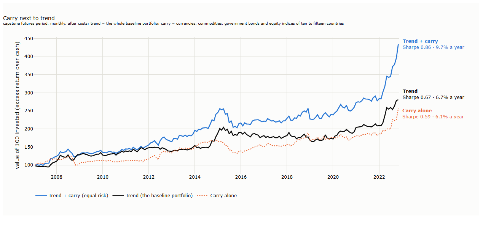

# Lecture 29: Carry and Value

*Systematic Trading: Lecture Notes (MSc) · draft, Nov 16, 2026 · Max Gnesi*

Lecture 28 tried to avoid trend's bad regimes by switching trend off, and no switch passed the test fixed in advance. This lecture takes the other answer to the same problem: hold, next to trend, strategies that earn for different reasons, so that they tend to earn when trend does not, without anyone forecasting the regime. The two best-documented candidates across asset classes are **carry**, what a position earns if prices stand still, and **value**, buying what is cheap against its own past. Both are built across four groups, currencies, commodities, government bonds and equity indices, and judged by what they add to trend. Where a published version exists, ours is checked against it, and every difference is shown with what it costs in agreement. The plan was fixed before any result was computed, and every change made after seeing results is dated and labelled ([results/hypotheses.md](results/hypotheses.md)).

## 1. A second business next to trend

| § | Topic | Question |
|---|---|---|
| 1 | A second business next to trend | What does carry add to trend, in one chart? |
| 2 | Why after Lecture 28 | Why hold another strategy rather than switch trend off? |
| 3 | The published versions and ours | How does AQR build carry and value, and where do we differ? |
| 4 | Carry | What does each group earn, and how is the signal built? |
| 5 | Value | Why is value weak in this period? |
| 6 | Results | Does carry beat luck, and what does it cost in crashes? |
| 7 | What did not add | Which refinements failed, and what does that teach? |
| 8 | Summary | Takeaways, exercises, reading |

The lecture's central result fits in one chart.

<b>How to read the figure.</b> <b>Axes.</b> x: time, January 2007 to October 2022, monthly (the capstone futures run out in December 2022); y: the value of 100 invested, excess return over cash, after costs. Black: trend, Lecture 27's baseline portfolio **across all its markets** (not trend on the carry markets). Dotted orange: carry alone, currencies, commodities, government bonds and equity indices together (§4). Blue: trend and carry at equal risk, the total scaled on its past to trend's risk. At the right: each line's Sharpe ratio and compound return a year. Our calculation ([results/key.json](results/key.json)).

Carry alone earned about what trend did (Sharpe ratio 0.59 against 0.67), but at different times: the two are almost uncorrelated (0.06). Held together at the same total risk, they earned more than either (0.86, 9.7% a year against 6.7%), with a worst loss about as deep as trend's alone (−20.6% against −19.3%). That is the whole case for a second strategy: not a better forecast, but a different source of return. The rest of the lecture asks whether the result is real (it beats all of 1,000 random strategies, §6), what it costs (carry adds sudden losses, §6), where it fails (the ETF years 2013-2026, §6), and which refinements did not help (§7). Value, the second candidate, did not earn in this period (§5).

## 2. Why after Lecture 28: a switch against a second business

Lecture 28 and this lecture answer the same problem, that trend loses money in some regimes, in two ways.

| | Switching trend (Lecture 28) | A second strategy (this lecture) |
|---|---|---|
| What changes | Trend is turned on and off | Carry and value are held next to trend, always in |
| What it needs | A forecast, on the day, of when trend will do badly | A different reason to earn; no forecast |
| Idle capital | Stays idle: a switch can only take away | None: every strategy is always in |
| Judged against | Random switching with the same time in the market | Random strategies on the same markets, added to trend the same way |
| Result on our data | No switch passed; the strongest pattern ran against the plan | Carry passes; value does not |

*Analogy (labelled):* a fisherman can stay in port when a storm is forecast, or also own an umbrella shop. The shop earns in storms without anyone forecasting them. A switch needs the forecast; a second business needs only that its customers come for a different reason.

Why carry and value, rather than strategies built from Lecture 28's regimes? They are the two cross-asset styles with the longest published record next to trend (momentum): Asness, Moskowitz and Pedersen (2013) for value and momentum, Koijen, Moskowitz, Pedersen and Vrugt (2018) for carry. Their returns come from different sources. Trend earns when prices keep moving; carry earns the income of a position while prices stand still; value earns when prices return towards a long-run level. A strategy that earns for a different reason is the "many small edges" of Lecture 1 §5.4 in practice.

Lecture 28's regimes are not thrown away: they are where carry and value are judged (§6), above all in the regimes where trend lost.

## 3. The published versions and ours

Carry and value have published constructions. Rebuilding them from free data forces choices, and each choice is a chance to differ from the literature, by necessity or by design. This section shows the published construction, ours, the reason for each difference, and the evidence of what it costs: the correlation of our series with AQR's published one, month by month, 2006 to October 2022. The pattern of the table, not its entries, is the point: a reader building a version of their own will face the same kinds of choices.

**The published series.** AQR publishes monthly returns of the value and momentum factors of Asness, Moskowitz and Pedersen (2013), by asset group, free in its data library ("Value and Momentum Everywhere: Factors, Monthly", AQR Capital Management, LLC). They are paper portfolios before costs, on more markets than ours. AQR publishes no carry factor in the free library; Koijen et al. (2018) describe the construction.

| Group | Published construction | Ours | Why we differ | Our value against AQR's (correlation) |
|---|---|---|---|---|
| **Currencies** | Value: 5-year change in the real exchange rate; 10 developed currencies. Carry: the interest-rate gap from forward rates | 9 currencies against the dollar, returns from spot rates plus the 3-month rate gap (FRED). Value: BIS real effective exchange rates. Carry: the rate gap | Free data; the same idea | **0.78** |
| **Commodities** | Value: price today against its average 4.5 to 5.5 years ago (5-year reversal); 27 commodities. Carry: slope of the futures curve | 7 commodities (capstone futures). Value: the same on the front contract's price. Carry: front against the contract 12 months later | No free clean futures for more commodities; 12 months removes the seasons | 0.53 |
| **Government bonds** | Value: 5-year change in 10-year yields; 10 countries, futures. Carry: term spread plus roll-down | 9 countries, returns built from each central bank's 10-year yield (no free bond futures). Carry: the term spread | No free bond futures; month-end yields from nine central banks | 0.69 |
| **Equity indices** | Value: book-to-market; 18 countries, futures. Carry: dividend yield minus the rate, from the futures | 15 country funds, hedged into dollars. Value: price against its past. Carry: the S&P 500's **earnings yield** minus the real bill rate; elsewhere the dividend yield minus the real cash rate | Book values are not free per country; earnings, not dividends, are what a holder accrues (buybacks), but free earnings exist only for the US | 0.46 |
| **Across groups** | Ranked within each group, equal risk across groups | The same, but weighted by a carry *score* rather than a rank (§4), and value against a 10-year trend line (§5) | Our design choices, tested against the published versions (§5, §7) | – |

<b>How to read the table.</b> One row per group. "Published": Asness, Moskowitz and Pedersen (2013) for value, Koijen et al. (2018) for carry. "Ours": what this lecture builds from free data. The last column is the correlation of the monthly returns of our value strategy, built with the published construction, with AQR's published value factor for the same group, 2006 to October 2022. Our calculation.

The agreement follows the universe. Where ours is nearly the same as AQR's, currencies, the two series move together (0.78); where we hold a fraction of the markets, commodities, or measure value differently, equity indices, agreement falls. Two of our first versions agreed far worse, and the comparison is what exposed them:

- **Bonds as two US maturities.** The first bond group held two US Treasury funds, a 5-year and a 20-year. Ranking them is a bet on the shape of the US curve, not on which country's bonds are cheap. Agreement with AQR was 0.19, and bond carry lost money. Rebuilt as nine countries, agreement rose to 0.69 and bond carry earned.
- **Equities as two US indices.** The S&P 500 against the Nasdaq-100 is not a value universe either: agreement 0.07. Rebuilt as fifteen countries: 0.46.

**What to take from this.** A published strategy is a family of choices, not a recipe (Lecture 1). Checking a rebuild against the published series early is cheap, and it catches errors that a backtest alone does not: both flaws above produced plausible-looking numbers.
