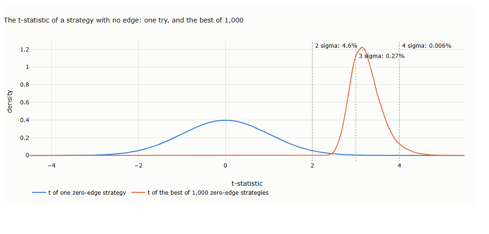
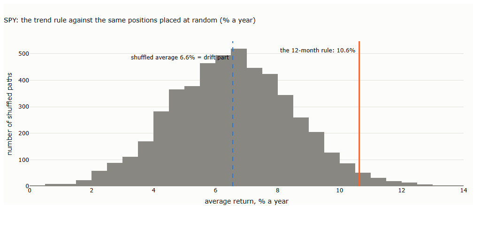
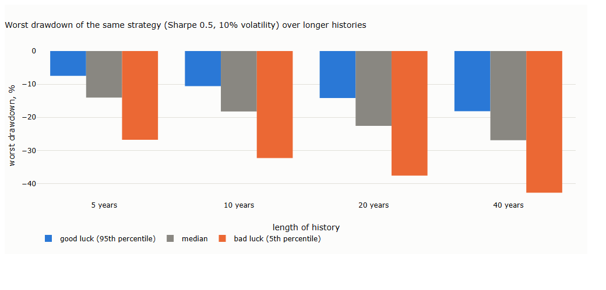

# Reading the evidence: a statistics toolkit

A reference page for the whole course. The lectures use a handful of statistics again and again: standard errors, t-statistics, Sharpe ratios, correlations, shuffles and bootstraps. Each card below explains one of them the same way: the plain question it answers, how it works, what it means on our own data, and what to watch out for. Every number on this page is computed in the [notebook](statistics_toolkit.ipynb), whose sections name the card they serve, on the monthly and daily ETF closes of Lecture 5 (to September 2026) and on simulations with fixed seeds.

The page does not repeat what the lectures already teach where they need it: volatility estimators, skew and kurtosis, beta and alpha (Lecture 3); the effective number of independent bets (Lecture 11); the checks that tell noise from an edge (Lecture 1 §5.3).

| Group | Card | The plain question | First used |
|---|---|---|---|
| **Returns and averages** | [1. Log and simple returns: which adds up where](#1-log-and-simple-returns-which-adds-up-where) | Which return adds up over time, and which across a portfolio? | Lecture 2 |
|  | [2. Arithmetic or geometric: the bet, the growth and the size](#2-arithmetic-or-geometric-the-bet-the-growth-and-the-size) | Which average judges the bet, and which the money an investor ends with? | Lecture 1 |
|  | [3. Annualising: the square root of time](#3-annualising-the-square-root-of-time) | Can a daily figure be turned into a yearly one by √252? | Lecture 1 |
| **Noise in an estimate** | [4. Standard error and t-statistic](#4-standard-error-and-t-statistic) | How far from zero is it, in units of its own noise? | Lectures 1, 5 |
|  | [5. What 2, 3 and 4 sigmas mean](#5-what-2-3-and-4-sigmas-mean) | How often would luck alone produce a number this far out? | Lecture 1 |
|  | [6. The Sharpe ratio's standard error](#6-the-sharpe-ratios-standard-error) | How many years before a Sharpe ratio means something? | Lecture 1 |
|  | [7. When the sigma is wrong](#7-when-the-sigma-is-wrong) | When is a t-statistic too high? | Lecture 7 |
| **Luck and many tries** | [8. Many tries](#8-many-tries) | How good does the best of many tries look by luck? | Lectures 1, 7 |
|  | [9. Shuffle and bootstrap](#9-shuffle-and-bootstrap) | What would luck produce on our own data? | Lectures 3, 7 |
| **Describing data and relationships** | [10. Median, percentiles and rank correlation](#10-median-percentiles-and-rank-correlation) | Can a few extreme points move the answer? | Lecture 1 |
|  | [11. Correlation and its noise](#11-correlation-and-its-noise) | How many observations before a correlation means something? | Lecture 3 |
|  | [12. R²: how much a forecast explains](#12-r-how-much-a-forecast-explains) | How much does a forecast explain, and what is that worth? | Lecture 7 |
| **Risk** | [13. The worst drawdown to expect](#13-the-worst-drawdown-to-expect) | Which drawdown should the Sharpe ratio make us expect? | Lecture 1 |

<sub><b>How to read the table.</b> One row per card, in five groups that build on each other: what returns and averages are; how noisy an estimate is; how far luck goes; how to describe data and relationships; and the risk to expect. For each card, its plain question and the lecture where the statistic first matters.</sub>

---

## 1. Log and simple returns: which adds up where

**Key message.** Log returns add up over time; simple returns add up across the positions of a portfolio. Each is right for its own sum, and the classic mistakes come from using one for the other's.

**How it works.** The simple return of a day is today's price divided by yesterday's, minus 1; the log return is the natural log of the same ratio, $`\ln(P_t/P_{t-1})`$. For small moves they are almost equal (1% simple is 0.995% log), but each adds up in one direction only:

| | Over time (day after day) | Across assets (a portfolio on one day) |
|---|---|---|
| Log returns | **Add up** | Do not add up |
| Simple returns | Compound: $`(1+r_1)(1+r_2)-1`$ | **Add up:** the portfolio's return is the weighted sum |

<sub><b>How to read the table.</b> Which return to use for which sum.</sub>

- **Over time.** A stock rises 10% on day 1 and falls 10% on day 2: 100 becomes 110, then 99. The simple returns add to 0%, which is wrong; the log returns, +9.53% and −10.54%, add to −1.01%, exactly $`\ln(0.99)`$.
- **Across assets.** Half the money in A, half in B; A rises 10% and B falls 10%: 50 + 50 becomes 55 + 45, unchanged. The weighted simple returns give 0%, which is right; the weighted log returns give −0.50%, which is wrong.

**The gap across assets has a name: the diversification return** (Booth and Fama, 1992). A rebalanced portfolio's log return exceeds the weighted average of its assets' log returns by about half the difference between the assets' average variance and the portfolio's variance:

```math
r_{\log,\,\text{portfolio}} \;\approx\; \sum_i w_i\, r_{\log,\,i} \;+\; \tfrac12\Big(\sum_i w_i\,\sigma_i^2 \;-\; \sigma_p^2\Big)
```

**On our data.** The 16 ETFs of Lecture 5, equally weighted and rebalanced monthly from mid-2006 to September 2026: the assets average 23% volatility, the portfolio 14%. The portfolio's log return is 8.4% a year, the weighted average of the assets' log returns only 6.7%: a gap of 1.7 points, close to the 1.8 the formula predicts. Whether the gap is a gain from rebalancing or only the drag that diversification avoids is debated (Willenbrock, 2011); the arithmetic is the same either way.

**Which return where: a recipe.**

| Step | Use | Why |
|---|---|---|
| 1. An asset's history: signals, lookbacks, volatility | Log returns | They add over time and treat rises and falls symmetrically |
| 2. The portfolio's return on one day | Simple returns, weighted: $`r_p = \sum_i w_i r_i`$, weights held at the start of the day | Only simple returns add across positions |
| 3. The equity curve | Compound: $`\prod (1 + r_p)`$; or, for an account that keeps its capital fixed, add the $`r_p`$ | It is the money actually there; say which account a curve shows |
| 4. Sharpe ratio, volatility, t-test of the average | Simple (excess) returns of the portfolio | They judge the average bet (card 2) |
| 5. Growth (compound annual return) | The average of $`\ln(1 + r_p)`$ | What is left after the volatility drag (card 2) |
| 6. Drawdowns | The equity curve of step 3 | A drawdown is a fall in money |
| 7. Who earned what | Simple contributions $`w_i r_i`$, summed over the year as an approximation | They add up exactly within a day, approximately over a year |

<sub><b>How to read the table.</b> One row per step of building and judging a portfolio, in order. For daily data the two kinds differ only in the second decimal, so steps 1 and 4 hardly depend on the choice; steps 2, 3, 5 and 6 do, because they add up across assets or over long periods.</sub>

**Watch out for** the four classic mistakes, one per step:
- **Log returns added across assets** (step 2): the diversification return is lost, 1.7 points a year on our ETFs. A per-asset profit of position × log return carries the same error, about $`\tfrac12\sigma^2`$ a year per unit held long, in the other direction when short. It can even create a finding: in Lecture 6 §3.1 it made a trend system's crisis "smile" look significant (t = 2.0) when, measured correctly, it is not (t = 1.0).
- **Simple returns added over time** (step 3): +100% then −50% becomes +50%.
- **A Sharpe ratio quoted as growth** (steps 4 and 5): card 2.
- **A drawdown from summed returns** (step 6) presented as a fall in money: at a 30% drawdown the two differ by about 4 points.

## 2. Arithmetic or geometric: the bet, the growth and the size

**Key message.** The arithmetic mean of simple returns, and the Sharpe ratio built on it, judge **the bet**. The geometric mean, the average log return, measures **the money**: it is the growth rate of the median investor's wealth. The gap between them is the volatility drag, about half the variance, and it depends on the size at which the bet is held.

**How it works.**

```math
\bar r_{\text{simple}} \;\approx\; \bar r_{\log} + \tfrac{1}{2}\sigma^2, \qquad \text{median wealth after } T \text{ years} \;\approx\; e^{\,T\,\bar r_{\log}}, \qquad g \;\approx\; \sigma\big(\mathrm{SR} - \tfrac12\sigma\big)
```

| Symbol | Meaning |
|---|---|
| $`\bar r_{\text{simple}}`$, $`\bar r_{\log}`$ | Average simple and average log return: the arithmetic and the geometric mean |
| $`g`$ | Growth of money, the compound annual excess return, for a strategy with Sharpe ratio SR held at volatility $`\sigma`$ |

**Why the average log return gives the median**, in three steps:

| Step | Statement | Why |
|---|---|---|
| 1 | Log wealth after $`T`$ years is the sum of the yearly log returns: $`\ln W_T = \sum_t r_{\log,t}`$ | Log returns add up over time (card 1) |
| 2 | The median of $`\ln W_T`$ is its mean, $`T\,ar r_{\log}`$ | A sum of many returns is close to a symmetric bell curve, and the middle of a symmetric distribution is its average |
| 3 | The median of $`W_T`$ is $`e^{\,T\,ar r_{\log}}`$ | Taking the exponential keeps the order of the outcomes, so the middle path in logs is the middle path in money |

<sub><b>How to read the table.</b> Three steps from log returns to the median investor's wealth. The mean of $`W_T`$ does not follow the same way: the exponential stretches the good paths more than it shrinks the bad ones, which is why the mean ends above the median.</sub>

**On our data.**
- **SPY:** an average simple return of 11.4% a year, an average log return of 10.3%; the gap, 1.1 points, is half the variance.
- **Twenty years, 7% log return, 20% volatility, 20,000 simulated paths:** the median path ends at 4.08 times its start, matching $`e^{20 \times 0.07} = 4.06`$; the mean ends at 6.05, and two paths in three end below it.
- **The extreme case:** +100% then −50% has an arithmetic mean of +25% and a volatility of 75%, a Sharpe ratio of 0.33 a period, yet the money is back where it started: the log returns, +69% and −69%, average zero.

**The same bet at different sizes.** A strategy with a Sharpe ratio of 0.5:

| Held at volatility | Sharpe ratio | Growth of money, % a year | Sharpe ratio built on growth |
|---|---|---|---|
| 10% | 0.50 | 4.5 | 0.45 |
| 20% | 0.50 | 8.0 | 0.40 |
| 50% | 0.50 | 12.5 (the most) | 0.25 |
| 100% | 0.50 | 0.0 | 0.00 |

<sub><b>How to read the table.</b> One strategy held at four sizes. The Sharpe ratio stays the same; growth, from $`g \approx \sigma(\mathrm{SR} - \tfrac12\sigma)`$, rises up to a volatility equal to the Sharpe ratio (the Kelly point, Lecture 9) and then falls; a Sharpe ratio built on growth, sometimes reported as a "geometric" Sharpe ratio, falls with every step up in size.</sub>

So a Sharpe ratio built on growth mixes two decisions, how good the bet is and how large it is held, and cannot compare strategies run at different sizes; its standard error also has no simple form. Practitioners keep the two apart: AQR's note on high-volatility alternatives (2024) rests on the ordinary Sharpe ratio staying the same under leverage, and places the drag at the level of the whole portfolio. At the 10% volatility of our trend portfolios, the two versions differ by 0.05; at 100% they tell different stories.

**When to use which.**

| The question | Use |
|---|---|
| How good is the bet? Which strategy is better? Is it significant? | Arithmetic mean and the Sharpe ratio: independent of size, with a known standard error (card 6) |
| What to expect next period; inputs to a portfolio optimiser | Arithmetic mean: expected returns add across positions |
| What did an investor end with? What will the typical investor end with? | Geometric mean: the compound annual return, with the worst drawdown (card 13) |
| How much does volatility cost? | Both: the gap, about $`\tfrac12\sigma^2`$ |

<sub><b>How to read the table.</b> One row per question and the mean that answers it. When volatility is low the two hardly differ; when it is high, report both.</sub>

A published example reports both. Levine, Ooi, Richardson and Sasseville (2018), on commodity futures since 1877, build their results on arithmetic returns, because "the sum of geometric returns of the individual assets does not itself equal a geometric return of the asset portfolio"; they add geometric means because for single commodities the two diverge: 5.0% a year arithmetic against 1.1% geometric on average (NBER working paper version). That gap is the debate of Lecture 5 §3.1: Erb and Harvey (2006) look at single commodities, where the geometric mean is near zero; Gorton and Rouwenhorst (2006) at an index, where diversification shrinks the gap (card 1).

**Watch out for:**
- **Average simple returns presented as what an investor earned.** They overstate it, the more so the higher the volatility.
- **The Sharpe ratio is the same at any size only approximately.** Borrowing above the risk-free rate, costs that grow faster than size such as market impact (Lecture 19), limits that bind at high leverage such as margin calls, and a volatility target that moves the weights over time (a different strategy, Lecture 9) all change it.
- **Sizing near the Kelly point.** Growth peaks there, but the Sharpe ratio behind it is only an estimate (card 6) and drawdowns deepen fast (card 13); practitioners stay well below it.

## 3. Annualising: the square root of time

**Key message.** Multiplying a daily volatility by √252, or a monthly one by √12, is exact only if returns are independent. Trending returns make the yearly volatility larger; reverting returns make it smaller.

**How it works.** The variance of a sum of $`n`$ returns is

```math
\mathrm{Var}\Big(\sum_{i=1}^{n} r_i\Big) \;=\; n\,\sigma^2 \Big(1 + 2\sum_{k=1}^{n-1}\big(1-\tfrac{k}{n}\big)\rho_k\Big)
```

| Symbol | Meaning |
|---|---|
| $`\sigma`$ | Volatility of one period (a day, a month) |
| $`\rho_k`$ | Autocorrelation at lag $`k`$: do returns $`k`$ periods apart move together (+) or against each other (−)? |
| The bracket | 1 when returns are independent; above 1 when they trend, below 1 when they revert |

The rule is the same for log and simple returns: for log returns it is exact when days are independent, because they add up over time; for simple returns, which compound, it is an approximation that is negligible at daily moves of about 1%. Means scale by the number of periods (252 or 12), so a Sharpe ratio scales by the square root: annual = daily × √252. A mean of simple returns scaled this way is the arithmetic annual mean, not the compound one (card 2).

**On our data.** Volatility in % a year, measured three ways:

| ETF | Daily × √252 | Monthly × √12 | Yearly returns |
|---|---|---|---|
| SPY | 18.5 | 14.8 | 17.4 |
| TLT | 14.3 | 13.4 | 15.3 |
| GLD | 18.3 | 17.2 | 16.8 |
| USO | 37.6 | 40.4 | 44.8 |

<sub><b>How to read the table.</b> One row per ETF: annual volatility estimated from daily returns, from monthly returns and from yearly returns, to September 2026. Equal numbers would mean independent returns.</sub>

Oil (USO) trends: its yearly volatility is 7 points above the daily figure scaled up. SPY's daily moves partly reverse within the month: daily data overstate its monthly risk. A simulated series with a daily autocorrelation of only 0.1 has a yearly volatility 8% above daily × √252.

**Watch out for:**
- **Estimates on long returns are noisy themselves.** With about 30 yearly returns, a yearly volatility has a standard error of about 13% of its value; differences of a point or two are noise.
- **A Sharpe ratio annualised with √252 inherits the same error.** Strategies that trade on short-term reversal look smoother on daily data than they are over a year.

## 4. Standard error and t-statistic

**Key message.** A t-statistic counts how many **sigmas of the estimate** a number lies from zero. Not sigmas of the data: the estimate's sigma, the standard error, shrinks as more data are averaged.

**How it works.** Two sigmas must be kept apart:

| Quantity | What it measures | SPY, monthly, 1993–2026 |
|---|---|---|
| Sigma of the data, $`\sigma`$ | How much a single month's return moves around | 4.27% |
| Standard error, $`\sigma / \sqrt{n}`$ | How much the **average** would move if history were rerun with new luck | 4.27% / √404 = 0.21% |
| t-statistic, average / standard error | How many standard errors the average lies from zero | 0.856% / 0.213% = **4.0** |

<sub><b>How to read the table.</b> One row per quantity: what it measures, and its value for SPY's monthly returns (404 months).</sub>

**On our data.** SPY's average month, +0.86%, is only 0.2 sigmas of a single month: one month says almost nothing about the drift. Thirty-four years of months say a lot, which is why the same average is 4 standard errors from zero (Lecture 5, Table 3.1). Over the last five years alone, SPY's average month was higher, +1.07%, yet its t-statistic is only 1.8: sixty months are not enough.

**Watch out for:**
- **Size and certainty are different things.** The t-statistic says how sure we are, not how large the effect is. A tiny effect measured on a huge sample can have a large t.
- **The t-statistic is only as good as its standard error.** The formula assumes independent observations; card 7 shows what happens when they are not.

## 5. What 2, 3 and 4 sigmas mean

**Key message.** If the true effect were zero, the t-statistic would follow roughly the same bell curve whatever was tested. So each number of sigmas maps to the same chance of a result at least that far out, in either direction, from luck alone.

| Sigmas | Chance from luck alone | About one in |
|---|---|---|
| 1 | 31.7% | 3 |
| 2 | 4.6% | 22 |
| 3 | 0.27% | 370 |
| 4 | 0.006% | 15,800 |
| 5 | 0.0001% | 1.7 million |

<sub><b>How to read the table.</b> One row per distance from zero: how often a result at least that far out, either side, arises when the true effect is zero, assuming the standard error is right. This chance is the p-value.</sub>

**On our data.** SPY's drift, at 4.0 sigmas, would arise by luck about once in 17,000 tries. The timing part of a single ETF in Lecture 5, at 0.8 sigmas at the median, arises by luck about four times in ten: it cannot be told apart from noise on any one ETF ([chart T.1](#t1-the-t-statistic-of-a-strategy-with-no-edge)).

**Watch out for:**
- **The p-value is not the chance the result is real.** It is the chance of the result if nothing were there. Whether something is there also depends on how plausible it was before the test: a 3-sigma result with a mechanism behind it (a risk premium) is more credible than the same number found by searching.
- **The same sigmas mean less after many tries.** Card 8.
- **Thresholds are conventions, not laws.** The course weighs evidence rather than passing it at 2 or 3 sigmas (Lecture 1 §5.3).

## 6. The Sharpe ratio's standard error

**Key message.** For an average return, the t-statistic is the Sharpe ratio times the square root of the number of years. A Sharpe ratio of 0.5 needs 16 years to reach 2 sigmas.

**How it works.** The Sharpe ratio is the average excess return divided by its volatility, so

```math
t \;=\; \frac{\bar r}{\sigma/\sqrt{n}} \;=\; \mathrm{SR}\,\sqrt{\text{years}} \qquad\Rightarrow\qquad \text{standard error of SR} \;\approx\; \frac{1}{\sqrt{\text{years}}}
```

| Sharpe ratio | t after 10 years | Years to reach t = 2 |
|---|---|---|
| 0.3 | 0.95 | 44 |
| 0.5 | 1.58 | 16 |
| 0.7 | 2.21 | 8 |
| 1.0 | 3.16 | 4 |
| 2.0 | 6.32 | 1 |

<sub><b>How to read the table.</b> One row per annual Sharpe ratio: its t-statistic after ten years of data, and the years of data needed for a t-statistic of 2 (from t = SR × √years).</sub>

**On our data.** The trend portfolios of the course earn Sharpe ratios of about 0.5 to 0.7. Even 25 years of data put them only 2.5 to 3.5 standard errors from zero, and the difference between two such systems, a few tenths, is far inside the noise. This is why the course compares systems on breadth, mechanism and luck baselines rather than on one Sharpe ratio (Lecture 7 §5).

**Watch out for:**
- **Skewed and fat-tailed returns widen the standard error** (Lo, 2002). On SPY's monthly returns (skew −0.73, kurtosis 4.4) it widens by about 8%; for strategies that sell options or provide liquidity, much more.
- **Autocorrelated returns change it too.** A strategy whose monthly returns are smoothed, by stale prices or illiquid holdings, shows a higher Sharpe ratio than it has (Lo, 2002).

## 7. When the sigma is wrong

**Key message.** A t-statistic assumes independent observations. Overlapping data break that assumption and can multiply the t-statistic several times.

**On our data.** SPY's average 12-month return is 10.2%. Measured on 393 overlapping 12-month windows, one starting each month, the naive t-statistic is **12.6**. Measured on its 33 separate years, it is **3.4**. Each window shares 11 months with the next, so the 393 windows hold about as much information as 33 years; the naive t is too high by about √12.

**Other ways the sigma comes out too small:**
- **Autocorrelated returns:** smoothed or stale prices understate volatility (cards 3 and 6).
- **Fat tails and a few huge months:** the sample volatility is unstable, and one crash in or out of the sample moves it.
- **Clustered volatility:** calm years make the noise look small; the bootstrap of blocks (card 9) helps.
- **Results pooled across markets that move together:** sixteen equity ETFs are not sixteen independent tests.

**Watch out for** any result whose observations overlap in time: rolling windows, holding periods longer than the sampling interval, or forecasts of 12-month returns made every month. Count the independent periods, not the rows.

---

## 8. Many tries

**Key message.** The best of many zero-edge tries looks good by luck. The best of 30 reaches 2 sigmas half of the time; the best of 1,000 sits at about 3.2.

| Tries | Median t-statistic of the best | Chance the best exceeds 2 |
|---|---|---|
| 1 | 0.0 | 2% |
| 10 | 1.5 | 20% |
| 30 | 2.0 | 50% |
| 100 | 2.5 | 90% |
| 1,000 | 3.2 | 100% |

<sub><b>How to read the table.</b> One row per number of independent tries, each with no edge: the median t-statistic of the best one, and how often the best clears 2 (one-sided, 20,000 simulations).</sub>



<a id="t1-the-t-statistic-of-a-strategy-with-no-edge"></a>
<sub><b>Chart T.1. How to read it.</b> Axes: x is the t-statistic, y the density. The blue curve is the t-statistic of one strategy with no edge, the bell curve of card 5; the orange curve is the t-statistic of the best of 1,000 such strategies. Dotted lines mark 2, 3 and 4 sigmas with their two-sided chance. The best of 1,000 is centred above 3: a single "3-sigma" result means little if a thousand were tried.</sub>

**How the course corrects for it.**
- **Count the tries** and raise the bar: the deflated Sharpe ratio asks whether the best result beats the best of that many zero-edge tries (Bailey and López de Prado, 2014; Lecture 1 §5.2; Lecture 10).
- **Benjamini–Hochberg** (1995), for many tests at once: sort the p-values from smallest to largest and compare the $`k`$-th of $`m`$ with $`k/m`$ times the accepted error rate; keep everything up to the last one that passes. It controls the share of false discoveries among the results kept (from Lecture 12 on).

**On our data.** In Lecture 7, the 31 luckiest of 1,000 zero-edge strategies had a Sharpe ratio of 0.60 in 2000–2012 and −0.08 afterwards.

**Watch out for:**
- **Uncounted tries.** Looking at a chart before choosing a rule, rerunning with a different start date, dropping a market that hurt: each is a try.
- **Correlated tries count for less than their number.** Twenty lookbacks of the same rule are perhaps five independent tries; the correction should use the effective number.

## 9. Shuffle and bootstrap

**Key message.** Instead of assuming a bell curve, build the luck baseline from our own data: **shuffle** to destroy the one thing being tested, **bootstrap** to see how much a statistic moves with new luck.

**How it works.**
- **Shuffle (permutation).** Keep everything about the strategy except the thing tested, and randomise that. To test timing, keep the trend rule's positions and their average, but place them in random months.
- **Bootstrap** (Efron, 1979). Draw a new history of the same length from the observed returns, with replacement, and recompute the statistic; repeat thousands of times. The spread of the results is the statistic's noise.

**On our data.** SPY's 12-month trend rule earns 10.6% a year. Shuffling its positions 5,000 times gives 6.6% on average, the drift part, with 90% of shuffles between 3.3% and 9.8%; only 2.4% of shuffles reach the rule ([chart T.2](#t2-the-trend-rule-against-the-same-positions-placed-at-random)). Bootstrapping the rule's own monthly returns gives a 90% band of 6.5% to 14.9%: the rule is clearly profitable, but its exact return is known only to within several points.



<a id="t2-the-trend-rule-against-the-same-positions-placed-at-random"></a>
<sub><b>Chart T.2. How to read it.</b> Axes: x is the average return in % a year, y the number of shuffled paths. The grey bars are 5,000 versions of SPY's trend rule with its positions placed in random months; the dashed line is their average, equal to the drift part; the solid line is the actual rule. The distance between the two lines is the timing part, and the bars show how far luck alone could have moved it.</sub>

**Watch out for:**
- **A shuffle destroys more than intended.** Shuffling single months also breaks volatility clustering and any autocorrelation; shuffle blocks of months when those must survive.
- **The plain bootstrap assumes independent observations.** For returns that cluster, resample blocks of consecutive months (a block bootstrap), as Lecture 3 §10 and Lecture 7 do.

## 10. Median, percentiles and rank correlation

**Key message.** An average and an ordinary correlation can be moved by one extreme point. The median and the rank correlation ask the same question while giving each observation one vote.

**How it works.**
- **Median and percentiles:** sort the values; the median is the middle one, the 5th percentile the value below which 5% fall. Bands such as "5th to 95th percentile" describe a spread without assuming a bell curve.
- **Rank (Spearman) correlation:** replace each value by its rank, then correlate the ranks. One huge value can only be first.

**On our data.**
- **Lecture 5's timing part across 16 ETFs:** mean 2.55% a year, median 2.18%. Without oil (USO), the mean falls to 2.23% and the median barely moves, to 2.08%. This is why the course reports medians across markets.
- **One extreme point in correlation:** two unrelated series of 30 points have a correlation of 0.01. Adding one point where both are extreme lifts it to **0.65**; the rank correlation moves from 0.12 to 0.20.

**Watch out for:**
- **The median of a sum is not the sum of medians.** Medians suit "the typical market"; portfolio returns add up, and for them the mean is what is earned.
- **The median ignores the tails by design.** For risk, the tails are the point: report the percentiles too.

## 11. Correlation and its noise

**Key message.** A correlation needs far more data than it seems. With 36 monthly returns, two unrelated assets show a correlation anywhere between −0.28 and +0.28 in nine cases out of ten.

**How it works.** Near zero, the standard error of a correlation is about $`1/\sqrt{n}`$:

| Observations | Standard error near zero |
|---|---|
| 12 months | 0.29 |
| 36 months | 0.17 |
| 60 months | 0.13 |
| 120 months | 0.09 |
| 400 months | 0.05 |

<sub><b>How to read the table.</b> One row per sample length: the approximate standard error of a correlation measured between two unrelated series.</sub>

**On our data.** SPY and TLT, stocks and long bonds, have a monthly correlation of −0.09 over 2002–2026. In 36-month windows it ranged from −0.79 (to January 2013) to +0.68 (to December 2024): the relationship changed sign (Lecture 3 §8.3). Both the noise and the true change are large; this is why the course does not lean on correlations across asset classes (Lecture 13 §4).

**Watch out for:**
- **Correlate returns, never prices.** Two independent random walks over 240 months show a median correlation of their **price levels** of 0.40, and above 0.5 in 38% of cases: trends in levels look like a relationship.
- **Correlation rises with volatility,** even when the underlying dependence is unchanged (Forbes and Rigobon, 2002): a jump during a sell-off is partly mechanical (Lecture 3 §8.3).
- **Correlation is blind to drift.** Two assets with a low daily correlation can end years with the same return, and a highly correlated hedge can still lose steadily (Lecture 3 §8.4).

## 12. R²: how much a forecast explains

**Key message.** R² is the share of the variance of returns that a forecast explains. In trading it is tiny for anything that works: a forecast that explains **1%** of next month's variance supports a Sharpe ratio of about **0.35**.

**How it works.** R² is the square of the correlation between forecast and outcome. A position proportional to a forecast with correlation $`\rho`$ earns a Sharpe ratio of about $`\rho`$ per period, so

```math
\text{annual Sharpe ratio} \;\approx\; \sqrt{12\,R^2} \quad \text{(monthly forecasts)}
```

| Monthly R² | Correlation | Annual Sharpe ratio (simulated) |
|---|---|---|
| 0.1% | 0.03 | 0.11 |
| 0.5% | 0.07 | 0.25 |
| 1% | 0.10 | 0.35 |
| 2% | 0.14 | 0.49 |
| 5% | 0.22 | 0.76 |

<sub><b>How to read the table.</b> One row per share of monthly variance explained: the forecast's correlation with the return, and the annual Sharpe ratio of holding a position proportional to the forecast (one million simulated months).</sub>

Small R² values can therefore be economically large (Campbell and Thompson, 2008); and many forecasts that each explain a little can be combined, which is the course's "many small edges" (Lecture 1 §5.4). The slope of the same regression is **beta**, taught in Lecture 3 §8.1.

**Watch out for:**
- **A high R² on prices is a warning, not a result.** Regressions of one price level on another produce high R² from shared trends alone (card 11).
- **In-sample R² flatters.** Out of sample, most published return forecasts explain less than the historical average does (Campbell and Thompson, 2008).

## 13. The worst drawdown to expect

**Key message.** The worst drawdown is largely predictable from the Sharpe ratio, the volatility and the length of the history (Magdon-Ismail, Atiya, Pratap and Abu-Mostafa, 2004). If a backtest has not shown the drawdown its Sharpe ratio implies, it was probably lucky, and the drawdown is likely still to come.

**How it works.** For a strategy with independent normal returns, the median worst drawdown, in units of its annual volatility:

| Sharpe ratio | 5 years | 10 years | 20 years | 40 years |
|---|---|---|---|---|
| 0.3 | 1.75 | 2.39 | 3.13 | 4.03 |
| 0.5 | 1.52 | 2.00 | 2.54 | 3.15 |
| 0.7 | 1.33 | 1.73 | 2.14 | 2.60 |
| 1.0 | 1.12 | 1.42 | 1.72 | 2.05 |

<sub><b>How to read the table.</b> One row per Sharpe ratio, one column per length of history: the median worst drawdown of 10,000 simulated paths, in units of annual volatility (log terms). Multiply by the volatility: at 10% volatility, 2.0 means a fall of about 18%.</sub>

The worst drawdown keeps growing with the length of history, slowly for a good strategy and fast for a weak one: a longer record shows a deeper worst drawdown without the strategy having got worse ([chart T.3](#t3-worst-drawdown-of-the-same-strategy-over-longer-histories)).



<a id="t3-worst-drawdown-of-the-same-strategy-over-longer-histories"></a>
<sub><b>Chart T.3. How to read it.</b> Axes: x is the length of history in years, y the worst drawdown in %. Each group shows the same strategy (Sharpe ratio 0.5, 10% volatility, 10,000 simulated paths): blue with good luck (95th percentile), grey the median, orange with bad luck (5th percentile). The median worst drawdown deepens from 14% over 5 years to 27% over 40.</sub>

**On our data.** Take a strategy with a Sharpe ratio of 0.5 and 10% volatility whose 10-year backtest happened to show a worst drawdown of only 10%. Over the next 10 years, the chance of a deeper one is 96%, and of one beyond 20% it is 39%; over the next 20 years, 100% and 65%.

**Watch out for:**
- **Real returns do worse than the table.** It assumes independent normal returns; fat tails, volatility clustering and correlations that rise in a crisis all deepen drawdowns. Read the table as a floor.
- **One drawdown is one observation.** The worst drawdown of a backtest has no standard error to speak of; judge it against the table, not against another backtest's single number.

## References

- AQR Capital Management (2024). *In praise of high-volatility alternatives.* AQR Perspective, September 2024, https://www.aqr.com/Insights/Perspectives/In-Praise-of-High-Volatility-Alternatives. — the Sharpe ratio under leverage; volatility drag at portfolio level (card 2).
- Bailey, D. and López de Prado, M. (2014). The deflated Sharpe ratio: correcting for selection bias, backtest overfitting, and non-normality. *Journal of Portfolio Management* 40(5), 94–107. — the luck of the best of many tries (card 8).
- Benjamini, Y. and Hochberg, Y. (1995). Controlling the false discovery rate: a practical and powerful approach to multiple testing. *Journal of the Royal Statistical Society, Series B* 57(1), 289–300. — the correction for many tests (card 8).
- Booth, D. G. and Fama, E. F. (1992). Diversification returns and asset contributions. *Financial Analysts Journal* 48(3), 26–32. — the diversification return (card 1).
- Campbell, J. Y. and Thompson, S. B. (2008). Predicting excess stock returns out of sample: can anything beat the historical average? *Review of Financial Studies* 21(4), 1509–1531. — small R² can be economically large; most forecasts fail out of sample (card 12).
- Efron, B. (1979). Bootstrap methods: another look at the jackknife. *Annals of Statistics* 7(1), 1–26. — the bootstrap (card 9).
- Forbes, K. J. and Rigobon, R. (2002). No contagion, only interdependence: measuring stock market comovements. *Journal of Finance* 57(5), 2223–2261. — correlation rises with volatility (card 11).
- Levine, A., Ooi, Y. H., Richardson, M. and Sasseville, C. (2018). Commodities for the long run. *Financial Analysts Journal* 74(2), 55–68; NBER working paper 22793. — arithmetic and geometric means of commodity futures since 1877 (card 2).
- Lo, A. W. (2002). The statistics of Sharpe ratios. *Financial Analysts Journal* 58(4), 36–52. — the standard error of a Sharpe ratio, and how autocorrelation biases it (card 6).
- Magdon-Ismail, M., Atiya, A. F., Pratap, A. and Abu-Mostafa, Y. S. (2004). On the maximum drawdown of a Brownian motion. *Journal of Applied Probability* 41(1), 147–161. — the expected worst drawdown from drift, volatility and time (card 13).
- Willenbrock, S. (2011). Diversification return, portfolio rebalancing, and the commodity return puzzle. *Financial Analysts Journal* 67(4), 42–49. — what the diversification return is, and is not (card 1).

*References checked against Crossref on 18 November 2026. Numbers from the notebook, data to September 2026.*
